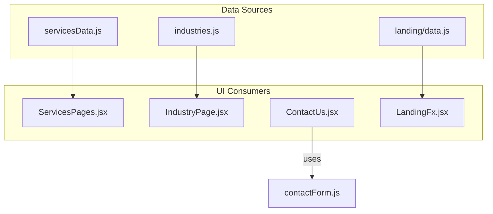
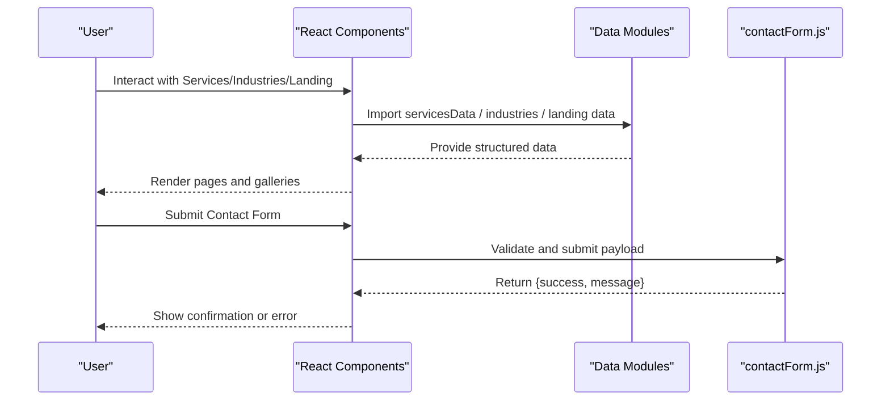
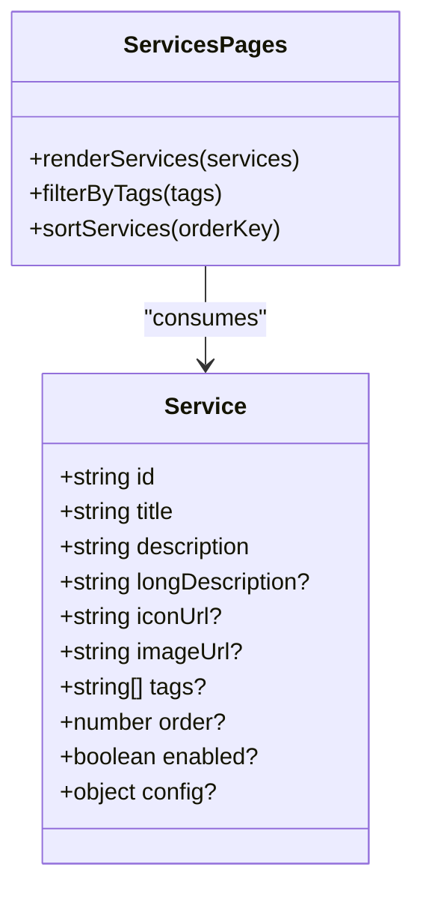
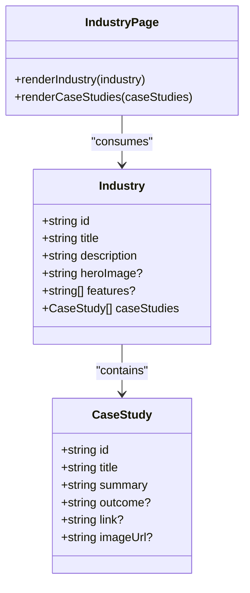
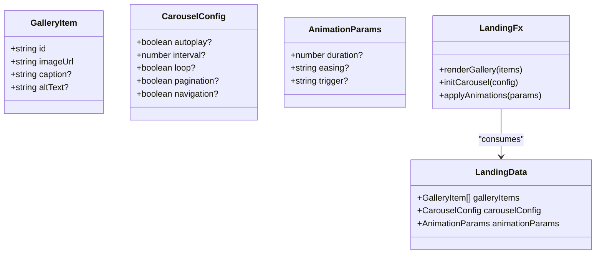
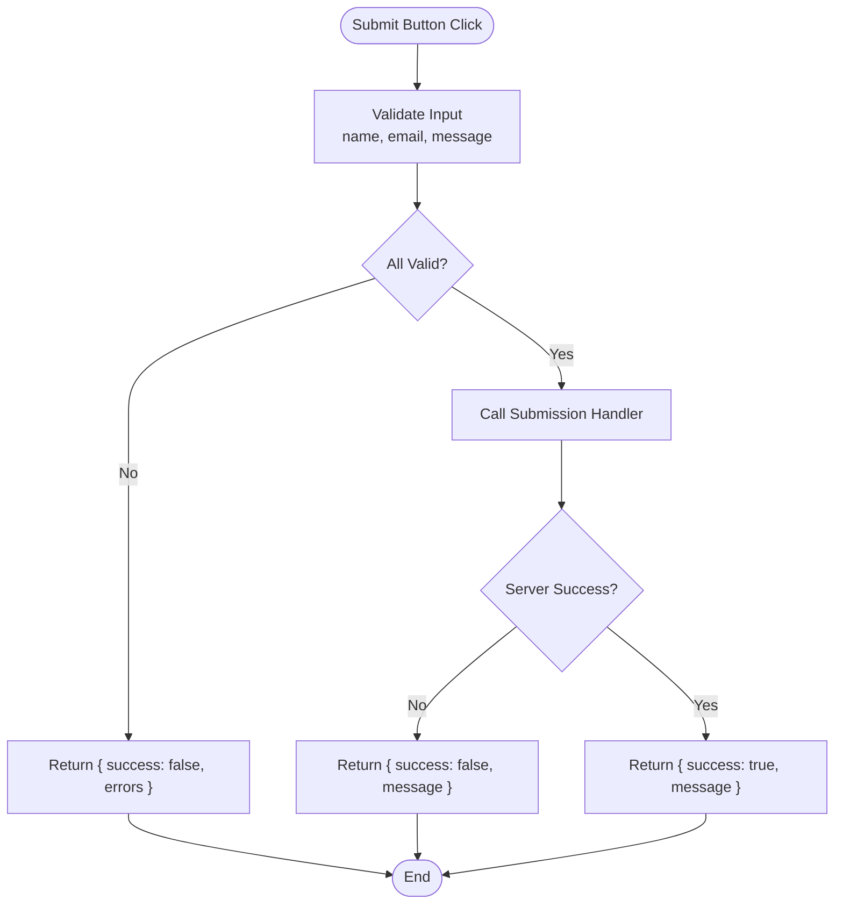
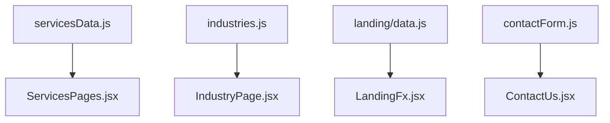

# API Reference

<cite>
**Referenced Files in This Document**
- [servicesData.js](file://src/servicesData.js)
- [industries.js](file://src/industries.js)
- [landing/data.js](file://src/landing/data.js)
- [contactForm.js](file://src/contactForm.js)
- [ContactUs.jsx](file://src/ContactUs.jsx)
- [IndustryPage.jsx](file://src/IndustryPage.jsx)
- [ServicesPages.jsx](file://src/ServicesPages.jsx)
- [LandingFx.jsx](file://src/LandingFx.jsx)
</cite>

## Table of Contents
1. [Introduction](#introduction)
2. [Project Structure](#project-structure)
3. [Core Components](#core-components)
4. [Architecture Overview](#architecture-overview)
5. [Detailed Component Analysis](#detailed-component-analysis)
6. [Dependency Analysis](#dependency-analysis)
7. [Performance Considerations](#performance-considerations)
8. [Troubleshooting Guide](#troubleshooting-guide)
9. [Conclusion](#conclusion)
10. [Appendices](#appendices)

## Introduction
This document provides a comprehensive API reference for the PodiumMinds application’s internal data models and services. It focuses on:
- Services data schema (service objects, metadata, configuration options)
- Industries data model (industry-specific content structure and case study formats)
- Landing page data structures (gallery items, carousel configurations, animation parameters)
- Contact form API (validation rules, submission handlers, response formats)
- TypeScript interfaces, example data structures, and usage patterns for extending the application’s data models

The goal is to enable developers to understand, integrate with, and extend the application’s data layer confidently.

## Project Structure
The relevant modules for this API reference are organized as follows:
- Services data: src/servicesData.js
- Industries data: src/industries.js
- Landing page data: src/landing/data.js
- Contact form logic: src/contactForm.js and src/ContactUs.jsx
- Industry page rendering: src/IndustryPage.jsx
- Services pages rendering: src/ServicesPages.jsx
- Landing page orchestration: src/LandingFx.jsx

**Diagram sources**
- [servicesData.js](file://src/servicesData.js)
- [industries.js](file://src/industries.js)
- [landing/data.js](file://src/landing/data.js)
- [ServicesPages.jsx](file://src/ServicesPages.jsx)
- [IndustryPage.jsx](file://src/IndustryPage.jsx)
- [ContactUs.jsx](file://src/ContactUs.jsx)
- [LandingFx.jsx](file://src/LandingFx.jsx)

**Section sources**
- [servicesData.js](file://src/servicesData.js)
- [industries.js](file://src/industries.js)
- [landing/data.js](file://src/landing/data.js)
- [ServicesPages.jsx](file://src/ServicesPages.jsx)
- [IndustryPage.jsx](file://src/IndustryPage.jsx)
- [ContactUs.jsx](file://src/ContactUs.jsx)
- [LandingFx.jsx](file://src/LandingFx.jsx)

## Core Components
This section summarizes the primary data schemas consumed by UI components.

- Services Data Schema
  - Purpose: Defines service offerings, metadata, and configuration used by the services pages.
  - Typical fields: identifiers, titles, descriptions, media assets, tags/categories, ordering/sorting keys, and feature flags or configuration toggles.
  - Usage: Consumed by ServicesPages.jsx to render service cards, lists, and detail views.

- Industries Data Model
  - Purpose: Encapsulates industry-specific content including overview, features, and case studies.
  - Typical fields: industry identifier, title, description, hero/media, feature list, and an array of case studies with titles, summaries, outcomes, and links.
  - Usage: Consumed by IndustryPage.jsx to render industry landing pages and case study sections.

- Landing Page Data Structures
  - Purpose: Provides gallery items, carousel configurations, and animation parameters for the landing experience.
  - Typical fields: gallery entries (images, captions, alt text), carousel settings (autoplay, interval, loop, pagination), and animation parameters (duration, easing, triggers).
  - Usage: Consumed by LandingFx.jsx and related landing components.

- Contact Form API
  - Purpose: Handles validation, submission, and response formatting for contact form interactions.
  - Typical fields: name, email, message; validation rules include required fields, email format, length constraints; submission handler returns success/error responses.
  - Usage: Used by ContactUs.jsx to present the form and handle user submissions.

**Section sources**
- [servicesData.js](file://src/servicesData.js)
- [ServicesPages.jsx](file://src/ServicesPages.jsx)
- [industries.js](file://src/industries.js)
- [IndustryPage.jsx](file://src/IndustryPage.jsx)
- [landing/data.js](file://src/landing/data.js)
- [LandingFx.jsx](file://src/LandingFx.jsx)
- [contactForm.js](file://src/contactForm.js)
- [ContactUs.jsx](file://src/ContactUs.jsx)

## Architecture Overview
The application uses static data modules that are imported by React components. The flow is straightforward:
- Data modules export typed arrays/objects.
- Components import these modules and render UI based on the data.
- The contact form module encapsulates validation and submission logic used by the contact component.

**Diagram sources**
- [servicesData.js](file://src/servicesData.js)
- [industries.js](file://src/industries.js)
- [landing/data.js](file://src/landing/data.js)
- [contactForm.js](file://src/contactForm.js)
- [ServicesPages.jsx](file://src/ServicesPages.jsx)
- [IndustryPage.jsx](file://src/IndustryPage.jsx)
- [LandingFx.jsx](file://src/LandingFx.jsx)
- [ContactUs.jsx](file://src/ContactUs.jsx)

## Detailed Component Analysis

### Services Data Schema
This schema defines the structure of service objects consumed by the services pages.

- Service Object Fields
  - id: string — Unique identifier for the service.
  - title: string — Display title.
  - description: string — Short description or summary.
  - longDescription?: string — Optional detailed description.
  - iconUrl?: string — Optional icon asset path.
  - imageUrl?: string — Optional image asset path.
  - tags?: string[] — Optional categorization tags.
  - order?: number — Optional sort order.
  - enabled?: boolean — Optional feature flag to show/hide.
  - config?: object — Optional configuration options specific to the service.

- Example Data Structure
  - An array of service objects where each entry conforms to the fields above.

- Usage Patterns
  - Map over the array to render service cards.
  - Filter by tags or enabled flag before rendering.
  - Sort by order if provided.

**Diagram sources**
- [servicesData.js](file://src/servicesData.js)
- [ServicesPages.jsx](file://src/ServicesPages.jsx)

**Section sources**
- [servicesData.js](file://src/servicesData.js)
- [ServicesPages.jsx](file://src/ServicesPages.jsx)

### Industries Data Model
This model defines industry-specific content and case study formats.

- Industry Object Fields
  - id: string — Unique identifier for the industry.
  - title: string — Display title.
  - description: string — Overview text.
  - heroImage?: string — Optional hero image path.
  - features?: string[] — Optional list of key features.
  - caseStudies?: CaseStudy[] — Array of case study entries.

- Case Study Object Fields
  - id: string — Unique identifier for the case study.
  - title: string — Title of the case study.
  - summary: string — Brief summary.
  - outcome?: string — Optional outcome or results.
  - link?: string — Optional external link.
  - imageUrl?: string — Optional image asset path.

- Example Data Structure
  - An array of industry objects, each containing nested case studies.

- Usage Patterns
  - Render industry overview and feature lists.
  - Iterate over caseStudies to display individual case study cards.
  - Use optional fields to gracefully handle missing assets.

**Diagram sources**
- [industries.js](file://src/industries.js)
- [IndustryPage.jsx](file://src/IndustryPage.jsx)

**Section sources**
- [industries.js](file://src/industries.js)
- [IndustryPage.jsx](file://src/IndustryPage.jsx)

### Landing Page Data Structures
This section documents gallery items, carousel configurations, and animation parameters.

- Gallery Item Fields
  - id: string — Unique identifier.
  - imageUrl: string — Path to the image asset.
  - caption?: string — Optional caption text.
  - altText?: string — Optional accessibility text.

- Carousel Configuration Fields
  - autoplay?: boolean — Enable/disable auto-play.
  - interval?: number — Time between slides in milliseconds.
  - loop?: boolean — Enable/disable looping.
  - pagination?: boolean — Show/hide pagination controls.
  - navigation?: boolean — Show/hide prev/next navigation.

- Animation Parameters
  - duration?: number — Transition duration in milliseconds.
  - easing?: string — CSS easing function name.
  - trigger?: string — Event or condition triggering animation.

- Example Data Structure
  - A configuration object containing galleryItems array and carouselConfig object, plus animationParams.

- Usage Patterns
  - Render gallery grid using galleryItems.
  - Initialize carousel with carouselConfig.
  - Apply animations using animationParams.

**Diagram sources**
- [landing/data.js](file://src/landing/data.js)
- [LandingFx.jsx](file://src/LandingFx.jsx)

**Section sources**
- [landing/data.js](file://src/landing/data.js)
- [LandingFx.jsx](file://src/LandingFx.jsx)

### Contact Form API
This API handles validation, submission, and response formatting for the contact form.

- Input Payload Fields
  - name: string — Required.
  - email: string — Required, must be valid email format.
  - message: string — Required, minimum length constraint.

- Validation Rules
  - Required fields: name, email, message.
  - Email format: standard email regex pattern.
  - Length constraints: message minimum length enforced.

- Submission Handler
  - Validates input payload.
  - Submits via internal handler (e.g., fetch or custom endpoint).
  - Returns a standardized response object.

- Response Format
  - success: boolean — Indicates whether submission succeeded.
  - message: string — Human-readable status message.
  - errors?: object — Optional field-level error map when validation fails.

- Usage Patterns
  - On submit, validate payload and call submission handler.
  - Update UI state based on response (show success banner or error messages).

**Diagram sources**
- [contactForm.js](file://src/contactForm.js)
- [ContactUs.jsx](file://src/ContactUs.jsx)

**Section sources**
- [contactForm.js](file://src/contactForm.js)
- [ContactUs.jsx](file://src/ContactUs.jsx)

## Dependency Analysis
The following diagram shows how data modules depend on and are consumed by UI components.

**Diagram sources**
- [servicesData.js](file://src/servicesData.js)
- [ServicesPages.jsx](file://src/ServicesPages.jsx)
- [industries.js](file://src/industries.js)
- [IndustryPage.jsx](file://src/IndustryPage.jsx)
- [landing/data.js](file://src/landing/data.js)
- [LandingFx.jsx](file://src/LandingFx.jsx)
- [contactForm.js](file://src/contactForm.js)
- [ContactUs.jsx](file://src/ContactUs.jsx)

**Section sources**
- [servicesData.js](file://src/servicesData.js)
- [ServicesPages.jsx](file://src/ServicesPages.jsx)
- [industries.js](file://src/industries.js)
- [IndustryPage.jsx](file://src/IndustryPage.jsx)
- [landing/data.js](file://src/landing/data.js)
- [LandingFx.jsx](file://src/LandingFx.jsx)
- [contactForm.js](file://src/contactForm.js)
- [ContactUs.jsx](file://src/ContactUs.jsx)

## Performance Considerations
- Prefer lazy loading for large galleries and images to reduce initial bundle size.
- Cache validated payloads and responses locally to avoid redundant processing.
- Debounce rapid submissions on the contact form to prevent duplicate requests.
- Use stable IDs and minimal re-renders by memoizing derived lists (filtered/sorted).
- Keep optional fields truly optional to avoid unnecessary checks and improve clarity.

[No sources needed since this section provides general guidance]

## Troubleshooting Guide
Common issues and resolutions:
- Missing required fields in contact form submission: ensure all required fields are present and non-empty.
- Invalid email format: verify email matches expected pattern before submission.
- Empty or malformed media URLs: confirm asset paths exist and are accessible.
- Unexpected null values in optional fields: guard against undefined/null before accessing properties.
- Duplicate submissions: implement debouncing or disable submit button during pending requests.

**Section sources**
- [contactForm.js](file://src/contactForm.js)
- [ContactUs.jsx](file://src/ContactUs.jsx)

## Conclusion
This API reference outlines the core data schemas and integration points across services, industries, landing pages, and the contact form. By adhering to the documented interfaces and usage patterns, developers can reliably extend and maintain the application’s data layer while ensuring consistent behavior across UI components.

[No sources needed since this section summarizes without analyzing specific files]

## Appendices

### TypeScript Interfaces
Below are recommended TypeScript interfaces aligned with the documented schemas. These can be added to a shared types file to enforce consistency.

- Services
  - interface Service { id: string; title: string; description: string; longDescription?: string; iconUrl?: string; imageUrl?: string; tags?: string[]; order?: number; enabled?: boolean; config?: Record<string, unknown>; }
  - type Services = Service[];

- Industries
  - interface CaseStudy { id: string; title: string; summary: string; outcome?: string; link?: string; imageUrl?: string; }
  - interface Industry { id: string; title: string; description: string; heroImage?: string; features?: string[]; caseStudies: CaseStudy[]; }
  - type Industries = Industry[];

- Landing
  - interface GalleryItem { id: string; imageUrl: string; caption?: string; altText?: string; }
  - interface CarouselConfig { autoplay?: boolean; interval?: number; loop?: boolean; pagination?: boolean; navigation?: boolean; }
  - interface AnimationParams { duration?: number; easing?: string; trigger?: string; }
  - interface LandingData { galleryItems: GalleryItem[]; carouselConfig: CarouselConfig; animationParams: AnimationParams; }

- Contact Form
  - interface ContactPayload { name: string; email: string; message: string; }
  - interface ContactResponse { success: boolean; message: string; errors?: Record<string, string[]>; }

[No sources needed since this section provides general guidance]