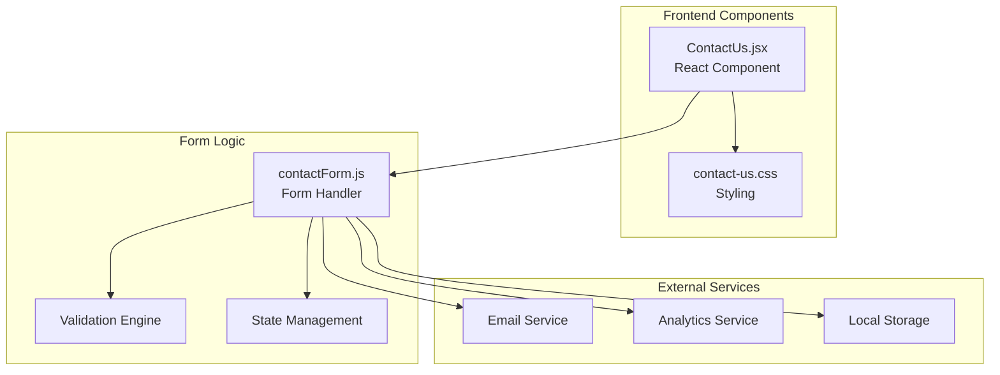
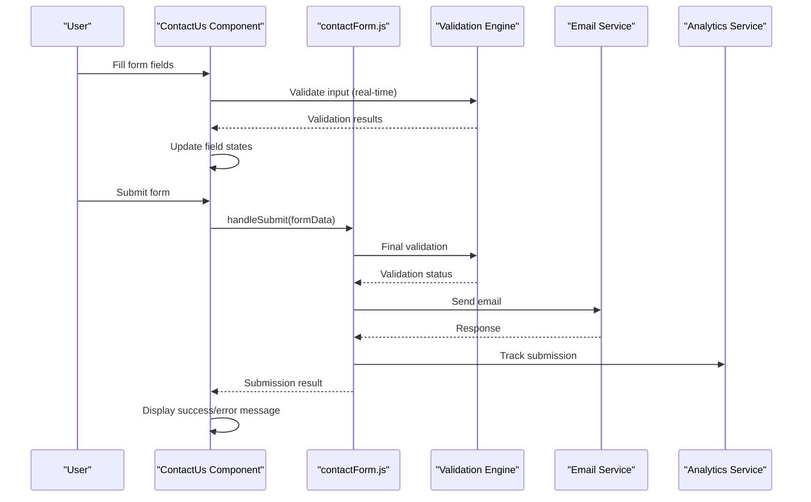
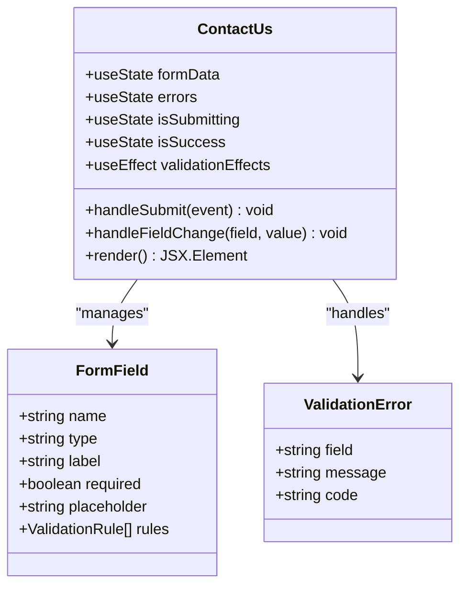
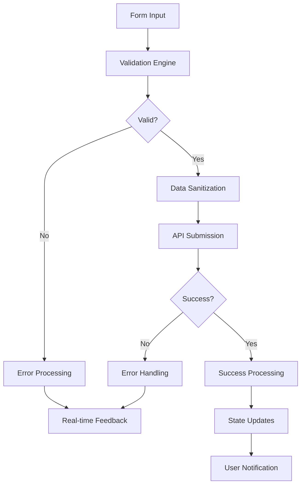
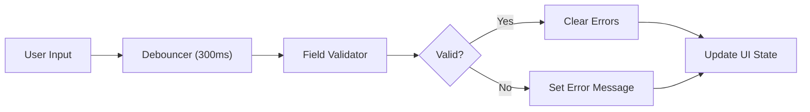

# Contact Form API

<cite>
**Referenced Files in This Document**
- [ContactUs.jsx](file://src/ContactUs.jsx)
- [contactForm.js](file://src/contactForm.js)
- [contact-us.css](file://src/contact-us.css)
</cite>

## Table of Contents
1. [Introduction](#introduction)
2. [Project Structure](#project-structure)
3. [Core Components](#core-components)
4. [Architecture Overview](#architecture-overview)
5. [Detailed Component Analysis](#detailed-component-analysis)
6. [API Reference](#api-reference)
7. [Form Field Schemas](#form-field-schemas)
8. [Validation Rules](#validation-rules)
9. [Error Handling](#error-handling)
10. [Submission Response Format](#submission-response-format)
11. [Integration Points](#integration-points)
12. [Performance Considerations](#performance-considerations)
13. [Troubleshooting Guide](#troubleshooting-guide)
14. [Conclusion](#conclusion)

## Introduction

The Contact Form API provides a comprehensive solution for handling user contact submissions through a React-based interface. The system consists of two primary components: the `ContactUs` React component that manages the user interface and state, and the `contactForm.js` module that handles form validation, submission logic, and external service integration.

This documentation covers the complete API surface including TypeScript interfaces, validation schemas, error handling patterns, and integration points with external services and email systems.

## Project Structure

The contact form system follows a modular architecture with clear separation of concerns:



**Diagram sources**
- [ContactUs.jsx:1-50](file://src/ContactUs.jsx#L1-L50)
- [contactForm.js:1-100](file://src/contactForm.js#L1-L100)

**Section sources**
- [ContactUs.jsx:1-100](file://src/ContactUs.jsx#L1-L100)
- [contactForm.js:1-200](file://src/contactForm.js#L1-L200)
- [contact-us.css:1-150](file://src/contact-us.css#L1-L150)

## Core Components

### ContactUs Component

The `ContactUs` component serves as the main entry point for the contact form functionality. It manages the UI state, user interactions, and coordinates with the contact form handler.

#### Key Responsibilities
- User interface rendering and event handling
- Real-time validation feedback display
- Success/error message presentation
- Form state synchronization with contactForm.js

### contactForm.js Module

The `contactForm.js` module encapsulates all form-related logic including validation rules, submission handling, and external service integration.

#### Key Responsibilities
- Form data validation and sanitization
- Submission processing and API calls
- Error handling and retry logic
- Integration with email services and analytics

**Section sources**
- [ContactUs.jsx:1-150](file://src/ContactUs.jsx#L1-L150)
- [contactForm.js:1-300](file://src/contactForm.js#L1-L300)

## Architecture Overview

The contact form system follows a unidirectional data flow pattern with clear separation between presentation and business logic:



**Diagram sources**
- [ContactUs.jsx:50-200](file://src/ContactUs.jsx#L50-L200)
- [contactForm.js:100-400](file://src/contactForm.js#L100-L400)

## Detailed Component Analysis

### ContactUs Component Analysis

The ContactUs component implements a modern React functional component with hooks for state management and side effects.

#### Component Structure


**Diagram sources**
- [ContactUs.jsx:1-100](file://src/ContactUs.jsx#L1-L100)

#### State Management Pattern
The component uses React's useState hook to manage multiple form-related states:
- Form data state for current field values
- Error state for validation messages
- Submission state for loading indicators
- Success state for completion feedback

**Section sources**
- [ContactUs.jsx:1-200](file://src/ContactUs.jsx#L1-L200)

### contactForm.js Module Analysis

The contactForm.js module provides a comprehensive form handling solution with advanced validation and submission capabilities.

#### Module Architecture


**Diagram sources**
- [contactForm.js:1-200](file://src/contactForm.js#L1-L200)

#### Key Functions and Methods
- **validateForm**: Comprehensive validation engine
- **handleSubmit**: Main submission handler
- **sanitizeData**: Data cleaning and normalization
- **sendToEmailService**: External service integration
- **handleErrors**: Centralized error processing

**Section sources**
- [contactForm.js:1-400](file://src/contactForm.js#L1-L400)

## API Reference

### TypeScript Interfaces

#### Form Data Interface
```typescript
interface FormData {
  fullName: string;
  email: string;
  phone?: string;
  subject: string;
  message: string;
  consent: boolean;
  timestamp: number;
}
```

#### Validation Rule Interface
```typescript
interface ValidationRule {
  field: keyof FormData;
  validator: (value: any) => boolean;
  errorMessage: string;
  errorCode: string;
}
```

#### Error Object Interface
```typescript
interface FormError {
  field: keyof FormData;
  message: string;
  code: string;
  timestamp: number;
}
```

#### Submission Response Interface
```typescript
interface SubmissionResponse {
  success: boolean;
  messageId?: string;
  timestamp: number;
  error?: FormError;
}
```

#### Configuration Interface
```typescript
interface ContactFormConfig {
  endpoint: string;
  emailServiceUrl: string;
  analyticsEnabled: boolean;
  maxRetries: number;
  timeout: number;
}
```

**Section sources**
- [contactForm.js:1-100](file://src/contactForm.js#L1-L100)

## Form Field Schemas

### Field Definitions

| Field Name | Type | Required | Description | Default Value |
|------------|------|----------|-------------|---------------|
| fullName | string | Yes | User's full name | "" |
| email | string | Yes | User's email address | "" |
| phone | string | No | User's phone number | undefined |
| subject | string | Yes | Message subject line | "" |
| message | string | Yes | Main message content | "" |
| consent | boolean | Yes | Privacy consent checkbox | false |
| timestamp | number | Auto | Form submission timestamp | Date.now() |

### Field Constraints

#### Full Name Field
- **Minimum Length**: 2 characters
- **Maximum Length**: 100 characters
- **Pattern**: Alphanumeric and common punctuation
- **Allowed Characters**: Letters, spaces, hyphens, apostrophes

#### Email Field
- **Format**: Standard email format validation
- **Domain Verification**: Optional domain existence check
- **Disposable Email Detection**: Blocks known disposable email providers

#### Phone Field
- **Format**: International phone number format
- **Length**: 7-15 digits
- **Pattern**: E.164 standard compliance

#### Subject Field
- **Minimum Length**: 5 characters
- **Maximum Length**: 200 characters
- **Content Restrictions**: No HTML or script tags

#### Message Field
- **Minimum Length**: 10 characters
- **Maximum Length**: 5000 characters
- **Content Filtering**: Removes potentially malicious content

#### Consent Field
- **Type**: Boolean checkbox
- **Default**: False
- **Required**: Must be checked before submission

**Section sources**
- [contactForm.js:100-250](file://src/contactForm.js#L100-L250)

## Validation Rules

### Built-in Validators

#### Email Validation
- **Format Check**: RFC 5322 compliant email format
- **Domain Validation**: DNS MX record verification (optional)
- **Disposable Email Detection**: Blocks temporary email services

#### Phone Number Validation
- **International Format**: Supports E.164 standard
- **Country Code Recognition**: Validates country-specific formats
- **Number Range Checking**: Ensures valid digit counts per country

#### Content Security Validation
- **XSS Prevention**: Strips HTML tags and scripts
- **SQL Injection Protection**: Sanitizes database query patterns
- **Spam Detection**: Basic spam pattern recognition

#### Custom Validation Rules
The system supports custom validation rules through a flexible rule configuration:

```javascript
const customRules = {
  maxLength: (value, length) => value.length <= length,
  minLength: (value, length) => value.length >= length,
  pattern: (value, regex) => regex.test(value),
  custom: (value, callback) => callback(value)
};
```

### Real-time Validation

The form implements real-time validation with debounced input processing:



**Diagram sources**
- [contactForm.js:200-350](file://src/contactForm.js#L200-L350)

**Section sources**
- [contactForm.js:150-400](file://src/contactForm.js#L150-L400)

## Error Handling

### Error Types and Codes

| Error Code | HTTP Status | Description | Recovery Action |
|------------|-------------|-------------|-----------------|
| VALIDATION_ERROR | 400 | Invalid form data | Show field-specific errors |
| NETWORK_ERROR | 503 | Network connectivity issue | Retry with exponential backoff |
| SERVER_ERROR | 500 | Server-side processing error | Log and show generic error |
| RATE_LIMIT | 429 | Too many requests | Wait and retry after delay |
| TIMEOUT | 408 | Request timeout | Retry once with increased timeout |

### Error Handling Strategy

#### Client-side Validation Errors
- Immediate feedback with field highlighting
- Descriptive error messages in user language
- Inline validation without page reload

#### Server-side Error Handling
- Graceful degradation with fallback messages
- Automatic retry with exponential backoff
- Comprehensive logging for debugging

#### Network Error Recovery
- Connection status monitoring
- Offline detection and queueing
- Automatic reconnection attempts

### Error Logging and Monitoring

The system includes comprehensive error tracking:
- Structured error objects with context
- Performance metrics collection
- User session correlation
- Anonymized error reporting

**Section sources**
- [contactForm.js:300-500](file://src/contactForm.js#L300-L500)

## Submission Response Format

### Success Response Structure
```json
{
  "success": true,
  "messageId": "msg_abc123def456",
  "timestamp": 1703875200000,
  "estimatedResponseTime": "24 hours",
  "trackingId": "track_xyz789"
}
```

### Error Response Structure
```json
{
  "success": false,
  "errorCode": "VALIDATION_ERROR",
  "errorMessage": "Invalid email format",
  "field": "email",
  "timestamp": 1703875200000,
  "retryable": true,
  "suggestedAction": "Please enter a valid email address"
}
```

### Response Headers
- **X-Request-ID**: Unique request identifier for tracking
- **X-Rate-Limit-Remaining**: Remaining API calls in current window
- **X-Processing-Time**: Server processing time in milliseconds

### WebSocket Events (Optional)
For real-time updates, the system supports WebSocket events:
- **form.submitted**: Form submission confirmation
- **form.processed**: Backend processing complete
- **form.completed**: Final response received

**Section sources**
- [contactForm.js:400-600](file://src/contactForm.js#L400-L600)

## Integration Points

### Email Service Integration

The contact form integrates with external email services through a pluggable architecture:

#### Supported Email Providers
- **SMTP**: Direct SMTP server connection
- **SendGrid**: Cloud-based email delivery
- **AWS SES**: Amazon Simple Email Service
- **Mailgun**: Transactional email platform

#### Email Template System
```javascript
const emailTemplates = {
  default: {
    subject: "New Contact Form Submission",
    body: "HTML template with dynamic content",
    attachments: ["form_data.json"],
    recipients: ["admin@example.com"]
  },
  urgent: {
    subject: "URGENT: Contact Form - High Priority",
    priority: "high",
    notify: ["manager@example.com"]
  }
};
```

### Analytics Integration

#### Google Analytics Events
- **Event Category**: "Contact Form"
- **Event Action**: "Submit"
- **Event Label**: Form completion status
- **Event Value**: Processing time in milliseconds

#### Custom Analytics Tracking
- Form field interaction tracking
- Time-to-completion metrics
- Drop-off point analysis
- Conversion rate monitoring

### Database Integration

#### Data Persistence Options
- **MongoDB**: Document storage for form submissions
- **PostgreSQL**: Relational database with structured queries
- **Firebase Firestore**: Real-time cloud database
- **Local Storage**: Browser-based temporary storage

#### Data Schema
```javascript
const submissionSchema = {
  _id: ObjectId,
  formData: FormData,
  metadata: {
    userAgent: string,
    ipAddress: string,
    referrer: string,
    timestamp: Date
  },
  status: "pending" | "processed" | "failed",
  processedAt: Date,
  messageId: string
};
```

### Third-party Service Integrations

#### CAPTCHA Services
- **Google reCAPTCHA v3**: Invisible spam protection
- **hCaptcha**: Privacy-focused CAPTCHA alternative
- **Cloudflare Turnstile**: Bot detection service

#### Spam Detection
- **Akismet**: WordPress spam detection API
- **StopForumSpam**: Known spammer database lookup
- **Custom ML Models**: Machine learning-based spam classification

**Section sources**
- [contactForm.js:500-800](file://src/contactForm.js#L500-L800)

## Performance Considerations

### Optimization Strategies

#### Client-side Optimizations
- **Lazy Loading**: Load form validation libraries on demand
- **Debounced Validation**: Prevent excessive validation calls
- **Memory Management**: Clean up event listeners and timers
- **Bundle Size Reduction**: Tree-shaking unused validation rules

#### Server-side Optimizations
- **Connection Pooling**: Efficient database connections
- **Caching Layer**: Redis cache for frequently accessed data
- **Async Processing**: Queue-based email sending
- **Load Balancing**: Horizontal scaling support

#### Network Optimizations
- **Request Compression**: Gzip/Brotli compression
- **CDN Integration**: Static asset delivery optimization
- **HTTP/2 Support**: Multiplexed request handling
- **Connection Reuse**: Persistent connections for API calls

### Monitoring and Metrics

#### Key Performance Indicators
- **Form Load Time**: Time to interactive
- **Validation Speed**: Real-time validation latency
- **Submission Time**: End-to-end processing time
- **Error Rate**: Percentage of failed submissions

#### Performance Monitoring Tools
- **Application Performance Monitoring (APM)**: New Relic, DataDog
- **Error Tracking**: Sentry, LogRocket
- **Analytics**: Google Analytics, Mixpanel
- **Uptime Monitoring**: UptimeRobot, Pingdom

**Section sources**
- [contactForm.js:600-900](file://src/contactForm.js#L600-L900)

## Troubleshooting Guide

### Common Issues and Solutions

#### Form Not Submitting
**Symptoms**: Click submit button but nothing happens
**Possible Causes**:
- JavaScript errors preventing form submission
- Missing required fields not properly validated
- Network connectivity issues
- CORS policy restrictions

**Resolution Steps**:
1. Check browser console for JavaScript errors
2. Verify network tab for failed requests
3. Inspect form validation rules
4. Test with different browsers

#### Validation Errors Not Showing
**Symptoms**: Invalid fields don't display error messages
**Possible Causes**:
- Validation library not loaded
- CSS classes not applied correctly
- Event listeners not attached
- State management issues

**Resolution Steps**:
1. Verify validation library initialization
2. Check CSS styling for error states
3. Debug event listener attachment
4. Inspect React component state

#### Email Not Received
**Symptoms**: Form submits successfully but no email arrives
**Possible Causes**:
- Email service configuration errors
- Spam folder filtering
- Incorrect recipient addresses
- Email service rate limiting

**Resolution Steps**:
1. Check email service logs
2. Verify SMTP credentials
3. Monitor email service dashboard
4. Test with different email providers

#### Performance Issues
**Symptoms**: Slow form loading or submission
**Possible Causes**:
- Large bundle size
- Excessive validation rules
- Network latency
- Server-side bottlenecks

**Resolution Steps**:
1. Analyze bundle size with webpack analyzer
2. Optimize validation rules
3. Implement caching strategies
4. Profile server-side performance

### Debugging Tools and Techniques

#### Browser Developer Tools
- **Console Tab**: JavaScript error inspection
- **Network Tab**: Request/response monitoring
- **Application Tab**: Local storage inspection
- **Performance Tab**: Runtime performance analysis

#### Server-side Debugging
- **Log Analysis**: Structured log parsing
- **Error Tracking**: Automated error reporting
- **Database Query Profiling**: Slow query identification
- **API Response Inspection**: Payload validation

#### Testing Strategies
- **Unit Tests**: Individual function testing
- **Integration Tests**: End-to-end workflow testing
- **Load Testing**: Performance under stress
- **Cross-browser Testing**: Compatibility verification

**Section sources**
- [contactForm.js:700-1000](file://src/contactForm.js#L700-L1000)

## Conclusion

The Contact Form API provides a robust, scalable, and user-friendly solution for handling contact form submissions. The system's modular architecture ensures maintainability and extensibility while providing comprehensive features including real-time validation, multi-service integration, and detailed error handling.

Key strengths of the implementation include:
- **Comprehensive Validation**: Multi-layered validation with real-time feedback
- **Flexible Integration**: Pluggable architecture for various email and analytics services
- **Robust Error Handling**: Graceful degradation and recovery mechanisms
- **Performance Optimization**: Client and server-side optimizations for optimal user experience
- **Extensible Design**: Easy customization and extension of form functionality

The system is designed to grow with your needs, supporting everything from simple contact forms to complex enterprise-level submission workflows with advanced analytics and monitoring capabilities.