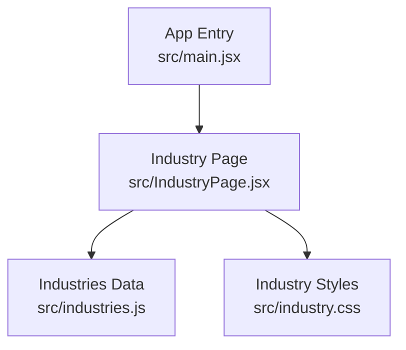
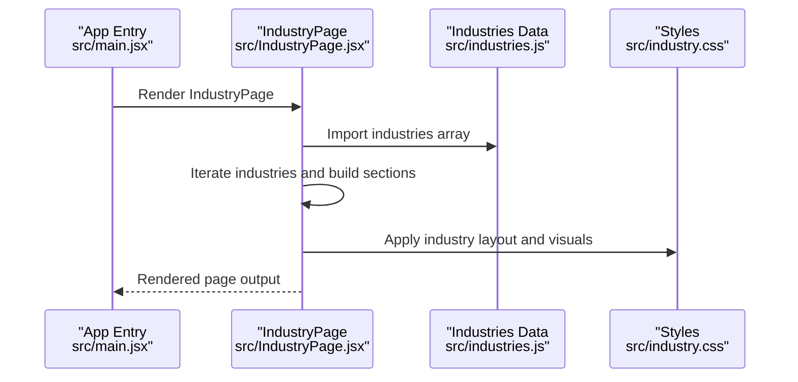
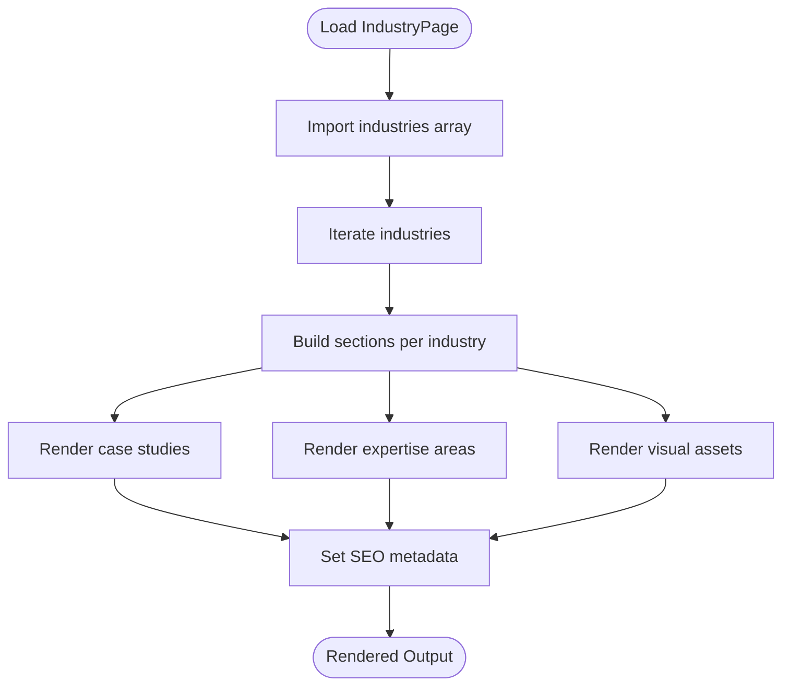
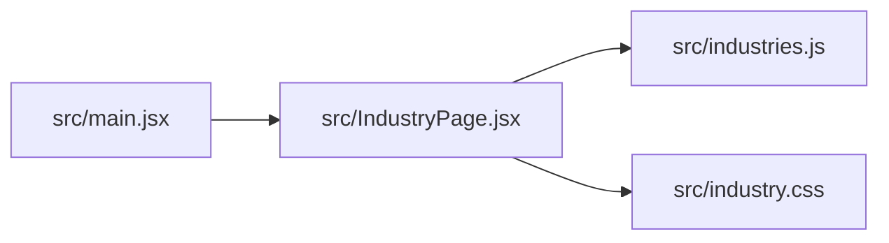

# Industries Data API

<cite>
**Referenced Files in This Document**
- [industries.js](file://src/industries.js)
- [IndustryPage.jsx](file://src/IndustryPage.jsx)
- [industry.css](file://src/industry.css)
- [main.jsx](file://src/main.jsx)
</cite>

## Table of Contents
1. [Introduction](#introduction)
2. [Project Structure](#project-structure)
3. [Core Components](#core-components)
4. [Architecture Overview](#architecture-overview)
5. [Detailed Component Analysis](#detailed-component-analysis)
6. [Dependency Analysis](#dependency-analysis)
7. [Performance Considerations](#performance-considerations)
8. [Troubleshooting Guide](#troubleshooting-guide)
9. [Conclusion](#conclusion)
10. [Appendices](#appendices)

## Introduction
This document describes the industries data model and its integration with the IndustryPage component to render dynamic industry pages. It covers the industry object schema (title, description, case studies, expertise areas, and visual assets), how industries are organized and consumed by the page renderer, and guidelines for maintaining content. It also explains SEO metadata and navigation integration patterns as implemented in the codebase.

## Project Structure
The industries feature is centered around a single data module and a dedicated page component:
- Data source: src/industries.js
- Page renderer: src/IndustryPage.jsx
- Styles: src/industry.css
- App entrypoint: src/main.jsx

**Diagram sources**
- [main.jsx](file://src/main.jsx)
- [IndustryPage.jsx](file://src/IndustryPage.jsx)
- [industries.js](file://src/industries.js)
- [industry.css](file://src/industry.css)

**Section sources**
- [main.jsx](file://src/main.jsx)
- [IndustryPage.jsx](file://src/IndustryPage.jsx)
- [industries.js](file://src/industries.js)
- [industry.css](file://src/industry.css)

## Core Components
- Industries data module: Provides an array of industry objects consumed by the page component. Each industry includes fields such as title, description, case studies, expertise areas, and visual assets.
- IndustryPage component: Consumes the industries data to render a dynamic page. It maps over the industries collection and renders sections per industry, including case studies and expertise areas.

Key responsibilities:
- Data consumption: Import and iterate over the industries array.
- Rendering: Build sections for each industry’s overview, case studies, and expertise areas.
- Styling: Apply industry-specific styles via the CSS file.

**Section sources**
- [industries.js](file://src/industries.js)
- [IndustryPage.jsx](file://src/IndustryPage.jsx)
- [industry.css](file://src/industry.css)

## Architecture Overview
The rendering flow connects the app entrypoint to the IndustryPage component, which reads from the industries data module and applies styles.

**Diagram sources**
- [main.jsx](file://src/main.jsx)
- [IndustryPage.jsx](file://src/IndustryPage.jsx)
- [industries.js](file://src/industries.js)
- [industry.css](file://src/industry.css)

## Detailed Component Analysis

### Industries Data Model
The industries data module exports an array of industry objects. Each industry object contains:
- title: string
- description: string
- caseStudies: array of case study objects
- expertiseAreas: array of strings or structured items
- visualAssets: object containing image/video references and captions

Case study structure:
- title: string
- description: string
- media: object with image/video references and alt text
- metrics: optional numeric or textual outcomes
- link: optional URL to a detailed project page

Visual assets:
- heroImage: reference to an image asset path
- gallery: optional array of images/videos
- captions: optional descriptive text

Guidelines:
- Keep titles concise and descriptive.
- Use clear, scannable descriptions.
- Ensure case studies include measurable outcomes where possible.
- Provide accessible alt text for all media.
- Maintain consistent naming conventions for asset paths.

Example definition pattern (illustrative):
- An industry entry with a title, description, two case studies (each with title, description, media, and optional metrics), three expertise areas, and a hero image asset.

**Section sources**
- [industries.js](file://src/industries.js)

### IndustryPage Component
Responsibilities:
- Imports the industries data array.
- Renders a section per industry.
- Displays overview, case studies, and expertise areas.
- Integrates visual assets into the layout.

Rendering logic:
- Map over industries to create top-level sections.
- For each industry, render:
  - Title and description
  - Case studies list with media and optional metrics
  - Expertise areas list
  - Visual assets (hero image/gallery)

Navigation integration:
- The page can be linked from site navigation using industry slugs derived from titles or explicit identifiers.
- Dynamic routes should resolve to this component with the appropriate industry identifier.

SEO metadata:
- Set page title and meta description based on the current industry’s title and description.
- Include Open Graph tags for social sharing when available.

Accessibility:
- Use semantic headings and lists.
- Provide alt text for images and captions for videos.

**Section sources**
- [IndustryPage.jsx](file://src/IndustryPage.jsx)
- [industry.css](file://src/industry.css)

### Data-to-Page Flow

**Diagram sources**
- [IndustryPage.jsx](file://src/IndustryPage.jsx)
- [industries.js](file://src/industries.js)

## Dependency Analysis
- IndustryPage depends on:
  - industries.js for data
  - industry.css for styling
- main.jsx initializes the application and mounts IndustryPage.

**Diagram sources**
- [main.jsx](file://src/main.jsx)
- [IndustryPage.jsx](file://src/IndustryPage.jsx)
- [industries.js](file://src/industries.js)
- [industry.css](file://src/industry.css)

**Section sources**
- [main.jsx](file://src/main.jsx)
- [IndustryPage.jsx](file://src/IndustryPage.jsx)
- [industries.js](file://src/industries.js)
- [industry.css](file://src/industry.css)

## Performance Considerations
- Lazy-load large media assets to improve initial page load times.
- Defer non-critical styles if necessary.
- Cache industries data at build time to avoid runtime overhead.
- Optimize images and use modern formats where supported.

[No sources needed since this section provides general guidance]

## Troubleshooting Guide
Common issues and resolutions:
- Missing or incorrect asset paths: Verify that visual asset references match actual files under public/assets/industries or related directories.
- Empty or malformed industries data: Ensure the industries array is well-formed and each object contains required fields.
- Broken navigation links: Confirm that route parameters align with industry identifiers used in the data.
- SEO not updating: Check that page title and meta description are set dynamically based on the active industry.

**Section sources**
- [IndustryPage.jsx](file://src/IndustryPage.jsx)
- [industries.js](file://src/industries.js)

## Conclusion
The industries feature is driven by a simple, maintainable data model and a focused page component. By adhering to the schema and guidelines outlined here, teams can consistently add new industries, enrich case studies, and keep SEO and accessibility in sync with content changes.

[No sources needed since this section summarizes without analyzing specific files]

## Appendices

### TypeScript Interfaces (Reference)
Use these interfaces as a guide for strongly-typed definitions in your environment:

- Industry
  - title: string
  - description: string
  - caseStudies: CaseStudy[]
  - expertiseAreas: string[]
  - visualAssets: VisualAssets

- CaseStudy
  - title: string
  - description: string
  - media: Media
  - metrics?: Record<string, string | number>
  - link?: string

- Media
  - image?: string
  - video?: string
  - alt?: string
  - caption?: string

- VisualAssets
  - heroImage?: string
  - gallery?: Media[]
  - captions?: string[]

[No sources needed since this section provides conceptual type definitions]

### Example Industry Definition (Illustrative)
- Industry: “Healthcare”
  - title: “Healthcare”
  - description: “Digital solutions tailored for healthcare providers and patients.”
  - caseStudies:
    - title: “Patient Portal Redesign”
      - description: “Improved access and usability for patient records.”
      - media: { image: "/assets/industries/healthcare-portal.jpg", alt: "Patient portal dashboard" }
      - metrics: { adoption: "+42%", satisfaction: "4.7/5" }
      - link: "/projects/healthcare-portal"
    - title: “Telehealth Integration”
      - description: “Seamless telehealth scheduling and visits.”
      - media: { video: "/assets/industries/telehealth-demo.mp4", alt: "Telehealth demo" }
  - expertiseAreas: ["Telehealth", "Compliance", "UX Research"]
  - visualAssets:
    - heroImage: "/assets/industries/healthcare-hero.jpg"
    - gallery: [
        { image: "/assets/industries/healthcare-1.jpg", alt: "Clinic workflow" },
        { image: "/assets/industries/healthcare-2.jpg", alt: "Patient engagement" }
      ]
    - captions: ["Streamlined clinic workflows", "Enhanced patient engagement"]

[No sources needed since this section provides illustrative examples]