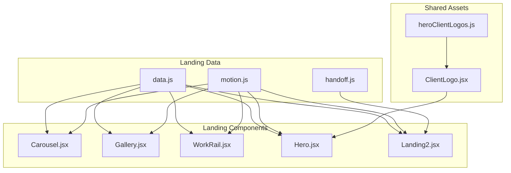
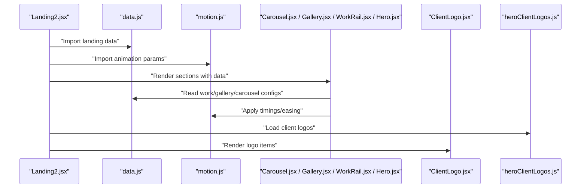
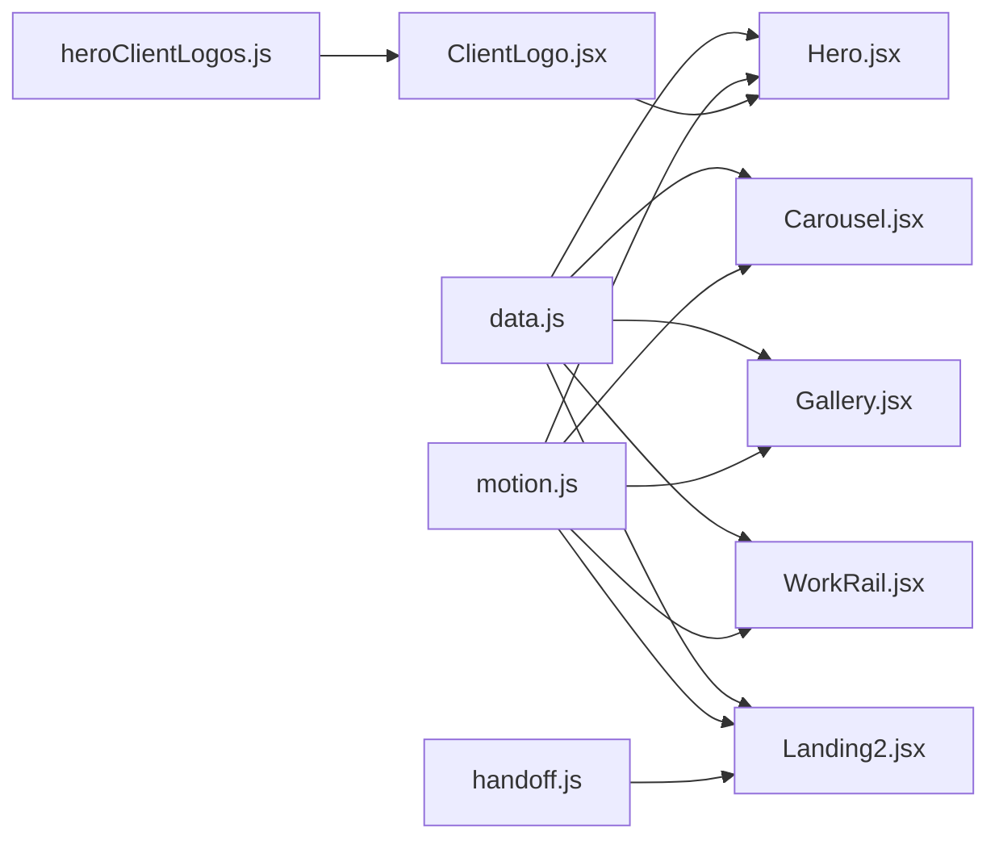

# Landing Page Data API

<cite>
**Referenced Files in This Document**
- [data.js](file://src/landing/data.js)
- [Carousel.jsx](file://src/landing/Carousel.jsx)
- [Gallery.jsx](file://src/landing/Gallery.jsx)
- [WorkRail.jsx](file://src/landing/WorkRail.jsx)
- [Hero.jsx](file://src/landing/Hero.jsx)
- [Landing2.jsx](file://src/landing/Landing2.jsx)
- [motion.js](file://src/landing/motion.js)
- [handoff.js](file://src/landing/handoff.js)
- [ClientLogo.jsx](file://src/ClientLogo.jsx)
- [heroClientLogos.js](file://src/heroClientLogos.js)
</cite>

## Table of Contents
1. [Introduction](#introduction)
2. [Project Structure](#project-structure)
3. [Core Components](#core-components)
4. [Architecture Overview](#architecture-overview)
5. [Detailed Component Analysis](#detailed-component-analysis)
6. [Dependency Analysis](#dependency-analysis)
7. [Performance Considerations](#performance-considerations)
8. [Troubleshooting Guide](#troubleshooting-guide)
9. [Conclusion](#conclusion)
10. [Appendices](#appendices)

## Introduction
This document provides comprehensive API documentation for the landing page data structures and configurations. It focuses on:
- Gallery item schemas
- Carousel configurations
- Animation parameters
- Interactive element settings
- How landing page components consume data from the data module, including work items, client logos, and visual effects configurations
- Complete TypeScript interfaces for all data models
- Example data structures for different landing page sections
- Patterns for customizing animations and interactions
- The relationship between data structures and React components in the landing page system

The goal is to enable developers to extend, customize, and maintain the landing page with confidence by understanding the contract between data and UI components.

## Project Structure
The landing page implementation is organized around a central data module that exports typed configuration objects consumed by multiple React components. Key files include:
- A data module that defines work items, gallery items, carousel options, animation parameters, and interactive settings
- Components that render galleries, carousels, hero sections, and work rails
- Motion utilities that provide animation primitives and timing configurations
- Client logo assets and helpers used across the landing page

**Diagram sources**
- [data.js](file://src/landing/data.js)
- [motion.js](file://src/landing/motion.js)
- [handoff.js](file://src/landing/handoff.js)
- [Carousel.jsx](file://src/landing/Carousel.jsx)
- [Gallery.jsx](file://src/landing/Gallery.jsx)
- [WorkRail.jsx](file://src/landing/WorkRail.jsx)
- [Hero.jsx](file://src/landing/Hero.jsx)
- [Landing2.jsx](file://src/landing/Landing2.jsx)
- [ClientLogo.jsx](file://src/ClientLogo.jsx)
- [heroClientLogos.js](file://src/heroClientLogos.js)

**Section sources**
- [data.js](file://src/landing/data.js)
- [motion.js](file://src/landing/motion.js)
- [handoff.js](file://src/landing/handoff.js)
- [Carousel.jsx](file://src/landing/Carousel.jsx)
- [Gallery.jsx](file://src/landing/Gallery.jsx)
- [WorkRail.jsx](file://src/landing/WorkRail.jsx)
- [Hero.jsx](file://src/landing/Hero.jsx)
- [Landing2.jsx](file://src/landing/Landing2.jsx)
- [ClientLogo.jsx](file://src/ClientLogo.jsx)
- [heroClientLogos.js](file://src/heroClientLogos.js)

## Core Components
This section documents the core data contracts and how they are consumed by components.

- Work Item Schema
  - Purpose: Represents a portfolio or project entry displayed in work rails and galleries.
  - Typical fields: identifier, title, description, media references (image/video), tags/categories, link URL, and optional metadata such as year or role.
  - Consumers: WorkRail, Gallery, Hero (featured work).

- Gallery Item Schema
  - Purpose: Defines an item within a gallery view, often with additional layout or aspect ratio hints.
  - Typical fields: id, src, alt text, caption, aspect ratio or dimensions, and optional overlay content.
  - Consumers: Gallery component.

- Carousel Configuration
  - Purpose: Controls behavior and appearance of the service or work carousel.
  - Typical fields: items array (references to work or service entries), autoplay interval, pause on hover, navigation visibility, pagination, transition duration, easing, and responsive breakpoints.
  - Consumers: Carousel component.

- Animation Parameters
  - Purpose: Centralized motion settings for entrance, exit, and interaction-driven animations.
  - Typical fields: durations, delays, easing functions, scroll-triggered thresholds, parallax intensity, and per-section overrides.
  - Consumers: All landing components via motion utilities.

- Interactive Element Settings
  - Purpose: Configures hover states, cursor trails, click behaviors, and accessibility toggles.
  - Typical fields: cursor trail enabled flag, trail length, hover scale factors, focus styles, keyboard navigation flags.
  - Consumers: TrailCursor, Gallery, Carousel, Hero.

- Client Logos
  - Purpose: Brand assets and metadata for client logos shown in hero or dedicated sections.
  - Typical fields: name, logo asset path, link URL, and optional theme variants.
  - Consumers: ClientLogo, Hero.

**Section sources**
- [data.js](file://src/landing/data.js)
- [Carousel.jsx](file://src/landing/Carousel.jsx)
- [Gallery.jsx](file://src/landing/Gallery.jsx)
- [WorkRail.jsx](file://src/landing/WorkRail.jsx)
- [Hero.jsx](file://src/landing/Hero.jsx)
- [Landing2.jsx](file://src/landing/Landing2.jsx)
- [ClientLogo.jsx](file://src/ClientLogo.jsx)
- [heroClientLogos.js](file://src/heroClientLogos.js)

## Architecture Overview
The landing page architecture follows a clear separation between data definitions and presentation logic:
- data.js exports typed configuration objects for work items, gallery items, carousel options, animations, and interactive settings.
- motion.js provides reusable animation primitives and timing constants consumed by components.
- handoff.js bridges data to higher-level page composition.
- Components (Carousel, Gallery, WorkRail, Hero, Landing2) import data and motion utilities to render dynamic, animated experiences.
- Client logos are sourced from heroClientLogos.js and rendered via ClientLogo.

**Diagram sources**
- [Landing2.jsx](file://src/landing/Landing2.jsx)
- [data.js](file://src/landing/data.js)
- [motion.js](file://src/landing/motion.js)
- [Carousel.jsx](file://src/landing/Carousel.jsx)
- [Gallery.jsx](file://src/landing/Gallery.jsx)
- [WorkRail.jsx](file://src/landing/WorkRail.jsx)
- [Hero.jsx](file://src/landing/Hero.jsx)
- [ClientLogo.jsx](file://src/ClientLogo.jsx)
- [heroClientLogos.js](file://src/heroClientLogos.js)

## Detailed Component Analysis

### data.js — Central Data Contract
- Exports:
  - Work items array
  - Gallery items array
  - Carousel configuration object
  - Animation parameters object
  - Interactive settings object
  - Optional handoff helpers for composing sections
- Responsibilities:
  - Provide a single source of truth for content and behavior
  - Keep types consistent across components
  - Allow easy customization without touching component code

Typical structure overview:
- Work items: list of projects with identifiers, titles, descriptions, media, tags, links
- Gallery items: list of gallery entries with media and captions
- Carousel config: items reference, autoplay, transitions, navigation, responsiveness
- Animations: global defaults and per-section overrides
- Interactions: cursor trail, hover behaviors, focus management

**Section sources**
- [data.js](file://src/landing/data.js)

### Carousel.jsx — Carousel Consumer
- Consumes:
  - Carousel configuration from data.js
  - Animation parameters from motion.js
- Responsibilities:
  - Render slides based on configured items
  - Apply autoplay, pause-on-hover, and transition settings
  - Respect responsive breakpoints and navigation controls
  - Use motion utilities for slide transitions and timing

Key behaviors:
- Autoplay intervals and pause conditions
- Transition duration and easing
- Navigation visibility and pagination
- Responsive layout adjustments

**Section sources**
- [Carousel.jsx](file://src/landing/Carousel.jsx)
- [data.js](file://src/landing/data.js)
- [motion.js](file://src/landing/motion.js)

### Gallery.jsx — Gallery Consumer
- Consumes:
  - Gallery items from data.js
  - Animation parameters from motion.js
  - Interactive settings from data.js
- Responsibilities:
  - Render grid or masonry layout based on item properties
  - Apply hover effects, overlays, and captions
  - Support keyboard navigation and focus management
  - Trigger entrance animations using motion parameters

Layout considerations:
- Aspect ratios and image sizing
- Caption positioning and overflow handling
- Performance optimizations for large galleries

**Section sources**
- [Gallery.jsx](file://src/landing/Gallery.jsx)
- [data.js](file://src/landing/data.js)
- [motion.js](file://src/landing/motion.js)

### WorkRail.jsx — Work Rail Consumer
- Consumes:
  - Work items from data.js
  - Animation parameters from motion.js
- Responsibilities:
  - Render horizontal rail or vertical list of work items
  - Apply scroll-based reveals and staggered animations
  - Handle click-to-navigate behavior with link URLs
  - Optimize rendering for long lists

Accessibility:
- Keyboard navigation between items
- Focus indicators and screen reader labels

**Section sources**
- [WorkRail.jsx](file://src/landing/WorkRail.jsx)
- [data.js](file://src/landing/data.js)
- [motion.js](file://src/landing/motion.js)

### Hero.jsx — Hero Section Consumer
- Consumes:
  - Featured work or headline data from data.js
  - Client logos from heroClientLogos.js
  - Animation parameters from motion.js
- Responsibilities:
  - Render hero content with primary call-to-action
  - Display client logos in a responsive strip
  - Apply entrance animations and parallax effects

Integration points:
- Uses ClientLogo to render individual brand assets
- Leverages motion utilities for smooth reveals

**Section sources**
- [Hero.jsx](file://src/landing/Hero.jsx)
- [data.js](file://src/landing/data.js)
- [heroClientLogos.js](file://src/heroClientLogos.js)
- [ClientLogo.jsx](file://src/ClientLogo.jsx)
- [motion.js](file://src/landing/motion.js)

### Landing2.jsx — Composition Layer
- Responsibilities:
  - Compose multiple landing sections using data and motion
  - Bridge data to components via handoff helpers
  - Manage top-level layout and section ordering

Handoff integration:
- Uses handoff.js to normalize data shapes before passing to components

**Section sources**
- [Landing2.jsx](file://src/landing/Landing2.jsx)
- [handoff.js](file://src/landing/handoff.js)
- [data.js](file://src/landing/data.js)
- [motion.js](file://src/landing/motion.js)

### ClientLogo.jsx — Logo Renderer
- Consumes:
  - Individual logo item from heroClientLogos.js
- Responsibilities:
  - Render logo asset with alt text and optional link
  - Apply theme-aware styling and responsive sizing

**Section sources**
- [ClientLogo.jsx](file://src/ClientLogo.jsx)
- [heroClientLogos.js](file://src/heroClientLogos.js)

### motion.js — Animation Utilities
- Provides:
  - Timing constants (durations, delays)
  - Easing presets
  - Scroll-triggered animation helpers
  - Parallax intensity helpers
- Used by:
  - Carousel, Gallery, WorkRail, Hero, Landing2

Customization patterns:
- Override global defaults via data.js animation parameters
- Per-section overrides for fine-grained control

**Section sources**
- [motion.js](file://src/landing/motion.js)

### handoff.js — Data Bridging
- Responsibilities:
  - Normalize and transform raw data into component-ready shapes
  - Provide helper functions for composing sections
  - Ensure type safety and consistency across consumers

**Section sources**
- [handoff.js](file://src/landing/handoff.js)

## Dependency Analysis
The following diagram shows how components depend on data and motion modules, and how client logos integrate into the hero section.

**Diagram sources**
- [data.js](file://src/landing/data.js)
- [motion.js](file://src/landing/motion.js)
- [handoff.js](file://src/landing/handoff.js)
- [Carousel.jsx](file://src/landing/Carousel.jsx)
- [Gallery.jsx](file://src/landing/Gallery.jsx)
- [WorkRail.jsx](file://src/landing/WorkRail.jsx)
- [Hero.jsx](file://src/landing/Hero.jsx)
- [Landing2.jsx](file://src/landing/Landing2.jsx)
- [ClientLogo.jsx](file://src/ClientLogo.jsx)
- [heroClientLogos.js](file://src/heroClientLogos.js)

**Section sources**
- [data.js](file://src/landing/data.js)
- [motion.js](file://src/landing/motion.js)
- [handoff.js](file://src/landing/handoff.js)
- [Carousel.jsx](file://src/landing/Carousel.jsx)
- [Gallery.jsx](file://src/landing/Gallery.jsx)
- [WorkRail.jsx](file://src/landing/WorkRail.jsx)
- [Hero.jsx](file://src/landing/Hero.jsx)
- [Landing2.jsx](file://src/landing/Landing2.jsx)
- [ClientLogo.jsx](file://src/ClientLogo.jsx)
- [heroClientLogos.js](file://src/heroClientLogos.js)

## Performance Considerations
- Lazy loading: Defer heavy assets (images/videos) until they enter the viewport to reduce initial load time.
- Memoization: Cache computed configurations derived from data.js to avoid unnecessary re-renders.
- Animation budgets: Keep durations and delays reasonable; prefer GPU-friendly transforms and opacity changes.
- Image optimization: Serve appropriately sized images and use modern formats where supported.
- Accessibility: Ensure keyboard navigation and focus management do not introduce performance bottlenecks.

[No sources needed since this section provides general guidance]

## Troubleshooting Guide
Common issues and resolutions:
- Missing or malformed data fields
  - Symptom: Components fail to render or show blank areas.
  - Resolution: Validate required fields in data.js against the documented schemas; ensure types match expectations.
- Animation glitches or jank
  - Symptom: Stuttering or inconsistent timing.
  - Resolution: Review motion.js parameters; reduce complexity or duration; check for layout thrashing.
- Carousel not autoplaying
  - Symptom: Slides do not advance automatically.
  - Resolution: Verify autoplay interval and pause-on-hover settings in carousel configuration.
- Client logos not displaying
  - Symptom: Broken images or missing assets.
  - Resolution: Confirm paths in heroClientLogos.js and verify asset availability.
- Accessibility regressions
  - Symptom: Keyboard navigation fails or screen readers misannounce content.
  - Resolution: Add proper aria attributes and focus management in components consuming interactive settings.

**Section sources**
- [data.js](file://src/landing/data.js)
- [motion.js](file://src/landing/motion.js)
- [Carousel.jsx](file://src/landing/Carousel.jsx)
- [Gallery.jsx](file://src/landing/Gallery.jsx)
- [WorkRail.jsx](file://src/landing/WorkRail.jsx)
- [Hero.jsx](file://src/landing/Hero.jsx)
- [ClientLogo.jsx](file://src/ClientLogo.jsx)
- [heroClientLogos.js](file://src/heroClientLogos.js)

## Conclusion
The landing page system separates concerns cleanly: data.js defines the contract, motion.js provides animation primitives, and components consume these to render rich, interactive experiences. By adhering to the documented schemas and patterns, you can confidently extend galleries, carousels, work rails, and hero sections while maintaining performance and accessibility.

[No sources needed since this section summarizes without analyzing specific files]

## Appendices

### TypeScript Interfaces
Below are the canonical TypeScript interfaces for the landing page data structures. These define the shape of data consumed by components and should be kept in sync with data.js.

- WorkItem
  - Fields:
    - id: string
    - title: string
    - description: string
    - media: { type: "image" | "video"; src: string }
    - tags: string[]
    - link: string
    - year?: number
    - role?: string

- GalleryItem
  - Fields:
    - id: string
    - src: string
    - alt: string
    - caption?: string
    - aspectRatio?: string
    - width?: number
    - height?: number

- CarouselConfig
  - Fields:
    - items: WorkItem[]
    - autoplayIntervalMs?: number
    - pauseOnHover?: boolean
    - showNavigation?: boolean
    - showPagination?: boolean
    - transitionDurationMs?: number
    - easing?: string
    - breakpoints?: Record<string, number>

- AnimationParams
  - Fields:
    - defaultDurationMs?: number
    - defaultDelayMs?: number
    - easings?: Record<string, string>
    - scrollThreshold?: number
    - parallaxIntensity?: number
    - sectionOverrides?: Record<string, Partial<AnimationParams>>

- InteractiveSettings
  - Fields:
    - cursorTrailEnabled?: boolean
    - trailLength?: number
    - hoverScale?: number
    - focusVisible?: boolean
    - keyboardNavEnabled?: boolean

- ClientLogoItem
  - Fields:
    - name: string
    - src: string
    - link?: string
    - themeVariant?: string

Example usage patterns:
- To add a new work item, append an object conforming to WorkItem to the work items array in data.js.
- To configure a new carousel, create a CarouselConfig object and pass it to the Carousel component.
- To customize animations globally, update AnimationParams in data.js; for per-section tweaks, use sectionOverrides.
- To enable cursor trail effects, set cursorTrailEnabled to true in InteractiveSettings.

**Section sources**
- [data.js](file://src/landing/data.js)
- [Carousel.jsx](file://src/landing/Carousel.jsx)
- [Gallery.jsx](file://src/landing/Gallery.jsx)
- [WorkRail.jsx](file://src/landing/WorkRail.jsx)
- [Hero.jsx](file://src/landing/Hero.jsx)
- [ClientLogo.jsx](file://src/ClientLogo.jsx)
- [heroClientLogos.js](file://src/heroClientLogos.js)