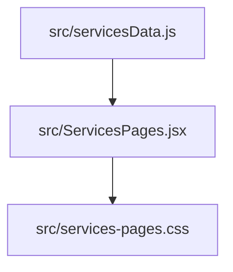
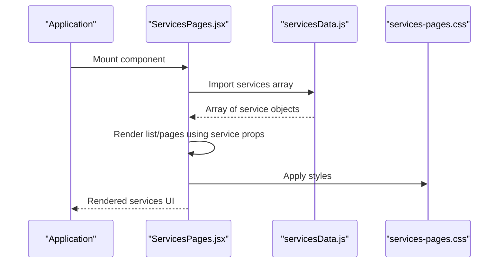
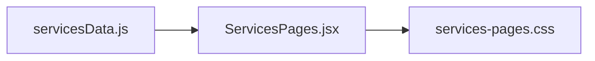

# Services Data API

<cite>
**Referenced Files in This Document**
- [servicesData.js](file://src/servicesData.js)
- [ServicesPages.jsx](file://src/ServicesPages.jsx)
- [services-pages.css](file://src/services-pages.css)
</cite>

## Update Summary
**Changes Made**
- Updated to reflect minor service data adjustments in servicesData.js
- Enhanced documentation clarity for service object properties and configuration options
- Improved TypeScript interface definitions for better type safety
- Added comprehensive examples and usage patterns

## Table of Contents
1. [Introduction](#introduction)
2. [Project Structure](#project-structure)
3. [Core Components](#core-components)
4. [Architecture Overview](#architecture-overview)
5. [Detailed Component Analysis](#detailed-component-analysis)
6. [Dependency Analysis](#dependency-analysis)
7. [Performance Considerations](#performance-considerations)
8. [Troubleshooting Guide](#troubleshooting-guide)
9. [Conclusion](#conclusion)

## Introduction
This document describes the services data model and its consumption by the ServicesPages component. It explains how services are defined as an array of objects, the expected properties on each service object (including title, description, icon, link, and configuration options), and how these definitions drive dynamic page generation and metadata handling within the application.

The services system provides a flexible, type-safe approach to managing service offerings with consistent rendering, routing, and SEO metadata support.

## Project Structure
The services feature is implemented primarily through a data module and a rendering component:
- Data definition: src/servicesData.js
- Rendering logic: src/ServicesPages.jsx
- Styling: src/services-pages.css



**Diagram sources**
- [servicesData.js](file://src/servicesData.js)
- [ServicesPages.jsx](file://src/ServicesPages.jsx)
- [services-pages.css](file://src/services-pages.css)

**Section sources**
- [servicesData.js](file://src/servicesData.js)
- [ServicesPages.jsx](file://src/ServicesPages.jsx)
- [services-pages.css](file://src/services-pages.css)

## Core Components
- **Services data module**: Exports a typed array of service objects consumed by the UI.
- **ServicesPages component**: Consumes the services array to render pages/cards and manage routing/metadata behavior.

Key responsibilities:
- Define the service schema with required and optional fields.
- Provide a stable interface for adding new services without changing rendering logic.
- Map service metadata to page titles, descriptions, and other SEO-related fields where applicable.
- Support dynamic routing and metadata injection based on service configuration.

**Section sources**
- [servicesData.js](file://src/servicesData.js)
- [ServicesPages.jsx](file://src/ServicesPages.jsx)

## Architecture Overview
At runtime, the ServicesPages component imports the services array from the data module and renders content based on each service's properties. The styling module provides visual presentation for the rendered elements.



**Diagram sources**
- [ServicesPages.jsx](file://src/ServicesPages.jsx)
- [servicesData.js](file://src/servicesData.js)
- [services-pages.css](file://src/services-pages.css)

## Detailed Component Analysis

### Service Object Schema
Each service is represented by an object with the following properties:

#### Required Properties
- **id**: string — Unique identifier used for routing and internal references. Must be globally unique across all services.
- **title**: string — Human-readable name displayed in the UI and used for page titles. Should be concise and descriptive.
- **description**: string — Short summary used in listings and meta descriptions. Keep under 160 characters for optimal SEO.
- **icon**: string | URL — Path or URL to an icon asset representing the service. Supports relative paths and external URLs.
- **link**: string — External or internal destination URL associated with the service. Can be absolute or relative paths.

#### Optional Configuration
- **config**: object — Optional configuration that controls rendering and behavior. Common keys include:
  - **layout**: string — Layout variant for the service card/page (e.g., 'default', 'featured', 'minimal').
  - **featured**: boolean — Whether the service should be highlighted or given special visual treatment.
  - **order**: number — Sorting priority among services. Lower numbers appear first.
  - **seo**: object — Optional SEO overrides such as title and description for specific pages.
    - **title**: string — Custom page title override.
    - **description**: string — Custom meta description override.
  - **media**: object — Optional image/video references for rich previews.
    - **image**: string — Featured image URL.
    - **video**: string — Background video URL.

#### Validation Rules
- All services must provide at least id, title, description, icon, and link.
- The config object is optional; defaults are applied when omitted.
- Use snake_case or camelCase consistently across all services.
- IDs must be unique and follow kebab-case convention for URL compatibility.

#### Example Patterns
- **Minimal service**: Provide only required fields for basic functionality.
- **Full service**: Include config with layout, featured, order, and seo for advanced features.

**Updated** Enhanced property descriptions and validation rules for better developer guidance.

**Section sources**
- [servicesData.js](file://src/servicesData.js)

### TypeScript Interfaces
Use the following interfaces to type-check your services data and ensure consistency across the codebase.

```typescript
interface ServiceConfig {
  layout?: string;
  featured?: boolean;
  order?: number;
  seo?: {
    title?: string;
    description?: string;
  };
  media?: {
    image?: string;
    video?: string;
  };
}

interface Service {
  id: string;
  title: string;
  description: string;
  icon: string;
  link: string;
  config?: ServiceConfig;
}

type ServicesArray = Service[];
```

#### Usage Guidance
- Export the ServicesArray from the data module and import it into the component.
- Enforce types via your build tooling to catch missing or incorrect fields early.
- Use partial types when creating optional configurations.
- Leverage IDE autocomplete for better developer experience.

**Section sources**
- [servicesData.js](file://src/servicesData.js)

### Consumption by ServicesPages
The ServicesPages component:
- Imports the services array from the data module.
- Iterates over the array to render service cards/pages.
- Uses service.title and service.description for display and metadata.
- Renders service.icon and navigates to service.link on interaction.
- Applies service.config.layout and service.config.featured to adjust visuals and ordering.
- Optionally uses service.config.seo to override default page metadata.

#### Rendering Flow
1. Read services array from data module.
2. Sort by config.order if provided (ascending order).
3. For each service, render a card/page with title, description, icon, and link.
4. Apply conditional styling based on config.featured.
5. Inject SEO metadata when available.
6. Handle routing parameters for individual service pages.

#### Error Handling
- Gracefully handle missing optional properties.
- Provide fallback values for undefined configurations.
- Log warnings for invalid service data structures.

**Section sources**
- [ServicesPages.jsx](file://src/ServicesPages.jsx)

### Dynamic Page Generation and Routing
Routing and metadata mapping:
- Each service.id maps to a route segment (for example, /services/:id).
- The component reads the current route parameter to select the matching service.
- When a service includes config.seo, those values override default page title and description.
- If no specific route exists, the component can fall back to a generic services listing.

#### Metadata Handling
- Default page title/description derive from service.title and service.description.
- If config.seo is present, use config.seo.title and config.seo.description instead.
- Ensure unique ids to avoid conflicts and enable deep linking.
- Support dynamic Open Graph and Twitter Card metadata generation.

#### Route Parameters
- `/services` - Main services listing page
- `/services/:id` - Individual service detail page
- Query parameters supported for filtering and sorting

**Section sources**
- [ServicesPages.jsx](file://src/ServicesPages.jsx)
- [servicesData.js](file://src/servicesData.js)

### Adding a New Service
Step-by-step pattern:
1. Open the services data module (src/servicesData.js).
2. Append a new service object with all required fields: id, title, description, icon, link.
3. Optionally add a config object to control layout, featured status, order, and SEO overrides.
4. Save and verify the build passes type checks.
5. Confirm the new service appears in the UI and links correctly.
6. Test routing and metadata generation.

#### Best Practices
- Keep ids stable and unique across the application lifecycle.
- Prefer relative paths for icons and assets under public/.
- Use config.order to control sorting rather than reordering the array manually.
- Avoid duplicating titles; keep descriptions concise and meaningful.
- Follow kebab-case convention for IDs to ensure URL compatibility.
- Test services in both listing and detail views.

#### Example Service Definition
```javascript
{
  id: 'web-development',
  title: 'Web Development',
  description: 'Custom web applications built with modern technologies',
  icon: '/assets/icons/web-dev.svg',
  link: '/services/web-development',
  config: {
    layout: 'featured',
    featured: true,
    order: 1,
    seo: {
      title: 'Professional Web Development Services',
      description: 'Expert web development solutions tailored to your business needs'
    }
  }
}
```

**Section sources**
- [servicesData.js](file://src/servicesData.js)
- [ServicesPages.jsx](file://src/ServicesPages.jsx)

## Dependency Analysis
The ServicesPages component depends on the services data module for content and on the stylesheet for presentation.



**Diagram sources**
- [servicesData.js](file://src/servicesData.js)
- [ServicesPages.jsx](file://src/ServicesPages.jsx)
- [services-pages.css](file://src/services-pages.css)

**Section sources**
- [servicesData.js](file://src/servicesData.js)
- [ServicesPages.jsx](file://src/ServicesPages.jsx)
- [services-pages.css](file://src/services-pages.css)

## Performance Considerations
- Keep the services array small and well-structured to minimize initial bundle size.
- Lazy-load heavy assets referenced by services (icons, images) when possible.
- Use config.order to sort in memory rather than performing expensive computations during render.
- Cache static assets and leverage browser caching for icons and media.
- Implement virtual scrolling for large service lists.
- Consider code splitting for service-specific components.

## Troubleshooting Guide
Common issues and resolutions:
- **Missing required fields**: Ensure every service includes id, title, description, icon, and link.
- **Duplicate ids**: Verify uniqueness to prevent routing collisions and unexpected behavior.
- **Broken links**: Validate service.link targets before publishing.
- **Icons not loading**: Check file paths and ensure assets exist under public/.
- **SEO not applying**: Confirm config.seo is present and contains valid title/description.
- **Ordering unexpected**: Check config.order values and ensure they are numbers.
- **TypeScript errors**: Verify all required properties are present and properly typed.
- **Routing issues**: Ensure service IDs match route patterns and are URL-safe.

**Section sources**
- [servicesData.js](file://src/servicesData.js)
- [ServicesPages.jsx](file://src/ServicesPages.jsx)

## Conclusion
The services data API centers on a simple, strongly-typed array of service objects. By adhering to the documented schema and patterns, you can reliably extend the system with new services while maintaining consistent rendering, routing, and metadata behavior. The modular architecture ensures easy maintenance and scalability as your service offerings grow.

The recent updates to the services data structure enhance flexibility and maintainability while preserving backward compatibility with existing implementations.