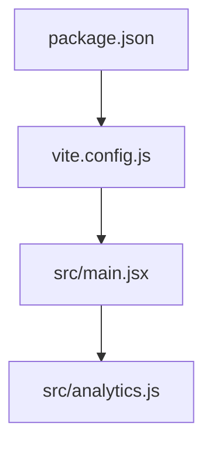
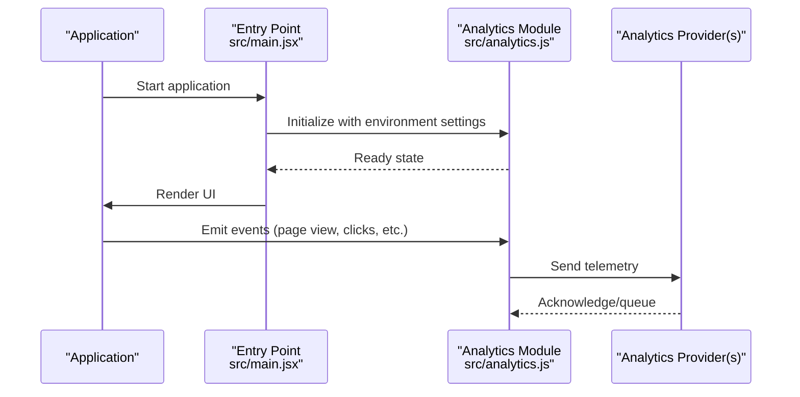
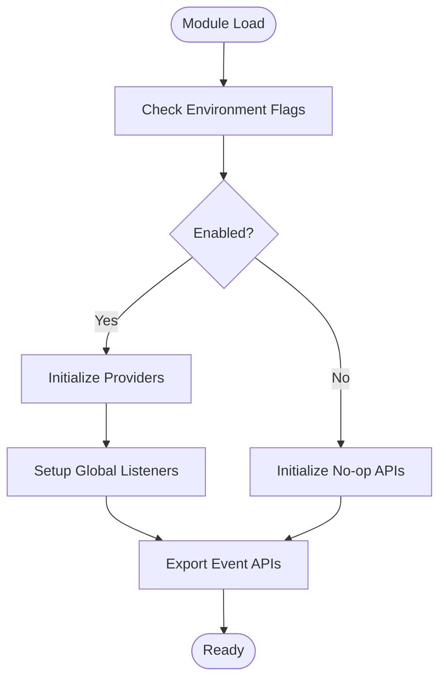
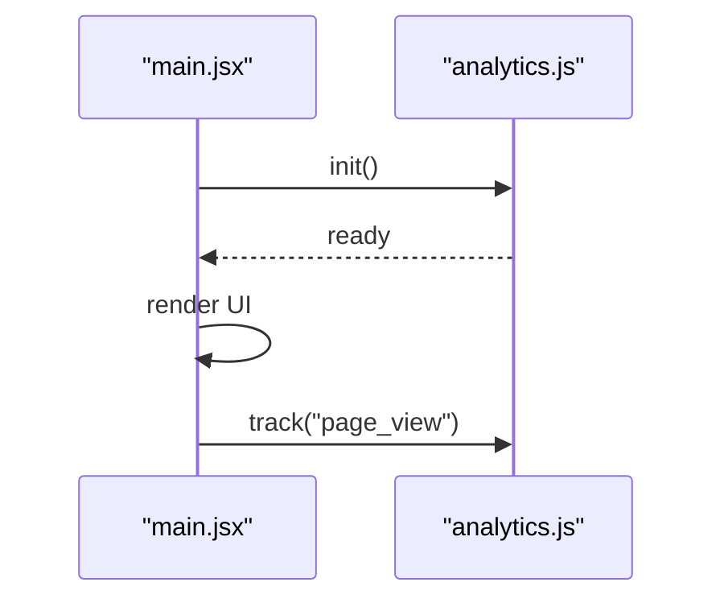

# Analytics and Tracking System

<cite>
**Referenced Files in This Document**
- [analytics.js](file://src/analytics.js)
- [main.jsx](file://src/main.jsx)
- [package.json](file://package.json)
- [vite.config.js](file://vite.config.js)
</cite>

## Table of Contents
1. [Introduction](#introduction)
2. [Project Structure](#project-structure)
3. [Core Components](#core-components)
4. [Architecture Overview](#architecture-overview)
5. [Detailed Component Analysis](#detailed-component-analysis)
6. [Dependency Analysis](#dependency-analysis)
7. [Performance Considerations](#performance-considerations)
8. [Troubleshooting Guide](#troubleshooting-guide)
9. [Conclusion](#conclusion)

## Introduction
This document describes the analytics and tracking system implemented in the project. It focuses on how analytics are initialized, configured, and integrated into the application lifecycle, as well as how build-time settings influence runtime behavior. The goal is to provide a clear understanding for both developers and non-technical stakeholders.

## Project Structure
The analytics implementation is primarily contained within a dedicated module and is wired into the application entry point. Build configuration files may also influence feature flags or environment-specific behavior.

**Diagram sources**
- [main.jsx:1-50](file://src/main.jsx#L1-L50)
- [analytics.js:1-120](file://src/analytics.js#L1-L120)
- [vite.config.js:1-80](file://vite.config.js#L1-L80)
- [package.json:1-40](file://package.json#L1-L40)

**Section sources**
- [main.jsx:1-50](file://src/main.jsx#L1-L50)
- [analytics.js:1-120](file://src/analytics.js#L1-L120)
- [vite.config.js:1-80](file://vite.config.js#L1-L80)
- [package.json:1-40](file://package.json#L1-L40)

## Core Components
- Analytics initialization module: centralizes setup, configuration, and event emission utilities.
- Application entry point: ensures analytics are bootstrapped before rendering UI components.
- Build configuration: may define environment variables or flags that control analytics behavior at build time.

Key responsibilities:
- Initialize third-party analytics SDKs based on environment.
- Expose helper functions for common events (e.g., page views, user actions).
- Provide safe no-op implementations when analytics are disabled.

**Section sources**
- [analytics.js:1-120](file://src/analytics.js#L1-L120)
- [main.jsx:1-50](file://src/main.jsx#L1-L50)

## Architecture Overview
At runtime, the application boots from the entry point, which initializes the analytics subsystem. The analytics module configures providers and exposes an API for emitting events throughout the app. Build-time configuration can enable or disable certain features depending on environment variables.

**Diagram sources**
- [main.jsx:1-50](file://src/main.jsx#L1-L50)
- [analytics.js:1-120](file://src/analytics.js#L1-L120)

## Detailed Component Analysis

### Analytics Initialization Module
Responsibilities:
- Detect environment and decide whether to enable analytics.
- Configure provider-specific options (e.g., IDs, consent mode).
- Provide a consistent interface for emitting events across the app.
- Gracefully handle missing configuration by falling back to no-op behavior.

Typical flow:
- On import, evaluate environment flags.
- If enabled, load provider scripts and initialize client instances.
- Register global event listeners if needed (e.g., route changes).
- Export utility functions for event emission.

**Diagram sources**
- [analytics.js:1-120](file://src/analytics.js#L1-L120)

**Section sources**
- [analytics.js:1-120](file://src/analytics.js#L1-L120)

### Application Entry Point Integration
Responsibilities:
- Ensure analytics are initialized prior to rendering UI.
- Optionally defer heavy work until after first render.
- Centralize any app-wide analytics setup (e.g., initial page view).

Integration pattern:
- Import analytics module.
- Call initialization function during bootstrap.
- Proceed with rendering once ready.

**Diagram sources**
- [main.jsx:1-50](file://src/main.jsx#L1-L50)
- [analytics.js:1-120](file://src/analytics.js#L1-L120)

**Section sources**
- [main.jsx:1-50](file://src/main.jsx#L1-L50)

### Build-Time Configuration Influence
Build configuration may define environment variables or flags that affect analytics behavior at compile time. Examples include enabling/disabling specific providers or setting default opt-in states.

Considerations:
- Use environment variables to toggle analytics features.
- Keep sensitive identifiers out of source; inject via build process.
- Validate configuration early to fail fast in CI.

**Section sources**
- [vite.config.js:1-80](file://vite.config.js#L1-L80)
- [package.json:1-40](file://package.json#L1-L40)

## Dependency Analysis
The analytics module is consumed by the application entry point. Build configuration influences how the app is compiled and what environment variables are available at runtime.

**Diagram sources**
- [vite.config.js:1-80](file://vite.config.js#L1-L80)
- [package.json:1-40](file://package.json#L1-L40)
- [main.jsx:1-50](file://src/main.jsx#L1-L50)
- [analytics.js:1-120](file://src/analytics.js#L1-L120)

**Section sources**
- [vite.config.js:1-80](file://vite.config.js#L1-L80)
- [package.json:1-40](file://package.json#L1-L40)
- [main.jsx:1-50](file://src/main.jsx#L1-L50)
- [analytics.js:1-120](file://src/analytics.js#L1-L120)

## Performance Considerations
- Defer non-critical analytics initialization until after first paint to avoid blocking UI.
- Batch events where possible to reduce network overhead.
- Use no-op implementations in development or when analytics are disabled to minimize overhead.
- Avoid synchronous calls in hot paths; prefer asynchronous queuing.

## Troubleshooting Guide
Common issues and resolutions:
- Missing environment variables: ensure required keys are present in the build environment.
- Provider not loading: verify network access and script URLs; check browser console for errors.
- Events not recorded: confirm that analytics are enabled and initialized before emitting events.
- Consent mode: implement consent checks to comply with privacy requirements.

Operational checks:
- Verify initialization order in the entry point.
- Inspect exported analytics APIs for correct usage.
- Review build configuration for correct variable injection.

**Section sources**
- [analytics.js:1-120](file://src/analytics.js#L1-L120)
- [main.jsx:1-50](file://src/main.jsx#L1-L50)

## Conclusion
The analytics and tracking system is designed to be modular, configurable, and unobtrusive. By centralizing initialization and providing a simple event API, it enables consistent tracking across the application while remaining easy to disable or adapt for different environments. Proper build-time configuration and careful integration in the entry point ensure reliable operation and minimal impact on performance.