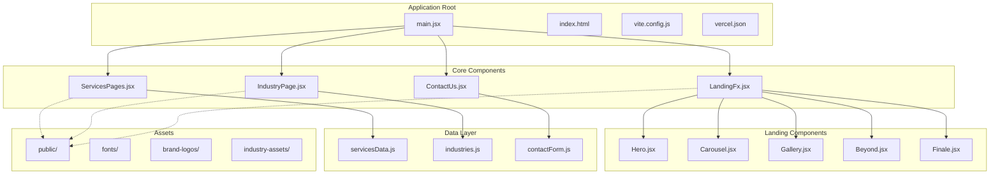
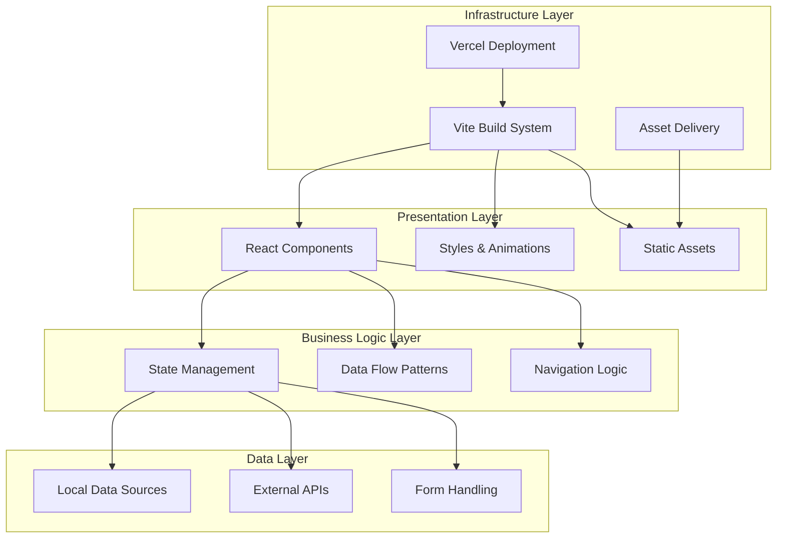
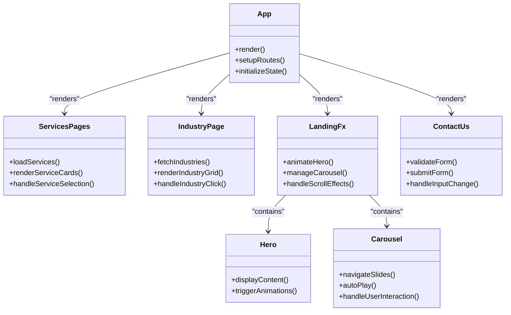
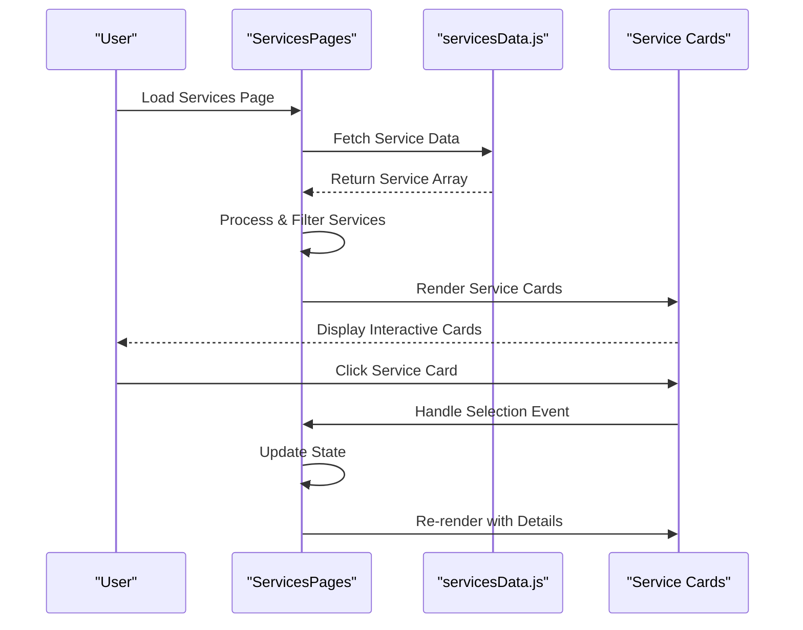
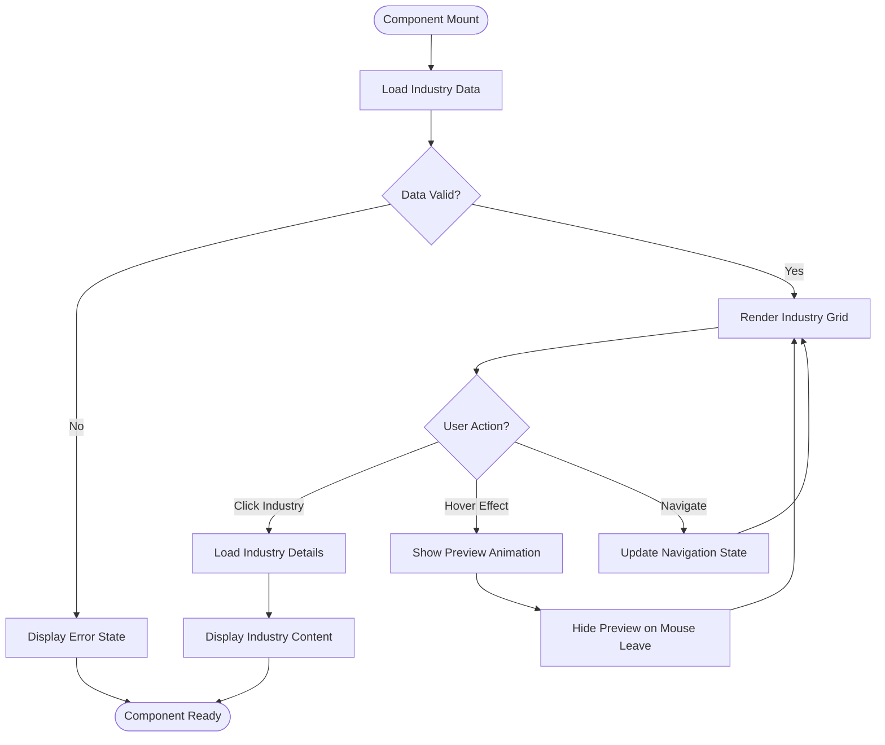
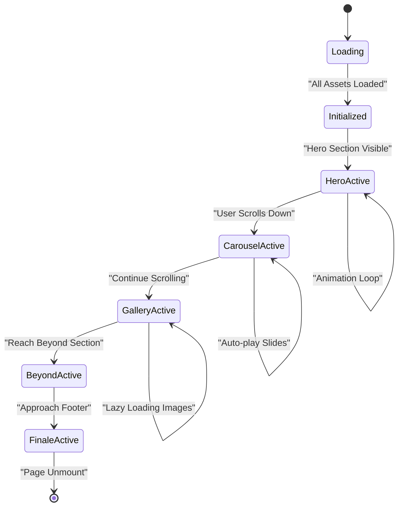
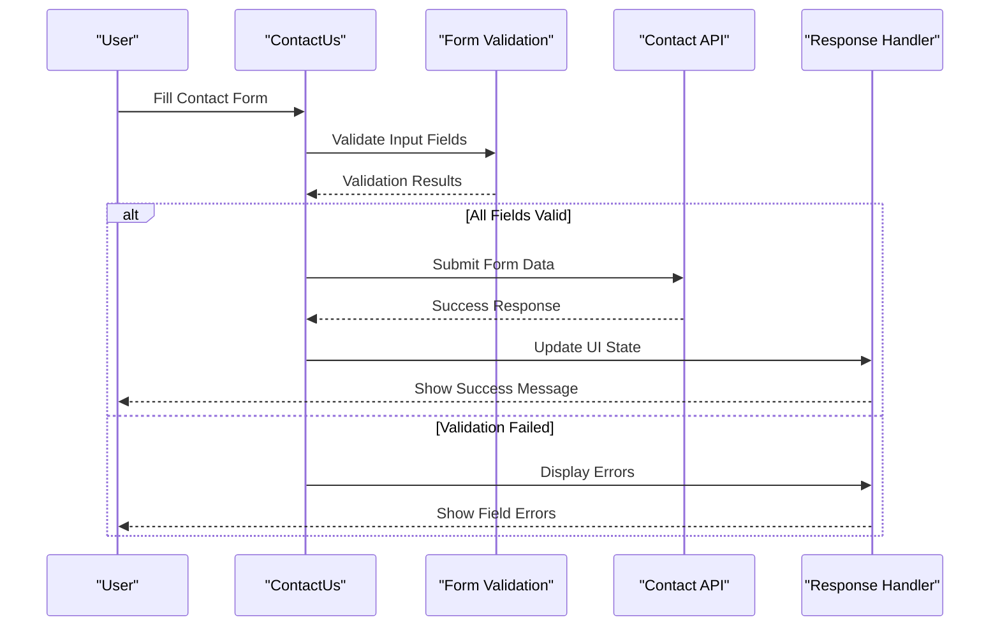
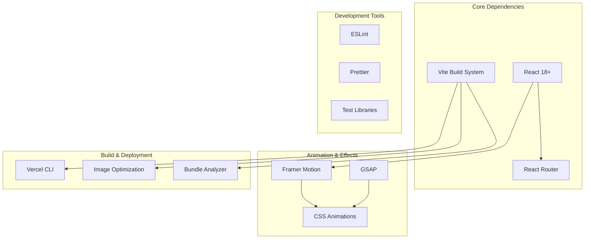

# Architecture Overview

<cite>
**Referenced Files in This Document**
- [main.jsx](file://src/main.jsx)
- [ServicesPages.jsx](file://src/ServicesPages.jsx)
- [IndustryPage.jsx](file://src/IndustryPage.jsx)
- [LandingFx.jsx](file://src/LandingFx.jsx)
- [ContactUs.jsx](file://src/ContactUs.jsx)
- [package.json](file://package.json)
- [vite.config.js](file://vite.config.js)
- [vercel.json](file://vercel.json)
- [index.html](file://index.html)
- [servicesData.js](file://src/servicesData.js)
- [industries.js](file://src/industries.js)
- [contactForm.js](file://src/contactForm.js)
- [Hero.jsx](file://src/landing/Hero.jsx)
- [Carousel.jsx](file://src/landing/Carousel.jsx)
- [Gallery.jsx](file://src/landing/Gallery.jsx)
</cite>

## Table of Contents
1. [Introduction](#introduction)
2. [Project Structure](#project-structure)
3. [Core Components](#core-components)
4. [Architecture Overview](#architecture-overview)
5. [Detailed Component Analysis](#detailed-component-analysis)
6. [Dependency Analysis](#dependency-analysis)
7. [Performance Considerations](#performance-considerations)
8. [Troubleshooting Guide](#troubleshooting-guide)
9. [Conclusion](#conclusion)

## Introduction

PodiumMinds is a modern React-based web application built with Vite as the build system, designed to showcase services, industries, and portfolio work through an interactive and visually engaging interface. The application follows a component-based architecture pattern, leveraging React's declarative UI paradigm to create reusable and maintainable user interfaces.

The application emphasizes performance optimization, smooth animations, and responsive design while maintaining clean separation of concerns between different functional areas such as landing pages, service management, industry showcases, and contact systems.

## Project Structure

The PodiumMinds application follows a feature-based organization pattern with clear separation between core application logic, landing page components, and static assets.

**Diagram sources**
- [main.jsx:1-50](file://src/main.jsx#L1-L50)
- [ServicesPages.jsx:1-100](file://src/ServicesPages.jsx#L1-L100)
- [IndustryPage.jsx:1-100](file://src/IndustryPage.jsx#L1-L100)
- [LandingFx.jsx:1-50](file://src/LandingFx.jsx#L1-L50)

**Section sources**
- [main.jsx:1-100](file://src/main.jsx#L1-L100)
- [package.json:1-50](file://package.json#L1-L50)
- [vite.config.js:1-100](file://vite.config.js#L1-L100)

## Core Components

The PodiumMinds application is built around several key components that handle different aspects of the user experience:

### Entry Point and Application Bootstrap
The application initializes through a main entry point that sets up the React application context and routes to different feature modules.

### Services Management System
The ServicesPages component serves as the central hub for managing and displaying various service offerings, integrating with data sources and providing interactive service cards.

### Industry Showcase
IndustryPage provides a dedicated interface for exploring different industry verticals, featuring dynamic content loading and specialized visual presentations.

### Landing Experience
LandingFx orchestrates the primary landing page experience, coordinating multiple sub-components including hero sections, carousels, galleries, and animated transitions.

### Contact Integration
ContactUs manages user interaction forms and communication channels, handling form validation and submission workflows.

**Section sources**
- [ServicesPages.jsx:1-200](file://src/ServicesPages.jsx#L1-L200)
- [IndustryPage.jsx:1-200](file://src/IndustryPage.jsx#L1-L200)
- [LandingFx.jsx:1-150](file://src/LandingFx.jsx#L1-L150)
- [ContactUs.jsx:1-100](file://src/ContactUs.jsx#L1-L100)

## Architecture Overview

The PodiumMinds application follows a layered architecture pattern with clear separation between presentation, business logic, and data layers.

**Diagram sources**
- [package.json:1-100](file://package.json#L1-L100)
- [vite.config.js:1-100](file://vite.config.js#L1-L100)
- [vercel.json:1-50](file://vercel.json#L1-L50)

### Component Hierarchy

The application maintains a well-defined component hierarchy that promotes reusability and maintainability:

**Diagram sources**
- [main.jsx:1-100](file://src/main.jsx#L1-L100)
- [ServicesPages.jsx:1-150](file://src/ServicesPages.jsx#L1-L150)
- [IndustryPage.jsx:1-150](file://src/IndustryPage.jsx#L1-L150)
- [LandingFx.jsx:1-100](file://src/LandingFx.jsx#L1-L100)

## Detailed Component Analysis

### Services Management Component

The ServicesPages component implements a comprehensive service management system with dynamic content rendering and user interaction capabilities.

**Diagram sources**
- [ServicesPages.jsx:1-200](file://src/ServicesPages.jsx#L1-L200)
- [servicesData.js:1-100](file://src/servicesData.js#L1-L100)

### Industry Showcase Implementation

IndustryPage provides a sophisticated industry exploration interface with dynamic content loading and specialized visual treatments.

**Diagram sources**
- [IndustryPage.jsx:1-200](file://src/IndustryPage.jsx#L1-L200)
- [industries.js:1-100](file://src/industries.js#L1-L100)

### Landing Page Orchestration

LandingFx coordinates the complex interactions between multiple landing page components, managing animations, scroll effects, and state synchronization.

**Diagram sources**
- [LandingFx.jsx:1-150](file://src/LandingFx.jsx#L1-L150)
- [Hero.jsx:1-100](file://src/landing/Hero.jsx#L1-L100)
- [Carousel.jsx:1-100](file://src/landing/Carousel.jsx#L1-L100)

### Contact System Integration

The ContactUs component handles form validation, user input processing, and integration with external communication services.

**Diagram sources**
- [ContactUs.jsx:1-150](file://src/ContactUs.jsx#L1-L150)
- [contactForm.js:1-100](file://src/contactForm.js#L1-L100)

## Dependency Analysis

The PodiumMinds application maintains a carefully curated dependency tree focused on performance and functionality.

**Diagram sources**
- [package.json:1-100](file://package.json#L1-L100)
- [vite.config.js:1-100](file://vite.config.js#L1-L100)

### Technology Stack Decisions

The technology stack was selected based on specific requirements for performance, developer experience, and scalability:

#### React Ecosystem
- **React 18+**: Provides concurrent features, improved performance, and long-term support
- **Vite**: Offers fast development server, optimized builds, and excellent DX
- **React Router**: Enables client-side routing with lazy loading capabilities

#### Animation Frameworks
- **Framer Motion**: Declarative animation library with excellent React integration
- **GSAP**: High-performance animation engine for complex sequences
- **CSS Animations**: Lightweight animations for simple transitions

#### Development & Quality
- **ESLint**: Code quality enforcement and consistency
- **Prettier**: Automatic code formatting
- **Testing Libraries**: Comprehensive testing strategy

**Section sources**
- [package.json:1-150](file://package.json#L1-L150)
- [vite.config.js:1-100](file://vite.config.js#L1-L100)

## Performance Considerations

The PodiumMinds application implements several performance optimization strategies to ensure fast load times and smooth user interactions.

### Bundle Optimization
- **Code Splitting**: Route-based and component-level lazy loading
- **Tree Shaking**: Elimination of unused code during build process
- **Asset Optimization**: Image compression and format optimization

### Runtime Performance
- **Memoization**: Strategic use of React.memo and useMemo for expensive computations
- **Virtual Scrolling**: Efficient rendering of large lists and galleries
- **Animation Optimization**: Hardware-accelerated transforms and will-change properties

### Asset Management
- **CDN Integration**: Static asset delivery through Vercel's global CDN
- **Caching Strategy**: Browser caching headers for optimal repeat visits
- **Progressive Loading**: Lazy loading of images and heavy components

### Infrastructure Requirements

The application requires the following infrastructure components for optimal operation:

#### Development Environment
- Node.js 18+ runtime
- Modern browser with ES2020+ support
- Minimum 4GB RAM for smooth development experience

#### Production Environment
- Vercel deployment platform
- Global CDN for asset delivery
- HTTPS enforcement and security headers

#### Scalability Considerations

The application architecture supports horizontal scaling through:

- **Stateless Components**: No server-side state dependencies
- **CDN-Cached Assets**: Static content served from edge locations
- **Database Abstraction**: Easy migration to scalable database solutions
- **API Gateway Pattern**: Centralized request handling and rate limiting

## Troubleshooting Guide

Common issues and their resolutions in the PodiumMinds application:

### Build Issues
- **Vite Configuration Errors**: Verify environment variables and path configurations
- **Asset Loading Failures**: Check file paths and public directory structure
- **Bundle Size Exceeded**: Analyze bundle composition and implement code splitting

### Runtime Errors
- **Animation Performance**: Monitor frame rates and optimize animation complexity
- **Memory Leaks**: Ensure proper cleanup of event listeners and intervals
- **Cross-Origin Issues**: Configure CORS policies for external API calls

### Deployment Problems
- **Environment Variables**: Verify Vercel environment configuration
- **Asset Paths**: Ensure correct relative paths in production builds
- **SSL/HTTPS**: Confirm certificate configuration and redirect rules

**Section sources**
- [vite.config.js:1-100](file://vite.config.js#L1-L100)
- [vercel.json:1-50](file://vercel.json#L1-L50)

## Conclusion

The PodiumMinds application demonstrates a well-architected React-based solution that balances performance, maintainability, and user experience. The component-based architecture, combined with modern build tools and deployment strategies, creates a scalable foundation for future growth and feature additions.

Key architectural strengths include:

- **Modular Design**: Clear separation of concerns across components and features
- **Performance Focus**: Multiple optimization strategies for fast load times and smooth interactions
- **Scalable Infrastructure**: Cloud-native deployment with global CDN distribution
- **Developer Experience**: Modern tooling and best practices for efficient development

The application's architecture supports both current requirements and future expansion, making it suitable for evolving business needs while maintaining high performance standards.