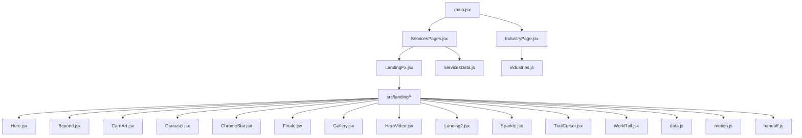
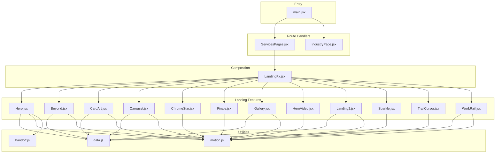
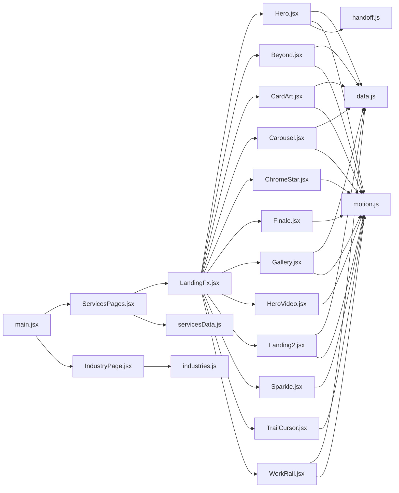

# Component Hierarchy and Relationships

<cite>
**Referenced Files in This Document**
- [main.jsx](file://src/main.jsx)
- [ServicesPages.jsx](file://src/ServicesPages.jsx)
- [IndustryPage.jsx](file://src/IndustryPage.jsx)
- [LandingFx.jsx](file://src/LandingFx.jsx)
- [Hero.jsx](file://src/landing/Hero.jsx)
- [Beyond.jsx](file://src/landing/Beyond.jsx)
- [CardArt.jsx](file://src/landing/CardArt.jsx)
- [Carousel.jsx](file://src/landing/Carousel.jsx)
- [ChromeStar.jsx](file://src/landing/ChromeStar.jsx)
- [Finale.jsx](file://src/landing/Finale.jsx)
- [Gallery.jsx](file://src/landing/Gallery.jsx)
- [HeroVideo.jsx](file://src/landing/HeroVideo.jsx)
- [Landing2.jsx](file://src/landing/Landing2.jsx)
- [Sparkle.jsx](file://src/landing/Sparkle.jsx)
- [TrailCursor.jsx](file://src/landing/TrailCursor.jsx)
- [WorkRail.jsx](file://src/landing/WorkRail.jsx)
- [data.js](file://src/landing/data.js)
- [motion.js](file://src/landing/motion.js)
- [handoff.js](file://src/landing/handoff.js)
- [industries.js](file://src/industries.js)
- [servicesData.js](file://src/servicesData.js)
- [ClientLogo.jsx](file://src/ClientLogo.jsx)
- [ContactUs.jsx](file://src/ContactUs.jsx)
- [usePageMotion.js](file://src/usePageMotion.js)
</cite>

## Table of Contents
1. [Introduction](#introduction)
2. [Project Structure](#project-structure)
3. [Core Components](#core-components)
4. [Architecture Overview](#architecture-overview)
5. [Detailed Component Analysis](#detailed-component-analysis)
6. [Dependency Analysis](#dependency-analysis)
7. [Performance Considerations](#performance-considerations)
8. [Troubleshooting Guide](#troubleshooting-guide)
9. [Conclusion](#conclusion)

## Introduction
This document explains the component hierarchy and relationships in PodiumMinds, focusing on how top-level route handlers compose landing page experiences and integrate with the main application flow. It details parent-child relationships among layout components, feature components, and reusable UI elements, and documents communication patterns such as prop passing and event handling. The modular organization of landing components under src/landing is mapped to root-level components to clarify responsibilities and data flows.

## Project Structure
At a high level:
- Application entry point initializes the React app and mounts the root component tree.
- Top-level route handlers render ServicesPages and IndustryPage for their respective routes.
- Landing experience components are organized under src/landing and composed by higher-level pages.
- Shared utilities (motion, handoff, data) support animations, transitions, and content across landing sections.

**Diagram sources**
- [main.jsx](file://src/main.jsx)
- [ServicesPages.jsx](file://src/ServicesPages.jsx)
- [IndustryPage.jsx](file://src/IndustryPage.jsx)
- [LandingFx.jsx](file://src/LandingFx.jsx)
- [Hero.jsx](file://src/landing/Hero.jsx)
- [Beyond.jsx](file://src/landing/Beyond.jsx)
- [CardArt.jsx](file://src/landing/CardArt.jsx)
- [Carousel.jsx](file://src/landing/Carousel.jsx)
- [ChromeStar.jsx](file://src/landing/ChromeStar.jsx)
- [Finale.jsx](file://src/landing/Finale.jsx)
- [Gallery.jsx](file://src/landing/Gallery.jsx)
- [HeroVideo.jsx](file://src/landing/HeroVideo.jsx)
- [Landing2.jsx](file://src/landing/Landing2.jsx)
- [Sparkle.jsx](file://src/landing/Sparkle.jsx)
- [TrailCursor.jsx](file://src/landing/TrailCursor.jsx)
- [WorkRail.jsx](file://src/landing/WorkRail.jsx)
- [data.js](file://src/landing/data.js)
- [motion.js](file://src/landing/motion.js)
- [handoff.js](file://src/landing/handoff.js)
- [industries.js](file://src/industries.js)
- [servicesData.js](file://src/servicesData.js)

**Section sources**
- [main.jsx](file://src/main.jsx)
- [ServicesPages.jsx](file://src/ServicesPages.jsx)
- [IndustryPage.jsx](file://src/IndustryPage.jsx)
- [LandingFx.jsx](file://src/LandingFx.jsx)
- [Hero.jsx](file://src/landing/Hero.jsx)
- [Beyond.jsx](file://src/landing/Beyond.jsx)
- [CardArt.jsx](file://src/landing/CardArt.jsx)
- [Carousel.jsx](file://src/landing/Carousel.jsx)
- [ChromeStar.jsx](file://src/landing/ChromeStar.jsx)
- [Finale.jsx](file://src/landing/Finale.jsx)
- [Gallery.jsx](file://src/landing/Gallery.jsx)
- [HeroVideo.jsx](file://src/landing/HeroVideo.jsx)
- [Landing2.jsx](file://src/landing/Landing2.jsx)
- [Sparkle.jsx](file://src/landing/Sparkle.jsx)
- [TrailCursor.jsx](file://src/landing/TrailCursor.jsx)
- [WorkRail.jsx](file://src/landing/WorkRail.jsx)
- [data.js](file://src/landing/data.js)
- [motion.js](file://src/landing/motion.js)
- [handoff.js](file://src/landing/handoff.js)
- [industries.js](file://src/industries.js)
- [servicesData.js](file://src/servicesData.js)

## Core Components
- ServicesPages.jsx: Primary route handler for services-related pages; composes landing-oriented sections and integrates shared motion and data modules.
- IndustryPage.jsx: Primary route handler for industry-specific pages; composes industry content using shared data and UI primitives.
- LandingFx.jsx: Orchestrates landing page composition and behavior, delegating to individual landing sections under src/landing.

Key responsibilities:
- Routing and composition at the top level.
- Data binding from centralized datasets (e.g., servicesData.js, industries.js).
- Integration of animation and interaction utilities (motion.js, handoff.js).

**Section sources**
- [ServicesPages.jsx](file://src/ServicesPages.jsx)
- [IndustryPage.jsx](file://src/IndustryPage.jsx)
- [LandingFx.jsx](file://src/LandingFx.jsx)
- [servicesData.js](file://src/servicesData.js)
- [industries.js](file://src/industries.js)
- [motion.js](file://src/landing/motion.js)
- [handoff.js](file://src/landing/handoff.js)

## Architecture Overview
The application follows a layered composition model:
- Entry layer: main.jsx bootstraps the app and mounts the root.
- Route layer: ServicesPages.jsx and IndustryPage.jsx act as top-level route handlers.
- Composition layer: LandingFx.jsx orchestrates landing sections.
- Feature layer: Individual landing components (Hero, Beyond, CardArt, Carousel, etc.) implement specific features.
- Utility layer: Shared modules provide motion, data, and handoff behaviors.

**Diagram sources**
- [main.jsx](file://src/main.jsx)
- [ServicesPages.jsx](file://src/ServicesPages.jsx)
- [IndustryPage.jsx](file://src/IndustryPage.jsx)
- [LandingFx.jsx](file://src/LandingFx.jsx)
- [Hero.jsx](file://src/landing/Hero.jsx)
- [Beyond.jsx](file://src/landing/Beyond.jsx)
- [CardArt.jsx](file://src/landing/CardArt.jsx)
- [Carousel.jsx](file://src/landing/Carousel.jsx)
- [ChromeStar.jsx](file://src/landing/ChromeStar.jsx)
- [Finale.jsx](file://src/landing/Finale.jsx)
- [Gallery.jsx](file://src/landing/Gallery.jsx)
- [HeroVideo.jsx](file://src/landing/HeroVideo.jsx)
- [Landing2.jsx](file://src/landing/Landing2.jsx)
- [Sparkle.jsx](file://src/landing/Sparkle.jsx)
- [TrailCursor.jsx](file://src/landing/TrailCursor.jsx)
- [WorkRail.jsx](file://src/landing/WorkRail.jsx)
- [data.js](file://src/landing/data.js)
- [motion.js](file://src/landing/motion.js)
- [handoff.js](file://src/landing/handoff.js)

## Detailed Component Analysis

### Route Handlers
- ServicesPages.jsx
  - Role: Top-level services route; composes landing-oriented sections and binds service data.
  - Communication: Passes props to child sections; may use context or utility hooks for global state if needed.
  - Event handling: Delegates user interactions to feature components; centralizes navigation or analytics calls where appropriate.
- IndustryPage.jsx
  - Role: Top-level industry route; renders industry-specific content using shared data and UI primitives.
  - Communication: Propagates industry metadata to child components; coordinates layout and section ordering.
  - Event handling: Handles industry-specific actions (e.g., filtering, toggling) via callbacks passed down to children.

**Section sources**
- [ServicesPages.jsx](file://src/ServicesPages.jsx)
- [IndustryPage.jsx](file://src/IndustryPage.jsx)

### Composition Layer
- LandingFx.jsx
  - Role: Orchestrates landing page composition; wires together Hero, Beyond, CardArt, Carousel, Gallery, WorkRail, and other sections.
  - Communication: Provides shared configuration (e.g., theme tokens, motion presets) via props or context; manages cross-section state when necessary.
  - Event handling: Centralizes global events (e.g., scroll-driven animations) and dispatches to relevant sections.

**Section sources**
- [LandingFx.jsx](file://src/LandingFx.jsx)

### Landing Feature Components
- Hero.jsx
  - Purpose: Primary hero section; integrates video/image assets and headline content.
  - Props: Title, subtitle, media references, call-to-action handlers.
  - Events: Click handlers for CTAs; optional play/pause for video.
- Beyond.jsx
  - Purpose: Narrative or value proposition section; often uses motion effects.
  - Props: Content blocks, animation triggers.
  - Events: Scroll-triggered animations via motion utilities.
- CardArt.jsx
  - Purpose: Displays curated art cards; supports hover and selection states.
  - Props: Card dataset, selection callback.
  - Events: Selection and navigation events.
- Carousel.jsx
  - Purpose: Horizontal or vertical carousel for showcasing items.
  - Props: Items array, autoplay settings, navigation controls.
  - Events: Slide change, pause/play, keyboard navigation.
- ChromeStar.jsx
  - Purpose: Decorative star effect; enhances visual polish.
  - Props: Positioning and intensity parameters.
  - Events: Typically passive; driven by motion utilities.
- Finale.jsx
  - Purpose: Closing section with summary or final CTA.
  - Props: Summary content, action handlers.
  - Events: CTA click, transition triggers.
- Gallery.jsx
  - Purpose: Grid or masonry gallery view.
  - Props: Images, layout options, lightbox integration.
  - Events: Image click, filter changes.
- HeroVideo.jsx
  - Purpose: Video player wrapper with controls and performance optimizations.
  - Props: Source URL, poster, autoplay flags.
  - Events: Play/pause, volume, fullscreen.
- Landing2.jsx
  - Purpose: Secondary landing layout variant; reuses common sections with different arrangement.
  - Props: Section order, theme overrides.
  - Events: Delegates to contained sections.
- Sparkle.jsx
  - Purpose: Sparkle particle effect; adds dynamic visuals.
  - Props: Density, speed, color palette.
  - Events: Passive animation loop.
- TrailCursor.jsx
  - Purpose: Custom cursor trail effect.
  - Props: Trail length, easing, visibility rules.
  - Events: Mouse movement tracking; pointer events.
- WorkRail.jsx
  - Purpose: Horizontal rail for work samples; supports drag or swipe.
  - Props: Work items, drag sensitivity.
  - Events: Drag start/end, item selection.

**Section sources**
- [Hero.jsx](file://src/landing/Hero.jsx)
- [Beyond.jsx](file://src/landing/Beyond.jsx)
- [CardArt.jsx](file://src/landing/CardArt.jsx)
- [Carousel.jsx](file://src/landing/Carousel.jsx)
- [ChromeStar.jsx](file://src/landing/ChromeStar.jsx)
- [Finale.jsx](file://src/landing/Finale.jsx)
- [Gallery.jsx](file://src/landing/Gallery.jsx)
- [HeroVideo.jsx](file://src/landing/HeroVideo.jsx)
- [Landing2.jsx](file://src/landing/Landing2.jsx)
- [Sparkle.jsx](file://src/landing/Sparkle.jsx)
- [TrailCursor.jsx](file://src/landing/TrailCursor.jsx)
- [WorkRail.jsx](file://src/landing/WorkRail.jsx)

### Utilities and Data
- data.js
  - Purpose: Centralized content for landing sections (text, images, links).
  - Usage: Imported by multiple sections to ensure consistency.
- motion.js
  - Purpose: Animation helpers and motion presets used across sections.
  - Usage: Imported by Hero, Beyond, CardArt, Carousel, etc.
- handoff.js
  - Purpose: Transition and handoff logic between sections or routes.
  - Usage: Used by composition layer and feature components for smooth UX.
- industries.js
  - Purpose: Industry-specific content and metadata consumed by IndustryPage.jsx.
- servicesData.js
  - Purpose: Service catalog and related content consumed by ServicesPages.jsx.

**Section sources**
- [data.js](file://src/landing/data.js)
- [motion.js](file://src/landing/motion.js)
- [handoff.js](file://src/landing/handoff.js)
- [industries.js](file://src/industries.js)
- [servicesData.js](file://src/servicesData.js)

### Reusable UI Elements
- ClientLogo.jsx
  - Purpose: Logo display component used in client showcases.
  - Props: Logo asset, alt text, link target.
  - Events: Click to navigate to client site.
- ContactUs.jsx
  - Purpose: Contact form and submission handling.
  - Props: Form fields, validation rules, submit callback.
  - Events: Submit, field changes, error handling.

**Section sources**
- [ClientLogo.jsx](file://src/ClientLogo.jsx)
- [ContactUs.jsx](file://src/ContactUs.jsx)

### Global Motion Hook
- usePageMotion.js
  - Purpose: Page-level motion hook for entrance/exit animations and scroll-based effects.
  - Usage: Consumed by route handlers and major sections to coordinate motion timing.

**Section sources**
- [usePageMotion.js](file://src/usePageMotion.js)

## Dependency Analysis
The following diagram maps key import relationships among core files:

**Diagram sources**
- [main.jsx](file://src/main.jsx)
- [ServicesPages.jsx](file://src/ServicesPages.jsx)
- [IndustryPage.jsx](file://src/IndustryPage.jsx)
- [LandingFx.jsx](file://src/LandingFx.jsx)
- [Hero.jsx](file://src/landing/Hero.jsx)
- [Beyond.jsx](file://src/landing/Beyond.jsx)
- [CardArt.jsx](file://src/landing/CardArt.jsx)
- [Carousel.jsx](file://src/landing/Carousel.jsx)
- [ChromeStar.jsx](file://src/landing/ChromeStar.jsx)
- [Finale.jsx](file://src/landing/Finale.jsx)
- [Gallery.jsx](file://src/landing/Gallery.jsx)
- [HeroVideo.jsx](file://src/landing/HeroVideo.jsx)
- [Landing2.jsx](file://src/landing/Landing2.jsx)
- [Sparkle.jsx](file://src/landing/Sparkle.jsx)
- [TrailCursor.jsx](file://src/landing/TrailCursor.jsx)
- [WorkRail.jsx](file://src/landing/WorkRail.jsx)
- [data.js](file://src/landing/data.js)
- [motion.js](file://src/landing/motion.js)
- [handoff.js](file://src/landing/handoff.js)
- [industries.js](file://src/industries.js)
- [servicesData.js](file://src/servicesData.js)

**Section sources**
- [main.jsx](file://src/main.jsx)
- [ServicesPages.jsx](file://src/ServicesPages.jsx)
- [IndustryPage.jsx](file://src/IndustryPage.jsx)
- [LandingFx.jsx](file://src/LandingFx.jsx)
- [Hero.jsx](file://src/landing/Hero.jsx)
- [Beyond.jsx](file://src/landing/Beyond.jsx)
- [CardArt.jsx](file://src/landing/CardArt.jsx)
- [Carousel.jsx](file://src/landing/Carousel.jsx)
- [ChromeStar.jsx](file://src/landing/ChromeStar.jsx)
- [Finale.jsx](file://src/landing/Finale.jsx)
- [Gallery.jsx](file://src/landing/Gallery.jsx)
- [HeroVideo.jsx](file://src/landing/HeroVideo.jsx)
- [Landing2.jsx](file://src/landing/Landing2.jsx)
- [Sparkle.jsx](file://src/landing/Sparkle.jsx)
- [TrailCursor.jsx](file://src/landing/TrailCursor.jsx)
- [WorkRail.jsx](file://src/landing/WorkRail.jsx)
- [data.js](file://src/landing/data.js)
- [motion.js](file://src/landing/motion.js)
- [handoff.js](file://src/landing/handoff.js)
- [industries.js](file://src/industries.js)
- [servicesData.js](file://src/servicesData.js)

## Performance Considerations
- Prefer lazy loading for heavy sections (e.g., HeroVideo, Gallery) to reduce initial bundle size.
- Use memoization for expensive computations within feature components.
- Debounce or throttle event handlers for high-frequency interactions (e.g., TrailCursor mousemove).
- Optimize media assets and leverage browser caching strategies.
- Avoid unnecessary re-renders by lifting minimal state and using stable references for props.

[No sources needed since this section provides general guidance]

## Troubleshooting Guide
Common issues and resolutions:
- Missing assets or broken links: Verify paths in data.js and component props.
- Animation glitches: Check motion.js usage and ensure proper cleanup of animation frames.
- Form submission failures: Inspect ContactUs.jsx validation and network requests; handle errors gracefully.
- Performance regressions: Profile heavy components (Carousel, Gallery) and consider virtualization or pagination.

**Section sources**
- [ContactUs.jsx](file://src/ContactUs.jsx)
- [TrailCursor.jsx](file://src/landing/TrailCursor.jsx)
- [Carousel.jsx](file://src/landing/Carousel.jsx)
- [Gallery.jsx](file://src/landing/Gallery.jsx)
- [HeroVideo.jsx](file://src/landing/HeroVideo.jsx)
- [motion.js](file://src/landing/motion.js)
- [data.js](file://src/landing/data.js)

## Conclusion
PodiumMinds employs a clear hierarchical architecture: main.jsx boots the app, ServicesPages.jsx and IndustryPage.jsx serve as top-level route handlers, LandingFx.jsx orchestrates landing sections, and src/landing components implement focused features. Communication relies on prop passing, shared data modules, and motion utilities. This structure promotes modularity, maintainability, and scalability while enabling rich interactive experiences.

[No sources needed since this section summarizes without analyzing specific files]