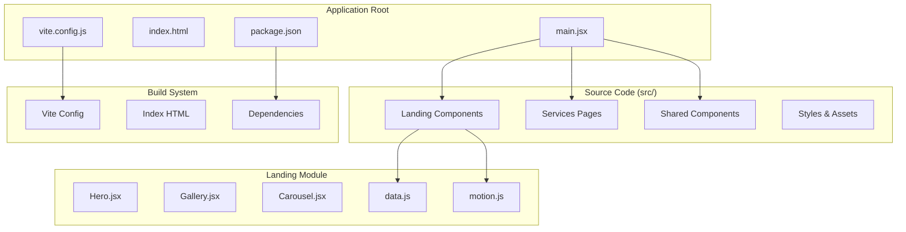
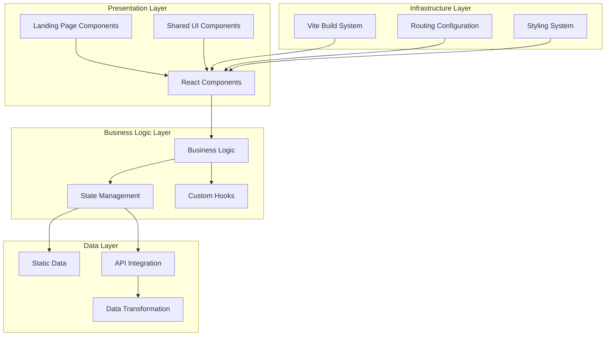
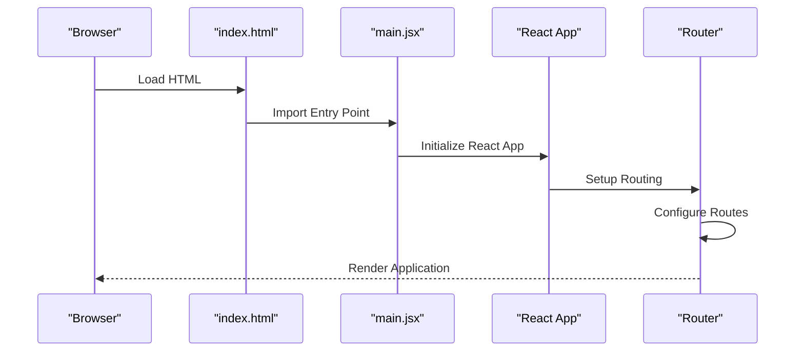
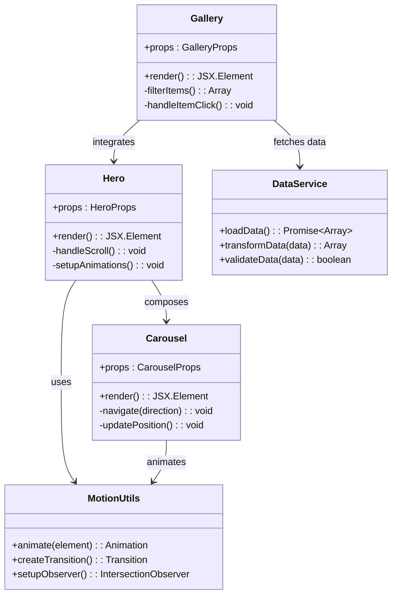
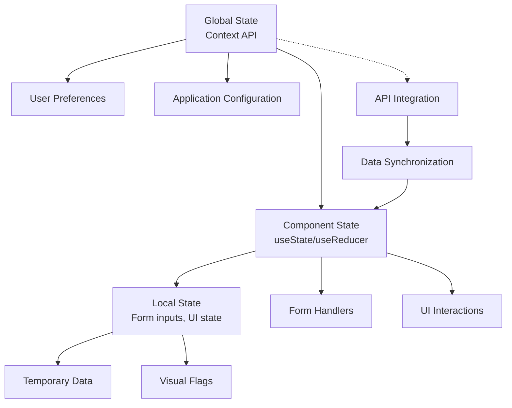
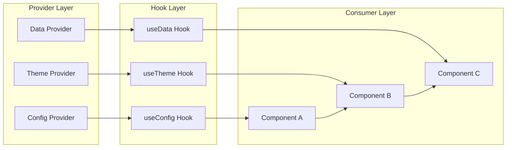
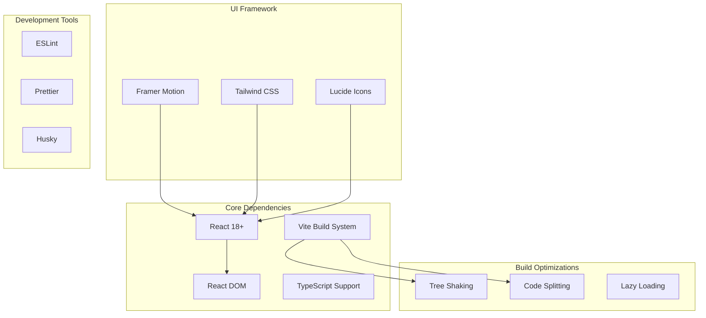

# Core Architecture Patterns

<cite>
**Referenced Files in This Document**
- [main.jsx](file://src/main.jsx)
- [vite.config.js](file://vite.config.js)
- [package.json](file://package.json)
- [index.html](file://index.html)
- [README.md](file://README.md)
- [Hero.jsx](file://src/landing/Hero.jsx)
- [Landing2.jsx](file://src/landing/Landing2.jsx)
- [data.js](file://src/landing/data.js)
- [motion.js](file://src/landing/motion.js)
- [servicesData.js](file://src/servicesData.js)
- [industries.js](file://src/industries.js)
</cite>

## Table of Contents
1. [Introduction](#introduction)
2. [Project Structure](#project-structure)
3. [Core Components](#core-components)
4. [Architecture Overview](#architecture-overview)
5. [Detailed Component Analysis](#detailed-component-analysis)
6. [Dependency Analysis](#dependency-analysis)
7. [Performance Considerations](#performance-considerations)
8. [Troubleshooting Guide](#troubleshooting-guide)
9. [Conclusion](#conclusion)

## Introduction

PodiumMinds is a modern React-based web application built with Vite as the build system. The project follows a component-driven architecture pattern, organizing UI elements into feature-based modules with clear separation of concerns between presentation components, business logic, and data management. The application leverages contemporary React patterns including functional components, hooks, and composition-based design principles.

The architecture emphasizes modularity, maintainability, and performance optimization through Vite's fast development server and efficient build pipeline. The project demonstrates best practices in React application structure, including proper component composition, state management strategies, and configuration management.

## Project Structure

The PodiumMinds application follows a feature-based organization pattern with clear separation between different architectural layers:

**Diagram sources**
- [main.jsx](file://src/main.jsx)
- [vite.config.js](file://vite.config.js)
- [package.json](file://package.json)

The project structure demonstrates several key architectural decisions:

### Feature-Based Organization
Components are organized by feature rather than type, grouping related functionality together. The `landing/` directory contains all landing page components, while shared utilities remain at the root level for easy access.

### Separation of Concerns
Each module maintains clear boundaries between UI components, business logic, and data management. Static data is separated from dynamic logic, and styling is co-located with components when appropriate.

### Build System Integration
Vite configuration provides optimized development and production builds with hot module replacement and efficient bundling strategies.

**Section sources**
- [main.jsx](file://src/main.jsx)
- [vite.config.js](file://vite.config.js)
- [package.json](file://package.json)

## Core Components

The application's core architecture revolves around several key architectural patterns:

### Entry Point Architecture
The application bootstraps through a centralized entry point that handles React initialization, routing setup, and global configuration. This pattern ensures consistent application lifecycle management and dependency injection.

### Component Composition Pattern
Components follow a composition-based approach where complex UIs are built by composing smaller, reusable components. This promotes reusability and maintainability across the application.

### Data Management Strategy
The application employs a layered data management approach with clear separation between static data, API calls, and component state. This pattern supports both client-side rendering and potential server-side rendering capabilities.

### Configuration Management
Environment-specific configurations are managed through dedicated configuration files, supporting different deployment environments and feature flags.

**Section sources**
- [main.jsx](file://src/main.jsx)
- [Hero.jsx](file://src/landing/Hero.jsx)
- [Landing2.jsx](file://src/landing/Landing2.jsx)

## Architecture Overview

The PodiumMinds application implements a modern React architecture with clear separation of concerns and modular design principles:

**Diagram sources**
- [main.jsx](file://src/main.jsx)
- [vite.config.js](file://vite.config.js)
- [Hero.jsx](file://src/landing/Hero.jsx)

### Architectural Principles

#### Component-Driven Development
The application follows a component-driven approach where each UI element is encapsulated as a self-contained component with well-defined props and responsibilities.

#### Modular Architecture
Features are organized into logical modules with clear interfaces, promoting loose coupling and high cohesion within the codebase.

#### Progressive Enhancement
The architecture supports progressive enhancement, allowing the application to function with basic JavaScript while providing enhanced experiences with full browser support.

#### Performance Optimization
Built-in optimizations include code splitting, lazy loading, and efficient bundling strategies to ensure optimal performance across different network conditions.

## Detailed Component Analysis

### Main Application Entry Point

The application entry point serves as the central bootstrap mechanism, handling React initialization, global configuration, and dependency injection:

**Diagram sources**
- [index.html](file://index.html)
- [main.jsx](file://src/main.jsx)

### Landing Page Architecture

The landing page implementation demonstrates sophisticated component composition and animation patterns:

**Diagram sources**
- [Hero.jsx](file://src/landing/Hero.jsx)
- [Landing2.jsx](file://src/landing/Landing2.jsx)
- [motion.js](file://src/landing/motion.js)
- [data.js](file://src/landing/data.js)

### State Management Strategy

The application employs a hierarchical state management approach:

### Dependency Injection Pattern

The application implements a lightweight dependency injection pattern through React Context and custom hooks:

**Section sources**
- [Hero.jsx](file://src/landing/Hero.jsx)
- [Landing2.jsx](file://src/landing/Landing2.jsx)
- [motion.js](file://src/landing/motion.js)
- [data.js](file://src/landing/data.js)

## Dependency Analysis

The application's dependency structure follows modern React ecosystem patterns with careful consideration of bundle size and performance:

**Diagram sources**
- [package.json](file://package.json)
- [vite.config.js](file://vite.config.js)

### Dependency Management Strategy

#### Version Pinning
Critical dependencies are version-pinned to ensure consistency across development and production environments.

#### Peer Dependencies
Framework dependencies are managed as peer dependencies to prevent conflicts and allow flexible version management.

#### Bundle Optimization
The build system automatically optimizes dependencies through tree shaking and selective imports to minimize bundle size.

**Section sources**
- [package.json](file://package.json)
- [vite.config.js](file://vite.config.js)

## Performance Considerations

The PodiumMinds architecture incorporates several performance optimization strategies:

### Build-Time Optimizations
- **Code Splitting**: Automatic chunking based on route and component boundaries
- **Tree Shaking**: Elimination of unused code during production builds
- **Asset Optimization**: Automatic image compression and font optimization
- **Caching Strategies**: Efficient caching headers and service worker integration

### Runtime Performance
- **Memoization**: Strategic use of React.memo and useMemo for expensive computations
- **Lazy Loading**: Component-level code splitting for improved initial load times
- **Animation Optimization**: Hardware-accelerated animations using Framer Motion
- **Memory Management**: Proper cleanup of event listeners and subscriptions

### Development Experience
- **Hot Module Replacement**: Instant feedback during development without full page reloads
- **Fast Refresh**: Preserves component state during development edits
- **Bundle Analysis**: Built-in tools for analyzing bundle composition and identifying bottlenecks

## Troubleshooting Guide

### Common Architecture Issues

#### Component Communication Problems
When components fail to communicate properly, verify the following:
- Ensure proper prop drilling or context usage patterns
- Check for circular dependencies in component imports
- Validate that context providers wrap the correct component hierarchy

#### Build System Issues
For Vite-related problems:
- Clear the `.vite` cache directory if experiencing stale builds
- Verify environment variable configuration in `.env` files
- Check for incompatible dependency versions in package.json

#### Performance Bottlenecks
To identify and resolve performance issues:
- Use React DevTools Profiler to analyze component render performance
- Monitor bundle size growth using Vite's built-in analysis tools
- Implement proper memoization for expensive computations
- Optimize image assets and implement lazy loading for heavy components

### Debugging Strategies

#### Component Debugging
- Use React DevTools to inspect component props and state
- Implement logging middleware for tracking component lifecycle events
- Create debug-only components for complex UI states

#### Build Process Debugging
- Enable verbose logging in Vite configuration
- Analyze generated bundles using bundle analyzer tools
- Test builds in isolation to identify problematic dependencies

**Section sources**
- [vite.config.js](file://vite.config.js)
- [package.json](file://package.json)

## Conclusion

The PodiumMinds application demonstrates a well-architected React application that balances modern development practices with performance considerations. The component-driven architecture, combined with Vite's build system, creates a scalable foundation for future feature additions and team collaboration.

Key architectural strengths include:
- **Modular Design**: Clear separation of concerns with feature-based organization
- **Performance Focus**: Comprehensive optimization strategies throughout the stack
- **Developer Experience**: Modern tooling and development workflows
- **Maintainability**: Consistent patterns and clear component boundaries

The architecture successfully addresses the challenges of building a modern web application while maintaining code quality, performance, and developer productivity. The patterns established in this project provide a solid foundation for scaling and evolving the application as requirements grow.