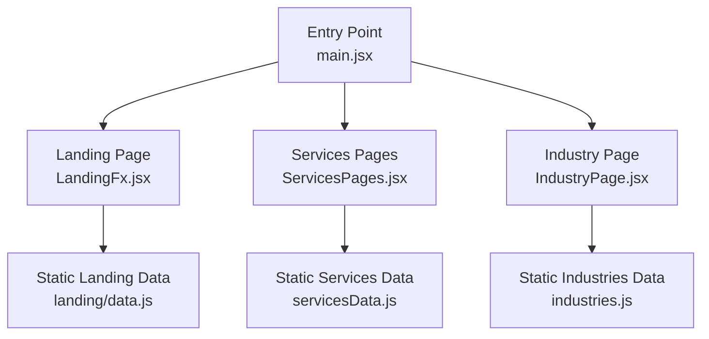
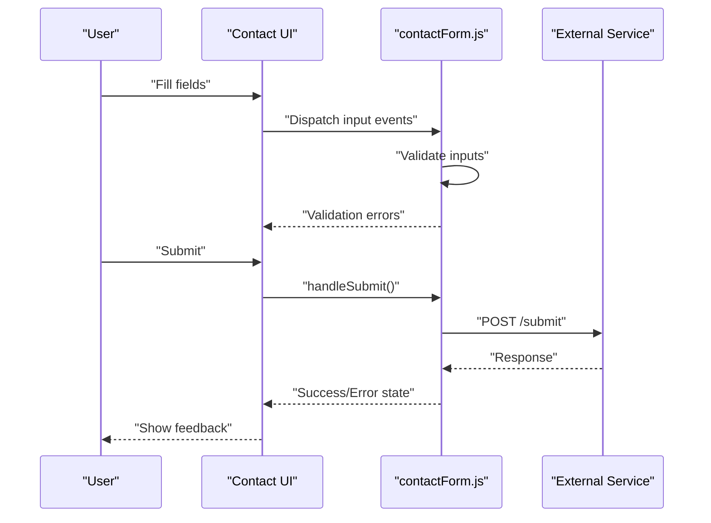
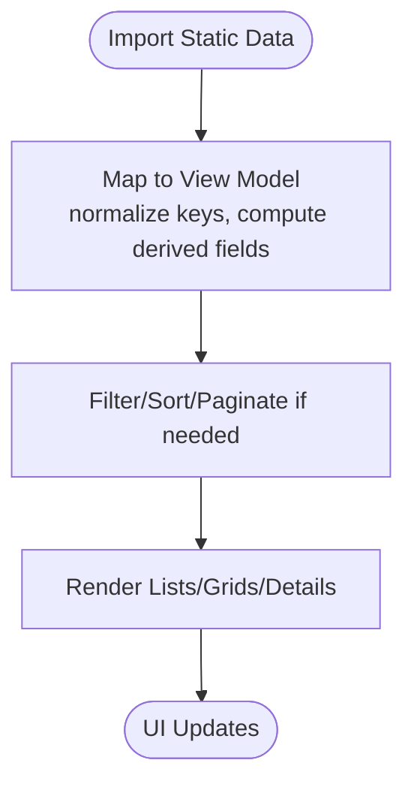
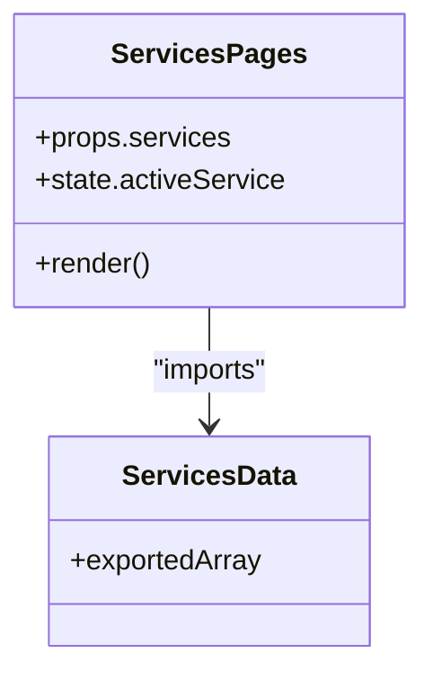
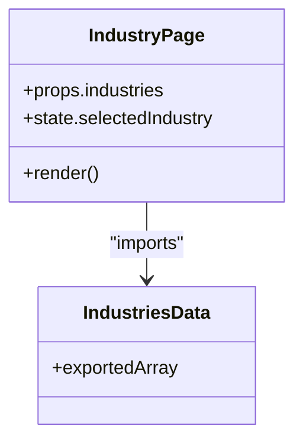
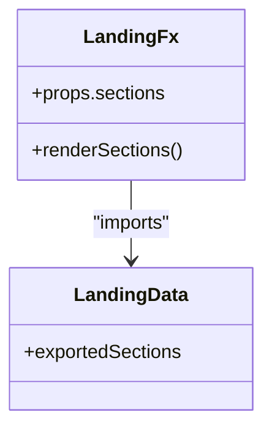
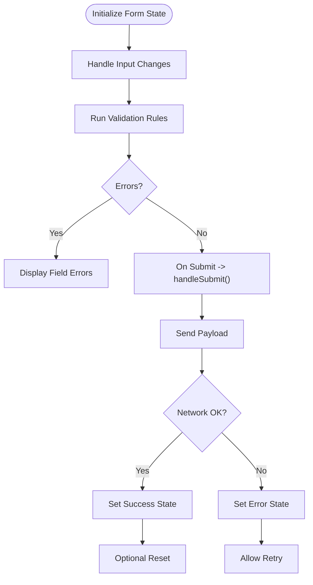
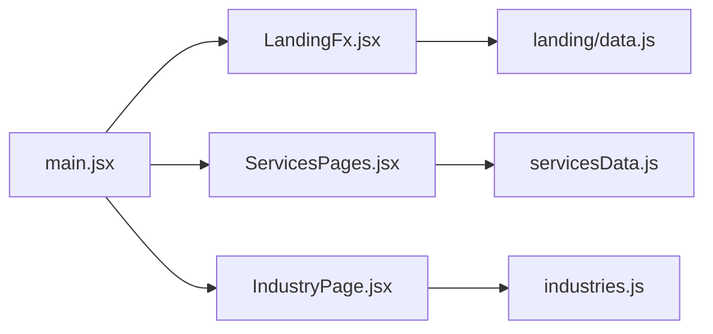

# Data Flow and State Management

<cite>
**Referenced Files in This Document**
- [servicesData.js](file://src/servicesData.js)
- [industries.js](file://src/industries.js)
- [data.js](file://src/landing/data.js)
- [contactForm.js](file://src/contactForm.js)
- [ServicesPages.jsx](file://src/ServicesPages.jsx)
- [IndustryPage.jsx](file://src/IndustryPage.jsx)
- [LandingFx.jsx](file://src/LandingFx.jsx)
- [main.jsx](file://src/main.jsx)
</cite>

## Table of Contents
1. [Introduction](#introduction)
2. [Project Structure](#project-structure)
3. [Core Components](#core-components)
4. [Architecture Overview](#architecture-overview)
5. [Detailed Component Analysis](#detailed-component-analysis)
6. [Dependency Analysis](#dependency-analysis)
7. [Performance Considerations](#performance-considerations)
8. [Troubleshooting Guide](#troubleshooting-guide)
9. [Conclusion](#conclusion)

## Introduction
This document explains how PodiumMinds manages data flow and state across the application, focusing on:
- Static data structures that drive dynamic rendering (services, industries, landing content)
- Form data flow for contact submission, including validation, submission handling, and UI state updates
- One-way data flow patterns, prop drilling strategies, and local state management
- Data transformation pipelines, caching strategies, and performance considerations for large datasets
- Error handling patterns and loading states

The goal is to provide a clear mental model of how data moves through the app and how components consume it predictably.

## Project Structure
At a high level, static data lives in dedicated modules and is consumed by page-level components that render lists, grids, or detail views. The entry point initializes the app and mounts the root component tree.

**Diagram sources**
- [main.jsx](file://src/main.jsx)
- [LandingFx.jsx](file://src/LandingFx.jsx)
- [ServicesPages.jsx](file://src/ServicesPages.jsx)
- [IndustryPage.jsx](file://src/IndustryPage.jsx)
- [servicesData.js](file://src/servicesData.js)
- [industries.js](file://src/industries.js)
- [data.js](file://src/landing/data.js)

**Section sources**
- [main.jsx](file://src/main.jsx)
- [LandingFx.jsx](file://src/LandingFx.jsx)
- [ServicesPages.jsx](file://src/ServicesPages.jsx)
- [IndustryPage.jsx](file://src/IndustryPage.jsx)
- [servicesData.js](file://src/servicesData.js)
- [industries.js](file://src/industries.js)
- [data.js](file://src/landing/data.js)

## Core Components
- servicesData.js: Centralized static dataset powering service listings and details.
- industries.js: Centralized static dataset powering industry pages and related assets.
- landing/data.js: Centralized static dataset powering landing sections and media.
- ServicesPages.jsx: Consumes servicesData.js to render service cards and detail views.
- IndustryPage.jsx: Consumes industries.js to render industry-specific content.
- LandingFx.jsx: Consumes landing/data.js to compose landing sections.
- contactForm.js: Encapsulates form state, validation, and submission logic used by the contact UI.

These modules follow a one-way data flow: static data is imported into components, which derive UI state from props and local state.

**Section sources**
- [servicesData.js](file://src/servicesData.js)
- [industries.js](file://src/industries.js)
- [data.js](file://src/landing/data.js)
- [ServicesPages.jsx](file://src/ServicesPages.jsx)
- [IndustryPage.jsx](file://src/IndustryPage.jsx)
- [LandingFx.jsx](file://src/LandingFx.jsx)
- [contactForm.js](file://src/contactForm.js)

## Architecture Overview
The application uses a unidirectional data flow pattern:
- Static data modules export plain objects/arrays.
- Page components import these modules and map them to UI elements.
- Local component state drives transient UI behavior (e.g., active tab, open modal).
- Forms encapsulate their own state and side effects, then communicate results upward via callbacks.

[No diagram sources needed since this sequence illustrates a conceptual flow]

## Detailed Component Analysis

### Static Data Modules and Rendering
Static data modules are single sources of truth for content. Components import and transform these datasets into view models tailored for rendering.

Key responsibilities:
- Normalize field names and types for consistent consumption.
- Derive computed properties (e.g., display labels, thumbnails).
- Provide stable references to avoid unnecessary re-renders.

**Section sources**
- [servicesData.js](file://src/servicesData.js)
- [industries.js](file://src/industries.js)
- [data.js](file://src/landing/data.js)
- [ServicesPages.jsx](file://src/ServicesPages.jsx)
- [IndustryPage.jsx](file://src/IndustryPage.jsx)
- [LandingFx.jsx](file://src/LandingFx.jsx)

#### Services Data Flow
- Source: servicesData.js exports a structured array/object of services.
- Consumer: ServicesPages.jsx imports and maps to service cards and detail panels.
- Pattern: One-way data flow; props carry normalized items down; local state controls selection and visibility.

**Diagram sources**
- [ServicesPages.jsx](file://src/ServicesPages.jsx)
- [servicesData.js](file://src/servicesData.js)

**Section sources**
- [servicesData.js](file://src/servicesData.js)
- [ServicesPages.jsx](file://src/ServicesPages.jsx)

#### Industries Data Flow
- Source: industries.js exports industry entries with associated assets and metadata.
- Consumer: IndustryPage.jsx renders industry overview and detail views.
- Pattern: Prop-driven rendering with optional local state for tabs or filters.

**Diagram sources**
- [IndustryPage.jsx](file://src/IndustryPage.jsx)
- [industries.js](file://src/industries.js)

**Section sources**
- [industries.js](file://src/industries.js)
- [IndustryPage.jsx](file://src/IndustryPage.jsx)

#### Landing Data Flow
- Source: landing/data.js exports landing section content and media references.
- Consumer: LandingFx.jsx composes sections using this data.
- Pattern: Declarative composition driven by static data arrays.

**Diagram sources**
- [LandingFx.jsx](file://src/LandingFx.jsx)
- [data.js](file://src/landing/data.js)

**Section sources**
- [data.js](file://src/landing/data.js)
- [LandingFx.jsx](file://src/LandingFx.jsx)

### Contact Form Data Flow
The contact form encapsulates its own state and side effects, exposing a simple interface to the parent UI.

Implementation notes:
- Local state holds values, touched flags, and error messages.
- Validation runs on change and blur to minimize latency.
- Submission triggers network I/O; success/error states update UI accordingly.
- Parent components receive callbacks for success/failure to coordinate navigation or notifications.

**Section sources**
- [contactForm.js](file://src/contactForm.js)

### One-Way Data Flow and Prop Drilling
- Data flows top-down: static data modules -> page components -> child components.
- Prop drilling is used where necessary; consider memoization to prevent unnecessary re-renders when passing large objects.
- Avoid mutating props; always create new objects/arrays when transforming data.

Best practices:
- Keep data transformations close to the consumer to maintain clarity.
- Use stable identifiers for list items to aid reconciliation.
- Prefer shallow comparisons and memoization for expensive computations.

[No sources needed since this section provides general guidance]

### Local State Management Approaches
- Use local state for transient UI concerns (active item, open/close toggles, form inputs).
- Lift state only when multiple siblings need shared access.
- For complex forms, encapsulate logic in a module (as seen in contactForm.js) to keep components focused on presentation.

[No sources needed since this section provides general guidance]

## Dependency Analysis
The following diagram shows how page components depend on static data modules and the entry point.

**Diagram sources**
- [main.jsx](file://src/main.jsx)
- [LandingFx.jsx](file://src/LandingFx.jsx)
- [ServicesPages.jsx](file://src/ServicesPages.jsx)
- [IndustryPage.jsx](file://src/IndustryPage.jsx)
- [servicesData.js](file://src/servicesData.js)
- [industries.js](file://src/industries.js)
- [data.js](file://src/landing/data.js)

**Section sources**
- [main.jsx](file://src/main.jsx)
- [LandingFx.jsx](file://src/LandingFx.jsx)
- [ServicesPages.jsx](file://src/ServicesPages.jsx)
- [IndustryPage.jsx](file://src/IndustryPage.jsx)
- [servicesData.js](file://src/servicesData.js)
- [industries.js](file://src/industries.js)
- [data.js](file://src/landing/data.js)

## Performance Considerations
- Memoize derived data: Wrap expensive mappings or filters with memoization to avoid recomputation on every render.
- Stable references: Ensure exported data structures are stable across renders to leverage referential equality checks.
- Virtualization: For very large lists, implement virtual scrolling to render only visible items.
- Image/media optimization: Lazy-load images and use appropriate formats/sizes to reduce initial payload.
- Code splitting: Split heavy components or routes to improve initial load time.
- Debounce/throttle: Apply debouncing to search/filter inputs and throttling to scroll-based interactions.

[No sources needed since this section provides general guidance]

## Troubleshooting Guide
Common issues and resolutions:
- Stale data in UI:
  - Ensure you are not mutating imported static data; create copies before modifying.
  - Verify that derived state is recalculated when dependencies change.
- Excessive re-renders:
  - Check for unstable object/array references passed as props.
  - Add memoization around expensive computations and child components.
- Form submission failures:
  - Inspect validation rules and ensure they run on both change and submit.
  - Log network requests and responses to diagnose server-side errors.
- Missing assets or broken links:
  - Confirm asset paths referenced in static data match actual file locations.

[No sources needed since this section provides general guidance]

## Conclusion
PodiumMinds follows a clean, predictable architecture:
- Static data modules act as single sources of truth.
- Components consume data via props and manage transient UI state locally.
- Forms encapsulate validation and submission logic, communicating outcomes upward.
- One-way data flow ensures traceability and simplifies debugging.
Adopting memoization, stable references, and lazy loading will further improve scalability and performance as the dataset grows.