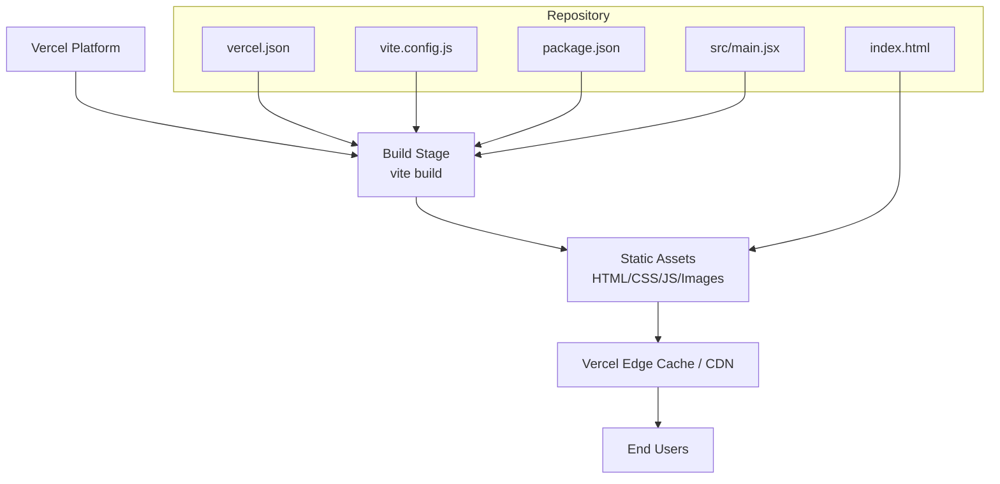
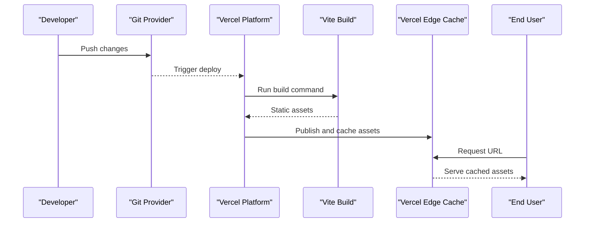
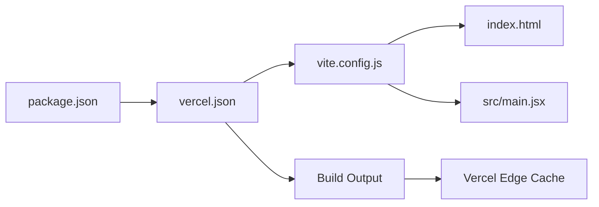

# Deployment and Infrastructure Architecture

<cite>
**Referenced Files in This Document**
- [vercel.json](file://vercel.json)
- [vite.config.js](file://vite.config.js)
- [index.html](file://index.html)
- [package.json](file://package.json)
- [src/main.jsx](file://src/main.jsx)
</cite>

## Table of Contents
1. [Introduction](#introduction)
2. [Project Structure](#project-structure)
3. [Core Components](#core-components)
4. [Architecture Overview](#architecture-overview)
5. [Detailed Component Analysis](#detailed-component-analysis)
6. [Dependency Analysis](#dependency-analysis)
7. [Performance Considerations](#performance-considerations)
8. [Troubleshooting Guide](#troubleshooting-guide)
9. [Conclusion](#conclusion)
10. [Appendices](#appendices)

## Introduction
This document describes the deployment and infrastructure architecture for PodiumMinds, focusing on:
- Vercel deployment configuration (routing rules, environment variables, build settings)
- Vite build pipeline for production optimization, asset bundling, and code splitting
- HTML template structure and meta tag configuration for SEO
- CDN integration, asset delivery strategies, and performance monitoring setup
- Scaling considerations, caching policies, and deployment automation workflows
- Environment-specific configurations and differences between development and production

The goal is to provide a clear, actionable reference for engineers and operators deploying and operating the application on Vercel with a Vite-based frontend.

## Project Structure
At a high level, the project is a Vite-powered React application deployed as a static site on Vercel. The key files that define deployment and build behavior are:
- vercel.json: Vercel routing and build configuration
- vite.config.js: Vite build pipeline and optimization settings
- index.html: Application shell and SEO-related meta tags
- package.json: Scripts and dependencies used by both local dev and CI/CD
- src/main.jsx: Application entry point

**Diagram sources**
- [vercel.json](file://vercel.json)
- [vite.config.js](file://vite.config.js)
- [index.html](file://index.html)
- [package.json](file://package.json)
- [src/main.jsx](file://src/main.jsx)

**Section sources**
- [vercel.json](file://vercel.json)
- [vite.config.js](file://vite.config.js)
- [index.html](file://index.html)
- [package.json](file://package.json)
- [src/main.jsx](file://src/main.jsx)

## Core Components
- Vercel Configuration (vercel.json): Defines build command, output directory, and routing rules such as redirects and rewrites. It also controls how Vercel serves the built assets.
- Vite Build Pipeline (vite.config.js): Configures the production build, including minification, chunking, asset handling, and any custom plugins or optimizations.
- HTML Template (index.html): Provides the root HTML document, base href, title, and meta tags for SEO and social sharing.
- Package Scripts (package.json): Declares build and preview scripts consumed by Vercel and local development.
- Application Entry (src/main.jsx): Bootstraps the React application within the Vite-built HTML shell.

**Section sources**
- [vercel.json](file://vercel.json)
- [vite.config.js](file://vite.config.js)
- [index.html](file://index.html)
- [package.json](file://package.json)
- [src/main.jsx](file://src/main.jsx)

## Architecture Overview
The deployment architecture follows a standard static-site pattern:
- Vercel triggers a build using the configured command from vercel.json and package.json.
- Vite compiles and optimizes the application into static assets.
- Vercel distributes these assets via its global edge network and caches them at the edge.
- Clients receive optimized HTML, CSS, JS, and media assets with appropriate cache headers.

[No sources needed since this diagram shows conceptual workflow, not actual code structure]

## Detailed Component Analysis

### Vercel Deployment Configuration
- Build Command and Output Directory: The build process is driven by the command defined in vercel.json, which typically invokes the build script declared in package.json. The output directory points to the Vite build artifact folder.
- Routing Rules: vercel.json can include redirects and rewrites to support single-page application routing, legacy paths, or API proxies. For SPA routing, a catch-all rewrite ensures client-side routers handle navigation after initial load.
- Environment Variables: Vercel injects environment variables at build time and runtime. Configure them in the Vercel dashboard or via CI secrets. Reference them in the app through Vite’s environment variable conventions.
- Framework Detection: If no explicit framework is set, Vercel auto-detects based on presence of Vite and React. Explicitly setting the framework can improve build performance and defaults.

Operational notes:
- Ensure the build command matches the one in package.json.
- Use redirects for permanent moves and rewrites for internal routing.
- Keep environment variables scoped per environment (development, preview, production).

**Section sources**
- [vercel.json](file://vercel.json)
- [package.json](file://package.json)

### Vite Build Pipeline and Production Optimization
- Build Command: The production build is executed by Vite, producing an optimized bundle in the configured outDir.
- Minification and Compression: JavaScript and CSS are minified; assets are optimized for size and performance.
- Code Splitting: Vite splits code by default for route-level and dynamic imports, enabling efficient loading.
- Asset Handling: Images, fonts, and other static assets are hashed and emitted to the output directory for cache-busting.
- Plugins and Aliases: Any custom Vite plugins or path aliases should be defined here to ensure consistent builds across environments.

Best practices:
- Avoid heavy synchronous operations during build.
- Prefer dynamic imports for large features to reduce initial bundle size.
- Validate that all public assets referenced in the source are present under the public directory if they must be copied as-is.

**Section sources**
- [vite.config.js](file://vite.config.js)
- [package.json](file://package.json)

### HTML Template Structure and SEO Meta Tags
- Root Document: index.html defines the application shell, including the base href and the root element where the React app mounts.
- SEO Meta Tags: Include title, description, canonical URL, Open Graph, and Twitter Card tags to improve search visibility and social sharing previews.
- Performance Hints: Preconnect to critical origins, preload key resources, and avoid blocking render-critical work.

Recommendations:
- Set a descriptive page title and unique descriptions per route when possible.
- Provide og:image and twitter:image dimensions to prevent layout shifts.
- Use canonical links to avoid duplicate content issues.

**Section sources**
- [index.html](file://index.html)

### CDN Integration and Asset Delivery Strategies
- Global Edge Network: Vercel automatically serves static assets from its global edge network, reducing latency worldwide.
- Cache-Busting: Vite emits hashed filenames for assets, enabling long-term caching without stale content.
- Static Assets: Place non-module assets in the public directory to be served directly.
- External CDNs: For third-party media or fonts, consider using a dedicated CDN and configure CORS appropriately.

Caching policy guidance:
- Leverage immutable caching for hashed assets.
- Apply short TTLs for index.html to allow fast rollouts.
- Use Vercel’s cache-control headers via redirects or middleware if needed.

**Section sources**
- [vite.config.js](file://vite.config.js)
- [vercel.json](file://vercel.json)

### Performance Monitoring Setup
- Web Vitals: Integrate a lightweight library to collect Core Web Vitals and send metrics to your analytics backend.
- Error Tracking: Capture unhandled exceptions and resource loading errors to aid debugging in production.
- Synthetic Monitoring: Optionally add uptime checks and synthetic tests to validate critical user flows.

Implementation tips:
- Initialize monitoring only in production builds.
- Respect user privacy and comply with regional regulations.
- Correlate performance regressions with deployments using versioned releases.

[No sources needed since this section provides general guidance]

### Scaling Considerations
- Static Site Scaling: As a static site, scaling is handled by Vercel’s edge network; there are no server instances to scale manually.
- Asset Size: Keep bundles small and leverage code splitting to minimize payload sizes.
- Image Optimization: Use modern formats and responsive images to reduce bandwidth.
- Third-Party Dependencies: Audit and limit external libraries to reduce TTI and memory usage.

[No sources needed since this section provides general guidance]

### Caching Policies
- Browser Caching: Rely on hashed filenames for long-lived caching of assets.
- HTML Caching: Short TTL for index.html ensures quick propagation of updates.
- CDN Caching: Vercel’s edge cache handles distribution; use redirects to control cache behavior for specific routes.

[No sources needed since this section provides general guidance]

### Deployment Automation Workflows
- CI/CD Triggers: Connect your Git repository to Vercel to trigger automatic deployments on push to main or pull requests.
- Preview Deployments: Enable preview URLs for branches to test changes before merging.
- Environment Variables: Manage secrets and environment variables in Vercel’s dashboard or via CI integrations.
- Rollbacks: Use Vercel’s deployment history to rollback to previous versions quickly.

**Section sources**
- [vercel.json](file://vercel.json)
- [package.json](file://package.json)

### Environment-Specific Configurations
- Development vs Production:
  - Local development uses Vite’s dev server with hot module replacement and unminified assets.
  - Production builds are optimized, minified, and split into chunks.
- Environment Variables:
  - Define variables in vercel.json or the Vercel dashboard.
  - Access variables in the app using Vite’s environment variable patterns.
- Feature Flags:
  - Toggle features based on environment variables to enable experimental functionality in preview environments.

**Section sources**
- [vercel.json](file://vercel.json)
- [vite.config.js](file://vite.config.js)
- [package.json](file://package.json)

## Dependency Analysis
The following diagram maps the primary configuration and entry points involved in building and deploying the application.

**Diagram sources**
- [package.json](file://package.json)
- [vercel.json](file://vercel.json)
- [vite.config.js](file://vite.config.js)
- [index.html](file://index.html)
- [src/main.jsx](file://src/main.jsx)

**Section sources**
- [package.json](file://package.json)
- [vercel.json](file://vercel.json)
- [vite.config.js](file://vite.config.js)
- [index.html](file://index.html)
- [src/main.jsx](file://src/main.jsx)

## Performance Considerations
- Bundle Size: Monitor and reduce bundle size using code splitting and lazy loading.
- Critical Rendering Path: Inline minimal CSS for above-the-fold content if necessary; defer non-critical styles.
- Image Strategy: Use next-gen formats, responsive images, and lazy loading.
- Network Efficiency: Enable gzip/brotli compression at the CDN layer (managed by Vercel).
- Observability: Track LCP, FID, CLS, and INP to identify bottlenecks.

[No sources needed since this section provides general guidance]

## Troubleshooting Guide
Common issues and resolutions:
- Build Failures:
  - Verify the build command in vercel.json matches package.json scripts.
  - Check for missing environment variables required at build time.
- Routing Errors:
  - Ensure SPA catch-all rewrite is configured so client-side routes resolve correctly.
- Missing Assets:
  - Confirm assets exist in the correct directories and are referenced consistently.
- Stale Cache:
  - Clear browser cache or force reload; verify cache headers for index.html and hashed assets.
- Environment Mismatch:
  - Ensure environment variables are set for the correct Vercel environment (preview vs production).

**Section sources**
- [vercel.json](file://vercel.json)
- [package.json](file://package.json)
- [vite.config.js](file://vite.config.js)

## Conclusion
PodiumMinds leverages a straightforward and scalable architecture: a Vite-built static site deployed on Vercel’s global edge network. By configuring vercel.json for routing and build behavior, optimizing the Vite pipeline, and structuring index.html for SEO, the application achieves fast loads, reliable caching, and easy rollouts. Following the recommended performance, caching, and monitoring practices will further enhance reliability and user experience across environments.

[No sources needed since this section summarizes without analyzing specific files]

## Appendices

### Appendix A: Key Files and Responsibilities
- vercel.json: Build command, output directory, redirects, rewrites, and framework detection.
- vite.config.js: Vite build options, plugins, asset handling, and optimization flags.
- index.html: Application shell, base href, and SEO meta tags.
- package.json: Scripts and dependencies used by Vercel and local development.
- src/main.jsx: Application bootstrap and mount point.

**Section sources**
- [vercel.json](file://vercel.json)
- [vite.config.js](file://vite.config.js)
- [index.html](file://index.html)
- [package.json](file://package.json)
- [src/main.jsx](file://src/main.jsx)