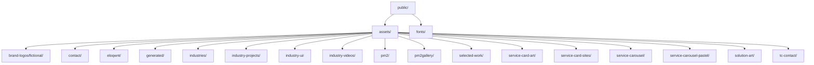
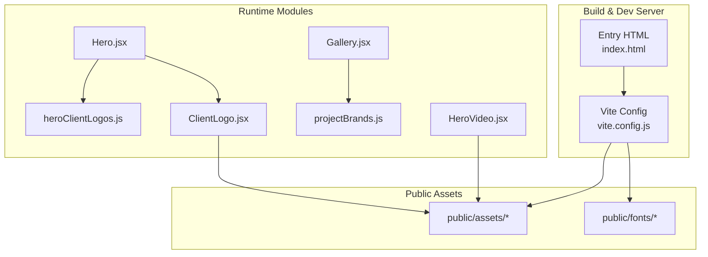
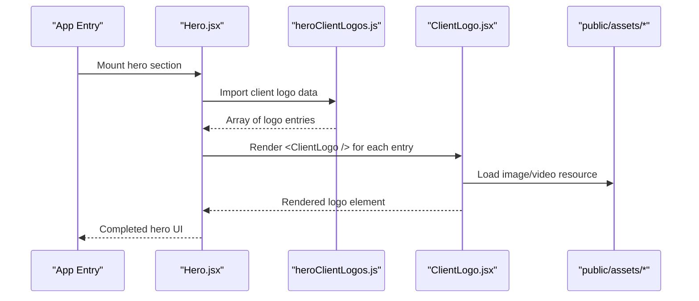
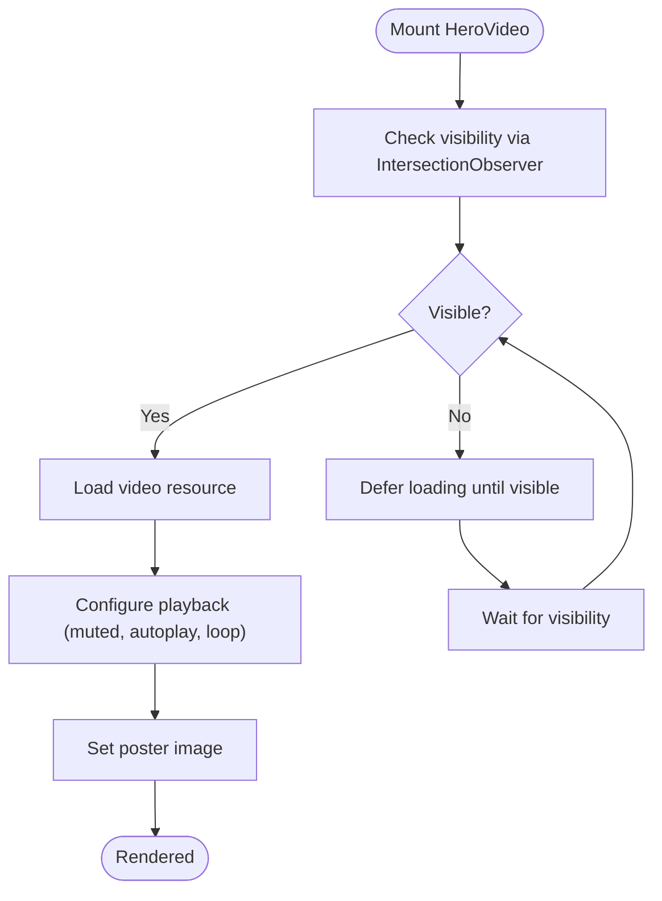
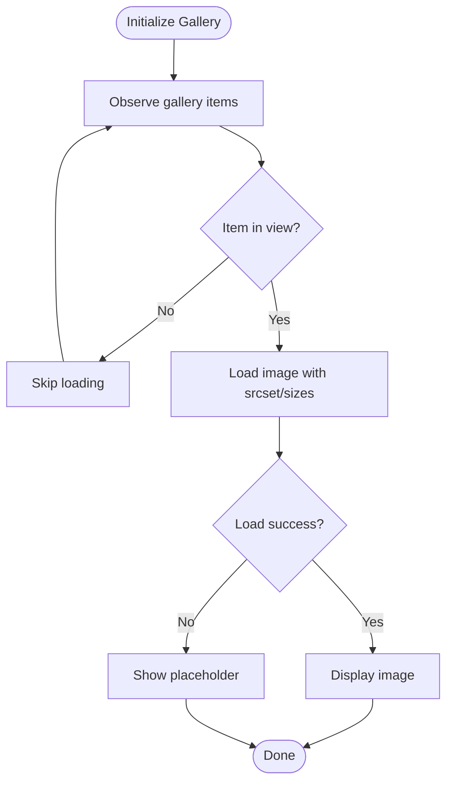
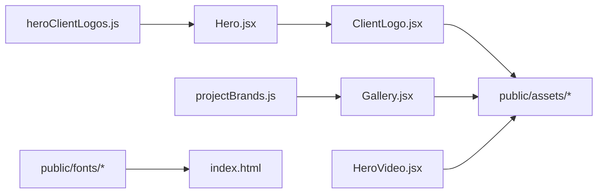

# Asset Management

<cite>
**Referenced Files in This Document**
- [vite.config.js](file://vite.config.js)
- [index.html](file://index.html)
- [package.json](file://package.json)
- [projectBrands.js](file://src/projectBrands.js)
- [heroClientLogos.js](file://src/heroClientLogos.js)
- [ClientLogo.jsx](file://src/ClientLogo.jsx)
- [Hero.jsx](file://src/landing/Hero.jsx)
- [HeroVideo.jsx](file://src/landing/HeroVideo.jsx)
- [Gallery.jsx](file://src/landing/Gallery.jsx)
- [work.css](file://src/landing/work.css)
</cite>

## Table of Contents
1. [Introduction](#introduction)
2. [Project Structure](#project-structure)
3. [Core Components](#core-components)
4. [Architecture Overview](#architecture-overview)
5. [Detailed Component Analysis](#detailed-component-analysis)
6. [Dependency Analysis](#dependency-analysis)
7. [Performance Considerations](#performance-considerations)
8. [Troubleshooting Guide](#troubleshooting-guide)
9. [Conclusion](#conclusion)
10. [Appendices](#appendices)

## Introduction
This document explains how static assets are organized and managed in the PodiumMinds application, focusing on:
- Static asset organization under public/assets and public/fonts
- JavaScript-based dynamic asset loading via projectBrands.js and heroClientLogos.js
- Image optimization strategies, lazy loading patterns, and performance considerations
- Guidelines for adding new assets, organizing media files, and maintaining versioning
- Vite asset pipeline configuration and optimizations

The goal is to provide a clear, actionable guide for developers and content contributors to manage brand materials, images, videos, and fonts efficiently while preserving performance and consistency.

## Project Structure
Static assets are primarily served from the public directory. The structure separates brand logos, industry-related media, service visuals, and generated outputs into logical folders. Fonts are placed under public/fonts for direct access.

Key points:
- Use descriptive folder names aligned with feature or domain (e.g., brand-logos, industries, service-carousel).
- Keep generated artifacts separate (e.g., generated/) to avoid confusion with source assets.
- Fonts are directly accessible at runtime without build-time processing.

**Section sources**
- [index.html](file://index.html)

## Core Components
This section covers the JavaScript modules that drive dynamic asset loading and rendering.

- projectBrands.js
  - Purpose: Centralizes brand logo references and metadata used across the site.
  - Typical responsibilities:
    - Export arrays or objects describing brands (name, logo path, optional variants).
    - Provide consistent naming conventions for logo assets.
    - Serve as the single source of truth for brand assets consumed by UI components.
  - Usage: Imported by components that render brand logos or lists.

- heroClientLogos.js
  - Purpose: Supplies client logo data for the hero section carousel/grid.
  - Typical responsibilities:
    - Export structured data for client logos (paths, alt text, links).
    - Maintain alignment between UI expectations and file paths under public/assets.
  - Usage: Consumed by Hero.jsx or related components to render the hero client logos.

- ClientLogo.jsx
  - Purpose: Reusable component for rendering individual client logos.
  - Responsibilities:
    - Accept props such as src, alt, link, and size.
    - Apply consistent styling and accessibility attributes.
    - Optionally implement lazy loading and error fallbacks.

- Hero.jsx
  - Purpose: Orchestrates hero section layout and integrates client logos.
  - Responsibilities:
    - Import heroClientLogos.js for data.
    - Render ClientLogo components within a responsive layout.
    - Coordinate animations or transitions if applicable.

- HeroVideo.jsx
  - Purpose: Renders hero video content with optimized playback behavior.
  - Responsibilities:
    - Configure muted, autoplay, loop, and playsinline where appropriate.
    - Implement lazy initialization or intersection observer to defer heavy resources.
    - Provide poster image and fallbacks for unsupported formats.

- Gallery.jsx
  - Purpose: Displays galleries of images/videos with performance-conscious loading.
  - Responsibilities:
    - Lazy load images using native loading="lazy" or IntersectionObserver.
    - Support responsive images and thumbnails.
    - Handle errors gracefully with placeholders.

- work.css
  - Purpose: Styles for work-related sections including galleries and carousels.
  - Responsibilities:
    - Define grid/flex layouts, spacing, and responsive breakpoints.
    - Ensure consistent visual hierarchy for media items.

**Section sources**
- [projectBrands.js](file://src/projectBrands.js)
- [heroClientLogos.js](file://src/heroClientLogos.js)
- [ClientLogo.jsx](file://src/ClientLogo.jsx)
- [Hero.jsx](file://src/landing/Hero.jsx)
- [HeroVideo.jsx](file://src/landing/HeroVideo.jsx)
- [Gallery.jsx](file://src/landing/Gallery.jsx)
- [work.css](file://src/landing/work.css)

## Architecture Overview
The asset management architecture combines static serving via Vite’s public directory with dynamic data-driven rendering through JavaScript modules.

- Vite serves static assets from public/ without transformation unless explicitly configured.
- Data modules export structured references to assets; components consume these references to render media.
- CSS styles govern layout and responsiveness for media-heavy sections.

**Diagram sources**
- [vite.config.js](file://vite.config.js)
- [index.html](file://index.html)
- [projectBrands.js](file://src/projectBrands.js)
- [heroClientLogos.js](file://src/heroClientLogos.js)
- [ClientLogo.jsx](file://src/ClientLogo.jsx)
- [Hero.jsx](file://src/landing/Hero.jsx)
- [HeroVideo.jsx](file://src/landing/HeroVideo.jsx)
- [Gallery.jsx](file://src/landing/Gallery.jsx)

## Detailed Component Analysis

### Dynamic Brand and Client Logo Loading
- Data-driven approach:
  - projectBrands.js and heroClientLogos.js act as centralized registries for brand and client assets.
  - Components import these modules to obtain asset paths and metadata, ensuring consistency and reducing duplication.
- Rendering flow:
  - Hero.jsx imports heroClientLogos.js and renders ClientLogo components.
  - ClientLogo.jsx handles per-logo rendering, including alt text and optional links.
  - Galleries and other sections may use projectBrands.js to display brand assets consistently.

**Diagram sources**
- [Hero.jsx](file://src/landing/Hero.jsx)
- [heroClientLogos.js](file://src/heroClientLogos.js)
- [ClientLogo.jsx](file://src/ClientLogo.jsx)

**Section sources**
- [Hero.jsx](file://src/landing/Hero.jsx)
- [heroClientLogos.js](file://src/heroClientLogos.js)
- [ClientLogo.jsx](file://src/ClientLogo.jsx)

### Video Optimization in Hero
- Playback settings:
  - Prefer muted, autoplay, loop, and playsinline for background hero videos.
  - Provide a lightweight poster image to improve perceived performance.
- Resource strategy:
  - Use multiple formats (e.g., MP4/WebM) when supported.
  - Defer heavy video initialization until visible using IntersectionObserver or similar techniques.
- Error handling:
  - Fallback to an image or simplified animation if video fails to load or play.

**Diagram sources**
- [HeroVideo.jsx](file://src/landing/HeroVideo.jsx)

**Section sources**
- [HeroVideo.jsx](file://src/landing/HeroVideo.jsx)

### Gallery Performance Patterns
- Lazy loading:
  - Use native loading="lazy" for below-the-fold images.
  - For advanced control, implement IntersectionObserver to load images only when near viewport.
- Responsive images:
  - Provide multiple resolutions and sizes to reduce bandwidth.
- Error resilience:
  - Show placeholder images and retry logic for failed loads.

**Diagram sources**
- [Gallery.jsx](file://src/landing/Gallery.jsx)
- [work.css](file://src/landing/work.css)

**Section sources**
- [Gallery.jsx](file://src/landing/Gallery.jsx)
- [work.css](file://src/landing/work.css)

## Dependency Analysis
The following diagram illustrates how modules depend on each other and on static assets.

- Direct dependencies:
  - Hero.jsx depends on heroClientLogos.js and ClientLogo.jsx.
  - Gallery.jsx depends on projectBrands.js.
  - ClientLogo.jsx consumes assets from public/assets.
  - HeroVideo.jsx consumes assets from public/assets.
  - index.html references fonts from public/fonts.

**Diagram sources**
- [projectBrands.js](file://src/projectBrands.js)
- [heroClientLogos.js](file://src/heroClientLogos.js)
- [ClientLogo.jsx](file://src/ClientLogo.jsx)
- [Hero.jsx](file://src/landing/Hero.jsx)
- [HeroVideo.jsx](file://src/landing/HeroVideo.jsx)
- [Gallery.jsx](file://src/landing/Gallery.jsx)
- [index.html](file://index.html)

**Section sources**
- [projectBrands.js](file://src/projectBrands.js)
- [heroClientLogos.js](file://src/heroClientLogos.js)
- [ClientLogo.jsx](file://src/ClientLogo.jsx)
- [Hero.jsx](file://src/landing/Hero.jsx)
- [HeroVideo.jsx](file://src/landing/HeroVideo.jsx)
- [Gallery.jsx](file://src/landing/Gallery.jsx)
- [index.html](file://index.html)

## Performance Considerations
- Image optimization:
  - Use modern formats (WebP/AVIF) where supported; provide fallbacks.
  - Employ responsive images (srcset/sizes) to serve appropriately sized assets.
  - Compress images and remove unnecessary metadata.
- Lazy loading:
  - Defer offscreen images and videos using native lazy loading or IntersectionObserver.
  - Preload critical assets (e.g., hero poster) to improve first paint.
- Caching and versioning:
  - Leverage browser caching by appending content hashes to filenames during build.
  - Avoid long-lived cache issues by updating asset references when content changes.
- Network efficiency:
  - Minimize payload sizes; prefer vector graphics (SVG) for scalable icons/logos.
  - Use HTTP/2 multiplexing and CDN delivery for static assets.
- Accessibility:
  - Always include meaningful alt text for images and descriptive labels for interactive elements.

[No sources needed since this section provides general guidance]

## Troubleshooting Guide
Common issues and resolutions:
- Missing assets:
  - Verify paths in projectBrands.js and heroClientLogos.js match actual locations under public/assets.
  - Ensure case sensitivity and correct extensions.
- Broken images/videos:
  - Check network tab for 404 errors; confirm asset availability and CORS if hosted externally.
  - Validate media format compatibility and fallbacks.
- Performance regressions:
  - Audit lazy loading implementation; ensure IntersectionObserver thresholds are appropriate.
  - Inspect bundle size and asset sizes; compress or replace heavy assets.
- Font loading problems:
  - Confirm font files exist in public/fonts and are referenced correctly in CSS/HTML.
  - Test cross-origin policies if fonts are served from another domain.

**Section sources**
- [projectBrands.js](file://src/projectBrands.js)
- [heroClientLogos.js](file://src/heroClientLogos.js)
- [index.html](file://index.html)

## Conclusion
PodiumMinds employs a straightforward yet robust asset management strategy:
- Centralized data modules define asset references for consistent consumption.
- Public directory serves static assets efficiently via Vite.
- Components implement lazy loading and responsive strategies to optimize performance.
Following the guidelines in this document will help maintain a performant, accessible, and scalable media system.

[No sources needed since this section summarizes without analyzing specific files]

## Appendices

### Adding New Assets
- Place new media under appropriate folders in public/assets (e.g., brand-logos/fictional/, industries/, service-carousel/).
- Update relevant data modules:
  - Add entries to projectBrands.js for brand assets.
  - Add entries to heroClientLogos.js for hero client logos.
- Reference assets in components using the exported data structures.
- Validate paths and test in development and production builds.

**Section sources**
- [projectBrands.js](file://src/projectBrands.js)
- [heroClientLogos.js](file://src/heroClientLogos.js)

### Organizing Media Files
- Use descriptive folder names aligned with features or domains.
- Separate generated artifacts into generated/ to avoid confusion.
- Keep fonts isolated under public/fonts for direct access.

**Section sources**
- [index.html](file://index.html)

### Maintaining Asset Versioning
- Rely on Vite’s build process to hash filenames and enable long-term caching.
- When updating assets, ensure data modules reference updated paths.
- Monitor cache invalidation after deployments to prevent stale assets.

**Section sources**
- [vite.config.js](file://vite.config.js)
- [package.json](file://package.json)

### Vite Asset Pipeline Configuration
- Static assets in public/ are served as-is; no transformation occurs unless explicitly configured.
- Build-time optimizations (e.g., minification, hashing) are controlled by Vite’s default settings and can be extended in vite.config.js.
- Ensure environment-specific configurations do not alter asset paths unexpectedly.

**Section sources**
- [vite.config.js](file://vite.config.js)
- [package.json](file://package.json)