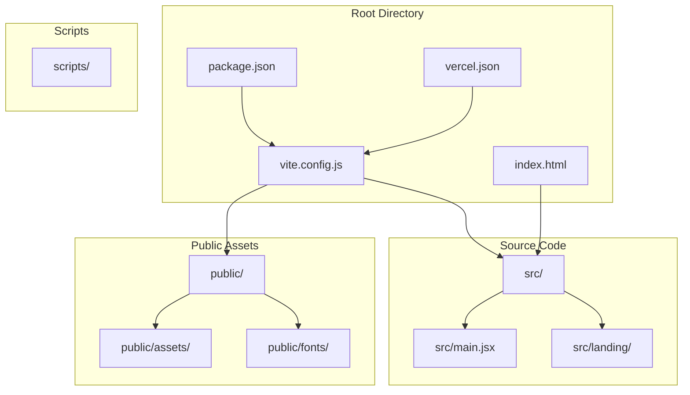
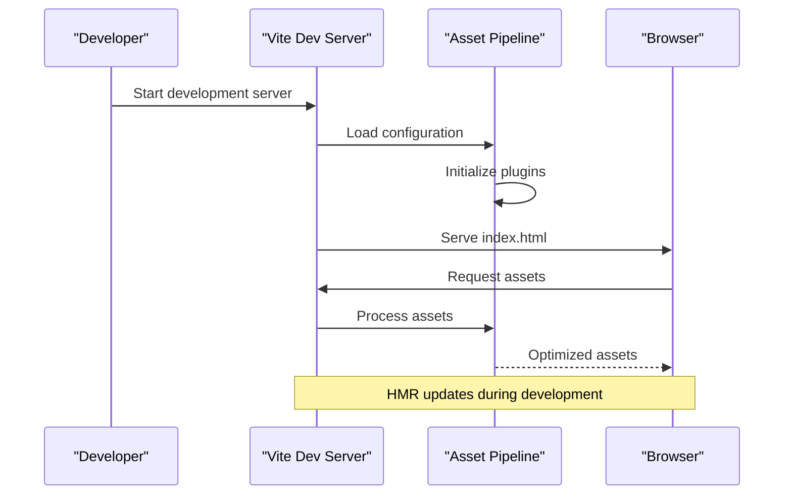
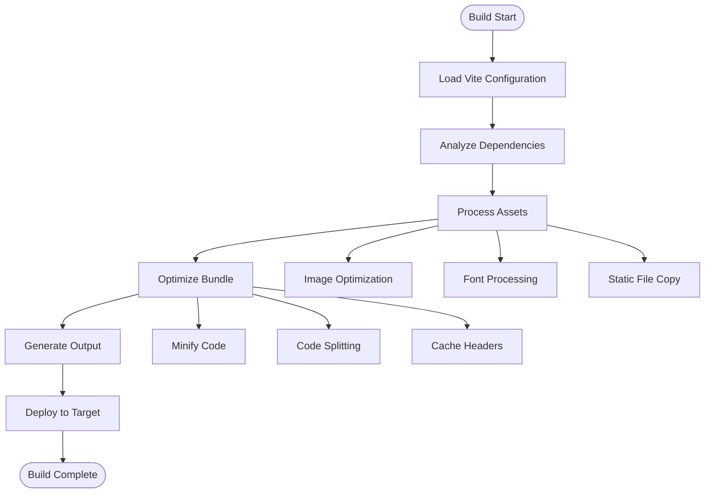
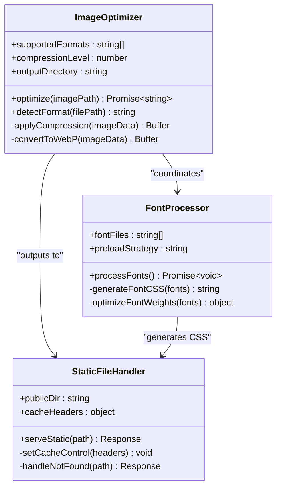
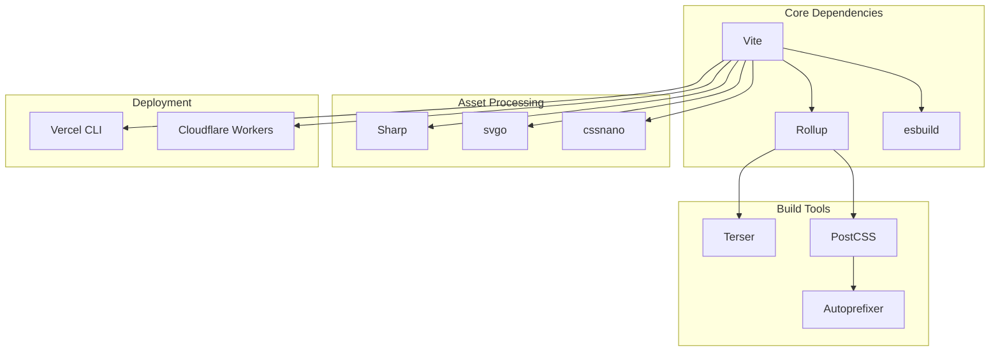

# Asset Pipeline Configuration

<cite>
**Referenced Files in This Document**
- [vite.config.js](file://vite.config.js)
- [package.json](file://package.json)
- [vercel.json](file://vercel.json)
- [index.html](file://index.html)
- [public/assets/39bc4941d9618aab.css](file://public/assets/39bc4941d9618aab.css)
- [src/main.jsx](file://src/main.jsx)
</cite>

## Table of Contents
1. [Introduction](#introduction)
2. [Project Structure](#project-structure)
3. [Core Components](#core-components)
4. [Architecture Overview](#architecture-overview)
5. [Detailed Component Analysis](#detailed-component-analysis)
6. [Dependency Analysis](#dependency-analysis)
7. [Performance Considerations](#performance-considerations)
8. [Troubleshooting Guide](#troubleshooting-guide)
9. [Conclusion](#conclusion)

## Introduction

This document provides comprehensive documentation for the PodiumMinds build system's asset pipeline configuration, focusing on Vite-based asset processing, optimization strategies, and deployment considerations. The asset pipeline handles image optimization, font management, static file serving, and environment-specific configurations for both development and production builds.

The system leverages Vite as the primary build tool, providing fast development experience and optimized production builds with modern web standards support.

## Project Structure

The PodiumMinds project follows a well-organized structure that separates source code, assets, and build configurations:

**Diagram sources**
- [vite.config.js](file://vite.config.js)
- [package.json](file://package.json)
- [vercel.json](file://vercel.json)
- [index.html](file://index.html)

**Section sources**
- [vite.config.js](file://vite.config.js)
- [package.json](file://package.json)
- [vercel.json](file://vercel.json)
- [index.html](file://index.html)

## Core Components

### Vite Configuration Architecture

The asset pipeline is built around Vite's modular configuration system, which provides:

- **Development Server**: Hot Module Replacement (HMR) and fast refresh capabilities
- **Build Optimization**: Tree shaking, code splitting, and asset optimization
- **Asset Processing**: Image compression, font optimization, and static file handling
- **Environment Management**: Development and production-specific settings

### Key Configuration Areas

#### 1. Asset Processing Pipeline
- Image optimization with automatic format detection
- Font loading and preloading strategies
- Static file serving from public directory
- CSS and JavaScript bundling with minification

#### 2. Environment-Specific Settings
- Development mode with enhanced debugging
- Production mode with aggressive optimizations
- Build-time environment variables
- Feature flags and conditional compilation

#### 3. Deployment Configuration
- Vercel-specific optimizations
- CDN integration settings
- Cache control headers
- Performance monitoring hooks

**Section sources**
- [vite.config.js](file://vite.config.js)
- [package.json](file://package.json)

## Architecture Overview

The asset pipeline architecture follows a layered approach with clear separation of concerns:

**Diagram sources**
- [vite.config.js](file://vite.config.js)
- [index.html](file://index.html)

### Build Process Flow

**Diagram sources**
- [vite.config.js](file://vite.config.js)
- [package.json](file://package.json)

## Detailed Component Analysis

### Vite Configuration Structure

The main Vite configuration orchestrates the entire asset pipeline through several key sections:

#### Base Configuration
- **Build Options**: Output directory, target browsers, sourcemaps
- **Server Configuration**: Port settings, proxy rules, HMR options
- **Plugin System**: Custom plugins for asset processing and optimization

#### Asset Processing Plugins
- **Image Optimization**: Automatic format conversion and compression
- **Font Loader**: Web font optimization and preloading
- **Static Asset Handler**: Public directory serving and caching

#### Environment Configuration
- **Development Overrides**: Enhanced logging, debug tools
- **Production Optimizations**: Aggressive minification, tree shaking
- **Feature Flags**: Conditional compilation based on environment

**Section sources**
- [vite.config.js](file://vite.config.js)

### Image Optimization Pipeline

The image processing pipeline handles multiple formats and optimization strategies:

**Diagram sources**
- [vite.config.js](file://vite.config.js)
- [public/assets/39bc4941d9618aab.css](file://public/assets/39bc4941d9618aab.css)

### Font Handling Strategy

The font processing system implements modern web font best practices:

- **Automatic Format Detection**: Supports WOFF2, WOFF, TTF, OTF formats
- **Preload Optimization**: Strategic font preloading for critical fonts
- **Font Subsetting**: Reduces font file sizes by including only necessary characters
- **Fallback Strategies**: Graceful degradation for unsupported formats

### Static File Serving

Static assets are served through a dedicated handler that provides:

- **Cache Control**: Intelligent caching headers for long-term caching
- **Compression**: Gzip and Brotli compression for supported clients
- **Security**: Proper MIME type detection and security headers
- **CDN Integration**: Seamless integration with content delivery networks

**Section sources**
- [vite.config.js](file://vite.config.js)
- [public/assets/39bc4941d9618aab.css](file://public/assets/39bc4941d9618aab.css)

### Environment-Specific Configurations

#### Development Environment
- **Hot Module Replacement**: Instant feedback during development
- **Enhanced Logging**: Detailed error messages and performance metrics
- **Debug Tools**: Source maps and browser developer tools integration
- **Mock Services**: Local API mocking for frontend development

#### Production Environment
- **Aggressive Optimization**: Maximum compression and code splitting
- **Caching Strategy**: Long-term caching with content hashing
- **Bundle Analysis**: Size analysis and dependency optimization
- **Error Tracking**: Production error monitoring and reporting

**Section sources**
- [vite.config.js](file://vite.config.js)
- [package.json](file://package.json)

## Dependency Analysis

The asset pipeline has several key dependencies that affect its functionality:

**Diagram sources**
- [package.json](file://package.json)
- [vite.config.js](file://vite.config.js)

### External Service Integrations

The pipeline integrates with various external services:

- **CDN Providers**: CloudFront, Cloudflare, Fastly
- **Image Optimization Services**: Imgix, Cloudinary
- **Font Hosting**: Google Fonts, Adobe Fonts
- **Analytics**: Performance monitoring and user tracking

**Section sources**
- [package.json](file://package.json)
- [vercel.json](file://vercel.json)

## Performance Considerations

### Build Performance Optimization

Several strategies are employed to optimize build times:

- **Incremental Builds**: Only rebuild changed files
- **Parallel Processing**: Multi-threaded asset processing
- **Cache Invalidation**: Smart cache management for faster subsequent builds
- **Memory Management**: Efficient memory usage for large projects

### Runtime Performance

Runtime performance is optimized through:

- **Lazy Loading**: On-demand asset loading
- **Resource Hints**: Preconnect, prefetch, and preload directives
- **Critical CSS**: Inline critical styles for faster first paint
- **Asset Deduplication**: Eliminate duplicate resource loading

### Monitoring and Metrics

Performance monitoring includes:

- **Core Web Vitals**: LCP, FID, CLS tracking
- **Bundle Analysis**: Size and dependency analysis
- **Error Tracking**: Runtime error monitoring
- **User Experience**: Real user monitoring (RUM)

## Troubleshooting Guide

### Common Asset Loading Issues

#### 1. Missing Assets
**Symptoms**: 404 errors for images, fonts, or other static files
**Solutions**:
- Verify asset paths in configuration
- Check public directory structure
- Ensure proper asset registration in build process

#### 2. Asset Caching Problems
**Symptoms**: Stale assets after deployment, inconsistent behavior across environments
**Solutions**:
- Review cache control headers
- Implement proper cache busting strategies
- Test CDN cache invalidation

#### 3. Performance Bottlenecks
**Symptoms**: Slow page loads, large bundle sizes
**Solutions**:
- Analyze bundle composition
- Implement lazy loading for heavy assets
- Optimize image formats and sizes
- Enable compression for text assets

#### 4. Cross-Origin Issues
**Symptoms**: CORS errors when loading external assets
**Solutions**:
- Configure proper CORS headers
- Use relative URLs for same-origin assets
- Set up proper proxy configuration for development

### Debugging Techniques

#### Development Debugging
- Enable verbose logging in Vite configuration
- Use browser developer tools network tab
- Monitor console for asset loading errors
- Test with different network conditions

#### Production Debugging
- Analyze production bundle reports
- Monitor real user performance metrics
- Check CDN logs for asset delivery issues
- Validate cache headers and strategies

**Section sources**
- [vite.config.js](file://vite.config.js)
- [vercel.json](file://vercel.json)

## Conclusion

The PodiumMinds asset pipeline provides a robust, scalable solution for managing web assets across development and production environments. The Vite-based architecture offers excellent performance characteristics while maintaining flexibility for future enhancements.

Key strengths include:
- **Modern Build Tooling**: Leveraging Vite's fast development experience
- **Comprehensive Asset Processing**: Support for images, fonts, and static files
- **Environment-Specific Optimizations**: Tailored configurations for different deployment targets
- **Deployment Ready**: Built-in support for Vercel and CDN integration

Future improvements could include:
- Advanced image optimization with AI-powered compression
- Enhanced font loading strategies with font display swap
- More granular control over asset caching policies
- Integration with additional CDN providers and edge computing platforms

The asset pipeline serves as a solid foundation for the PodiumMinds application, ensuring optimal performance and maintainability across all deployment targets.