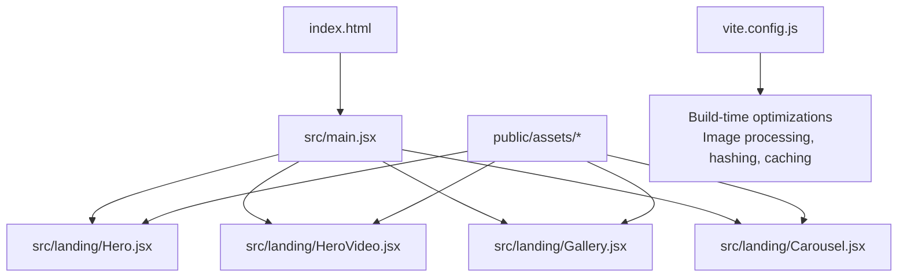
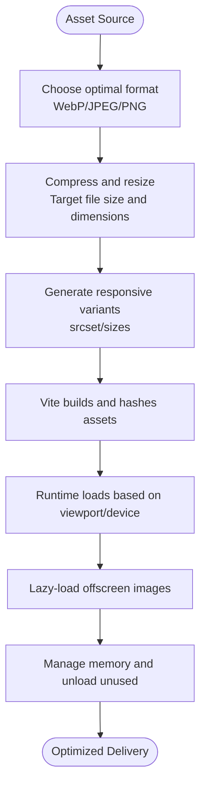
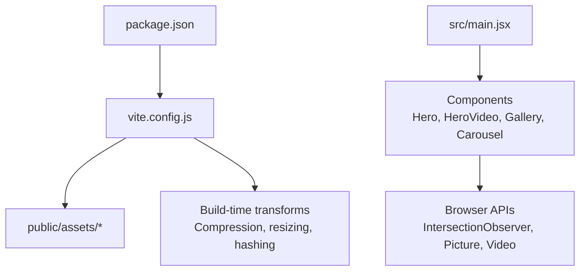

# Image and Media Optimization

<cite>
**Referenced Files in This Document**
- [vite.config.js](file://vite.config.js)
- [package.json](file://package.json)
- [index.html](file://index.html)
- [src/main.jsx](file://src/main.jsx)
- [src/landing/Hero.jsx](file://src/landing/Hero.jsx)
- [src/landing/HeroVideo.jsx](file://src/landing/HeroVideo.jsx)
- [src/landing/Gallery.jsx](file://src/landing/Gallery.jsx)
- [src/landing/Carousel.jsx](file://src/landing/Carousel.jsx)
- [src/landing/Hero 2.jsx](file://src/landing/Hero%202.jsx)
- [public/assets/service-carousel-pastel/placeholder.png](file://public/assets/service-carousel-pastel/placeholder.png)
</cite>

## Table of Contents
1. [Introduction](#introduction)
2. [Project Structure](#project-structure)
3. [Core Components](#core-components)
4. [Architecture Overview](#architecture-overview)
5. [Detailed Component Analysis](#detailed-component-analysis)
6. [Dependency Analysis](#dependency-analysis)
7. [Performance Considerations](#performance-considerations)
8. [Troubleshooting Guide](#troubleshooting-guide)
9. [Conclusion](#conclusion)
10. [Appendices](#appendices)

## Introduction
This document provides a comprehensive guide to image and media optimization strategies for the PodiumMinds application. It explains how Vite optimizes images, how lazy loading is implemented for galleries and hero sections, and how to handle large media files efficiently. It also includes best practices for image formats (WebP, JPEG, PNG), compression settings, responsive images, video optimization, font loading strategies, CDN integration, and memory management for large galleries and carousels.

## Project Structure
The project uses Vite as the build tool and React for UI components. Media assets are stored under public/assets, while components that render images and videos live under src/landing. The following diagram shows the high-level structure relevant to media handling:



**Diagram sources**
- [index.html:1-50](file://index.html#L1-L50)
- [src/main.jsx:1-50](file://src/main.jsx#L1-L50)
- [src/landing/Hero.jsx:1-120](file://src/landing/Hero.jsx#L1-L120)
- [src/landing/HeroVideo.jsx:1-120](file://src/landing/HeroVideo.jsx#L1-L120)
- [src/landing/Gallery.jsx:1-120](file://src/landing/Gallery.jsx#L1-L120)
- [src/landing/Carousel.jsx:1-120](file://src/landing/Carousel.jsx#L1-L120)
- [vite.config.js:1-120](file://vite.config.js#L1-L120)

**Section sources**
- [index.html:1-50](file://index.html#L1-L50)
- [src/main.jsx:1-50](file://src/main.jsx#L1-L50)
- [vite.config.js:1-120](file://vite.config.js#L1-L120)

## Core Components
- Hero section component: Renders hero imagery and may include background images or inline SVGs.
- Hero video component: Manages video playback, preload behavior, and visibility-based loading.
- Gallery component: Displays multiple images with lazy loading and responsive sizing.
- Carousel component: Handles sliding media with on-demand loading and memory cleanup.

These components integrate with Vite’s asset pipeline and browser-native features to optimize performance.

**Section sources**
- [src/landing/Hero.jsx:1-120](file://src/landing/Hero.jsx#L1-L120)
- [src/landing/HeroVideo.jsx:1-120](file://src/landing/HeroVideo.jsx#L1-L120)
- [src/landing/Gallery.jsx:1-120](file://src/landing/Gallery.jsx#L1-L120)
- [src/landing/Carousel.jsx:1-120](file://src/landing/Carousel.jsx#L1-L120)

## Architecture Overview
The media optimization architecture combines build-time transformations by Vite with runtime behaviors in React components:

```mermaid
sequenceDiagram
participant Dev as "Developer"
participant Vite as "Vite Build Pipeline"
participant Browser as "Browser"
participant App as "React App"
participant CompHero as "Hero.jsx"
participant CompVideo as "HeroVideo.jsx"
participant CompGallery as "Gallery.jsx"
participant CompCarousel as "Carousel.jsx"
Dev->>Vite : Import assets from public/assets
Vite-->>App : Optimized URLs with content hashes
App->>CompHero : Render hero image(s)
App->>CompVideo : Initialize video element
App->>CompGallery : Render gallery items
App->>CompCarousel : Initialize carousel slides
Note over CompHero,Browser : Use  with decoding="async", sizes/picture for responsive images
Note over CompVideo,Browser : Use preload="metadata", playsinline, muted, autoplay when appropriate
Note over CompGallery,Browser : Use loading="lazy" and IntersectionObserver for offscreen images
Note over CompCarousel,Browser : Lazy-load visible slides; unload offscreen slides
```

**Diagram sources**
- [vite.config.js:1-120](file://vite.config.js#L1-L120)
- [src/landing/Hero.jsx:1-120](file://src/landing/Hero.jsx#L1-L120)
- [src/landing/HeroVideo.jsx:1-120](file://src/landing/HeroVideo.jsx#L1-L120)
- [src/landing/Gallery.jsx:1-120](file://src/landing/Gallery.jsx#L1-L120)
- [src/landing/Carousel.jsx:1-120](file://src/landing/Carousel.jsx#L1-L120)

## Detailed Component Analysis

### Hero Section (Hero.jsx)
Responsibilities:
- Display hero imagery optimized for different viewports.
- Apply responsive image techniques using picture/source elements and sizes attributes.
- Ensure fast initial paint with minimal layout shift.

Optimization strategies:
- Prefer WebP/JPEG for photographic content; use PNG only where transparency is required.
- Provide multiple resolutions via srcset and sizes to reduce bandwidth.
- Use decoding="async" to avoid main-thread blocking during decode.
- Avoid heavy animations on first paint; defer non-critical effects.

Best practices:
- Preload critical hero images using link rel="preload".
- Set explicit width/height or aspect-ratio to prevent CLS.
- Consider CSS background-image with object-fit for full-bleed backgrounds.

**Section sources**
- [src/landing/Hero.jsx:1-120](file://src/landing/Hero.jsx#L1-L120)

### Hero Video (HeroVideo.jsx)
Responsibilities:
- Manage video playback in hero areas.
- Control preload behavior and visibility-based loading.
- Optimize for mobile and low-power devices.

Optimization strategies:
- Use preload="metadata" to avoid downloading entire video upfront.
- Enable playsinline, muted, and autoplay where supported to improve UX without sound.
- Defer initialization until the video enters viewport using IntersectionObserver.
- Provide poster image to show immediate visual feedback.

Accessibility and fallbacks:
- Include captions/subtitles for accessibility.
- Offer a static image fallback if video cannot play.

**Section sources**
- [src/landing/HeroVideo.jsx:1-120](file://src/landing/HeroVideo.jsx#L1-L120)

### Gallery (Gallery.jsx)
Responsibilities:
- Render a grid/list of images with efficient loading.
- Implement lazy loading for offscreen images.
- Support responsive layouts across breakpoints.

Optimization strategies:
- Use loading="lazy" on img elements to defer offscreen images.
- Combine with IntersectionObserver for advanced control (e.g., prefetching near-visible images).
- Serve WebP/JPEG variants with srcset for device pixel ratio and screen size.
- Use placeholder thumbnails to reduce perceived load time.

Memory considerations:
- Unload images no longer needed by removing references.
- Limit concurrent downloads to avoid network saturation.

**Section sources**
- [src/landing/Gallery.jsx:1-120](file://src/landing/Gallery.jsx#L1-L120)

### Carousel (Carousel.jsx)
Responsibilities:
- Present a sliding set of media items.
- Load only visible slides eagerly; lazy-load others.
- Clean up resources when slides leave the viewport.

Optimization strategies:
- Implement virtualization-like behavior: keep only active and adjacent slides loaded.
- Pause or stop media (video/audio) when slides are not visible.
- Debounce slide transitions to reduce reflows and repaints.

Memory management:
- Release references to offscreen images/videos.
- Cancel pending requests for slides that will not be shown.

**Section sources**
- [src/landing/Carousel.jsx:1-120](file://src/landing/Carousel.jsx#L1-L120)

### Conceptual Overview
The following conceptual flow illustrates how images are optimized end-to-end:



[No sources needed since this diagram shows conceptual workflow, not actual code structure]

## Dependency Analysis
Media-related dependencies and configuration:



**Diagram sources**
- [package.json:1-120](file://package.json#L1-L120)
- [vite.config.js:1-120](file://vite.config.js#L1-L120)
- [src/main.jsx:1-50](file://src/main.jsx#L1-L50)

**Section sources**
- [package.json:1-120](file://package.json#L1-L120)
- [vite.config.js:1-120](file://vite.config.js#L1-L120)
- [src/main.jsx:1-50](file://src/main.jsx#L1-L50)

## Performance Considerations
- Image formats:
  - Prefer WebP for photos; use JPEG when broader compatibility is needed; reserve PNG for transparency or simple graphics.
  - Provide fallbacks via picture element with source types.
- Compression settings:
  - Target balanced quality (e.g., 75–85% for JPEG/WebP) to minimize size while preserving clarity.
  - Resize to display dimensions; avoid serving oversized images.
- Responsive images:
  - Use srcset and sizes to deliver appropriately sized images per device and DPR.
  - Define clear breakpoints and limit variant count to reduce overhead.
- Lazy loading:
  - Use loading="lazy" for offscreen images.
  - For galleries/carousels, implement IntersectionObserver to prefetch near-visible items.
- Large media files:
  - Split large galleries into chunks; paginate or infinite scroll with careful memory management.
  - Use placeholders and skeleton loaders to improve perceived performance.
- Video optimization:
  - Use modern codecs (H.264/AVC, VP9, AV1) with appropriate bitrates.
  - Provide multiple resolutions and adaptive streaming if feasible.
  - Defer loading until visible; pause playback when offscreen.
- Font loading strategies:
  - Use font-display: swap to avoid invisible text.
  - Subset fonts and preload critical weights.
  - Host fonts on CDN with proper cache headers.
- CDN integration:
  - Serve assets from a CDN with HTTP/2 or HTTP/3 enabled.
  - Configure long-term caching with content hashing; leverage stale-while-revalidate.
  - Enable Brotli/Gzip compression at the edge.

[No sources needed since this section provides general guidance]

## Troubleshooting Guide
Common issues and remedies:
- Images not optimizing:
  - Verify Vite configuration for asset processing and ensure correct import paths.
  - Check that assets are referenced through the build pipeline rather than direct public links when transformation is required.
- Excessive layout shifts:
  - Add explicit width/height or aspect-ratio to images and containers.
  - Use placeholder images or skeleton loaders.
- Videos not autoplaying:
  - Ensure muted and playsinline attributes are present on mobile.
  - Confirm user gesture requirements and browser policies.
- High memory usage in galleries/carousels:
  - Remove references to offscreen images/videos.
  - Stop media playback and cancel pending requests for inactive slides.
- Slow initial load:
  - Preload critical hero assets.
  - Reduce number of concurrent downloads; prioritize above-the-fold content.

**Section sources**
- [src/landing/Gallery.jsx:1-120](file://src/landing/Gallery.jsx#L1-L120)
- [src/landing/Carousel.jsx:1-120](file://src/landing/Carousel.jsx#L1-L120)
- [src/landing/HeroVideo.jsx:1-120](file://src/landing/HeroVideo.jsx#L1-L120)

## Conclusion
By combining Vite’s build-time optimizations with thoughtful runtime strategies—responsive images, lazy loading, and careful memory management—the PodiumMinds application can deliver fast, efficient media experiences across devices. Adhering to best practices for formats, compression, and CDN delivery further enhances performance and reliability.

[No sources needed since this section summarizes without analyzing specific files]

## Appendices

### Best Practices Checklist
- Choose optimal formats (WebP/JPEG/PNG) and provide fallbacks.
- Generate responsive variants with srcset/sizes.
- Use loading="lazy" and IntersectionObserver for offscreen content.
- Preload critical assets and set explicit dimensions to prevent CLS.
- Optimize videos with preload="metadata", muted, playsinline, and deferred initialization.
- Subset and preload fonts; use font-display: swap.
- Serve assets via CDN with strong caching and compression.

[No sources needed since this section provides general guidance]