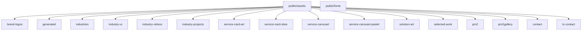
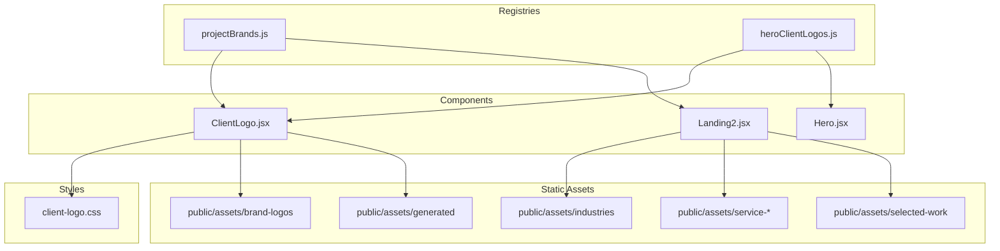
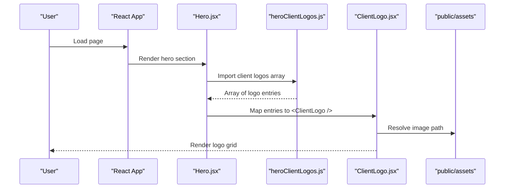
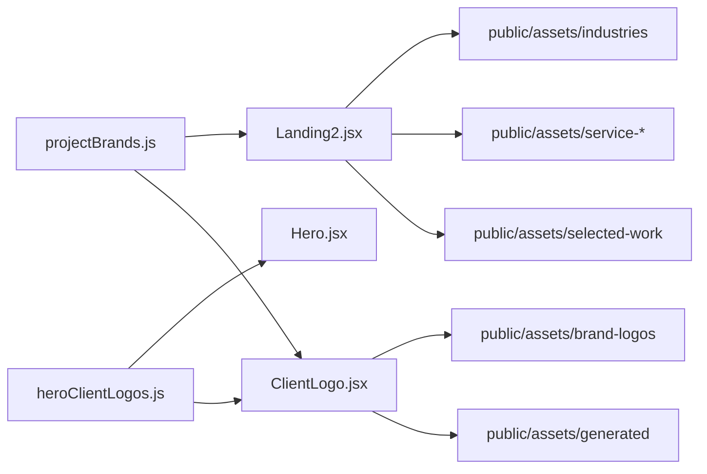

# Static Assets Organization

<cite>
**Referenced Files in This Document**
- [projectBrands.js](file://src/projectBrands.js)
- [heroClientLogos.js](file://src/heroClientLogos.js)
- [ClientLogo.jsx](file://src/ClientLogo.jsx)
- [client-logo.css](file://src/client-logo.css)
- [Landing2.jsx](file://src/landing/Landing2.jsx)
- [Hero.jsx](file://src/landing/Hero.jsx)
- [servicesData.js](file://src/servicesData.js)
- [industries.js](file://src/industries.js)
</cite>

## Table of Contents
1. [Introduction](#introduction)
2. [Project Structure](#project-structure)
3. [Core Components](#core-components)
4. [Architecture Overview](#architecture-overview)
5. [Detailed Component Analysis](#detailed-component-analysis)
6. [Dependency Analysis](#dependency-analysis)
7. [Performance Considerations](#performance-considerations)
8. [Troubleshooting Guide](#troubleshooting-guide)
9. [Conclusion](#conclusion)
10. [Appendices](#appendices)

## Introduction
This document explains how static assets are organized and consumed in the PodiumMinds application, focusing on the public/assets directory and the JavaScript-based asset management system that dynamically loads client logos and brand assets. It provides clear guidelines for organizing new assets, naming conventions, and maintaining consistency across the asset library.

## Project Structure
The static assets live under public/assets/. The structure is organized by purpose:
- Brand and client identity assets (brand-logos, generated content)
- Industry materials (industries, industry-ui, industry-videos, industry-projects)
- Service showcases (service-card-art, service-card-sites, service-carousel, service-carousel-pastel, solution-art)
- Client portfolios and selected work (selected-work, pm2, pm2gallery)
- Contact-related visuals (contact, tc-contact)
- Fonts (public/fonts)

**Diagram sources**
- [projectBrands.js:1-200](file://src/projectBrands.js#L1-L200)
- [heroClientLogos.js:1-200](file://src/heroClientLogos.js#L1-L200)

**Section sources**
- [projectBrands.js:1-200](file://src/projectBrands.js#L1-L200)
- [heroClientLogos.js:1-200](file://src/heroClientLogos.js#L1-L200)

## Core Components
The dynamic loading of brand and client assets is driven by two primary modules:
- projectBrands.js: Central registry of brand assets used across projects and pages.
- heroClientLogos.js: Registry of client logos rendered in hero sections and related components.

These registries are consumed by React components such as ClientLogo.jsx and landing page components like Landing2.jsx and Hero.jsx. Styling for logo grids and carousels is centralized in client-logo.css.

Key responsibilities:
- Define asset metadata (paths, alt text, links).
- Provide arrays or objects consumed by UI components to render images and links.
- Keep asset paths consistent with the public/assets directory layout.

**Section sources**
- [projectBrands.js:1-200](file://src/projectBrands.js#L1-L200)
- [heroClientLogos.js:1-200](file://src/heroClientLogos.js#L1-L200)
- [ClientLogo.jsx:1-200](file://src/ClientLogo.jsx#L1-L200)
- [client-logo.css:1-200](file://src/client-logo.css#L1-L200)
- [Landing2.jsx:1-200](file://src/landing/Landing2.jsx#L1-L200)
- [Hero.jsx:1-200](file://src/landing/Hero.jsx#L1-L200)

## Architecture Overview
The asset architecture follows a simple pattern:
- Registries (JavaScript files) define structured data about assets.
- Components consume these registries to render images and links.
- CSS modules provide consistent styling for grids and carousels.
- Static files reside under public/assets/ and are referenced via relative paths from the registries.

**Diagram sources**
- [projectBrands.js:1-200](file://src/projectBrands.js#L1-L200)
- [heroClientLogos.js:1-200](file://src/heroClientLogos.js#L1-L200)
- [ClientLogo.jsx:1-200](file://src/ClientLogo.jsx#L1-L200)
- [client-logo.css:1-200](file://src/client-logo.css#L1-L200)
- [Landing2.jsx:1-200](file://src/landing/Landing2.jsx#L1-L200)
- [Hero.jsx:1-200](file://src/landing/Hero.jsx#L1-L200)

## Detailed Component Analysis

### Asset Registries
- projectBrands.js
  - Purpose: Centralized list of brand assets used across multiple pages and components.
  - Typical fields: id, name, path, link, altText, category.
  - Usage: Imported by landing and services pages to render brand galleries and case studies.
- heroClientLogos.js
  - Purpose: Curated set of client logos for hero sections and trust signals.
  - Typical fields: id, name, path, link, altText.
  - Usage: Consumed by Hero.jsx and ClientLogo.jsx to render responsive logo grids.

Guidelines:
- Keep entries sorted alphabetically by name for maintainability.
- Use stable IDs and avoid changing paths without updating references.
- Ensure altText is descriptive and accessible.

**Section sources**
- [projectBrands.js:1-200](file://src/projectBrands.js#L1-L200)
- [heroClientLogos.js:1-200](file://src/heroClientLogos.js#L1-L200)

### Logo Rendering Component
- ClientLogo.jsx
  - Purpose: Renders a single logo item with image, optional link, and hover behavior.
  - Props: Typically includes src, alt, link, size, and style overrides.
  - Integration: Used within lists provided by registries; styled via client-logo.css.

Best practices:
- Always provide meaningful alt text.
- Wrap images in anchor tags only when link is present.
- Respect aspect ratios defined in styles.

**Section sources**
- [ClientLogo.jsx:1-200](file://src/ClientLogo.jsx#L1-L200)
- [client-logo.css:1-200](file://src/client-logo.css#L1-L200)

### Landing Page Integration
- Landing2.jsx
  - Purpose: Aggregates industry, service, and portfolio assets into landing sections.
  - Data sources: May import servicesData.js and industries.js for contextual content.
  - Asset usage: References directories under public/assets for images and videos.

- Hero.jsx
  - Purpose: Displays hero content including client logos and brand highlights.
  - Data sources: Uses heroClientLogos.js for logo rendering.

**Section sources**
- [Landing2.jsx:1-200](file://src/landing/Landing2.jsx#L1-L200)
- [Hero.jsx:1-200](file://src/landing/Hero.jsx#L1-L200)
- [servicesData.js:1-200](file://src/servicesData.js#L1-L200)
- [industries.js:1-200](file://src/industries.js#L1-L200)

### Directory-Specific Guidelines

#### brand-logos
- Purpose: Official brand marks and variations for clients and partners.
- Subfolders: Organize by client or partner (e.g., fictional).
- Naming: lowercase-with-dashes.svg or .png; include version suffix if needed (e.g., v2).
- Usage: Referenced by projectBrands.js and heroClientLogos.js.

#### generated
- Purpose: Auto-generated outputs (screenshots, exports, previews).
- Naming: Include source identifier and timestamp or hash for uniqueness.
- Maintenance: Clean up stale files regularly; reference via registries only when needed.

#### industries
- Purpose: Visuals and media for industry verticals (cards, backgrounds, icons).
- Naming: industry-name-category.ext (e.g., healthcare-hero.jpg).
- Usage: Referenced by landing pages and industry-specific components.

#### industry-ui
- Purpose: UI elements specific to industry pages (icons, badges, illustrations).
- Naming: industry-ui-[element].svg or .png.
- Usage: Imported by industry components and templates.

#### industry-videos
- Purpose: Video assets for industry showcases.
- Naming: industry-[name]-[type].mp4 or webm.
- Usage: Embedded via video components; ensure proper formats and fallbacks.

#### industry-projects
- Purpose: Case study assets tied to industry segments.
- Naming: industry-project-[id]-[asset-type].ext.
- Usage: Linked from project detail pages and galleries.

#### service-card-art / service-card-sites
- Purpose: Artwork and site screenshots for service cards.
- Naming: service-[name]-art.jpg or service-[name]-site.png.
- Usage: Rendered in service listings and detail views.

#### service-carousel / service-carousel-pastel
- Purpose: Carousel assets for service highlights (standard and pastel variants).
- Naming: carousel-service-[name]-[variant].jpg.
- Usage: Loaded by carousel components on landing and services pages.

#### solution-art
- Purpose: Illustrations and diagrams for solutions.
- Naming: solution-[title]-[type].svg or .png.
- Usage: Embedded in solution sections and marketing pages.

#### selected-work / pm2 / pm2gallery
- Purpose: Portfolio pieces and curated collections.
- Naming: work-[client]-[project]-[asset].ext; gallery items grouped by project.
- Usage: Displayed in portfolio galleries and case studies.

#### contact / tc-contact
- Purpose: Contact form visuals and thank-you confirmations.
- Naming: contact-[state].jpg or png.
- Usage: Shown during form interactions and success states.

**Section sources**
- [projectBrands.js:1-200](file://src/projectBrands.js#L1-L200)
- [heroClientLogos.js:1-200](file://src/heroClientLogos.js#L1-L200)
- [Landing2.jsx:1-200](file://src/landing/Landing2.jsx#L1-L200)
- [Hero.jsx:1-200](file://src/landing/Hero.jsx#L1-L200)

### Dynamic Loading Flow
The typical flow for rendering client logos in the hero section:

**Diagram sources**
- [Hero.jsx:1-200](file://src/landing/Hero.jsx#L1-L200)
- [heroClientLogos.js:1-200](file://src/heroClientLogos.js#L1-L200)
- [ClientLogo.jsx:1-200](file://src/ClientLogo.jsx#L1-L200)

## Dependency Analysis
The following diagram shows how registries feed into components and which asset directories are commonly referenced.

**Diagram sources**
- [projectBrands.js:1-200](file://src/projectBrands.js#L1-L200)
- [heroClientLogos.js:1-200](file://src/heroClientLogos.js#L1-L200)
- [ClientLogo.jsx:1-200](file://src/ClientLogo.jsx#L1-L200)
- [Landing2.jsx:1-200](file://src/landing/Landing2.jsx#L1-L200)
- [Hero.jsx:1-200](file://src/landing/Hero.jsx#L1-L200)

**Section sources**
- [projectBrands.js:1-200](file://src/projectBrands.js#L1-L200)
- [heroClientLogos.js:1-200](file://src/heroClientLogos.js#L1-L200)
- [ClientLogo.jsx:1-200](file://src/ClientLogo.jsx#L1-L200)
- [Landing2.jsx:1-200](file://src/landing/Landing2.jsx#L1-L200)
- [Hero.jsx:1-200](file://src/landing/Hero.jsx#L1-L200)

## Performance Considerations
- Prefer vector formats (SVG) for logos and icons where possible to reduce file size and improve scalability.
- Use appropriate raster formats (WebP, AVIF) for photos and screenshots to balance quality and performance.
- Implement lazy loading for large galleries and off-screen assets.
- Cache long-lived assets using immutable filenames or versioning to leverage browser caching.
- Avoid referencing unused assets in registries to keep bundle manifests lean.

## Troubleshooting Guide
Common issues and resolutions:
- Broken image links
  - Verify asset exists at the referenced path under public/assets.
  - Check registry entries for typos in file names or directories.
- Incorrect alt text or missing accessibility attributes
  - Ensure every image has descriptive altText in the registry.
- Inconsistent sizing or cropping
  - Confirm component props match expected aspect ratios; adjust styles in client-logo.css if necessary.
- Stale generated assets
  - Remove outdated files from generated and update registries accordingly.

**Section sources**
- [client-logo.css:1-200](file://src/client-logo.css#L1-L200)
- [ClientLogo.jsx:1-200](file://src/ClientLogo.jsx#L1-L200)
- [projectBrands.js:1-200](file://src/projectBrands.js#L1-L200)
- [heroClientLogos.js:1-200](file://src/heroClientLogos.js#L1-L200)

## Conclusion
A well-organized static asset strategy improves maintainability, performance, and developer experience. By centralizing asset metadata in registries, standardizing naming conventions, and keeping directory structures aligned with feature areas, the PodiumMinds application ensures consistent delivery of brand and client visuals across all pages.

## Appendices

### Naming Conventions
- Lowercase with dashes for multi-word names (e.g., client-logo-primary.svg).
- Include type or variant suffixes when needed (e.g., -dark, -v2).
- For generated assets, append timestamps or hashes to prevent collisions.

### Adding New Assets
- Place files in the appropriate public/assets subdirectory based on purpose.
- Update the relevant registry (projectBrands.js or heroClientLogos.js) with a new entry.
- Reference the asset in components via the registry rather than hardcoding paths.
- Validate accessibility by providing meaningful altText.

### Maintenance Checklist
- Periodically audit registries for unused entries.
- Normalize file formats and compress assets.
- Review altText and link targets for accuracy.
- Ensure consistent naming and folder organization.