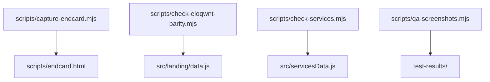
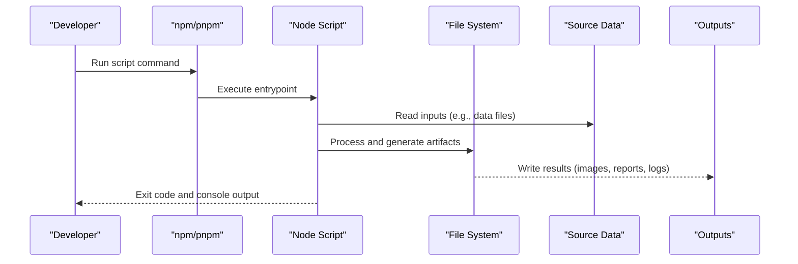
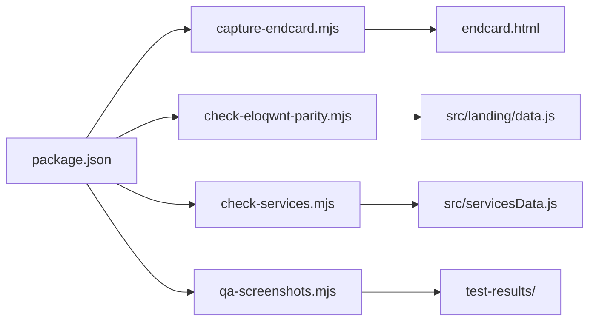

# Build Scripts and Automation

<cite>
**Referenced Files in This Document**
- [capture-endcard.mjs](file://scripts/capture-endcard.mjs)
- [check-eloqwnt-parity.mjs](file://scripts/check-eloqwnt-parity.mjs)
- [check-services.mjs](file://scripts/check-services.mjs)
- [qa-screenshots.mjs](file://scripts/qa-screenshots.mjs)
- [endcard.html](file://scripts/endcard.html)
- [package.json](file://package.json)
</cite>

## Table of Contents
1. [Introduction](#introduction)
2. [Project Structure](#project-structure)
3. [Core Components](#core-components)
4. [Architecture Overview](#architecture-overview)
5. [Detailed Component Analysis](#detailed-component-analysis)
6. [Dependency Analysis](#dependency-analysis)
7. [Performance Considerations](#performance-considerations)
8. [Troubleshooting Guide](#troubleshooting-guide)
9. [Conclusion](#conclusion)

## Introduction
This document explains the build automation scripts and quality assurance tools located under the scripts directory. It covers:
- End card generation for marketing assets
- Feature parity checks between feature sets
- Service validation to ensure service definitions are consistent
- Automated screenshot capture for QA regression testing

It also provides usage instructions, outputs, customization options, and troubleshooting guidance to integrate these scripts into your development workflow.

## Project Structure
The scripts directory contains Node.js (ESM) utilities that automate common tasks across the project. The end card generator uses a dedicated HTML template to render final assets.

**Diagram sources**
- [capture-endcard.mjs](file://scripts/capture-endcard.mjs)
- [endcard.html](file://scripts/endcard.html)
- [check-eloqwnt-parity.mjs](file://scripts/check-eloqwnt-parity.mjs)
- [check-services.mjs](file://scripts/check-services.mjs)
- [qa-screenshots.mjs](file://scripts/qa-screenshots.mjs)
- [data.js](file://src/landing/data.js)
- [servicesData.js](file://src/servicesData.js)

**Section sources**
- [capture-endcard.mjs](file://scripts/capture-endcard.mjs)
- [check-eloqwnt-parity.mjs](file://scripts/check-eloqwnt-parity.mjs)
- [check-services.mjs](file://scripts/check-services.mjs)
- [qa-screenshots.mjs](file://scripts/qa-screenshots.mjs)
- [endcard.html](file://scripts/endcard.html)

## Core Components
- End Card Generator: Renders an end card asset using a template and optional configuration.
- ELOQWNT Parity Checker: Compares feature lists or content sets to ensure parity across variants.
- Services Validator: Validates service definitions for consistency and completeness.
- QA Screenshots Runner: Captures screenshots of key pages/components for visual regression checks.

These scripts are designed to be run from the repository root with Node.js and any required dependencies installed.

**Section sources**
- [capture-endcard.mjs](file://scripts/capture-endcard.mjs)
- [check-eloqwnt-parity.mjs](file://scripts/check-eloqwnt-parity.mjs)
- [check-services.mjs](file://scripts/check-services.mjs)
- [qa-screenshots.mjs](file://scripts/qa-screenshots.mjs)

## Architecture Overview
The scripts operate as standalone CLI utilities. They read source data or templates, perform processing, and write outputs to well-known directories. Some scripts may depend on local modules under src for data structures.

[No sources needed since this diagram shows conceptual workflow, not actual code structure]

## Detailed Component Analysis

### End Card Generator (capture-endcard.mjs)
Purpose:
- Generate end card images or assets by rendering a template with provided configuration.

How it works:
- Loads the end card HTML template.
- Applies configuration (e.g., title, subtitle, branding).
- Renders the final asset to an output location.

Usage:
- Run directly with Node.js or via npm/pnpm scripts if configured.
- Typical invocation includes flags or environment variables for customization.

Outputs:
- Generated end card assets written to a designated folder.
- Console logs indicating success or errors.

Customization:
- Template variables can be adjusted via arguments or environment variables.
- Output path and filename patterns can be configured.

Integration:
- Can be added to pre-publish or CI steps to regenerate assets when content changes.

Troubleshooting:
- If rendering fails, verify the template exists and all required variables are provided.
- Check file permissions for the output directory.

**Section sources**
- [capture-endcard.mjs](file://scripts/capture-endcard.mjs)
- [endcard.html](file://scripts/endcard.html)

### ELOQWNT Parity Checker (check-eloqwnt-parity.mjs)
Purpose:
- Ensure feature parity between different content sets or feature branches.

How it works:
- Reads feature lists or content arrays from source data.
- Compares keys or identifiers across datasets.
- Reports missing or extra items and returns a non-zero exit code on mismatch.

Usage:
- Run locally before merging or publishing to catch regressions early.
- Integrate into CI to block merges when parity is broken.

Outputs:
- Summary report listing differences.
- Exit code indicates pass/fail status.

Customization:
- Specify which datasets to compare via arguments or config.
- Adjust strictness (e.g., ignore ordering vs. exact match).

Integration:
- Add to pre-commit hooks or CI pipelines to enforce parity.

Troubleshooting:
- If parity fails unexpectedly, review recent changes to the compared datasets.
- Use verbose logging to identify specific mismatches.

**Section sources**
- [check-eloqwnt-parity.mjs](file://scripts/check-eloqwnt-parity.mjs)
- [data.js](file://src/landing/data.js)

### Services Validator (check-services.mjs)
Purpose:
- Validate service definitions for consistency, required fields, and completeness.

How it works:
- Loads service data from the services module.
- Validates schema constraints and business rules.
- Aggregates errors and prints a summary.

Usage:
- Run during development to catch invalid service entries.
- Include in CI to prevent bad service configurations from being deployed.

Outputs:
- Validation report with error details.
- Non-zero exit code when validation fails.

Customization:
- Toggle validation strictness.
- Provide alternate data sources for testing.

Integration:
- Hook into linting or build steps to fail fast on invalid services.

Troubleshooting:
- Review reported field-level errors and correct the service entries.
- Ensure the services module exports the expected shape.

**Section sources**
- [check-services.mjs](file://scripts/check-services.mjs)
- [servicesData.js](file://src/servicesData.js)

### QA Screenshots Runner (qa-screenshots.mjs)
Purpose:
- Capture automated screenshots of key pages or components for visual regression testing.

How it works:
- Starts or connects to a running application instance.
- Navigates to specified URLs or renders components headlessly.
- Saves screenshots to a test results directory.

Usage:
- Ensure the app is built and served before running.
- Configure viewport sizes and target routes.

Outputs:
- Screenshot images saved under test-results.
- Optional diff reports against baseline images.

Customization:
- Set device profiles, page load timeouts, and output paths.
- Filter targets by tags or route patterns.

Integration:
- Run in CI to detect visual regressions.
- Compare new screenshots with baselines to flag changes.

Troubleshooting:
- Verify the app server is reachable and loads without errors.
- Increase timeouts for slow-loading pages.
- Ensure the output directory is writable.

**Section sources**
- [qa-screenshots.mjs](file://scripts/qa-screenshots.mjs)

## Dependency Analysis
Scripts rely on:
- Local source data modules for content and configuration.
- File system operations for reading templates and writing outputs.
- Potentially external tooling (e.g., headless browser) for screenshot capture.

**Diagram sources**
- [package.json](file://package.json)
- [capture-endcard.mjs](file://scripts/capture-endcard.mjs)
- [endcard.html](file://scripts/endcard.html)
- [check-eloqwnt-parity.mjs](file://scripts/check-eloqwnt-parity.mjs)
- [check-services.mjs](file://scripts/check-services.mjs)
- [qa-screenshots.mjs](file://scripts/qa-screenshots.mjs)
- [data.js](file://src/landing/data.js)
- [servicesData.js](file://src/servicesData.js)

**Section sources**
- [package.json](file://package.json)
- [capture-endcard.mjs](file://scripts/capture-endcard.mjs)
- [check-eloqwnt-parity.mjs](file://scripts/check-eloqwnt-parity.mjs)
- [check-services.mjs](file://scripts/check-services.mjs)
- [qa-screenshots.mjs](file://scripts/qa-screenshots.mjs)

## Performance Considerations
- Batch operations: Where possible, process multiple items in parallel to reduce total runtime.
- Caching: Cache rendered templates or parsed data to avoid repeated I/O.
- Headless rendering: Limit concurrent browser instances to avoid resource exhaustion.
- Incremental runs: Only regenerate assets when inputs change.

[No sources needed since this section provides general guidance]

## Troubleshooting Guide
Common issues and resolutions:
- Missing dependencies: Install project dependencies before running scripts.
- Permission errors: Ensure output directories exist and are writable.
- Network timeouts: Increase timeouts for screenshot capture or remote resources.
- Data mismatches: Review source data files for inconsistencies flagged by parity or validation scripts.
- Template errors: Confirm all required variables are provided to the end card template.

Operational tips:
- Use verbose logging flags where available.
- Pin versions of external tooling to avoid flaky behavior.
- Keep baseline screenshots updated after intentional UI changes.

**Section sources**
- [capture-endcard.mjs](file://scripts/capture-endcard.mjs)
- [check-eloqwnt-parity.mjs](file://scripts/check-eloqwnt-parity.mjs)
- [check-services.mjs](file://scripts/check-services.mjs)
- [qa-screenshots.mjs](file://scripts/qa-screenshots.mjs)

## Conclusion
These scripts streamline repetitive tasks and improve quality by automating asset generation, enforcing feature parity, validating service definitions, and capturing visual regressions. Integrating them into local workflows and CI ensures consistent outputs and early detection of issues. Customize parameters to fit your team’s needs and maintain clear documentation for contributors.