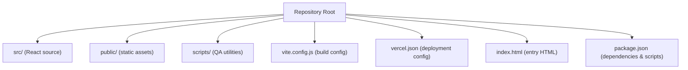
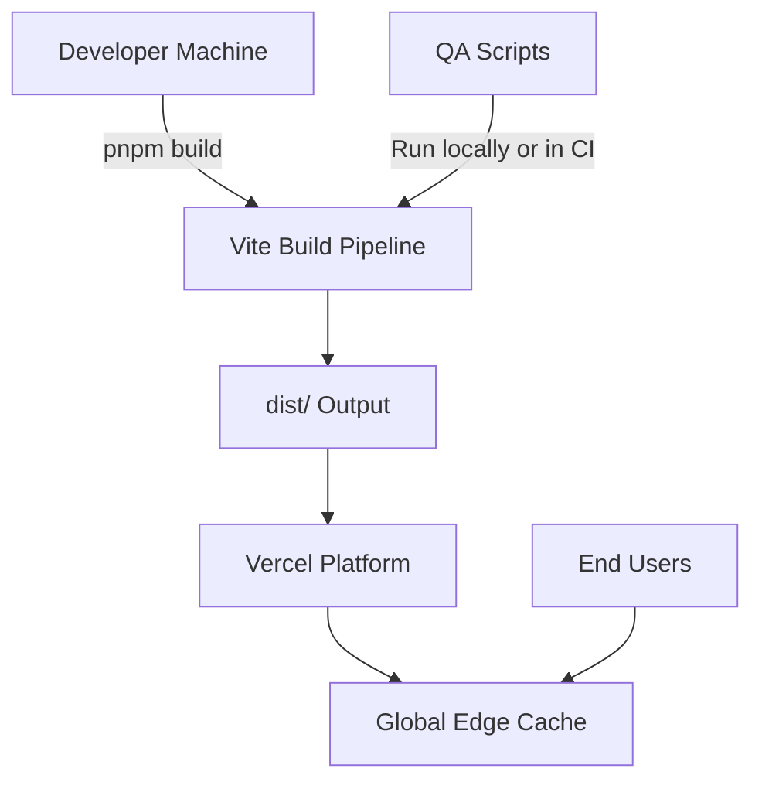
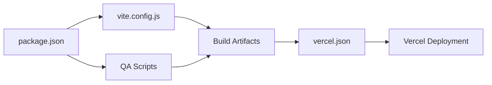

# Build and Deployment

<cite>
**Referenced Files in This Document**
- [package.json](file://package.json)
- [vite.config.js](file://vite.config.js)
- [vercel.json](file://vercel.json)
- [index.html](file://index.html)
- [README.md](file://README.md)
- [scripts/capture-endcard.mjs](file://scripts/capture-endcard.mjs)
- [scripts/check-eloqwnt-parity.mjs](file://scripts/check-eloqwnt-parity.mjs)
- [scripts/check-services.mjs](file://scripts/check-services.mjs)
- [scripts/qa-screenshots.mjs](file://scripts/qa-screenshots.mjs)
</cite>

## Table of Contents
1. [Introduction](#introduction)
2. [Project Structure](#project-structure)
3. [Core Components](#core-components)
4. [Architecture Overview](#architecture-overview)
5. [Detailed Component Analysis](#detailed-component-analysis)
6. [Dependency Analysis](#dependency-analysis)
7. [Performance Considerations](#performance-considerations)
8. [Troubleshooting Guide](#troubleshooting-guide)
9. [Conclusion](#conclusion)
10. [Appendices](#appendices)

## Introduction
This document provides comprehensive build and deployment guidance for the PodiumMinds application. It covers Vite build configuration, optimization settings, plugin usage, bundle analysis, and end-to-end deployment to Vercel including environment configuration, custom domains, and CI/CD pipelines. It also documents QA scripts for testing, screenshot capture, and quality assurance, along with performance optimization strategies and production best practices.

## Project Structure
The repository follows a standard Vite + React layout with additional tooling for QA and deployment:
- Root configuration files define build and deployment behavior.
- Source code resides under src/, organized by feature and assets.
- Static assets are served from public/.
- Scripts under scripts/ support QA workflows such as screenshots and parity checks.
- Vercel deployment is configured via vercel.json.

[No sources needed since this diagram shows conceptual workflow, not actual code structure]

## Core Components
- Build system: Vite with a dedicated configuration file for optimizations and plugins.
- Entry point: index.html bootstraps the React app.
- Deployment target: Vercel, configured via vercel.json.
- QA tooling: Node scripts for automated testing, screenshot capture, and content parity checks.

Key responsibilities:
- vite.config.js defines build targets, optimization flags, plugins, and output behavior.
- vercel.json controls serverless routing, headers, rewrites, and environment variable mapping.
- package.json centralizes dependency management and exposes npm/pnpm scripts for local dev, build, and QA tasks.
- index.html initializes the client-side app and references the built entry.

**Section sources**
- [vite.config.js](file://vite.config.js)
- [vercel.json](file://vercel.json)
- [package.json](file://package.json)
- [index.html](file://index.html)

## Architecture Overview
The application uses a static-site architecture powered by Vite and deployed to Vercel’s edge network. The build pipeline compiles and optimizes assets, while Vercel serves the resulting static files globally. QA scripts run locally or in CI to validate UI and content consistency.

[No sources needed since this diagram shows conceptual workflow, not actual code structure]

## Detailed Component Analysis

### Vite Build Configuration
The build configuration centralizes optimization and plugin setup. Typical areas covered include:
- Build targets and minification settings
- Asset handling and image optimization
- Code splitting and chunk naming
- Plugins for CSS processing, fonts, and asset optimization
- Environment variables injection into the client bundle
- Bundle analysis integration (e.g., rollup-plugin-visualizer)

Recommended checklist:
- Ensure production builds enable minification and tree-shaking.
- Configure asset preloading and prefetching where appropriate.
- Use deterministic chunk names for long-term caching.
- Inject only necessary environment variables to the client.
- Integrate a visualizer to analyze bundle composition during builds.

**Section sources**
- [vite.config.js](file://vite.config.js)

### Vercel Deployment Configuration
Deployment is driven by vercel.json, which typically includes:
- Rewrites and redirects for SPA routing
- Headers for security, caching, and performance
- Build command overrides if needed
- Environment variable mappings for runtime use
- Framework detection and output directory targeting

Best practices:
- Define explicit rewrites for client-side routes.
- Set cache-control headers for static assets and API responses.
- Keep build commands minimal; rely on Vercel’s framework detection when possible.
- Map environment variables securely through Vercel’s dashboard or CI secrets.

**Section sources**
- [vercel.json](file://vercel.json)

### Package Scripts and Workflows
package.json should expose scripts for:
- Development server
- Production build
- Linting and type checks
- QA tasks (screenshots, parity checks)
- Optional bundle analysis

Example script categories:
- dev: Start local development server
- build: Run optimized production build
- preview: Preview production build locally
- lint/typecheck: Quality gates before build
- qa:*: Screenshot capture and content validation

Ensure consistent lockfiles and install commands across environments.

**Section sources**
- [package.json](file://package.json)

### QA Scripts
The scripts directory contains Node-based utilities for QA:
- capture-endcard.mjs: Captures end-card visuals for review
- check-eloqwnt-parity.mjs: Validates fidelity against reference designs
- check-services.mjs: Verifies services page content and links
- qa-screenshots.mjs: Orchestrates full-page or section screenshots

Usage patterns:
- Run locally after building to validate UI changes
- Integrate into CI to enforce visual regression and content parity
- Generate artifacts for review and audit trails

Operational notes:
- Pin browser versions for reproducible screenshots
- Use headless execution in CI
- Store screenshots deterministically and diff against baselines

**Section sources**
- [scripts/capture-endcard.mjs](file://scripts/capture-endcard.mjs)
- [scripts/check-eloqwnt-parity.mjs](file://scripts/check-eloqwnt-parity.mjs)
- [scripts/check-services.mjs](file://scripts/check-services.mjs)
- [scripts/qa-screenshots.mjs](file://scripts/qa-screenshots.mjs)

### Application Entry Point
index.html initializes the React application and loads the built entry. Ensure:
- Correct base path for deployments under subpaths
- Proper meta tags for SEO and social sharing
- Minimal inline code to reduce initial payload

**Section sources**
- [index.html](file://index.html)

## Dependency Analysis
At a high level:
- Vite orchestrates the build and development experience.
- React powers the UI layer.
- Vercel hosts and serves the final static output.
- QA scripts depend on Node.js and may use headless browsers or HTTP clients.

[No sources needed since this diagram shows conceptual workflow, not actual code structure]

**Section sources**
- [package.json](file://package.json)
- [vite.config.js](file://vite.config.js)
- [vercel.json](file://vercel.json)

## Performance Considerations
Optimization strategies:
- Enable production minification and dead-code elimination.
- Configure code splitting at route or component boundaries.
- Preload critical resources and defer non-critical ones.
- Optimize images and fonts; consider next-gen formats.
- Use deterministic filenames for long-term caching.
- Analyze bundle size regularly and remove unused dependencies.
- Prefer lazy loading for heavy components and media.

Bundle analysis:
- Integrate a visualizer to identify large modules and vendor bloat.
- Track trends over time to prevent regressions.
- Focus on reducing first-contentful paint and total blocking time.

Caching and delivery:
- Leverage Vercel’s global edge cache.
- Set appropriate cache-control headers for immutable assets.
- Use CDN-friendly URLs and avoid query strings for static assets.

[No sources needed since this section provides general guidance]

## Troubleshooting Guide
Common issues and resolutions:
- Missing environment variables: Ensure they are set in Vercel’s dashboard or CI secrets and mapped in vercel.json if required.
- SPA routing errors: Verify rewrites in vercel.json to direct unknown routes to the index file.
- Asset 404s: Confirm base path and public folder usage; ensure paths match build output.
- Large bundles: Use bundle analysis to locate oversized dependencies and replace with lighter alternatives.
- Inconsistent screenshots: Pin browser versions and viewport sizes; run in headless mode in CI.
- Build failures: Validate Node version compatibility and lockfile integrity; clear caches between runs.

Environment configuration:
- Separate client and server variables; only inject what the client needs.
- Use .env files for local development and platform-specific secret managers for production.
- Avoid committing secrets; prefer CI/CD secret stores.

**Section sources**
- [vercel.json](file://vercel.json)
- [package.json](file://package.json)

## Conclusion
By centralizing build configuration in Vite, enforcing quality with QA scripts, and deploying to Vercel with explicit configuration, the PodiumMinds application achieves a reliable, performant, and maintainable delivery pipeline. Regular bundle analysis, strict environment management, and CI-integrated QA will keep the product stable and fast as it evolves.

[No sources needed since this section summarizes without analyzing specific files]

## Appendices

### Build and Deployment Checklist
- Local development:
  - Install dependencies and start dev server
  - Verify hot reload and environment variables
- Pre-build:
  - Run linters and type checks
  - Execute QA scripts locally
- Build:
  - Produce optimized artifacts
  - Inspect bundle report
- Deploy:
  - Push to main branch or trigger CI
  - Verify environment variables and domain settings
  - Post-deploy smoke tests and screenshot diffs

### Environment Variables
- Client-only variables must be explicitly exposed to the browser by the build tool.
- Server-only variables should never be injected into the client bundle.
- Use distinct values per environment (dev, staging, prod).

### Custom Domain Setup (Vercel)
- Add a custom domain in the Vercel dashboard.
- Configure DNS records as instructed by Vercel.
- Enable HTTPS and verify propagation.
- Test rewrites and headers on the live domain.

### CI/CD Pipelines
- Trigger builds on pull requests and merges.
- Cache dependencies to speed up builds.
- Run QA scripts and fail the pipeline on regressions.
- Promote builds to production via approvals or branch rules.

[No sources needed since this section provides general guidance]