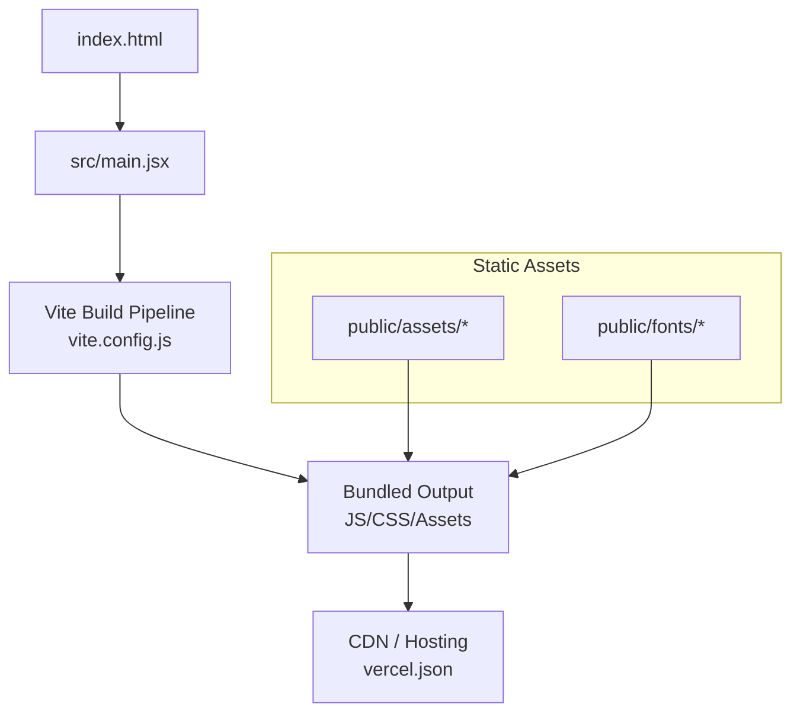
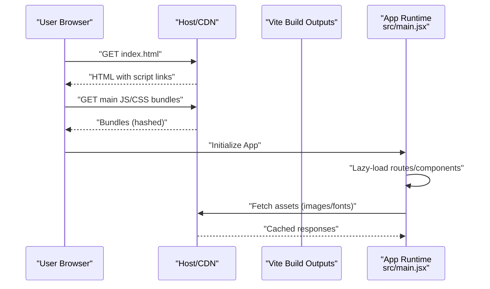
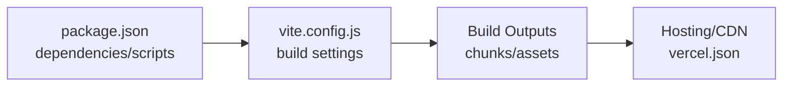

# Performance Optimization and Bundle Analysis

<cite>
**Referenced Files in This Document**
- [vite.config.js](file://vite.config.js)
- [package.json](file://package.json)
- [index.html](file://index.html)
- [src/main.jsx](file://src/main.jsx)
- [vercel.json](file://vercel.json)
</cite>

## Table of Contents
1. [Introduction](#introduction)
2. [Project Structure](#project-structure)
3. [Core Components](#core-components)
4. [Architecture Overview](#architecture-overview)
5. [Detailed Component Analysis](#detailed-component-analysis)
6. [Dependency Analysis](#dependency-analysis)
7. [Performance Considerations](#performance-considerations)
8. [Troubleshooting Guide](#troubleshooting-guide)
9. [Conclusion](#conclusion)
10. [Appendices](#appendices)

## Introduction
This document provides a comprehensive performance optimization guide for the PodiumMinds application. It covers bundle size analysis, code splitting strategies, lazy loading implementation, asset optimization techniques (images, fonts), caching strategies, Vite’s built-in optimizations, performance monitoring, metrics collection, profiling techniques, common bottlenecks with solutions, and best practices to maintain optimal performance.

## Project Structure
The project is a Vite-based frontend application with:
- Build configuration in vite.config.js
- Application entry point in src/main.jsx
- Static assets under public/ (including images and fonts)
- Deployment configuration in vercel.json
- Package metadata and scripts in package.json
- HTML shell in index.html

**Diagram sources**
- [index.html:1-50](file://index.html#L1-L50)
- [src/main.jsx:1-50](file://src/main.jsx#L1-L50)
- [vite.config.js:1-200](file://vite.config.js#L1-L200)
- [vercel.json:1-100](file://vercel.json#L1-L100)

**Section sources**
- [index.html:1-50](file://index.html#L1-L50)
- [src/main.jsx:1-50](file://src/main.jsx#L1-L50)
- [vite.config.js:1-200](file://vite.config.js#L1-L200)
- [vercel.json:1-100](file://vercel.json#L1-L100)

## Core Components
- Build system: Vite with custom configuration in vite.config.js
- Entry point: src/main.jsx bootstraps the app
- Static assets: public/assets and public/fonts
- Deployment: vercel.json for hosting and caching headers
- Dependencies and scripts: package.json

Key areas to focus on for performance:
- Code splitting and dynamic imports
- Asset pipeline (images, fonts)
- Caching and HTTP headers
- Monitoring and profiling integration

**Section sources**
- [vite.config.js:1-200](file://vite.config.js#L1-L200)
- [src/main.jsx:1-50](file://src/main.jsx#L1-L50)
- [package.json:1-200](file://package.json#L1-L200)
- [vercel.json:1-100](file://vercel.json#L1-L100)

## Architecture Overview
The runtime architecture emphasizes fast initial load and efficient updates through Vite’s build-time optimizations and CDN-friendly outputs.

[No sources needed since this diagram shows conceptual workflow, not actual code structure]

## Detailed Component Analysis

### Build Configuration and Vite Optimizations
Focus areas:
- Enable production optimizations (minification, tree-shaking, chunking)
- Configure output naming for cache busting
- Optimize image and font processing
- Set up plugins for compression and analytics if needed

Recommended actions:
- Ensure minify is enabled for JS/CSS
- Use manual chunks for large libraries or feature modules
- Configure asset filename hashing for long-term caching
- Add image optimization plugin (e.g., sharp-based) for WebP/AVIF conversion
- Preload critical resources and defer non-critical ones

**Section sources**
- [vite.config.js:1-200](file://vite.config.js#L1-L200)

### Entry Point and Lazy Loading Strategy
Focus areas:
- Avoid heavy synchronous imports at startup
- Implement route-level and component-level lazy loading
- Use Suspense boundaries for better UX during async loads

Implementation patterns:
- Dynamic imports for routes and heavy components
- Prefetching hints for likely next interactions
- Splitting vendor libraries into separate chunks

**Section sources**
- [src/main.jsx:1-50](file://src/main.jsx#L1-L50)

### Asset Optimization (Images and Fonts)
Focus areas:
- Convert images to modern formats (WebP/AVIF) with fallbacks
- Use responsive images (sizes/srcset) where applicable
- Subset and preconnect fonts; use display=swap
- Serve fonts from CDN with proper caching

Actions:
- Integrate an image optimization plugin in Vite config
- Generate multiple sizes and formats for key images
- Apply font-display: swap and preload critical fonts
- Organize assets under public/assets with clear hierarchy

**Section sources**
- [vite.config.js:1-200](file://vite.config.js#L1-L200)

### Caching Strategies and Deployment Headers
Focus areas:
- Long-term caching for hashed assets
- Short-lived caching for index.html
- Cache-control and immutable flags for static assets
- CDN configuration via vercel.json

Actions:
- Configure cache headers for static assets (immutable, max-age)
- Ensure index.html has no-cache or short TTL
- Leverage service worker only if necessary; prefer native caching

**Section sources**
- [vercel.json:1-100](file://vercel.json#L1-L100)

### Bundle Size Analysis and Code Splitting
Focus areas:
- Identify large dependencies and unused code
- Split routes and heavy UI components
- Vendor chunking for third-party libraries
- Analyze bundle composition regularly

Tools and workflows:
- Use Vite’s bundle analyzer plugin to visualize chunk sizes
- Track regressions in CI by comparing bundle sizes
- Prefer tree-shakeable libraries and avoid default imports of entire packages

**Section sources**
- [vite.config.js:1-200](file://vite.config.js#L1-L200)
- [package.json:1-200](file://package.json#L1-L200)

### Performance Monitoring, Metrics, and Profiling
Focus areas:
- Collect real-user metrics (LCP, INP, CLS, TTFB)
- Instrument error tracking and slow requests
- Profile CPU and memory usage in development and staging

Recommendations:
- Integrate a lightweight analytics SDK for core web vitals
- Add performance mark/measure around critical paths
- Use browser DevTools Performance panel and Lighthouse CI
- Log resource timing for network waterfall analysis

**Section sources**
- [src/main.jsx:1-50](file://src/main.jsx#L1-L50)

## Dependency Analysis
Understand how dependencies impact bundle size and runtime performance.

**Diagram sources**
- [package.json:1-200](file://package.json#L1-L200)
- [vite.config.js:1-200](file://vite.config.js#L1-L200)
- [vercel.json:1-100](file://vercel.json#L1-L100)

**Section sources**
- [package.json:1-200](file://package.json#L1-L200)
- [vite.config.js:1-200](file://vite.config.js#L1-L200)
- [vercel.json:1-100](file://vercel.json#L1-L100)

## Performance Considerations
- Initial Load
  - Minimize critical CSS and JS
  - Defer non-critical scripts
  - Preload critical fonts and hero images
- Interactivity
  - Lazy-load heavy components and routes
  - Avoid long tasks on the main thread
  - Use requestIdleCallback or Web Workers for heavy work
- Network
  - Enable gzip/br compression
  - Use HTTP/2 or HTTP/3
  - Keep payload sizes small; compress images and fonts
- Caching
  - Hashed filenames for immutable caching
  - Proper cache-control headers per resource type
- Rendering
  - Reduce layout thrashing
  - Batch DOM updates
  - Virtualize long lists

[No sources needed since this section provides general guidance]

## Troubleshooting Guide
Common issues and resolutions:
- Large bundle size
  - Identify top contributors using bundle analyzer
  - Replace heavy libraries with lighter alternatives
  - Split routes and components; remove unused exports
- Slow Time to First Byte
  - Check server response times and CDN edge latency
  - Reduce HTML size; inline minimal critical CSS if needed
- Poor Largest Contentful Paint
  - Optimize hero images; serve WebP/AVIF
  - Preload critical resources; prioritize above-the-fold content
- High Interaction to Next Paint
  - Break up long tasks; debounce/throttle user input handlers
  - Offload heavy computations to Web Workers
- Cache misses
  - Verify cache headers and asset hashing
  - Ensure index.html is not cached aggressively

**Section sources**
- [vite.config.js:1-200](file://vite.config.js#L1-L200)
- [vercel.json:1-100](file://vercel.json#L1-L100)

## Conclusion
By applying Vite’s build-time optimizations, implementing strategic code splitting and lazy loading, optimizing images and fonts, and enforcing robust caching policies, the PodiumMinds application can achieve faster initial loads, smoother interactions, and lower bandwidth usage. Continuous monitoring and regular bundle analysis will help sustain performance over time.

[No sources needed since this section summarizes without analyzing specific files]

## Appendices

### Bundle Analysis Workflow
- Run local analysis with Vite bundle analyzer plugin
- Compare baseline vs current builds in CI
- Track regressions and alert on thresholds

**Section sources**
- [vite.config.js:1-200](file://vite.config.js#L1-L200)
- [package.json:1-200](file://package.json#L1-L200)

### Asset Optimization Checklist
- Convert images to WebP/AVIF with fallbacks
- Use responsive images and correct dimensions
- Subset fonts and apply display=swap
- Preconnect to font CDNs
- Organize assets under public/assets for clarity

**Section sources**
- [vite.config.js:1-200](file://vite.config.js#L1-L200)

### Caching Header Guidelines
- index.html: no-cache or short max-age
- Static assets (hashed): immutable, long max-age
- Fonts: immutable, long max-age
- API responses: appropriate cache-control based on data freshness

**Section sources**
- [vercel.json:1-100](file://vercel.json#L1-L100)