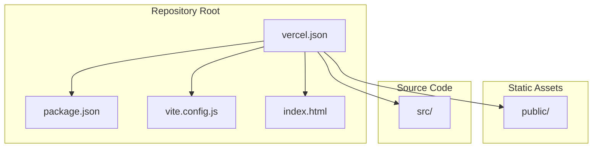
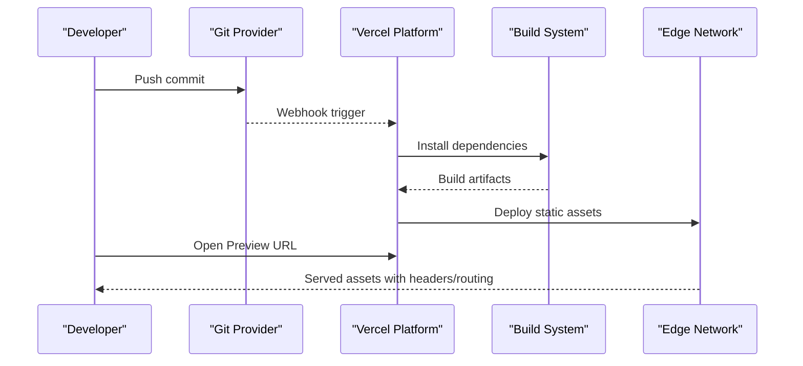
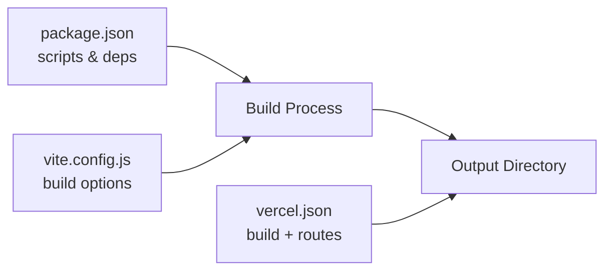

# Vercel Deployment Configuration

<cite>
**Referenced Files in This Document**
- [vercel.json](file://vercel.json)
- [package.json](file://package.json)
- [vite.config.js](file://vite.config.js)
- [index.html](file://index.html)
- [README.md](file://README.md)
</cite>

## Table of Contents
1. [Introduction](#introduction)
2. [Project Structure](#project-structure)
3. [Core Components](#core-components)
4. [Architecture Overview](#architecture-overview)
5. [Detailed Component Analysis](#detailed-component-analysis)
6. [Dependency Analysis](#dependency-analysis)
7. [Performance Considerations](#performance-considerations)
8. [Troubleshooting Guide](#troubleshooting-guide)
9. [Conclusion](#conclusion)
10. [Appendices](#appendices)

## Introduction
This document provides comprehensive deployment guidance for hosting the project on Vercel. It explains how to configure vercel.json, set up environment variables, define build settings and triggers, manage preview deployments versus production releases, configure custom domains and SSL, optimize performance, and handle troubleshooting, rollbacks, and monitoring. The content is tailored to a Vite-based frontend application with static assets and client-side routing considerations.

## Project Structure
The repository is a Vite-based frontend application with:
- A root configuration file for Vercel (vercel.json)
- Build and dependency metadata (package.json)
- Vite configuration (vite.config.js)
- Static assets under public/
- Source code under src/
- An entry HTML file at index.html

**Diagram sources**
- [vercel.json](file://vercel.json)
- [package.json](file://package.json)
- [vite.config.js](file://vite.config.js)
- [index.html](file://index.html)

**Section sources**
- [vercel.json](file://vercel.json)
- [package.json](file://package.json)
- [vite.config.js](file://vite.config.js)
- [index.html](file://index.html)

## Core Components
- Vercel configuration: vercel.json defines build commands, output directory, rewrites, redirects, headers, env injection, and framework detection.
- Build system: package.json scripts and dependencies drive the build; Vite config controls asset handling and base path.
- Entry point: index.html serves as the SPA entry for client-side routing.

Key responsibilities:
- vercel.json: Build settings, routing rules, environment variable injection, caching headers, and framework hints.
- package.json: Defines install and build scripts that Vercel executes during deployment.
- vite.config.js: Controls build output location and asset base paths to align with Vercel’s static serving behavior.
- index.html: Single-page application entry used by rewrites or fallbacks.

**Section sources**
- [vercel.json](file://vercel.json)
- [package.json](file://package.json)
- [vite.config.js](file://vite.config.js)
- [index.html](file://index.html)

## Architecture Overview
Vercel builds and deploys the app as a static site. The pipeline typically follows these steps:
- Install dependencies using package manager defined in the repository.
- Execute the build script from package.json.
- Publish the configured output directory to Vercel’s edge network.
- Apply routing rules (rewrites/redirects), headers, and environment variables.
- Serve the built assets globally via CDN with automatic HTTPS.

[No sources needed since this diagram shows conceptual workflow, not actual code structure]

## Detailed Component Analysis

### vercel.json Configuration
Purpose:
- Define build command and output directory.
- Configure routing rules (rewrites and redirects).
- Set HTTP headers for caching and security.
- Inject environment variables into the build/runtime.
- Specify framework detection and build settings.

Recommended sections to review and adjust:
- build: Command and output directory aligned with your build tooling.
- routes: Rewrites for SPA fallback to index.html; redirects for legacy URLs; header rules for cache control and security.
- env: Variables available at build time and/or runtime depending on usage.
- framework: Optional hint to enable framework-specific optimizations.

Important notes:
- Ensure the output directory matches what your build produces.
- For SPAs, add a rewrite rule that sends all non-file requests to index.html.
- Use headers to enforce long-lived caching for immutable assets and short cache for index.html if necessary.
- Environment variables should be managed via Vercel’s environment settings; vercel.json can declare defaults or build-time variables.

**Section sources**
- [vercel.json](file://vercel.json)

### Build Settings and Triggers
- Build command: Defined in vercel.json or inferred from package.json scripts.
- Output directory: Must match the build artifact folder.
- Framework detection: Can be explicitly set to skip auto-detection when needed.
- Triggers: Deployments are triggered by pushes to connected branches; preview deployments are created per pull request.

Best practices:
- Keep build commands deterministic and idempotent.
- Pin versions in lockfiles to ensure reproducible builds.
- Avoid heavy dev-only dependencies in production builds.

**Section sources**
- [vercel.json](file://vercel.json)
- [package.json](file://package.json)

### Routing Rules
Common patterns:
- SPA fallback: Rewrite all unmatched routes to index.html.
- Redirects: Map old URLs to new ones or external destinations.
- Headers: Cache policies, CORS, security headers.

SPA example pattern:
- Add a rewrite rule that forwards requests not matching existing files to index.html.

Headers example pattern:
- Long cache for hashed assets.
- No-store for index.html if you prefer server-driven updates.

**Section sources**
- [vercel.json](file://vercel.json)

### Environment Variables
- Build-time vs runtime: Choose based on whether variables are needed during build or only at runtime.
- Scope: Per-project, per-environment (development, preview, production).
- Injection: Variables can be injected into the build process or accessed at runtime depending on configuration.

Guidelines:
- Never commit secrets to version control.
- Use Vercel’s environment UI or CLI to manage sensitive values.
- Align variable names with those expected by your application and build scripts.

**Section sources**
- [vercel.json](file://vercel.json)

### Custom Domains and SSL
- Add custom domains in Vercel dashboard; DNS records must be configured at your registrar.
- SSL certificates are provisioned automatically once DNS is valid.
- Enforce HTTPS via redirects if needed.

Steps:
- Add domain in Vercel project settings.
- Update DNS (CNAME or A records) as instructed by Vercel.
- Wait for certificate provisioning; verify with browser or CLI.

**Section sources**
- [vercel.json](file://vercel.json)

### Performance Optimizations
- Asset caching: Use immutable filenames and long cache times for static assets.
- Compression: Enable gzip/brotli via headers if not handled by default.
- Minification and tree-shaking: Ensure enabled in build configuration.
- Image optimization: Prefer modern formats and lazy loading where applicable.
- Edge caching: Leverage Vercel’s global CDN; set appropriate cache-control headers.

**Section sources**
- [vercel.json](file://vercel.json)
- [vite.config.js](file://vite.config.js)

### Deployment Pipeline, Preview, and Production
- Preview deployments: Created automatically for each PR branch; isolated URLs for testing.
- Production deployments: Triggered by merging to the main branch or via manual deploy.
- Rollbacks: Re-deploy a previous commit or use Vercel’s rollback feature to restore prior state.

Operational tips:
- Use branch aliases to map specific branches to stable URLs.
- Tag important releases for easy rollback.
- Monitor deployment logs for failures and warnings.

**Section sources**
- [vercel.json](file://vercel.json)

## Dependency Analysis
The build depends on:
- Node.js runtime and package manager (pnpm or npm)
- Dependencies declared in package.json
- Vite configuration controlling build outputs and asset handling

**Diagram sources**
- [package.json](file://package.json)
- [vite.config.js](file://vite.config.js)
- [vercel.json](file://vercel.json)

**Section sources**
- [package.json](file://package.json)
- [vite.config.js](file://vite.config.js)
- [vercel.json](file://vercel.json)

## Performance Considerations
- Ensure build output contains hashed filenames for effective caching.
- Configure headers to maximize cache hits while allowing fast invalidation for index.html.
- Reduce bundle size by removing unused dependencies and enabling minification.
- Use lazy loading for large components and images.
- Monitor Lighthouse metrics and Vercel analytics to identify bottlenecks.

[No sources needed since this section provides general guidance]

## Troubleshooting Guide
Common issues and resolutions:
- Build fails due to missing dependencies: Verify package manager and lockfile presence; ensure correct Node.js version.
- 404 on refresh for SPA: Confirm rewrite rule to index.html exists and points to the correct path.
- Environment variables not available: Check scope (build vs runtime) and ensure variables are set in the correct environment.
- Custom domain not resolving: Validate DNS records and propagation; confirm SSL provisioning status.
- Stale assets after deploy: Invalidate cache or bump version; ensure cache-control headers are configured appropriately.

Rollback procedures:
- From Vercel dashboard: Select a previous deployment and redeploy it as production.
- Via CLI: Use the Vercel CLI to promote a specific deployment ID to production.
- Git-based: Revert to a tagged commit and push to trigger a new production deployment.

Monitoring setup:
- Use Vercel Analytics for page views and web vitals.
- Integrate error tracking (e.g., Sentry) via environment variables.
- Set up health checks or synthetic monitors for critical endpoints.

**Section sources**
- [vercel.json](file://vercel.json)
- [README.md](file://README.md)

## Conclusion
By configuring vercel.json correctly, aligning build outputs, and applying robust routing and caching strategies, you can achieve reliable, high-performance deployments on Vercel. Use preview deployments for safe iteration, manage environments securely, and leverage Vercel’s global CDN and automatic SSL. Follow the troubleshooting and rollback guidance to maintain stability and quickly recover from issues.

[No sources needed since this section summarizes without analyzing specific files]

## Appendices

### Quick Checklist
- Build command and output directory verified in vercel.json
- SPA rewrite rule present and correct
- Environment variables scoped and injected properly
- Custom domains added and DNS configured
- Caching headers optimized for static assets
- Monitoring and error tracking integrated

[No sources needed since this section provides general guidance]