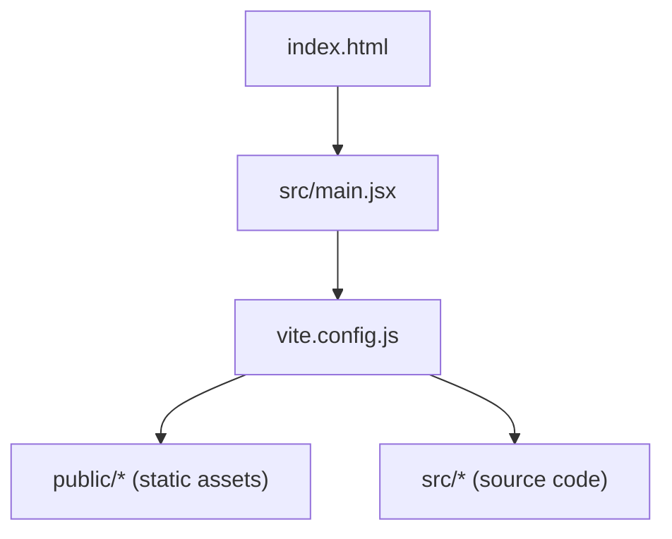
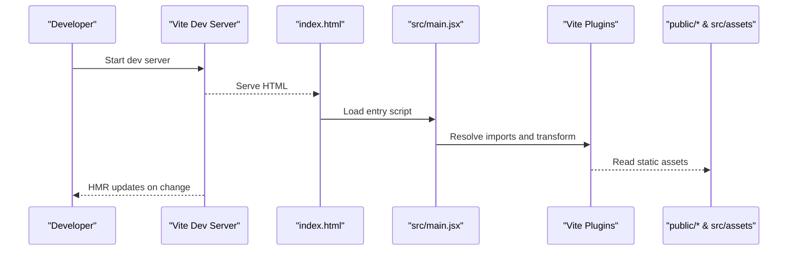
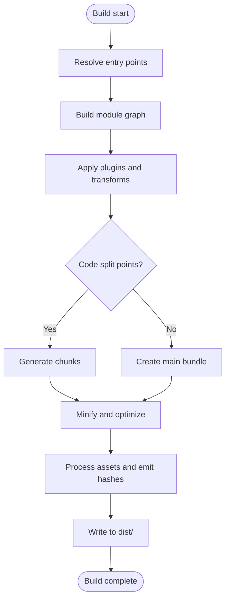
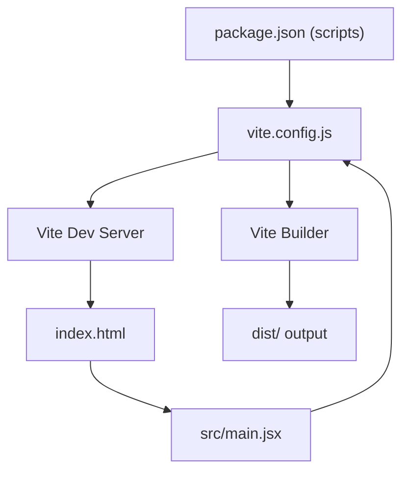

# Vite Configuration and Build Setup

<cite>
**Referenced Files in This Document**
- [vite.config.js](file://vite.config.js)
- [package.json](file://package.json)
- [index.html](file://index.html)
- [src/main.jsx](file://src/main.jsx)
</cite>

## Table of Contents
1. [Introduction](#introduction)
2. [Project Structure](#project-structure)
3. [Core Components](#core-components)
4. [Architecture Overview](#architecture-overview)
5. [Detailed Component Analysis](#detailed-component-analysis)
6. [Dependency Analysis](#dependency-analysis)
7. [Performance Considerations](#performance-considerations)
8. [Troubleshooting Guide](#troubleshooting-guide)
9. [Conclusion](#conclusion)

## Introduction
This document explains the Vite configuration and build setup for the PodiumMinds application. It covers plugin configurations, optimization settings, asset handling, development server options, environment variables, custom build commands, and the development workflow. It also includes guidance on debugging techniques and performance tuning strategies to help you maintain a fast and reliable build pipeline.

## Project Structure
The project is a Vite-based frontend with:
- A root HTML entry point that bootstraps the app
- A JavaScript entry file under src/
- Static assets under public/
- Vite configuration at the repository root

**Diagram sources**
- [index.html:1-20](file://index.html#L1-L20)
- [src/main.jsx:1-20](file://src/main.jsx#L1-L20)
- [vite.config.js:1-20](file://vite.config.js#L1-L20)

**Section sources**
- [index.html:1-20](file://index.html#L1-L20)
- [src/main.jsx:1-20](file://src/main.jsx#L1-L20)
- [vite.config.js:1-20](file://vite.config.js#L1-L20)

## Core Components
- Vite configuration file: centralizes plugins, dev server, build targets, and optimizations
- Package scripts: define development and production commands
- Entry points: index.html and src/main.jsx connect the browser to the Vite pipeline
- Static assets: served from public/ without transformation by default

Key responsibilities:
- Configure plugins for React support and any additional tooling
- Define development server behavior (port, host, proxy, HMR)
- Set build targets, minification, sourcemaps, and output structure
- Manage asset handling and path resolution

**Section sources**
- [vite.config.js:1-20](file://vite.config.js#L1-L20)
- [package.json:1-20](file://package.json#L1-L20)
- [index.html:1-20](file://index.html#L1-L20)
- [src/main.jsx:1-20](file://src/main.jsx#L1-L20)

## Architecture Overview
The build and dev architecture centers around Vite’s fast dev server and optimized production bundling. The HTML entry loads the JS entry, which initializes the app. Vite resolves modules, applies plugins, and serves or bundles assets accordingly.

**Diagram sources**
- [index.html:1-20](file://index.html#L1-L20)
- [src/main.jsx:1-20](file://src/main.jsx#L1-L20)
- [vite.config.js:1-20](file://vite.config.js#L1-L20)

## Detailed Component Analysis

### Vite Configuration File
The Vite configuration defines:
- Plugins: e.g., React plugin and any additional integrations
- Development server: port, host, open behavior, proxy rules, HMR
- Build options: target browsers, minifier, sourcemaps, chunking strategy, rollup options
- Asset handling: base path, asset prefix, file size limits, and resource inclusion
- Environment variable handling: process.env usage and .env files

Typical areas to review:
- Plugin order and configuration flags
- Dev server proxy for API calls during local development
- Build target compatibility and feature detection
- Output directory and filename patterns
- Asset URL generation and CDN integration

**Section sources**
- [vite.config.js:1-20](file://vite.config.js#L1-L20)

### Build Process and Bundle Generation
High-level flow:
- Entry resolution from index.html to src/main.jsx
- Module graph construction and dependency analysis
- Transformation via plugins (e.g., JSX/TSX, CSS, images)
- Code splitting based on dynamic imports and route boundaries
- Minification and tree-shaking for production
- Asset processing and hashing for cache busting
- Output to dist/ with manifest and index files

[No sources needed since this diagram shows conceptual workflow, not actual code structure]

### Optimization Settings
Common optimizations to consider:
- Target modern browsers to leverage native features and reduce polyfills
- Enable minification and dead code elimination
- Tune chunk sizes and naming for better caching
- Configure asset compression and image optimization
- Use pre-bundling and dependency hoisting effectively
- Adjust sourcemap generation for faster builds vs. debuggability trade-offs

**Section sources**
- [vite.config.js:1-20](file://vite.config.js#L1-L20)

### Asset Handling
Static assets:
- Files under public/ are copied as-is and referenced by absolute paths
- Dynamic imports of assets within src/ are processed and hashed
- Image, font, and media handling can be tuned via plugins or Rollup options
- Base path and asset prefix affect generated URLs for deployment

**Section sources**
- [vite.config.js:1-20](file://vite.config.js#L1-L20)

### Development Server Options
Development server capabilities:
- Hot Module Replacement (HMR) for instant feedback
- Proxy configuration to forward API requests to backend services
- Custom port and host bindings for local testing
- Open browser automatically on start
- Middleware injection for custom behaviors

**Section sources**
- [vite.config.js:1-20](file://vite.config.js#L1-L20)

### Environment Variables
Environment variables:
- Vite exposes client-side env variables prefixed according to its rules
- Use .env, .env.development, .env.production for different environments
- Access variables in source code via standard env APIs
- Ensure sensitive values are not exposed to the browser

**Section sources**
- [vite.config.js:1-20](file://vite.config.js#L1-L20)

### Custom Build Commands
Custom commands typically live in package.json:
- Development command to start the dev server
- Production build command to generate optimized assets
- Optional preview command to serve the production build locally
- Scripts for linting, type checks, or asset validation

**Section sources**
- [package.json:1-20](file://package.json#L1-L20)

### Entry Points and App Bootstrap
- index.html references the entry script and sets up the DOM root
- src/main.jsx initializes the application framework and mounts components
- These files integrate with Vite’s dev server and build pipeline

**Section sources**
- [index.html:1-20](file://index.html#L1-L20)
- [src/main.jsx:1-20](file://src/main.jsx#L1-L20)

## Dependency Analysis
The following diagram illustrates how the core files interact during development and build:

**Diagram sources**
- [package.json:1-20](file://package.json#L1-L20)
- [vite.config.js:1-20](file://vite.config.js#L1-L20)
- [index.html:1-20](file://index.html#L1-L20)
- [src/main.jsx:1-20](file://src/main.jsx#L1-L20)

**Section sources**
- [package.json:1-20](file://package.json#L1-L20)
- [vite.config.js:1-20](file://vite.config.js#L1-L20)
- [index.html:1-20](file://index.html#L1-L20)
- [src/main.jsx:1-20](file://src/main.jsx#L1-L20)

## Performance Considerations
- Keep the module graph small by avoiding unnecessary dependencies
- Prefer dynamic imports for large routes or heavy components
- Use modern browser targets to reduce polyfills and enable native optimizations
- Enable efficient asset pipelines (image formats, fonts subsetting)
- Avoid large static assets in public/; prefer lazy loading where possible
- Tune chunking to balance initial load and cache efficiency
- Use sourcemaps only when necessary in CI to speed up builds

[No sources needed since this section provides general guidance]

## Troubleshooting Guide
Common issues and remedies:
- Port conflicts: change dev server port or free the occupied port
- Proxy failures: verify backend availability and CORS policies
- Missing assets: ensure correct paths and that assets are either in public/ or imported from src/
- Environment variables not available: confirm proper prefixes and file names (.env.*), and restart the dev server
- Slow builds: disable sourcemaps temporarily, reduce plugin overhead, and analyze bundle sizes
- HMR not working: check network tab for failed WebSocket connections and ensure no middleware breaks HMR

**Section sources**
- [vite.config.js:1-20](file://vite.config.js#L1-L20)
- [package.json:1-20](file://package.json#L1-L20)

## Conclusion
The PodiumMinds application uses a standard Vite setup centered around a clear configuration file, well-defined entry points, and static asset management. By carefully configuring plugins, optimizing the build, and leveraging environment variables and dev server features, you can achieve fast development cycles and efficient production bundles. Use the troubleshooting tips and performance recommendations to maintain a smooth workflow as the project evolves.