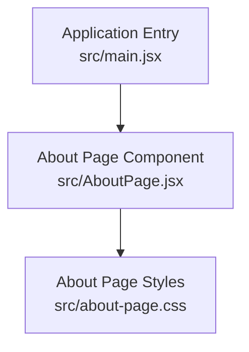
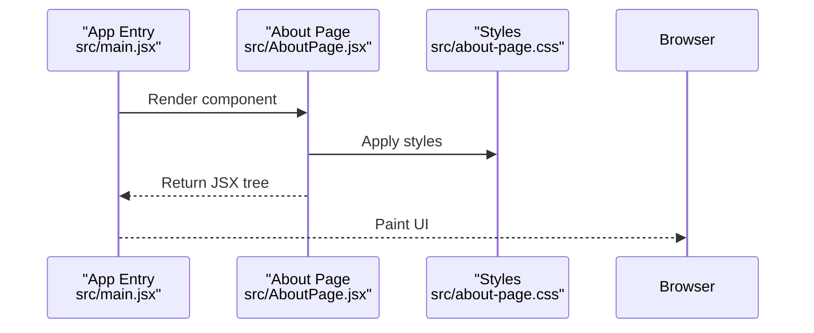
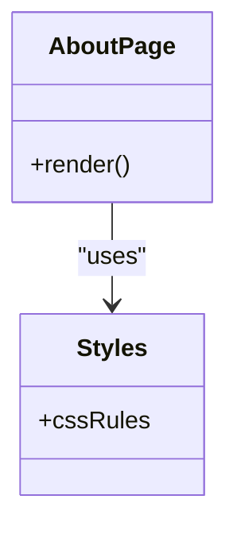
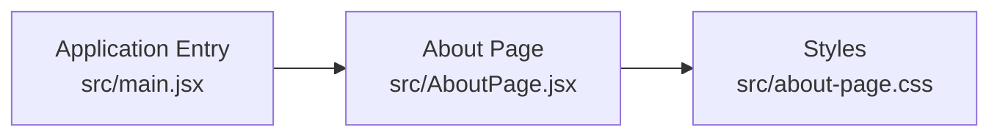

# About Page Component

<cite>
**Referenced Files in This Document**
- [AboutPage.jsx](file://src/AboutPage.jsx)
- [about-page.css](file://src/about-page.css)
- [main.jsx](file://src/main.jsx)
</cite>

## Table of Contents
1. [Introduction](#introduction)
2. [Project Structure](#project-structure)
3. [Core Components](#core-components)
4. [Architecture Overview](#architecture-overview)
5. [Detailed Component Analysis](#detailed-component-analysis)
6. [Dependency Analysis](#dependency-analysis)
7. [Performance Considerations](#performance-considerations)
8. [Troubleshooting Guide](#troubleshooting-guide)
9. [Conclusion](#conclusion)

## Introduction
This document describes the About Page component and its integration within the application. It explains how the component is structured, styled, and mounted into the app shell, and provides guidance for maintenance and troubleshooting.

## Project Structure
The About Page feature is implemented as a single React component with an associated stylesheet. The component is integrated into the application entry point where it is rendered as part of the page routing or layout.

**Diagram sources**
- [main.jsx:1-200](file://src/main.jsx#L1-L200)
- [AboutPage.jsx:1-200](file://src/AboutPage.jsx#L1-L200)
- [about-page.css:1-200](file://src/about-page.css#L1-L200)

**Section sources**
- [main.jsx:1-200](file://src/main.jsx#L1-L200)
- [AboutPage.jsx:1-200](file://src/AboutPage.jsx#L1-L200)
- [about-page.css:1-200](file://src/about-page.css#L1-L200)

## Core Components
- About Page Component: Renders the about content and UI elements. It is responsible for composing the page’s structure and behavior.
- About Page Styles: Provides styling rules scoped to the About Page, including layout, typography, and responsive behavior.
- Application Entry: Mounts the About Page component into the DOM as part of the application bootstrap.

Key responsibilities:
- Rendering the About Page view.
- Applying styles via the dedicated stylesheet.
- Integrating with the application entry point for rendering.

**Section sources**
- [AboutPage.jsx:1-200](file://src/AboutPage.jsx#L1-L200)
- [about-page.css:1-200](file://src/about-page.css#L1-L200)
- [main.jsx:1-200](file://src/main.jsx#L1-L200)

## Architecture Overview
The About Page follows a simple component-based architecture:
- The application entry initializes the app and renders the About Page component.
- The About Page component composes UI elements and applies styles from its stylesheet.
- No additional services or external modules are required for basic rendering.

**Diagram sources**
- [main.jsx:1-200](file://src/main.jsx#L1-L200)
- [AboutPage.jsx:1-200](file://src/AboutPage.jsx#L1-L200)
- [about-page.css:1-200](file://src/about-page.css#L1-L200)

## Detailed Component Analysis

### About Page Component (AboutPage.jsx)
- Purpose: Implements the About Page view by composing UI elements and applying styles.
- Inputs/Outputs: Renders JSX representing the page; no explicit props are required for basic usage.
- Styling: Uses the dedicated stylesheet for visual presentation.
- Integration: Imported and rendered by the application entry.

**Diagram sources**
- [AboutPage.jsx:1-200](file://src/AboutPage.jsx#L1-L200)
- [about-page.css:1-200](file://src/about-page.css#L1-L200)

**Section sources**
- [AboutPage.jsx:1-200](file://src/AboutPage.jsx#L1-L200)
- [about-page.css:1-200](file://src/about-page.css#L1-L200)

### Stylesheet (about-page.css)
- Purpose: Defines layout, typography, spacing, and responsive rules for the About Page.
- Scope: Styles are intended to be applied to components within the About Page context.
- Maintenance: Update selectors carefully to avoid unintended side effects on other pages.

**Section sources**
- [about-page.css:1-200](file://src/about-page.css#L1-L200)

### Application Entry (main.jsx)
- Purpose: Bootstraps the application and mounts the About Page component into the DOM.
- Integration: Imports and renders the About Page component during initialization.

**Section sources**
- [main.jsx:1-200](file://src/main.jsx#L1-L200)

## Dependency Analysis
The About Page has minimal dependencies:
- Direct dependency on its own stylesheet for styling.
- Consumed by the application entry for rendering.

**Diagram sources**
- [main.jsx:1-200](file://src/main.jsx#L1-L200)
- [AboutPage.jsx:1-200](file://src/AboutPage.jsx#L1-L200)
- [about-page.css:1-200](file://src/about-page.css#L1-L200)

**Section sources**
- [main.jsx:1-200](file://src/main.jsx#L1-L200)
- [AboutPage.jsx:1-200](file://src/AboutPage.jsx#L1-L200)
- [about-page.css:1-200](file://src/about-page.css#L1-L200)

## Performance Considerations
- Keep the About Page lightweight to ensure fast initial render.
- Prefer static content and minimal state to reduce re-renders.
- Use efficient CSS selectors and avoid heavy animations unless necessary.
- Ensure images and assets referenced by the About Page are optimized and lazy-loaded if applicable.

## Troubleshooting Guide
Common issues and resolutions:
- Styles not applied: Verify that the stylesheet is imported and selectors match the component’s markup.
- Component not rendering: Confirm the application entry imports and mounts the About Page correctly.
- Layout breaks on mobile: Check responsive rules in the stylesheet and test across viewport sizes.

**Section sources**
- [AboutPage.jsx:1-200](file://src/AboutPage.jsx#L1-L200)
- [about-page.css:1-200](file://src/about-page.css#L1-L200)
- [main.jsx:1-200](file://src/main.jsx#L1-L200)

## Conclusion
The About Page component is a focused, self-contained feature that renders the about content and applies dedicated styles. Its simplicity makes it easy to maintain and extend while keeping performance predictable. Follow the guidelines above to update content, refine styling, and troubleshoot common issues effectively.