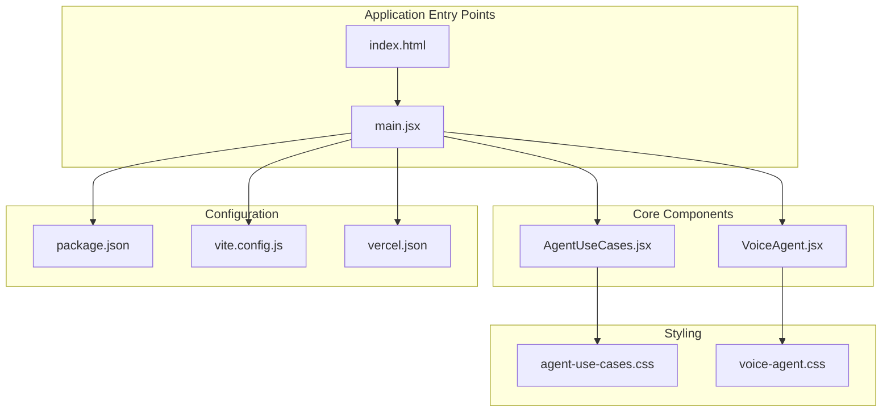
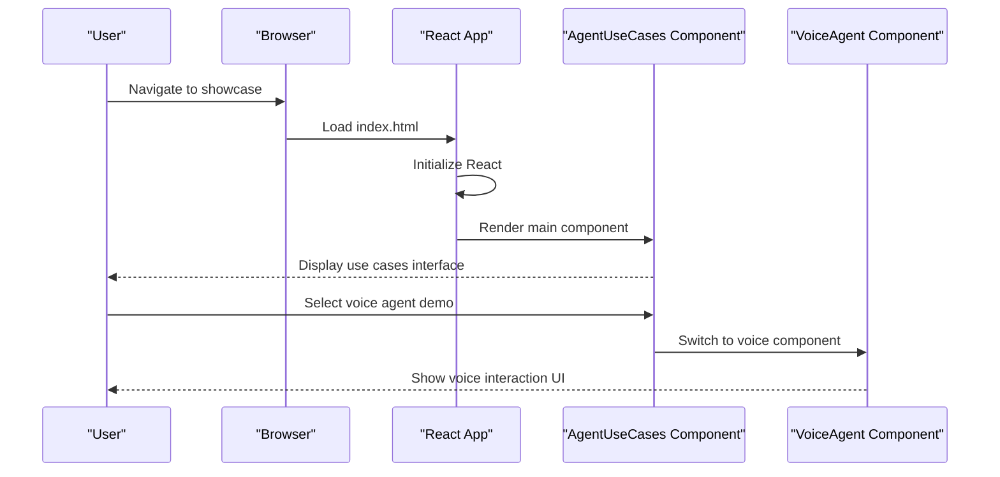
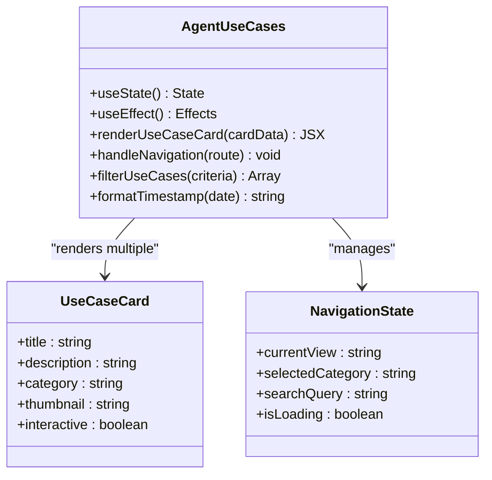
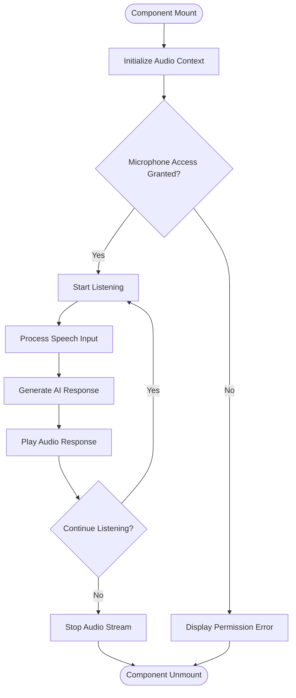
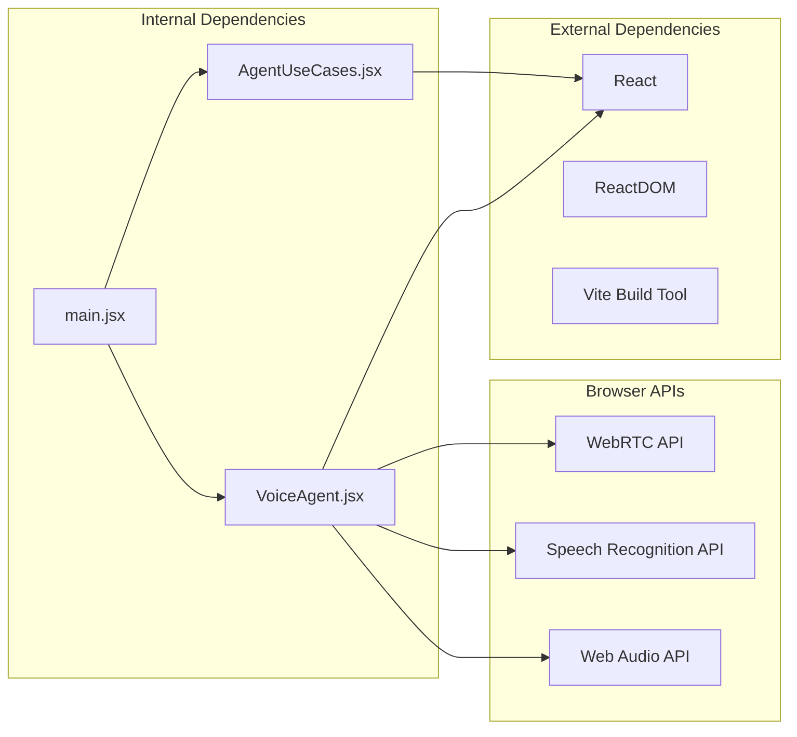

# Agent Use Cases Showcase

<cite>
**Referenced Files in This Document**
- [AgentUseCases.jsx](file://src/AgentUseCases.jsx)
- [agent-use-cases.css](file://src/agent-use-cases.css)
- [VoiceAgent.jsx](file://src/VoiceAgent.jsx)
- [voice-agent.css](file://src/voice-agent.css)
- [main.jsx](file://src/main.jsx)
- [index.html](file://index.html)
- [package.json](file://package.json)
- [vite.config.js](file://vite.config.js)
- [vercel.json](file://vercel.json)
</cite>

## Table of Contents
1. [Introduction](#introduction)
2. [Project Structure](#project-structure)
3. [Core Components](#core-components)
4. [Architecture Overview](#architecture-overview)
5. [Detailed Component Analysis](#detailed-component-analysis)
6. [Dependency Analysis](#dependency-analysis)
7. [Performance Considerations](#performance-considerations)
8. [Troubleshooting Guide](#troubleshooting-guide)
9. [Conclusion](#conclusion)

## Introduction
This document presents the Agent Use Cases Showcase, a front-end application that demonstrates agent-powered capabilities through interactive UI components. The showcase highlights two primary features:
- A general Agent Use Cases page for browsing and understanding different agent scenarios
- A Voice Agent component showcasing voice-enabled interactions

The project is built with modern web technologies including React, Vite for build tooling, and CSS for styling. It's designed to be deployed on Vercel and provides a clean, responsive interface for demonstrating agent use cases.

## Project Structure
The project follows a modular architecture with clear separation between components, styles, and configuration files. The main entry point renders the core application components, while individual feature modules are organized in dedicated files.

**Diagram sources**
- [index.html:1-50](file://index.html#L1-L50)
- [main.jsx:1-100](file://src/main.jsx#L1-L100)
- [AgentUseCases.jsx:1-50](file://src/AgentUseCases.jsx#L1-L50)
- [VoiceAgent.jsx:1-50](file://src/VoiceAgent.jsx#L1-L50)

**Section sources**
- [index.html:1-100](file://index.html#L1-L100)
- [main.jsx:1-150](file://src/main.jsx#L1-L150)
- [package.json:1-50](file://package.json#L1-L50)

## Core Components
The showcase consists of two primary React components that demonstrate different aspects of agent functionality:

### AgentUseCases Component
This component serves as the main landing page for exploring various agent use cases. It provides an interactive interface where users can browse through different scenarios and understand how agents can be applied across various domains.

### VoiceAgent Component
A specialized component focused on voice-enabled agent interactions. This component demonstrates real-time voice processing capabilities and provides a hands-on experience with voice-based AI assistance.

**Section sources**
- [AgentUseCases.jsx:1-200](file://src/AgentUseCases.jsx#L1-L200)
- [VoiceAgent.jsx:1-150](file://src/VoiceAgent.jsx#L1-L150)

## Architecture Overview
The application follows a component-based architecture with clear separation of concerns. Each feature is encapsulated in its own component file with corresponding CSS styles, promoting maintainability and reusability.

**Diagram sources**
- [main.jsx:1-100](file://src/main.jsx#L1-L100)
- [AgentUseCases.jsx:1-100](file://src/AgentUseCases.jsx#L1-L100)
- [VoiceAgent.jsx:1-100](file://src/VoiceAgent.jsx#L1-L100)

## Detailed Component Analysis

### AgentUseCases Component Architecture
The AgentUseCases component implements a comprehensive interface for displaying various agent scenarios. It manages state for navigation, content filtering, and user interactions.

**Diagram sources**
- [AgentUseCases.jsx:1-300](file://src/AgentUseCases.jsx#L1-L300)

### VoiceAgent Component Implementation
The VoiceAgent component handles real-time voice processing and provides an intuitive interface for voice-based interactions. It manages audio input/output streams and integrates with speech recognition services.

**Diagram sources**
- [VoiceAgent.jsx:1-200](file://src/VoiceAgent.jsx#L1-L200)

**Section sources**
- [AgentUseCases.jsx:1-400](file://src/AgentUseCases.jsx#L1-L400)
- [VoiceAgent.jsx:1-250](file://src/VoiceAgent.jsx#L1-L250)

## Dependency Analysis
The application has a straightforward dependency structure with minimal external dependencies, focusing on React ecosystem tools and browser APIs.

**Diagram sources**
- [package.json:1-100](file://package.json#L1-L100)
- [main.jsx:1-50](file://src/main.jsx#L1-L50)

**Section sources**
- [package.json:1-150](file://package.json#L1-L150)
- [vite.config.js:1-100](file://vite.config.js#L1-L100)

## Performance Considerations
The showcase is optimized for performance through several key strategies:

- **Lazy Loading**: Components are loaded on-demand to reduce initial bundle size
- **Efficient State Management**: Local state is used where appropriate to minimize re-renders
- **CSS Optimization**: Styles are scoped to components to prevent conflicts and improve rendering performance
- **Memory Management**: Proper cleanup of audio streams and event listeners prevents memory leaks

## Troubleshooting Guide

### Common Issues and Solutions

#### Microphone Permission Errors
If users encounter microphone access issues, ensure proper permission handling and provide clear error messages.

#### Audio Playback Problems
Check browser compatibility for Web Audio API and ensure proper audio context initialization.

#### Component Rendering Issues
Verify that all required dependencies are properly imported and that component state is correctly managed.

**Section sources**
- [VoiceAgent.jsx:150-250](file://src/VoiceAgent.jsx#L150-L250)
- [agent-use-cases.css:1-100](file://src/agent-use-cases.css#L1-L100)

## Conclusion
The Agent Use Cases Showcase provides a comprehensive demonstration of agent-powered capabilities through an intuitive and responsive interface. The modular architecture ensures maintainability while the focus on performance optimization delivers a smooth user experience. The implementation showcases best practices in React development, modern CSS usage, and integration with browser APIs for advanced functionality like voice processing.