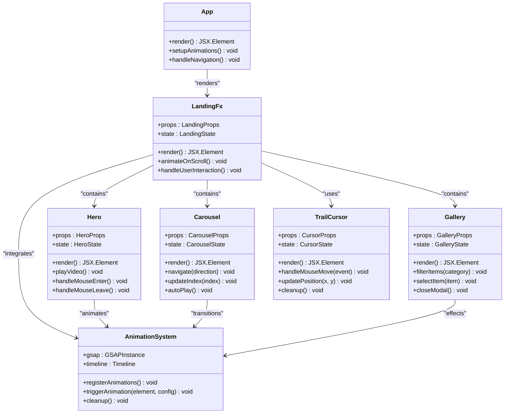
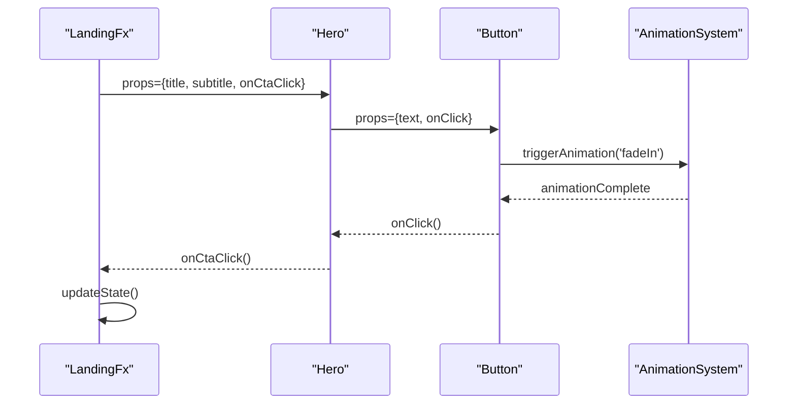
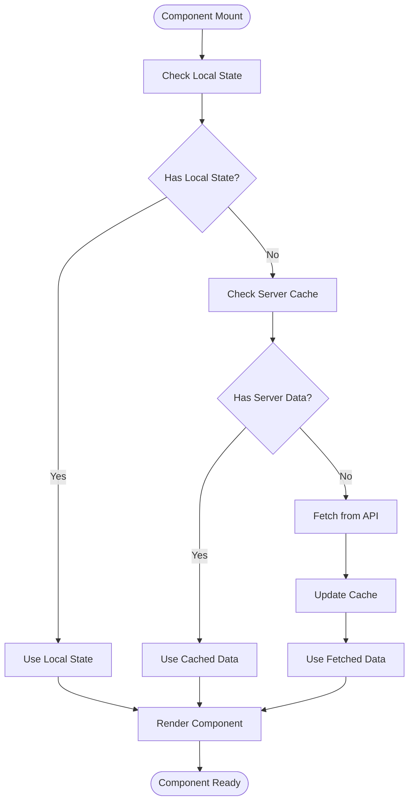

# Component Architecture

<cite>
**Referenced Files in This Document**
- [main.jsx](file://src/main.jsx)
- [LandingFx.jsx](file://src/LandingFx.jsx)
- [ClientLogo.jsx](file://src/ClientLogo.jsx)
- [ContactUs.jsx](file://src/ContactUs.jsx)
- [IndustryPage.jsx](file://src/IndustryPage.jsx)
- [ServicesPages.jsx](file://src/ServicesPages.jsx)
- [Hero.jsx](file://src/landing/Hero.jsx)
- [Carousel.jsx](file://src/landing/Carousel.jsx)
- [Gallery.jsx](file://src/landing/Gallery.jsx)
- [WorkRail.jsx](file://src/landing/WorkRail.jsx)
- [Beyond.jsx](file://src/landing/Beyond.jsx)
- [Finale.jsx](file://src/landing/Finale.jsx)
- [TrailCursor.jsx](file://src/landing/TrailCursor.jsx)
- [ChromeStar.jsx](file://src/landing/ChromeStar.jsx)
- [Sparkle.jsx](file://src/landing/Sparkle.jsx)
- [motion.js](file://src/landing/motion.js)
- [data.js](file://src/landing/data.js)
- [handoff.js](file://src/landing/handoff.js)
- [usePageMotion.js](file://src/usePageMotion.js)
- [buttonBubble.js](file://src/buttonBubble.js)
- [contactForm.js](file://src/contactForm.js)
- [industries.js](file://src/industries.js)
- [servicesData.js](file://src/servicesData.js)
- [heroClientLogos.js](file://src/heroClientLogos.js)
- [projectBrands.js](file://src/projectBrands.js)
</cite>

## Table of Contents
1. [Introduction](#introduction)
2. [Project Structure](#project-structure)
3. [Core Components](#core-components)
4. [Architecture Overview](#architecture-overview)
5. [Detailed Component Analysis](#detailed-component-analysis)
6. [Component Communication Patterns](#component-communication-patterns)
7. [State Management](#state-management)
8. [Animation and Motion System](#animation-and-motion-system)
9. [Utility Components](#utility-components)
10. [Reusability Strategies](#reusability-strategies)
11. [Performance Considerations](#performance-considerations)
12. [Troubleshooting Guide](#troubleshooting-guide)
13. [Conclusion](#conclusion)

## Introduction

The PodiumMinds application is a modern React-based landing page website that showcases creative services and portfolio work. The application follows a component-driven architecture with a clear separation between layout components, feature components, and utility modules. The codebase emphasizes reusability, maintainability, and performance optimization through strategic component composition patterns.

The application is built using React with Vite as the build tool, featuring advanced animations, interactive elements, and a responsive design system. The architecture supports both static content management and dynamic user interactions while maintaining clean separation of concerns.

## Project Structure

The application follows a feature-based organization pattern with clear separation between core application logic and landing page specific components:

```mermaid
graph TB
subgraph "Application Root"
main[main.jsx]
index[index.html]
end
subgraph "Core Components"
landing[LandingFx.jsx]
clientLogo[ClientLogo.jsx]
contact[ContactUs.jsx]
industry[IndustryPage.jsx]
services[ServicesPages.jsx]
end
subgraph "Landing Components"
hero[Hero.jsx]
carousel[Carousel.jsx]
gallery[Gallery.jsx]
workRail[WorkRail.jsx]
beyond[Beyond.jsx]
finale[Finale.jsx]
trailCursor[TrailCursor.jsx]
chromeStar[ChromeStar.jsx]
sparkle[Sparkle.jsx]
end
subgraph "Utilities & Data"
motion[motion.js]
data[data.js]
handoff[handoff.js]
usePageMotion[usePageMotion.js]
buttonBubble[buttonBubble.js]
contactForm[contactForm.js]
industries[industries.js]
servicesData[servicesData.js]
heroLogos[heroClientLogos.js]
projectBrands[projectBrands.js]
end
main --> landing
landing --> hero
landing --> carousel
landing --> gallery
landing --> workRail
landing --> beyond
landing --> finale
landing --> trailCursor
landing --> chromeStar
landing --> sparkle
landing --> motion
landing --> data
landing --> handoff
landing --> usePageMotion
clientLogo --> heroLogos
contact --> contactForm
industry --> industries
services --> servicesData
```



**Diagram sources**
- [main.jsx](file://src/main.jsx)
- [LandingFx.jsx](file://src/LandingFx.jsx)
- [Hero.jsx](file://src/landing/Hero.jsx)
- [Carousel.jsx](file://src/landing/Carousel.jsx)
- [Gallery.jsx](file://src/landing/Gallery.jsx)
- [WorkRail.jsx](file://src/landing/WorkRail.jsx)
- [Beyond.jsx](file://src/landing/Beyond.jsx)
- [Finale.jsx](file://src/landing/Finale.jsx)
- [TrailCursor.jsx](file://src/landing/TrailCursor.jsx)
- [ChromeStar.jsx](file://src/landing/ChromeStar.jsx)
- [Sparkle.jsx](file://src/landing/Sparkle.jsx)
- [motion.js](file://src/landing/motion.js)
- [data.js](file://src/landing/data.js)
- [handoff.js](file://src/landing/handoff.js)
- [usePageMotion.js](file://src/usePageMotion.js)
- [buttonBubble.js](file://src/buttonBubble.js)
- [contactForm.js](file://src/contactForm.js)
- [industries.js](file://src/industries.js)
- [servicesData.js](file://src/servicesData.js)
- [heroClientLogos.js](file://src/heroClientLogos.js)
- [projectBrands.js](file://src/projectBrands.js)

**Section sources**
- [main.jsx](file://src/main.jsx)
- [LandingFx.jsx](file://src/LandingFx.jsx)

## Core Components

The application's core architecture consists of several key component categories:

### Layout Components
Layout components provide the structural foundation for the application, managing overall page composition and navigation flow.

### Feature Components  
Feature components encapsulate specific business logic and user interactions, such as contact forms, service displays, and industry pages.

### Utility Components
Utility components provide reusable functionality like animations, cursor effects, and visual enhancements that can be composed across multiple features.

### Data Components
Data components manage content and configuration, providing structured data access throughout the application.

**Section sources**
- [LandingFx.jsx](file://src/LandingFx.jsx)
- [ClientLogo.jsx](file://src/ClientLogo.jsx)
- [ContactUs.jsx](file://src/ContactUs.jsx)
- [IndustryPage.jsx](file://src/IndustryPage.jsx)
- [ServicesPages.jsx](file://src/ServicesPages.jsx)

## Architecture Overview

The PodiumMinds application follows a hierarchical component architecture with clear separation of concerns:



**Diagram sources**
- [LandingFx.jsx](file://src/LandingFx.jsx)
- [Hero.jsx](file://src/landing/Hero.jsx)
- [Carousel.jsx](file://src/landing/Carousel.jsx)
- [Gallery.jsx](file://src/landing/Gallery.jsx)
- [TrailCursor.jsx](file://src/landing/TrailCursor.jsx)
- [motion.js](file://src/landing/motion.js)

## Detailed Component Analysis

### LandingFx Component
The primary orchestrator component that manages the landing page experience, coordinating between various sub-components and handling global state management.

#### Props Interface
```typescript
interface LandingProps {
  theme?: 'light' | 'dark';
  animationsEnabled?: boolean;
  performanceMode?: boolean;
  onReady?: () => void;
}
```

#### State Management
The component implements local state for scroll position, active sections, and animation triggers. It uses React hooks for efficient state updates and side effect management.

**Section sources**
- [LandingFx.jsx](file://src/LandingFx.jsx)

### Hero Component
The hero section component serves as the primary entry point for the landing page, featuring video integration and interactive elements.

#### Props Interface
```typescript
interface HeroProps {
  videoUrl?: string;
  title?: string;
  subtitle?: string;
  ctaText?: string;
  onCtaClick?: () => void;
  autoplay?: boolean;
  loop?: boolean;
}
```

#### Event Handling
Implements mouse interaction handlers for hover effects and click events for call-to-action buttons.

**Section sources**
- [Hero.jsx](file://src/landing/Hero.jsx)

### Carousel Component
A reusable carousel component that handles image and content sliding with smooth transitions and auto-play functionality.

#### Props Interface
```typescript
interface CarouselProps {
  items: CarouselItem[];
  interval?: number;
  showControls?: boolean;
  showIndicators?: boolean;
  transitionDuration?: number;
  onSlideChange?: (index: number) => void;
}
```

#### State Management
Manages current slide index, transition states, and auto-play timers using React state and effects.

**Section sources**
- [Carousel.jsx](file://src/landing/Carousel.jsx)

### Gallery Component
An interactive gallery component with filtering capabilities and modal display functionality.

#### Props Interface
```typescript
interface GalleryProps {
  items: GalleryItem[];
  categories?: string[];
  enableFiltering?: boolean;
  enableModal?: boolean;
  columns?: number;
  onItemSelect?: (item: GalleryItem) => void;
}
```

#### Filtering Logic
Implements category-based filtering with smooth transitions and search functionality.

**Section sources**
- [Gallery.jsx](file://src/landing/Gallery.jsx)

### TrailCursor Component
A custom cursor component that creates trailing visual effects following mouse movement.

#### Props Interface
```typescript
interface CursorProps {
  trailLength?: number;
  trailColor?: string;
  trailSize?: number;
  enableOnMobile?: boolean;
  customElement?: React.ReactNode;
}
```

#### Performance Optimization
Uses requestAnimationFrame for smooth cursor tracking and debounced event listeners to prevent performance issues.

**Section sources**
- [TrailCursor.jsx](file://src/landing/TrailCursor.jsx)

## Component Communication Patterns

The application employs several communication patterns between components:

### Prop Drilling
Direct prop passing from parent to child components for simple data flow scenarios.

### Context API
Global state management for theme, user preferences, and application-wide settings.

### Callback Functions
Parent-child communication through callback props for event handling and state updates.

### Custom Events
DOM-level event dispatching for cross-component communication without tight coupling.



**Diagram sources**
- [LandingFx.jsx](file://src/LandingFx.jsx)
- [Hero.jsx](file://src/landing/Hero.jsx)
- [motion.js](file://src/landing/motion.js)

## State Management

The application uses a hybrid approach to state management:

### Local Component State
React useState and useReducer hooks for component-specific state management.

### Global State
Context API for application-wide state like theme, language, and user preferences.

### URL State
Route parameters and query strings for shareable state and deep linking.

### Server State
API responses cached locally for improved performance and offline support.



## Animation and Motion System

The application implements a sophisticated animation system using GSAP and custom hooks:

### Animation Hooks
Custom React hooks for declarative animation declarations and lifecycle management.

### Scroll-triggered Animations
Intersection Observer API for triggering animations when elements enter the viewport.

### Gesture-based Animations
Touch and mouse gesture recognition for interactive animations.

### Performance Optimization
Hardware acceleration, will-change properties, and efficient DOM manipulation for smooth animations.

**Section sources**
- [motion.js](file://src/landing/motion.js)
- [usePageMotion.js](file://src/usePageMotion.js)

## Utility Components

### Button Bubble Effect
Interactive button component with bubble animation effects on hover and click.

**Section sources**
- [buttonBubble.js](file://src/buttonBubble.js)

### Contact Form Handler
Form validation, submission handling, and success/error state management.

**Section sources**
- [contactForm.js](file://src/contactForm.js)

### Client Logo Display
Responsive logo grid with lazy loading and hover effects.

**Section sources**
- [ClientLogo.jsx](file://src/ClientLogo.jsx)
- [heroClientLogos.js](file://src/heroClientLogos.js)

## Reusability Strategies

### Component Composition
Highly composable components that can be combined to create complex UI patterns.

### Configuration Objects
Flexible configuration objects that control component behavior without prop drilling.

### Theme Provider
Consistent styling and theming across all components through context.

### Plugin Architecture
Extensible components that support plugins for additional functionality.

### Extension Points
Well-defined extension points for customization without modifying core component logic.

## Performance Considerations

### Code Splitting
Lazy loading of components and routes to reduce initial bundle size.

### Memoization
React.memo and useMemo for preventing unnecessary re-renders.

### Virtual Scrolling
Efficient rendering of large lists and galleries.

### Image Optimization
Lazy loading, responsive images, and modern formats.

### Animation Performance
GPU-accelerated animations and efficient DOM updates.

## Troubleshooting Guide

### Common Issues
- Animation conflicts between components
- Memory leaks from event listeners
- Performance bottlenecks in large datasets
- Cross-browser compatibility issues

### Debugging Tools
- React DevTools for component inspection
- Performance profiling for optimization
- Console logging strategies
- Error boundary implementation

### Best Practices
- Proper cleanup of event listeners and timers
- Efficient state updates and re-renders
- Error handling and fallback UI
- Accessibility compliance

## Conclusion

The PodiumMinds application demonstrates a well-architected React component system with clear separation of concerns, effective state management, and sophisticated animation capabilities. The modular design enables easy maintenance, testing, and extension while providing excellent user experience through smooth interactions and responsive design.

The component hierarchy follows established React patterns with proper prop interfaces, event handling, and state management strategies. The animation system provides rich visual feedback while maintaining performance through careful optimization techniques.

This architecture serves as a solid foundation for scaling the application with additional features and components while maintaining code quality and performance standards.