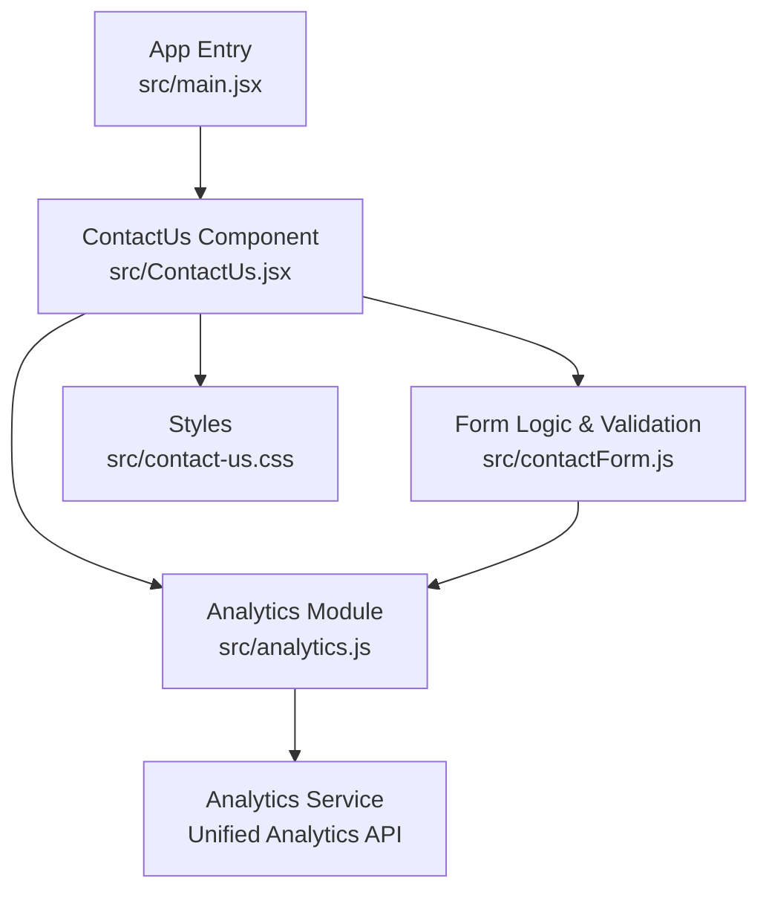
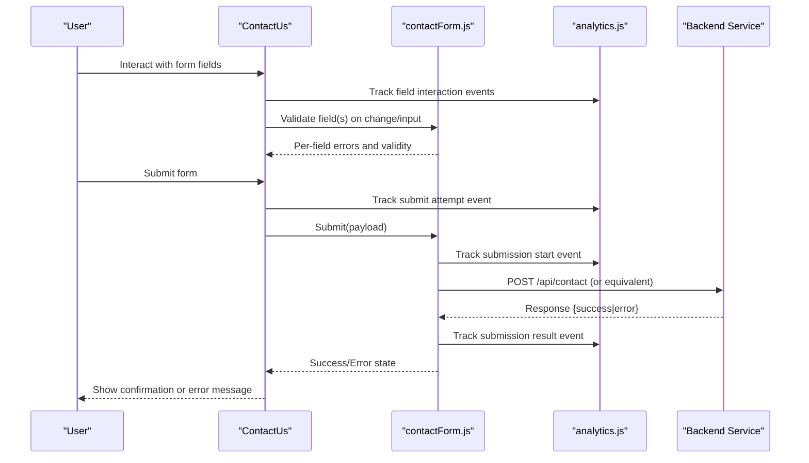
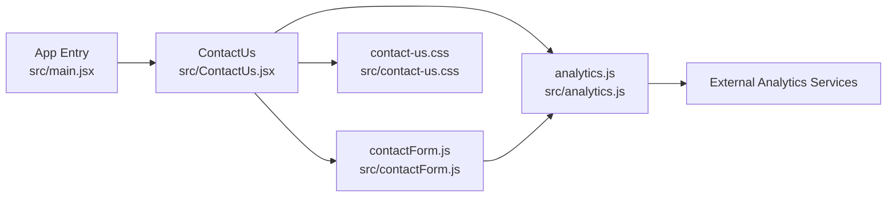

# Contact System Components

<cite>
**Referenced Files in This Document**
- [ContactUs.jsx](file://src/ContactUs.jsx)
- [contactForm.js](file://src/contactForm.js)
- [contact-us.css](file://src/contact-us.css)
- [main.jsx](file://src/main.jsx)
- [analytics.js](file://src/analytics.js)
</cite>

## Update Summary
**Changes Made**
- Added comprehensive analytics integration documentation for form submission tracking and user engagement metrics
- Updated architecture diagrams to include the unified analytics module
- Enhanced security considerations with analytics-specific privacy guidelines
- Added new section on analytics implementation patterns and best practices

## Table of Contents
1. [Introduction](#introduction)
2. [Project Structure](#project-structure)
3. [Core Components](#core-components)
4. [Architecture Overview](#architecture-overview)
5. [Analytics Integration](#analytics-integration)
6. [Detailed Component Analysis](#detailed-component-analysis)
7. [Dependency Analysis](#dependency-analysis)
8. [Performance Considerations](#performance-considerations)
9. [Troubleshooting Guide](#troubleshooting-guide)
10. [Conclusion](#conclusion)
11. [Appendices](#appendices)

## Introduction
This document explains the contact system components responsible for lead generation and user communication. It focuses on:
- The ContactUs component architecture and how it orchestrates form behavior
- The contactForm.js module's validation and submission logic
- **Enhanced analytics integration for tracking form submissions and user engagement metrics through the unified analytics module**
- Error handling patterns, success/error states, and real-time validation
- Form field management and integration with backend services
- Customization guidance for fields, validation rules, and submission handlers
- Security considerations, accessibility compliance, and UX best practices

The goal is to help developers understand, extend, and maintain the contact flow while ensuring robustness, security, and a great user experience with comprehensive analytics tracking.

## Project Structure
The contact system is implemented as a React-based feature with a primary UI component and a dedicated form logic module. Styling is isolated in a CSS file. The application entry point wires the feature into the app shell. The system now includes integrated analytics tracking for form interactions and submissions.

**Diagram sources**
- [main.jsx](file://src/main.jsx)
- [ContactUs.jsx](file://src/ContactUs.jsx)
- [contactForm.js](file://src/contactForm.js)
- [contact-us.css](file://src/contact-us.css)
- [analytics.js](file://src/analytics.js)

**Section sources**
- [main.jsx](file://src/main.jsx)
- [ContactUs.jsx](file://src/ContactUs.jsx)
- [contactForm.js](file://src/contactForm.js)
- [contact-us.css](file://src/contact-us.css)
- [analytics.js](file://src/analytics.js)

## Core Components
- ContactUs (UI orchestration): Renders the contact form, manages user interactions, displays feedback, delegates validation/submission to the form logic module, and triggers analytics events for user engagement tracking.
- contactForm.js (form engine): Encapsulates field definitions, validation rules, real-time validation, error aggregation, and submission handling. Integrates with backend APIs and the unified analytics module for comprehensive tracking.
- **analytics.js (unified analytics)**: Provides centralized analytics tracking for form interactions, submission events, and user engagement metrics across the contact system.

Key responsibilities:
- Field schema and default values
- Real-time validation on input/change events
- Aggregated error state and per-field messages
- Submission lifecycle (start, success, error)
- **Analytics event tracking for form interactions and submissions**
- Optional integrations (API calls, analytics, CRM)

**Section sources**
- [ContactUs.jsx](file://src/ContactUs.jsx)
- [contactForm.js](file://src/contactForm.js)
- [analytics.js](file://src/analytics.js)

## Architecture Overview
The contact flow follows a clear separation of concerns with enhanced analytics integration:
- UI layer (ContactUs) handles presentation, user interaction, and analytics event triggering
- Logic layer (contactForm.js) encapsulates validation, submission, and analytics data collection
- Styles are scoped to the component via a dedicated CSS file
- Backend integration is abstracted within the form logic module
- **Analytics layer provides unified tracking for all form interactions and submissions**

**Diagram sources**
- [ContactUs.jsx](file://src/ContactUs.jsx)
- [contactForm.js](file://src/contactForm.js)
- [analytics.js](file://src/analytics.js)

## Analytics Integration
**New** The contact system now includes comprehensive analytics integration through the unified analytics module for tracking form submissions and user engagement metrics.

### Analytics Event Tracking
The system tracks key user interactions and form behaviors:
- **Field-level interactions**: Input focus, blur, character count changes
- **Validation events**: Real-time validation triggers, error occurrences
- **Submission lifecycle**: Form start, submit attempts, success/completion, failure rates
- **User engagement**: Time spent on form, field completion rates, drop-off points

### Unified Analytics Module
The analytics.js module provides centralized tracking capabilities:
- Standardized event naming conventions
- Privacy-compliant data collection
- Configurable tracking options
- Error handling for analytics failures
- Batch processing for performance optimization

### Implementation Patterns
Analytics integration follows these patterns:
- Non-blocking event tracking that doesn't impact form functionality
- Graceful degradation when analytics services are unavailable
- Privacy-first approach with configurable data collection
- Performance-optimized event batching and debouncing

**Section sources**
- [analytics.js](file://src/analytics.js)
- [ContactUs.jsx](file://src/ContactUs.jsx)
- [contactForm.js](file://src/contactForm.js)

## Detailed Component Analysis

### ContactUs Component
Responsibilities:
- Renders the form layout and binds inputs to the form logic
- Displays real-time validation messages and global status banners
- Delegates submit actions to the form logic module
- **Triggers analytics events for user engagement tracking**
- Manages focus and accessibility attributes for screen readers

Integration points:
- Imports the form logic module for validation and submission
- Uses styles from the component-specific CSS file
- **Integrates with analytics module for tracking form interactions and submissions**

Customization hooks:
- Exposes props or configuration to add/remove fields
- Allows swapping out submission handlers for custom backends
- Supports theme overrides via CSS variables or class names
- **Configurable analytics tracking options**

Accessibility highlights:
- Associates labels with inputs using proper attributes
- Announces errors and success messages to assistive technologies
- Provides keyboard navigation and visible focus indicators
- **Ensures analytics events don't interfere with accessibility features**

**Section sources**
- [ContactUs.jsx](file://src/ContactUs.jsx)
- [contact-us.css](file://src/contact-us.css)
- [analytics.js](file://src/analytics.js)

### contactForm.js Module
Responsibilities:
- Defines the form schema: fields, types, defaults, and constraints
- Implements real-time validation rules (required, format, length, etc.)
- Aggregates validation results and exposes per-field and global errors
- Handles submission lifecycle: start, success, error, reset
- **Integrates with analytics module for comprehensive tracking**
- Integrates with backend services and optional telemetry

Validation model:
- Field-level validators run on blur and input events
- Global validator runs before submission to catch cross-field issues
- Errors are normalized into a consistent shape for UI consumption
- **Analytics events triggered for validation interactions and outcomes**

Submission flow:
- Builds payload from current field values
- Performs pre-submission checks (e.g., consent, honeypot)
- Sends request to backend endpoint
- Normalizes response into success/error states
- Resets or persists state based on outcome
- **Tracks complete submission lifecycle through analytics events**

Extensibility:
- Add new fields by extending the schema and adding validators
- Plug in custom submission handlers for different endpoints or CRMs
- Integrate third-party services (e.g., analytics, fraud detection)
- **Configure analytics tracking for new form elements and interactions**

**Section sources**
- [contactForm.js](file://src/contactForm.js)
- [analytics.js](file://src/analytics.js)

### Styling and Theming
- All visual aspects are defined in the component's CSS file
- Use semantic class names and avoid inline styles for maintainability
- Provide CSS variables for colors, spacing, and typography to support theming
- **Ensure analytics tracking doesn't affect visual rendering or performance**

**Section sources**
- [contact-us.css](file://src/contact-us.css)

## Dependency Analysis
The contact feature has minimal external dependencies beyond React and its own modules. The dependency graph emphasizes cohesion and low coupling between UI and logic, with analytics integration providing centralized tracking capabilities.

**Diagram sources**
- [main.jsx](file://src/main.jsx)
- [ContactUs.jsx](file://src/ContactUs.jsx)
- [contactForm.js](file://src/contactForm.js)
- [contact-us.css](file://src/contact-us.css)
- [analytics.js](file://src/analytics.js)

**Section sources**
- [main.jsx](file://src/main.jsx)
- [ContactUs.jsx](file://src/ContactUs.jsx)
- [contactForm.js](file://src/contactForm.js)
- [contact-us.css](file://src/contact-us.css)
- [analytics.js](file://src/analytics.js)

## Performance Considerations
- Debounce real-time validation on high-frequency inputs (e.g., name, email) to reduce re-renders
- Memoize derived validation results where appropriate
- Avoid heavy computations during render; move work to event handlers or effects
- Keep CSS scoped and minimal to prevent layout thrashing
- Batch multiple state updates when processing submission responses
- **Implement non-blocking analytics event tracking to avoid impacting form performance**
- **Use debouncing and throttling for analytics events to prevent excessive network requests**
- **Ensure analytics failures don't block form functionality or degrade user experience**

## Troubleshooting Guide
Common issues and resolutions:
- Validation not triggering: Ensure inputs are wired to change/input handlers and that the form logic exports the correct validation functions.
- Submission fails silently: Check network requests and normalize backend errors into the expected error shape consumed by the UI.
- Accessibility warnings: Verify label-input associations, aria-live regions for announcements, and focus management after submission.
- Style conflicts: Confirm that component classes are unique and not overridden by global styles.
- **Analytics tracking issues: Verify analytics module initialization and check for network errors in analytics service calls**
- **Performance degradation: Monitor analytics event frequency and implement proper debouncing/throttling**

Operational tips:
- Log submission payloads and responses in development only
- Add feature flags for experimental submission backends
- Instrument analytics for drop-off points (field edits, submit clicks)
- **Monitor analytics service health and implement fallback mechanisms**
- **Track analytics event success rates and error conditions**

**Section sources**
- [ContactUs.jsx](file://src/ContactUs.jsx)
- [contactForm.js](file://src/contactForm.js)
- [analytics.js](file://src/analytics.js)

## Conclusion
The contact system cleanly separates UI and logic, enabling easy customization and maintenance. With the enhanced analytics integration, developers can now track comprehensive user engagement metrics while maintaining robust form functionality. By following the guidance here—especially around validation, error handling, security, accessibility, and analytics tracking—you can extend the form confidently while preserving a reliable, inclusive, and measurable user experience.

## Appendices

### Customizing Form Fields
- Add a new field by updating the schema in the form logic module and providing a corresponding input in the UI component.
- Define default values and initial focus behavior if needed.
- Wire up any additional display logic (e.g., conditional visibility).
- **Configure analytics tracking for new field interactions and validation events**

**Section sources**
- [contactForm.js](file://src/contactForm.js)
- [ContactUs.jsx](file://src/ContactUs.jsx)
- [analytics.js](file://src/analytics.js)

### Adding Validation Rules
- Implement field-level validators for required, format, and length constraints.
- Add global validators for cross-field dependencies.
- Normalize errors into a consistent structure for UI rendering.
- **Add analytics events for validation interactions and error conditions**

**Section sources**
- [contactForm.js](file://src/contactForm.js)
- [analytics.js](file://src/analytics.js)

### Implementing Custom Submission Handlers
- Replace or wrap the default submission handler to target alternative endpoints or CRMs.
- Preserve the same success/error contract so the UI remains unchanged.
- Include CSRF tokens, consent flags, and anti-bot signals as required.
- **Ensure analytics tracking continues for custom submission flows**

**Section sources**
- [contactForm.js](file://src/contactForm.js)
- [analytics.js](file://src/analytics.js)

### Security Considerations
- Sanitize and validate all inputs server-side; treat client-side validation as UX only.
- Use HTTPS-only endpoints and enforce Content Security Policy headers.
- Implement rate limiting and bot protection (e.g., honeypot fields, CAPTCHA).
- Avoid logging sensitive data; redact PII in analytics and logs.
- **Configure analytics to exclude sensitive form data from tracking**
- **Implement privacy controls for analytics data collection**
- **Ensure analytics events comply with data protection regulations**

### Accessibility Compliance
- Associate each input with a descriptive label.
- Announce validation errors and success messages using live regions.
- Ensure full keyboard operability and visible focus indicators.
- Provide clear instructions and examples for complex fields.
- **Ensure analytics tracking doesn't interfere with screen reader functionality**
- **Avoid announcing analytics events to assistive technologies**

### User Experience Best Practices
- Provide inline, actionable error messages near the relevant fields.
- Show a concise success confirmation and next steps.
- Keep the form short; use progressive disclosure for advanced options.
- Offer helpful placeholders and examples without replacing labels.
- **Ensure analytics tracking doesn't impact form responsiveness or user flow**
- **Provide meaningful insights from analytics data to improve form design**

### Analytics Implementation Guidelines
**New** Comprehensive guidelines for implementing analytics in the contact system:

#### Event Naming Conventions
- Use consistent naming patterns: `form.field.interaction`, `form.submit.attempt`, `form.submit.success`
- Include contextual metadata: field names, validation results, timestamps
- Maintain backward compatibility when updating event schemas

#### Privacy and Compliance
- Exclude sensitive personal information from analytics events
- Implement user consent mechanisms where required
- Provide opt-out options for analytics tracking
- Comply with GDPR, CCPA, and other privacy regulations

#### Performance Optimization
- Debounce high-frequency events (input tracking, validation)
- Batch related events to reduce network overhead
- Implement retry logic for failed analytics transmissions
- Monitor analytics service performance and availability

#### Error Handling
- Gracefully handle analytics service failures
- Log analytics errors for debugging without exposing sensitive data
- Implement fallback mechanisms when analytics services are unavailable
- Monitor analytics event delivery rates and error conditions

**Section sources**
- [analytics.js](file://src/analytics.js)