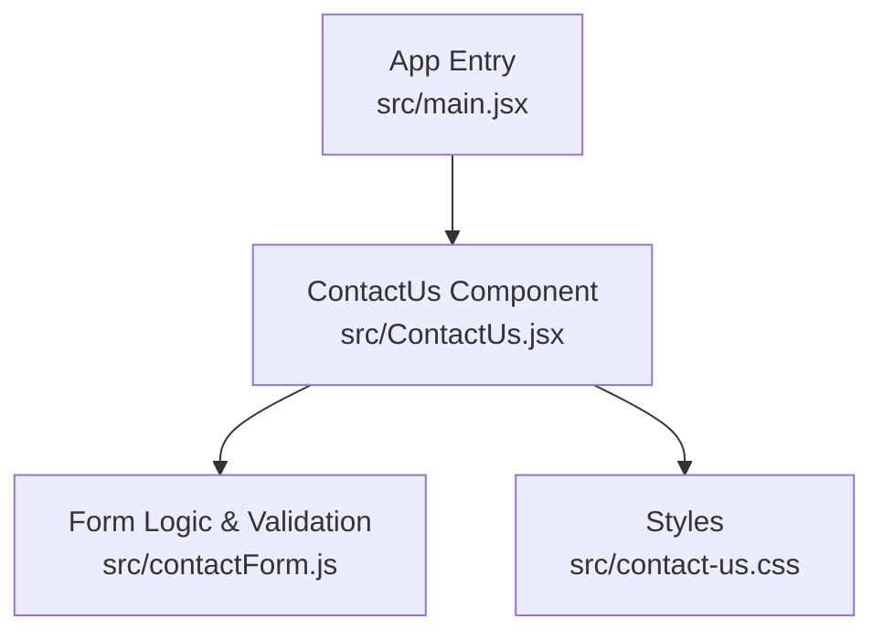
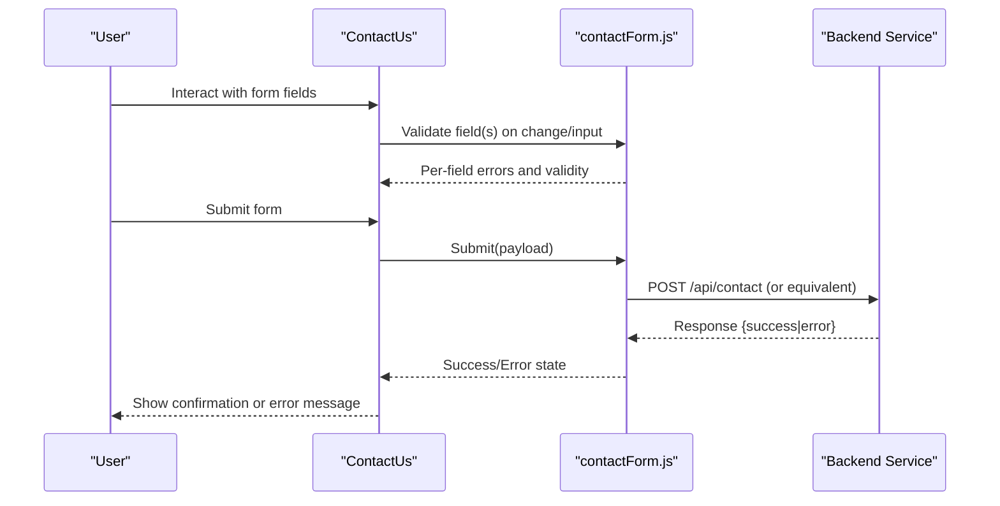
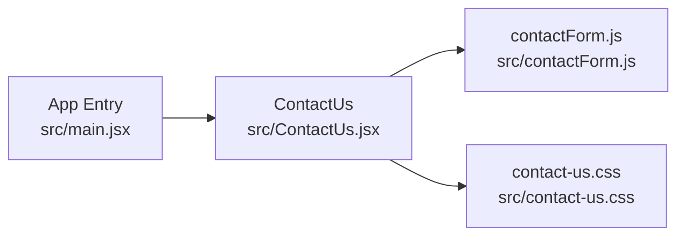

# Contact System Components

<cite>
**Referenced Files in This Document**
- [ContactUs.jsx](file://src/ContactUs.jsx)
- [contactForm.js](file://src/contactForm.js)
- [contact-us.css](file://src/contact-us.css)
- [main.jsx](file://src/main.jsx)
</cite>

## Table of Contents
1. [Introduction](#introduction)
2. [Project Structure](#project-structure)
3. [Core Components](#core-components)
4. [Architecture Overview](#architecture-overview)
5. [Detailed Component Analysis](#detailed-component-analysis)
6. [Dependency Analysis](#dependency-analysis)
7. [Performance Considerations](#performance-considerations)
8. [Troubleshooting Guide](#troubleshooting-guide)
9. [Conclusion](#conclusion)
10. [Appendices](#appendices)

## Introduction
This document explains the contact system components responsible for lead generation and user communication. It focuses on:
- The ContactUs component architecture and how it orchestrates form behavior
- The contactForm.js module’s validation and submission logic
- Error handling patterns, success/error states, and real-time validation
- Form field management and integration with backend services
- Customization guidance for fields, validation rules, and submission handlers
- Security considerations, accessibility compliance, and UX best practices

The goal is to help developers understand, extend, and maintain the contact flow while ensuring robustness, security, and a great user experience.

## Project Structure
The contact system is implemented as a React-based feature with a primary UI component and a dedicated form logic module. Styling is isolated in a CSS file. The application entry point wires the feature into the app shell.

**Diagram sources**
- [main.jsx](file://src/main.jsx)
- [ContactUs.jsx](file://src/ContactUs.jsx)
- [contactForm.js](file://src/contactForm.js)
- [contact-us.css](file://src/contact-us.css)

**Section sources**
- [main.jsx](file://src/main.jsx)
- [ContactUs.jsx](file://src/ContactUs.jsx)
- [contactForm.js](file://src/contactForm.js)
- [contact-us.css](file://src/contact-us.css)

## Core Components
- ContactUs (UI orchestration): Renders the contact form, manages user interactions, displays feedback, and delegates validation/submission to the form logic module.
- contactForm.js (form engine): Encapsulates field definitions, validation rules, real-time validation, error aggregation, and submission handling. It may integrate with backend APIs or analytics.

Key responsibilities:
- Field schema and default values
- Real-time validation on input/change events
- Aggregated error state and per-field messages
- Submission lifecycle (start, success, error)
- Optional integrations (API calls, analytics, CRM)

**Section sources**
- [ContactUs.jsx](file://src/ContactUs.jsx)
- [contactForm.js](file://src/contactForm.js)

## Architecture Overview
The contact flow follows a clear separation of concerns:
- UI layer (ContactUs) handles presentation and user interaction
- Logic layer (contactForm.js) encapsulates validation and submission
- Styles are scoped to the component via a dedicated CSS file
- Backend integration is abstracted within the form logic module

**Diagram sources**
- [ContactUs.jsx](file://src/ContactUs.jsx)
- [contactForm.js](file://src/contactForm.js)

## Detailed Component Analysis

### ContactUs Component
Responsibilities:
- Renders the form layout and binds inputs to the form logic
- Displays real-time validation messages and global status banners
- Delegates submit actions to the form logic module
- Manages focus and accessibility attributes for screen readers

Integration points:
- Imports the form logic module for validation and submission
- Uses styles from the component-specific CSS file
- May trigger analytics events on key interactions (e.g., submit attempts)

Customization hooks:
- Exposes props or configuration to add/remove fields
- Allows swapping out submission handlers for custom backends
- Supports theme overrides via CSS variables or class names

Accessibility highlights:
- Associates labels with inputs using proper attributes
- Announces errors and success messages to assistive technologies
- Provides keyboard navigation and visible focus indicators

**Section sources**
- [ContactUs.jsx](file://src/ContactUs.jsx)
- [contact-us.css](file://src/contact-us.css)

### contactForm.js Module
Responsibilities:
- Defines the form schema: fields, types, defaults, and constraints
- Implements real-time validation rules (required, format, length, etc.)
- Aggregates validation results and exposes per-field and global errors
- Handles submission lifecycle: start, success, error, reset
- Integrates with backend services and optional telemetry

Validation model:
- Field-level validators run on blur and input events
- Global validator runs before submission to catch cross-field issues
- Errors are normalized into a consistent shape for UI consumption

Submission flow:
- Builds payload from current field values
- Performs pre-submission checks (e.g., consent, honeypot)
- Sends request to backend endpoint
- Normalizes response into success/error states
- Resets or persists state based on outcome

Extensibility:
- Add new fields by extending the schema and adding validators
- Plug in custom submission handlers for different endpoints or CRMs
- Integrate third-party services (e.g., analytics, fraud detection)

**Section sources**
- [contactForm.js](file://src/contactForm.js)

### Styling and Theming
- All visual aspects are defined in the component’s CSS file
- Use semantic class names and avoid inline styles for maintainability
- Provide CSS variables for colors, spacing, and typography to support theming

**Section sources**
- [contact-us.css](file://src/contact-us.css)

## Dependency Analysis
The contact feature has minimal external dependencies beyond React and its own modules. The dependency graph emphasizes cohesion and low coupling between UI and logic.

**Diagram sources**
- [main.jsx](file://src/main.jsx)
- [ContactUs.jsx](file://src/ContactUs.jsx)
- [contactForm.js](file://src/contactForm.js)
- [contact-us.css](file://src/contact-us.css)

**Section sources**
- [main.jsx](file://src/main.jsx)
- [ContactUs.jsx](file://src/ContactUs.jsx)
- [contactForm.js](file://src/contactForm.js)
- [contact-us.css](file://src/contact-us.css)

## Performance Considerations
- Debounce real-time validation on high-frequency inputs (e.g., name, email) to reduce re-renders
- Memoize derived validation results where appropriate
- Avoid heavy computations during render; move work to event handlers or effects
- Keep CSS scoped and minimal to prevent layout thrashing
- Batch multiple state updates when processing submission responses

[No sources needed since this section provides general guidance]

## Troubleshooting Guide
Common issues and resolutions:
- Validation not triggering: Ensure inputs are wired to change/input handlers and that the form logic exports the correct validation functions.
- Submission fails silently: Check network requests and normalize backend errors into the expected error shape consumed by the UI.
- Accessibility warnings: Verify label-input associations, aria-live regions for announcements, and focus management after submission.
- Style conflicts: Confirm that component classes are unique and not overridden by global styles.

Operational tips:
- Log submission payloads and responses in development only
- Add feature flags for experimental submission backends
- Instrument analytics for drop-off points (field edits, submit clicks)

**Section sources**
- [ContactUs.jsx](file://src/ContactUs.jsx)
- [contactForm.js](file://src/contactForm.js)

## Conclusion
The contact system cleanly separates UI and logic, enabling easy customization and maintenance. By following the guidance here—especially around validation, error handling, security, and accessibility—you can extend the form confidently while preserving a reliable and inclusive user experience.

[No sources needed since this section summarizes without analyzing specific files]

## Appendices

### Customizing Form Fields
- Add a new field by updating the schema in the form logic module and providing a corresponding input in the UI component.
- Define default values and initial focus behavior if needed.
- Wire up any additional display logic (e.g., conditional visibility).

**Section sources**
- [contactForm.js](file://src/contactForm.js)
- [ContactUs.jsx](file://src/ContactUs.jsx)

### Adding Validation Rules
- Implement field-level validators for required, format, and length constraints.
- Add global validators for cross-field dependencies.
- Normalize errors into a consistent structure for UI rendering.

**Section sources**
- [contactForm.js](file://src/contactForm.js)

### Implementing Custom Submission Handlers
- Replace or wrap the default submission handler to target alternative endpoints or CRMs.
- Preserve the same success/error contract so the UI remains unchanged.
- Include CSRF tokens, consent flags, and anti-bot signals as required.

**Section sources**
- [contactForm.js](file://src/contactForm.js)

### Security Considerations
- Sanitize and validate all inputs server-side; treat client-side validation as UX only.
- Use HTTPS-only endpoints and enforce Content Security Policy headers.
- Implement rate limiting and bot protection (e.g., honeypot fields, CAPTCHA).
- Avoid logging sensitive data; redact PII in analytics and logs.

[No sources needed since this section provides general guidance]

### Accessibility Compliance
- Associate each input with a descriptive label.
- Announce validation errors and success messages using live regions.
- Ensure full keyboard operability and visible focus indicators.
- Provide clear instructions and examples for complex fields.

[No sources needed since this section provides general guidance]

### User Experience Best Practices
- Provide inline, actionable error messages near the relevant fields.
- Show a concise success confirmation and next steps.
- Keep the form short; use progressive disclosure for advanced options.
- Offer helpful placeholders and examples without replacing labels.

[No sources needed since this section provides general guidance]