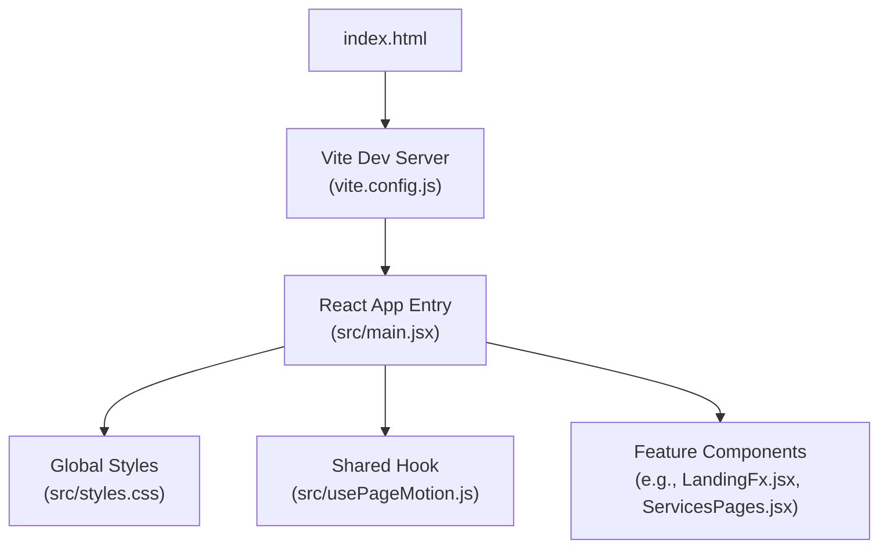
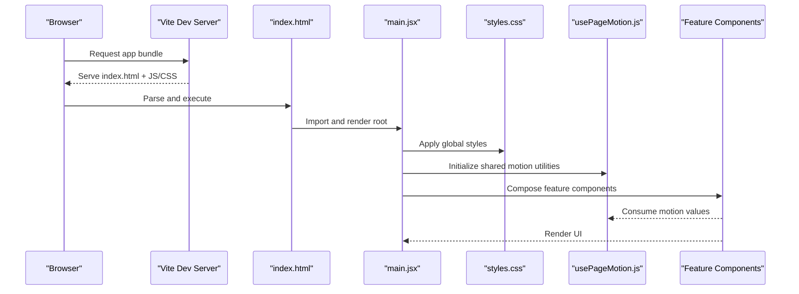
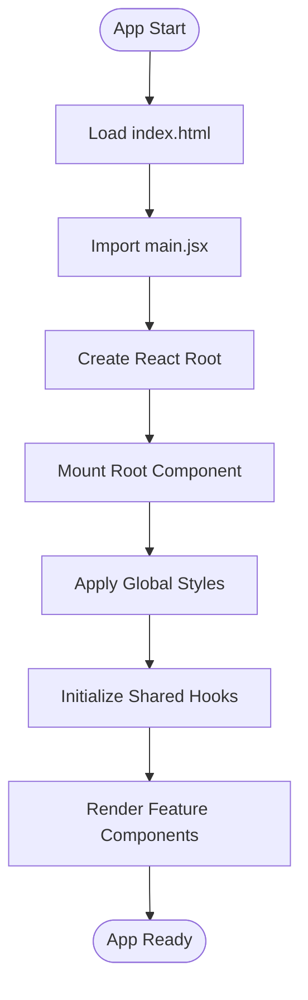
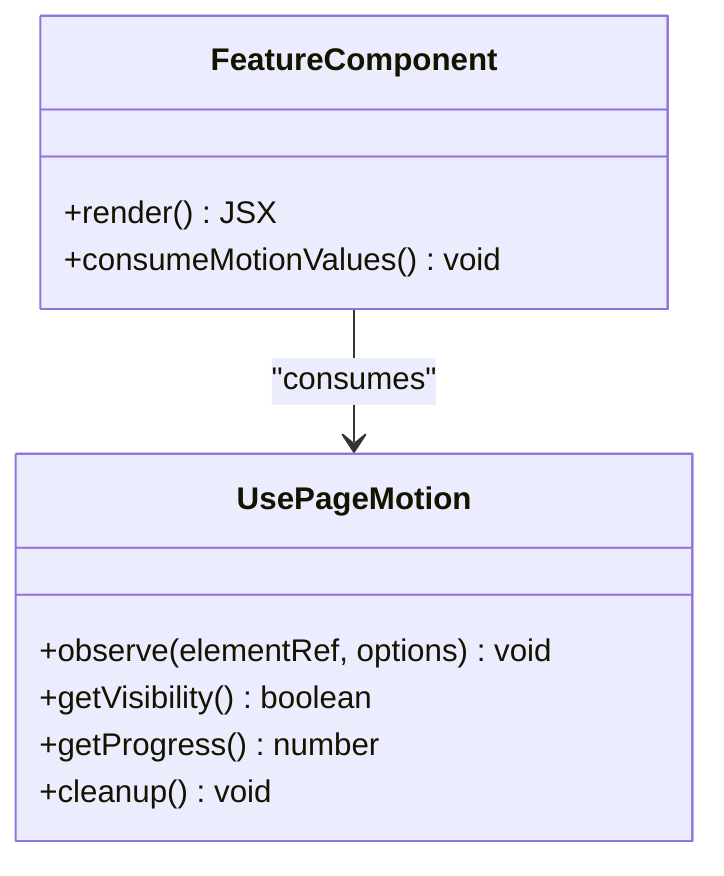
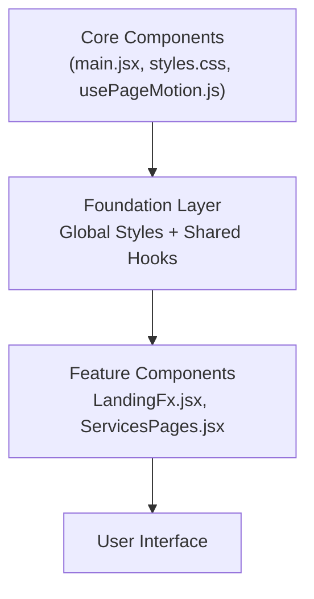
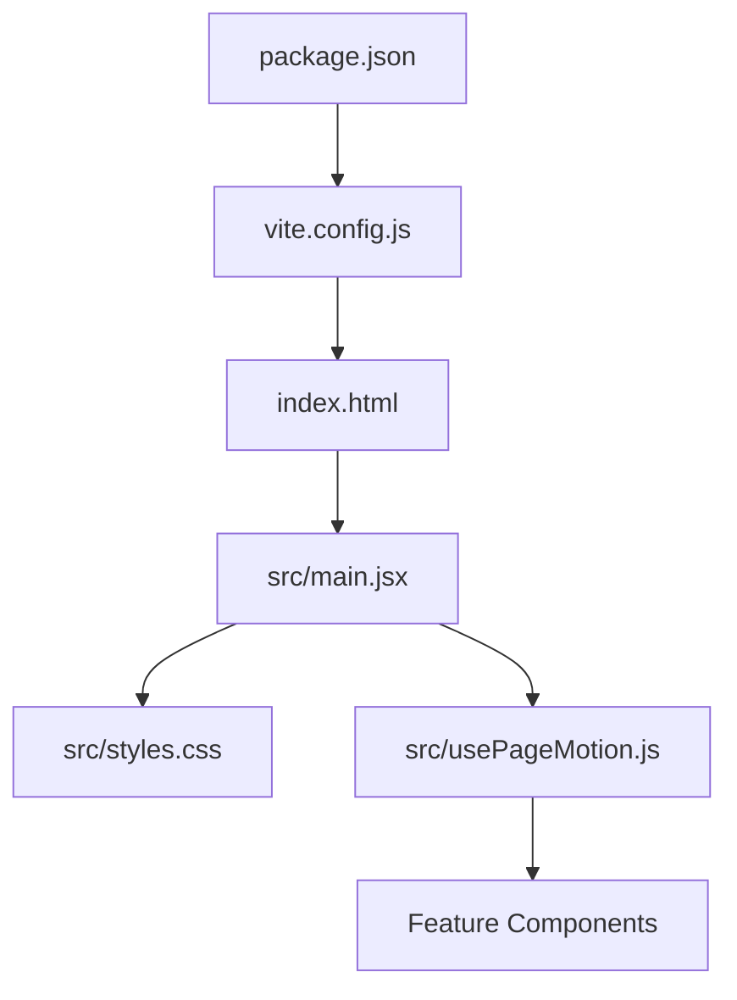

# Core Components

<cite>
**Referenced Files in This Document**
- [main.jsx](file://src/main.jsx)
- [usePageMotion.js](file://src/usePageMotion.js)
- [styles.css](file://src/styles.css)
- [index.html](file://index.html)
- [package.json](file://package.json)
- [vite.config.js](file://vite.config.js)
</cite>

## Table of Contents
1. [Introduction](#introduction)
2. [Project Structure](#project-structure)
3. [Core Components](#core-components)
4. [Architecture Overview](#architecture-overview)
5. [Detailed Component Analysis](#detailed-component-analysis)
6. [Dependency Analysis](#dependency-analysis)
7. [Performance Considerations](#performance-considerations)
8. [Troubleshooting Guide](#troubleshooting-guide)
9. [Conclusion](#conclusion)

## Introduction
This document explains the core application components that form the foundation of the PodiumMinds application. It focuses on the main entry point, global styling system, and shared utilities such as the usePageMotion hook. You will learn how the app initializes, how global state patterns are applied at the root level, and how core components provide foundational functionality to feature components. The guide also covers composition patterns, prop interfaces, lifecycle integration points, performance considerations, and best practices for extending core functionality.

## Project Structure
At a high level, the application is a React project built with Vite. The root HTML file mounts the React app, which is bootstrapped from the main entry point. Global styles are centralized, and shared hooks (like usePageMotion) encapsulate cross-cutting behavior used by multiple features.

**Diagram sources**
- [index.html:1-50](file://index.html#L1-L50)
- [vite.config.js:1-50](file://vite.config.js#L1-L50)
- [main.jsx:1-50](file://src/main.jsx#L1-L50)
- [styles.css:1-50](file://src/styles.css#L1-L50)
- [usePageMotion.js:1-50](file://src/usePageMotion.js#L1-L50)

**Section sources**
- [index.html:1-50](file://index.html#L1-L50)
- [package.json:1-50](file://package.json#L1-L50)
- [vite.config.js:1-50](file://vite.config.js#L1-L50)
- [main.jsx:1-50](file://src/main.jsx#L1-L50)

## Core Components
This section documents the foundational pieces that power the rest of the application.

- Main Application Entry Point
  - Responsibilities:
    - Mounts the React application into the DOM.
    - Establishes global providers or context if needed.
    - Loads global styles and registers shared utilities.
  - Lifecycle Integration:
    - Uses React’s root rendering APIs to mount the app once during initialization.
    - May attach top-level event listeners or observers via effect hooks within the root component.
  - Composition Pattern:
    - Renders a root layout that composes feature pages and shared UI primitives.
  - Prop Interfaces:
    - Typically minimal at the root; props are passed down to feature components through composition rather than deep prop drilling.

- Global Styling System
  - Centralized CSS file(s) define design tokens, base resets, typography scales, spacing, color variables, and utility classes.
  - Feature-specific styles are layered on top of the global base to ensure consistency.
  - Best Practices:
    - Keep global styles small and focused on cross-cutting concerns.
    - Use CSS custom properties for theming and maintainability.
    - Avoid heavy animations in global styles; prefer per-component motion where possible.

- Shared Utilities: usePageMotion Hook
  - Purpose:
    - Encapsulates page-level motion logic (e.g., scroll-driven animations, entrance transitions).
    - Provides a consistent API to feature components for animating sections, headers, or content blocks.
  - Typical Behavior:
    - Observes viewport changes using IntersectionObserver or scroll events.
    - Exposes reactive values (e.g., visibility flags, progress ratios) consumed by components.
    - Cleans up observers and listeners on unmount to prevent memory leaks.
  - Integration Points:
    - Consumed by feature components to animate their sections without duplicating logic.
    - Can be extended with configuration options (e.g., thresholds, easing, direction).

**Section sources**
- [main.jsx:1-120](file://src/main.jsx#L1-L120)
- [styles.css:1-200](file://src/styles.css#L1-L200)
- [usePageMotion.js:1-120](file://src/usePageMotion.js#L1-L120)

## Architecture Overview
The application follows a simple, layered architecture:
- Entry Layer: index.html and Vite configuration bootstrap the development and production builds.
- Root Layer: main.jsx renders the root React tree, applies global styles, and wires shared utilities.
- Feature Layer: Feature components compose reusable UI and leverage shared hooks like usePageMotion.

**Diagram sources**
- [index.html:1-50](file://index.html#L1-L50)
- [vite.config.js:1-50](file://vite.config.js#L1-L50)
- [main.jsx:1-120](file://src/main.jsx#L1-L120)
- [styles.css:1-200](file://src/styles.css#L1-L200)
- [usePageMotion.js:1-120](file://src/usePageMotion.js#L1-L120)

## Detailed Component Analysis

### Main Application Entry Point (main.jsx)
- Initialization Flow:
  - Imports React and necessary dependencies.
  - Creates a React root and mounts the application into the DOM element defined in index.html.
  - Applies global styles and sets up any top-level providers or contexts.
- Lifecycle Integration:
  - Uses root rendering APIs to mount once.
  - If effects are required at the root level, they are implemented within the root component to initialize global behaviors (e.g., registering global observers).
- Composition Patterns:
  - Renders a root layout that includes navigation, footer, and feature pages.
  - Delegates complex UI to feature components while maintaining a clean root structure.
- Error Boundaries:
  - Optionally wraps the app with an error boundary to catch rendering errors and display fallback UI.

**Diagram sources**
- [index.html:1-50](file://index.html#L1-L50)
- [main.jsx:1-120](file://src/main.jsx#L1-L120)

**Section sources**
- [main.jsx:1-120](file://src/main.jsx#L1-L120)

### Global Styling System (styles.css)
- Design Tokens:
  - Defines CSS custom properties for colors, typography, spacing, and breakpoints.
- Base Resets:
  - Normalizes browser defaults and establishes consistent baseline styles.
- Utility Classes:
  - Provides common layout and text utilities to reduce duplication across components.
- Theming Strategy:
  - Leverages CSS variables to support theme switching and consistent updates.

Best Practices:
- Keep global styles modular and scoped to cross-cutting concerns.
- Prefer component-scoped styles for complex interactions.
- Use media queries consistently and centralize breakpoint definitions.

**Section sources**
- [styles.css:1-200](file://src/styles.css#L1-L200)

### Shared Utility: usePageMotion Hook (usePageMotion.js)
- Responsibilities:
  - Manages page-level motion states (e.g., visibility, scroll progress).
  - Exposes a stable interface for feature components to consume animation triggers.
- Implementation Highlights:
  - Uses IntersectionObserver to detect when elements enter the viewport.
  - Emits reactive values updated via state setters.
  - Ensures cleanup of observers and event listeners on unmount.
- Usage Patterns:
  - Feature components call the hook to receive motion values and apply CSS classes or inline styles accordingly.
  - Configuration options allow fine-tuning thresholds and animation behavior.

**Diagram sources**
- [usePageMotion.js:1-120](file://src/usePageMotion.js#L1-L120)

**Section sources**
- [usePageMotion.js:1-120](file://src/usePageMotion.js#L1-L120)

### Conceptual Overview
The following conceptual diagram illustrates how core components enable feature components to focus on business logic while reusing shared motion and styling capabilities.

[No sources needed since this diagram shows conceptual workflow, not actual code structure]

## Dependency Analysis
The core depends on React and Vite tooling. The entry point imports global styles and shared hooks, which are then consumed by feature components.

**Diagram sources**
- [package.json:1-50](file://package.json#L1-L50)
- [vite.config.js:1-50](file://vite.config.js#L1-L50)
- [index.html:1-50](file://index.html#L1-L50)
- [main.jsx:1-120](file://src/main.jsx#L1-L120)
- [styles.css:1-200](file://src/styles.css#L1-L200)
- [usePageMotion.js:1-120](file://src/usePageMotion.js#L1-L120)

**Section sources**
- [package.json:1-50](file://package.json#L1-L50)
- [vite.config.js:1-50](file://vite.config.js#L1-L50)
- [index.html:1-50](file://index.html#L1-L50)
- [main.jsx:1-120](file://src/main.jsx#L1-L120)

## Performance Considerations
- Minimize Re-renders:
  - Memoize expensive computations and derived values in shared hooks.
  - Use React.memo for pure feature components where appropriate.
- Efficient Observers:
  - Debounce or throttle observer callbacks to avoid excessive updates.
  - Unregister observers promptly on unmount to prevent memory leaks.
- CSS Performance:
  - Prefer transforms and opacity for animations to leverage GPU acceleration.
  - Avoid layout thrashing by batching style reads/writes.
- Bundle Size:
  - Tree-shake unused modules and lazy-load heavy feature components.
  - Keep global styles lean; move heavy rules to feature-scoped stylesheets.

[No sources needed since this section provides general guidance]

## Troubleshooting Guide
Common issues and resolutions:
- App does not mount:
  - Verify the root element exists in index.html and matches the selector used in main.jsx.
  - Check console for import errors or missing dependencies.
- Animations not triggering:
  - Ensure refs are correctly attached to target elements.
  - Confirm IntersectionObserver thresholds and root margins are configured appropriately.
- Memory leaks:
  - Validate that all observers and event listeners are cleaned up in effect teardown.
- Style conflicts:
  - Inspect computed styles in the browser devtools to identify specificity issues.
  - Refactor global styles to use more specific selectors or CSS modules where needed.

**Section sources**
- [main.jsx:1-120](file://src/main.jsx#L1-L120)
- [usePageMotion.js:1-120](file://src/usePageMotion.js#L1-L120)
- [styles.css:1-200](file://src/styles.css#L1-L200)

## Conclusion
The core components of PodiumMinds establish a solid foundation for building feature-rich experiences. The main entry point orchestrates initialization and composition, the global styling system ensures visual consistency, and shared utilities like usePageMotion encapsulate cross-cutting behavior. By adhering to the recommended patterns and performance practices, you can extend the application effectively while maintaining clarity and scalability.