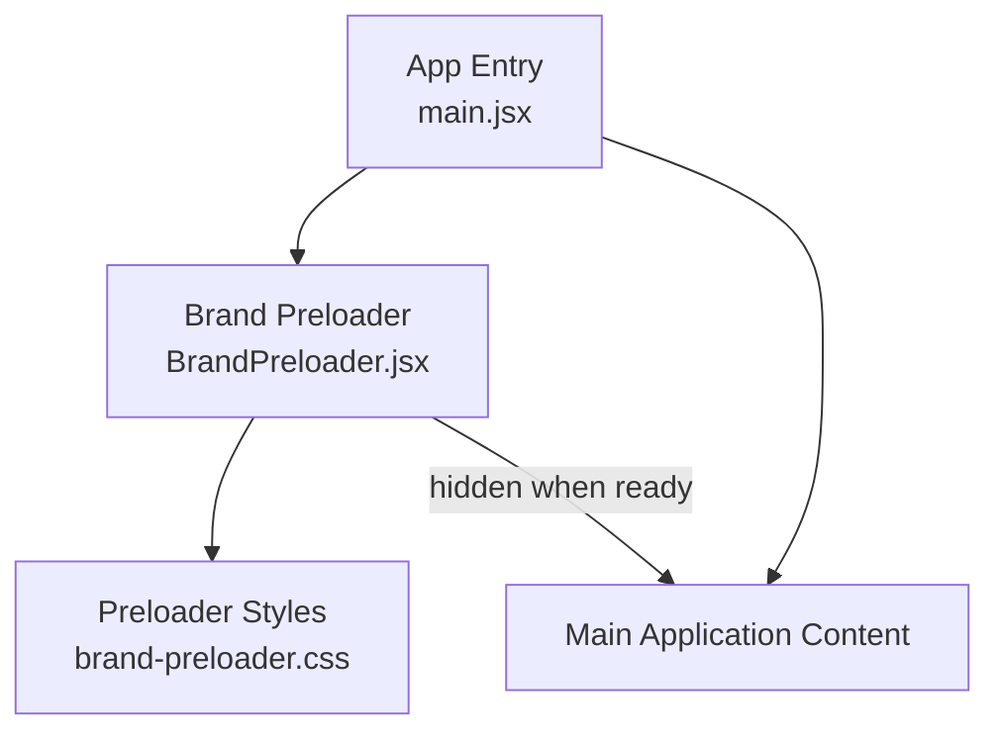
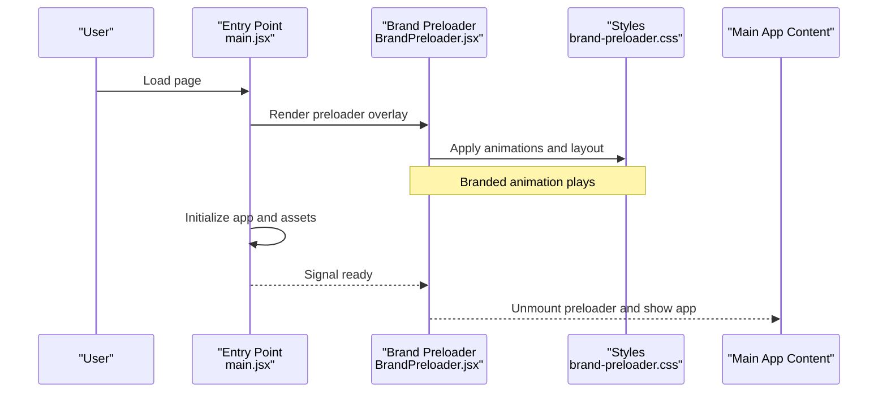
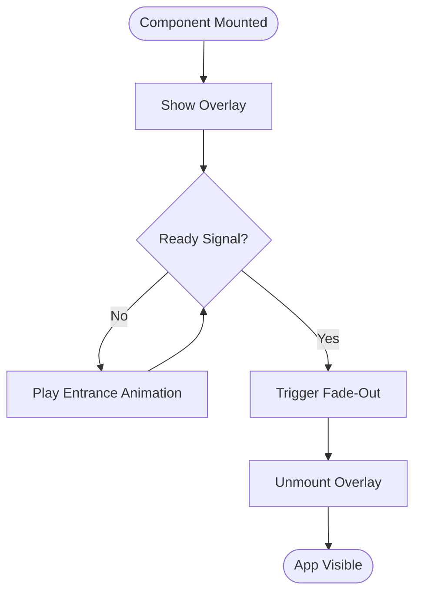
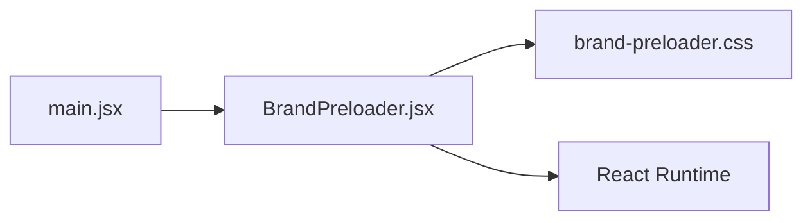

# Brand Preloader System

<cite>
**Referenced Files in This Document**
- [BrandPreloader.jsx](file://src/BrandPreloader.jsx)
- [brand-preloader.css](file://src/brand-preloader.css)
- [main.jsx](file://src/main.jsx)
</cite>

## Table of Contents
1. [Introduction](#introduction)
2. [Project Structure](#project-structure)
3. [Core Components](#core-components)
4. [Architecture Overview](#architecture-overview)
5. [Detailed Component Analysis](#detailed-component-analysis)
6. [Dependency Analysis](#dependency-analysis)
7. [Performance Considerations](#performance-considerations)
8. [Troubleshooting Guide](#troubleshooting-guide)
9. [Conclusion](#conclusion)

## Introduction
This document describes the Brand Preloader System, a React-based component that displays a branded loading experience before the main application content is ready. It covers how the preloader integrates with the app entry point, its visual behavior, and best practices for extending or customizing it.

## Project Structure
The Brand Preloader System consists of:
- A React component that controls the preloader lifecycle and state
- A stylesheet defining animations and layout for the preloader visuals
- Integration within the application’s root entry point to mount the preloader conditionally until assets are ready

**Diagram sources**
- [main.jsx](file://src/main.jsx)
- [BrandPreloader.jsx](file://src/BrandPreloader.jsx)
- [brand-preloader.css](file://src/brand-preloader.css)

**Section sources**
- [BrandPreloader.jsx](file://src/BrandPreloader.jsx)
- [brand-preloader.css](file://src/brand-preloader.css)
- [main.jsx](file://src/main.jsx)

## Core Components
- BrandPreloader (React component): Manages visibility, animation triggers, and readiness signals. Renders the branded logo and any associated motion effects while the app initializes.
- brand-preloader.css: Defines keyframes, transitions, and layout rules for the preloader overlay, logo scaling, and fade-out behavior.
- main.jsx: Mounts the preloader at app start and switches to the main UI once initialization completes.

Key responsibilities:
- Show an initial branded screen immediately on load
- Hide the preloader after critical resources or app bootstrap complete
- Provide smooth transitions between preloader and main content

**Section sources**
- [BrandPreloader.jsx](file://src/BrandPreloader.jsx)
- [brand-preloader.css](file://src/brand-preloader.css)
- [main.jsx](file://src/main.jsx)

## Architecture Overview
The preloader sits above the main application content during initialization. The entry point renders the preloader first, then mounts the primary app once ready. The preloader uses CSS-driven animations for performance and minimal JavaScript overhead.

**Diagram sources**
- [main.jsx](file://src/main.jsx)
- [BrandPreloader.jsx](file://src/BrandPreloader.jsx)
- [brand-preloader.css](file://src/brand-preloader.css)

## Detailed Component Analysis

### BrandPreloader Component
Responsibilities:
- Control overlay visibility based on app readiness
- Trigger entrance and exit animations
- Ensure accessibility by managing focus and screen reader hints where applicable

Behavioral flow:
- On mount, display the branded overlay
- Listen for readiness signals from the entry point or internal initialization logic
- When ready, initiate fade-out and unmount the overlay to reveal the main content

**Diagram sources**
- [BrandPreloader.jsx](file://src/BrandPreloader.jsx)

**Section sources**
- [BrandPreloader.jsx](file://src/BrandPreloader.jsx)

### Stylesheet: brand-preloader.css
Responsibilities:
- Define overlay container positioning and z-index
- Specify keyframes for logo scale, opacity, and rotation (if used)
- Manage transition durations and easing for smooth UX

Common patterns:
- Full-screen overlay with centered branding
- Hardware-accelerated transforms for smooth animations
- Media queries for responsive adjustments

**Section sources**
- [brand-preloader.css](file://src/brand-preloader.css)

### Integration: main.jsx
Responsibilities:
- Render the preloader at startup
- Coordinate readiness state across the app
- Swap preloader with the main application UI once initialization completes

Integration points:
- Conditional rendering based on initialization status
- Event or state signaling to the preloader to begin exit animation

**Section sources**
- [main.jsx](file://src/main.jsx)

## Dependency Analysis
The preloader has minimal dependencies:
- React runtime for component lifecycle and state
- CSS styles for presentation and animation
- The entry point for mounting and readiness coordination

**Diagram sources**
- [main.jsx](file://src/main.jsx)
- [BrandPreloader.jsx](file://src/BrandPreloader.jsx)
- [brand-preloader.css](file://src/brand-preloader.css)

**Section sources**
- [main.jsx](file://src/main.jsx)
- [BrandPreloader.jsx](file://src/BrandPreloader.jsx)
- [brand-preloader.css](file://src/brand-preloader.css)

## Performance Considerations
- Prefer CSS animations and transforms for smoother frame rates and lower CPU usage
- Keep the preloader lightweight; avoid heavy computations during initialization
- Use lazy loading for non-critical assets behind the preloader
- Ensure animations respect reduced-motion preferences for accessibility

[No sources needed since this section provides general guidance]

## Troubleshooting Guide
Common issues and resolutions:
- Preloader does not hide: Verify readiness signal propagation from the entry point to the preloader component.
- Flicker on load: Ensure the preloader is rendered synchronously at app start and that CSS is loaded before content appears.
- Animations feel choppy: Check for layout thrashing and prefer transform/opacity changes; confirm GPU acceleration via transforms.
- Accessibility concerns: Confirm that the preloader does not trap focus and that screen readers can navigate to the main content after the preloader unmounts.

**Section sources**
- [BrandPreloader.jsx](file://src/BrandPreloader.jsx)
- [brand-preloader.css](file://src/brand-preloader.css)
- [main.jsx](file://src/main.jsx)

## Conclusion
The Brand Preloader System provides a performant, accessible, and visually consistent loading experience. By keeping the preloader simple and leveraging CSS animations, it minimizes overhead while delivering a polished brand introduction. Extend or customize by updating the component’s readiness logic and the stylesheet’s animations to match evolving design needs.