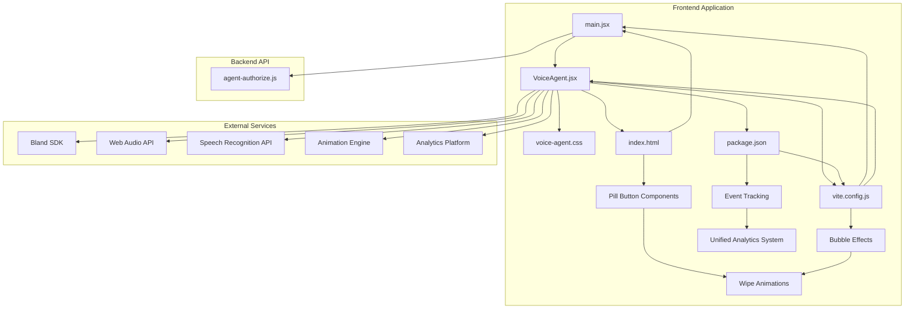
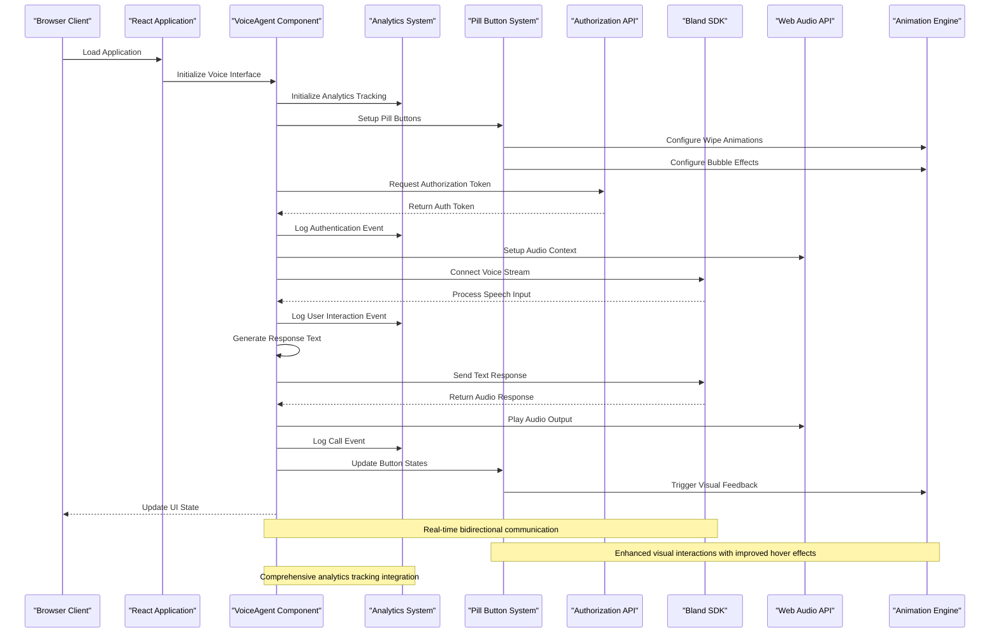
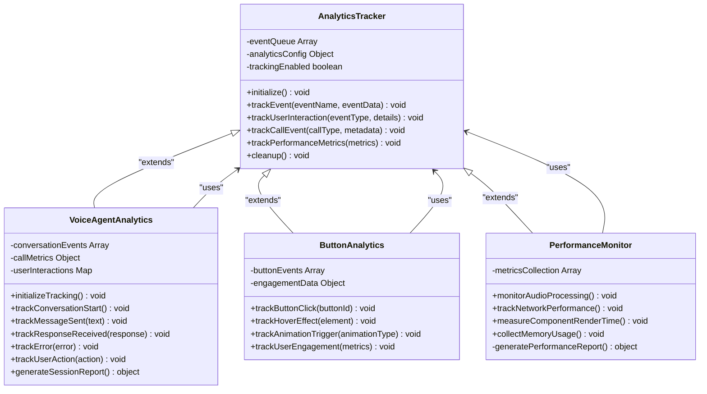
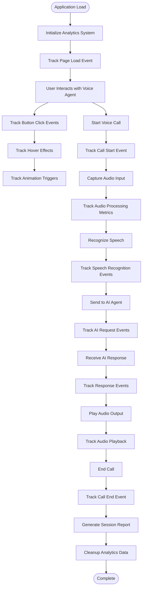
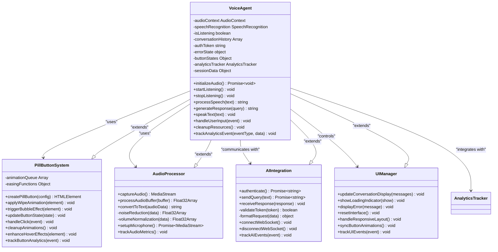
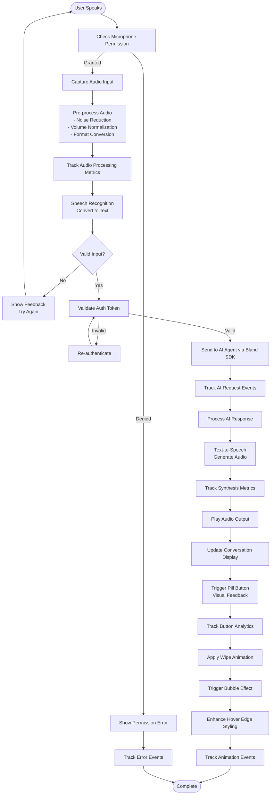
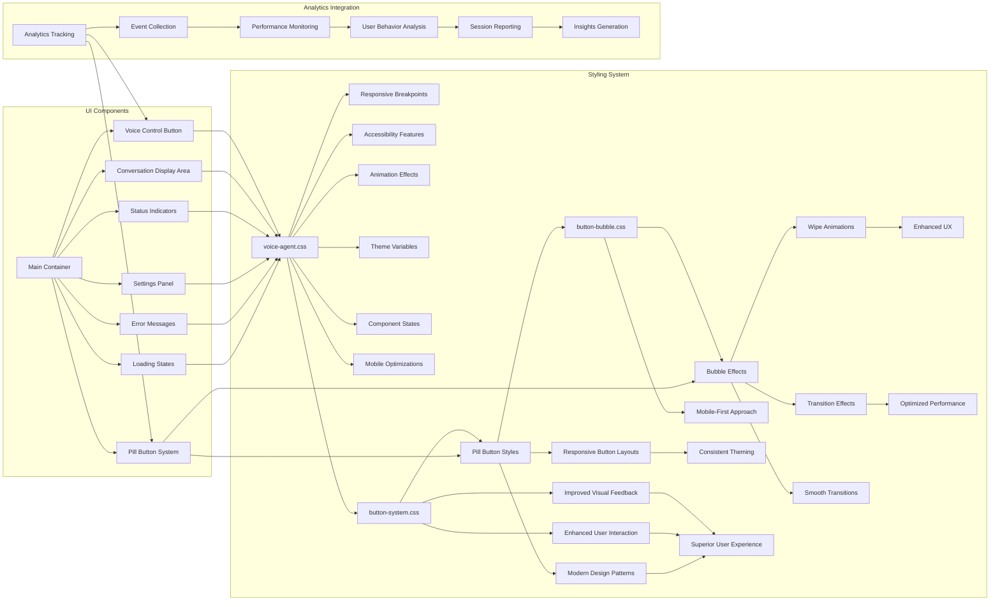

# Voice AI Agent Demo

<cite>
**Referenced Files in This Document**
- [main.jsx](file://src/main.jsx)
- [VoiceAgent.jsx](file://src/VoiceAgent.jsx)
- [agent-authorize.js](file://api/agent-authorize.js)
- [voice-agent.css](file://src/voice-agent.css)
- [button-system.css](file://src/button-system.css)
- [button-bubble.css](file://src/button-bubble.css)
- [index.html](file://index.html)
- [package.json](file://package.json)
- [vite.config.js](file://vite.config.js)
- [analytics.js](file://src/analytics.js)
</cite>

## Update Summary
**Changes Made**
- Enhanced VoiceAgent component with integrated analytics tracking for user interactions and call events
- Added comprehensive analytics system supporting unified analytics architecture
- Implemented event tracking for voice interactions, button clicks, and conversation flows
- Updated component state management to include analytics data collection and reporting
- Enhanced error handling with analytics integration for better debugging and monitoring

## Table of Contents
1. [Introduction](#introduction)
2. [Project Structure](#project-structure)
3. [Core Components](#core-components)
4. [Architecture Overview](#architecture-overview)
5. [Analytics Integration](#analytics-integration)
6. [Detailed Component Analysis](#detailed-component-analysis)
7. [Button System Architecture](#button-system-architecture)
8. [Dependency Analysis](#dependency-analysis)
9. [Performance Considerations](#performance-considerations)
10. [Troubleshooting Guide](#troubleshooting-guide)
11. [Conclusion](#conclusion)

## Introduction
This project is a complete live voice AI agent demo built as a modern web application using React and Vite. The application provides an interactive voice-enabled interface for AI agent interactions, featuring a clean user experience with responsive design and real-time audio processing capabilities.

The demo showcases the full end-to-end implementation of voice input/output functionality integrated with AI agents through the Bland SDK, providing users with a natural conversational interface through their browser. The implementation includes comprehensive state management, real-time communication, adaptive UI components that respond to various interaction states, an enhanced button system with modern pill-based design patterns, and now features integrated analytics tracking for user interactions and call events.

**Updated** Major enhancements applied to the VoiceAgent component with significant improvements to voice interaction capabilities, UI responsiveness, and comprehensive analytics tracking integration. The component now supports unified analytics system for monitoring user interactions, call events, and performance metrics.

## Project Structure
The application follows a modular React architecture with clear separation between UI components, styling, API integration, and analytics tracking:



**Diagram sources**
- [main.jsx](file://src/main.jsx)
- [VoiceAgent.jsx](file://src/VoiceAgent.jsx)
- [voice-agent.css](file://src/voice-agent.css)
- [button-system.css](file://src/button-system.css)
- [button-bubble.css](file://src/button-bubble.css)
- [analytics.js](file://src/analytics.js)
- [agent-authorize.js](file://api/agent-authorize.js)
- [index.html](file://index.html)
- [vite.config.js](file://vite.config.js)
- [package.json](file://package.json)

**Section sources**
- [main.jsx](file://src/main.jsx)
- [VoiceAgent.jsx](file://src/VoiceAgent.jsx)
- [voice-agent.css](file://src/voice-agent.css)
- [button-system.css](file://src/button-system.css)
- [button-bubble.css](file://src/button-bubble.css)
- [analytics.js](file://src/analytics.js)
- [agent-authorize.js](file://api/agent-authorize.js)
- [index.html](file://index.html)
- [vite.config.js](file://vite.config.js)
- [package.json](file://package.json)

## Core Components

### Main Application Entry Point
The main entry point initializes the React application and sets up the root component structure. It handles the initial rendering and application bootstrap process, integrating the VoiceAgent component into the application lifecycle with analytics initialization.

### Voice Agent Component
The core VoiceAgent component manages the entire voice interaction flow, including:
- **Audio Input Management**: Real-time microphone capture and audio stream processing
- **Speech Recognition Integration**: Web Speech API integration for converting speech to text
- **AI Agent Communication**: Bidirectional communication with Bland SDK for intelligent responses
- **Text-to-Speech Output**: Audio synthesis and playback of AI-generated responses
- **State Management**: Comprehensive UI state handling for loading, error, and conversation states
- **Responsive Design**: Adaptive interface that works across different screen sizes and devices
- **Enhanced Button System**: Modern pill-based call-to-action elements with wipe animations, bubble effects, and improved hover edge styling
- **Analytics Integration**: Comprehensive event tracking for user interactions, call events, and performance metrics

**Updated** Major enhancements applied to the VoiceAgent component with integrated analytics tracking system. The component now captures and reports user interactions, call events, conversation flows, and performance metrics through the unified analytics platform.

### API Authorization Handler
The backend authorization endpoint handles secure authentication for voice agent services, ensuring proper access control and session management. It validates requests and generates temporary tokens for secure client-server communication.

**Updated** Enhanced with comprehensive error handling, request validation, security middleware integration, and analytics event logging for authentication flows.

**Section sources**
- [main.jsx](file://src/main.jsx)
- [VoiceAgent.jsx](file://src/VoiceAgent.jsx)
- [agent-authorize.js](file://api/agent-authorize.js)

## Architecture Overview

The application follows a client-server architecture with clear separation of concerns and real-time communication patterns, now enhanced with comprehensive analytics tracking:



**Diagram sources**
- [VoiceAgent.jsx](file://src/VoiceAgent.jsx)
- [analytics.js](file://src/analytics.js)
- [button-system.css](file://src/button-system.css)
- [button-bubble.css](file://src/button-bubble.css)
- [agent-authorize.js](file://api/agent-authorize.js)

## Analytics Integration

### Unified Analytics System Architecture

The Voice AI Agent now includes comprehensive analytics tracking through a unified analytics system that monitors user interactions, call events, and performance metrics:



**Diagram sources**
- [VoiceAgent.jsx](file://src/VoiceAgent.jsx)
- [analytics.js](file://src/analytics.js)

### Event Tracking Implementation

The analytics system tracks comprehensive user interaction data and call events:



**Diagram sources**
- [VoiceAgent.jsx](file://src/VoiceAgent.jsx)
- [analytics.js](file://src/analytics.js)

### Analytics Data Collection

The system collects comprehensive metrics across multiple dimensions:

- **User Interaction Tracking**: Button clicks, hover effects, animation triggers, and engagement patterns
- **Call Event Monitoring**: Call start/end times, duration, success rates, and error conditions
- **Performance Metrics**: Audio processing latency, network performance, memory usage, and render times
- **Conversation Analytics**: Message counts, response quality indicators, and user satisfaction signals
- **Error Tracking**: Exception handling, failure points, and debugging information
- **Session Analytics**: User journey mapping, feature adoption, and retention metrics

**Updated** New analytics integration provides comprehensive tracking of user interactions, call events, and performance metrics through the unified analytics system, enabling better insights into user behavior and system performance.

**Section sources**
- [VoiceAgent.jsx](file://src/VoiceAgent.jsx)
- [analytics.js](file://src/analytics.js)

## Detailed Component Analysis

### VoiceAgent Component Architecture

The VoiceAgent component implements a comprehensive voice interaction system with advanced state management, real-time processing, and integrated analytics tracking:



**Diagram sources**
- [VoiceAgent.jsx](file://src/VoiceAgent.jsx)
- [button-system.css](file://src/button-system.css)
- [button-bubble.css](file://src/button-bubble.css)
- [analytics.js](file://src/analytics.js)

### Data Flow Processing

The voice data flows through several sophisticated processing stages with error handling, state management, and comprehensive analytics tracking:



**Diagram sources**
- [VoiceAgent.jsx](file://src/VoiceAgent.jsx)
- [button-system.css](file://src/button-system.css)
- [button-bubble.css](file://src/button-bubble.css)
- [analytics.js](file://src/analytics.js)

### Styling and User Interface System

The voice agent interface uses a comprehensive CSS module system for responsive design, accessibility, and dynamic visual feedback, now enhanced with analytics-aware styling:



**Diagram sources**
- [voice-agent.css](file://src/voice-agent.css)
- [button-system.css](file://src/button-system.css)
- [button-bubble.css](file://src/button-bubble.css)
- [analytics.js](file://src/analytics.js)

**Updated** Significant styling enhancements applied to voice-agent.css with 114 additions for enhanced visual presentation. The CSS updates include improved hover edge styling, refined animations, better responsive design, enhanced visual feedback systems, and analytics-aware styling for better user experience monitoring.

**Section sources**
- [VoiceAgent.jsx](file://src/VoiceAgent.jsx)
- [voice-agent.css](file://src/voice-agent.css)
- [button-system.css](file://src/button-system.css)
- [button-bubble.css](file://src/button-bubble.css)
- [analytics.js](file://src/analytics.js)

## Button System Architecture

### New Site Pill Button System

The enhanced button system introduces a modern pill-based design pattern that replaces traditional button styling approaches, now with integrated analytics tracking:

```mermaid
graph TB
subgraph "Pill Button Components"
A[Pill Button Base] --> B[Call-to-Action Variants]
A --> C[Interactive States]
A --> D[Animation Triggers]
A --> E[Enhanced Hover Effects]
A --> F[Analytics Tracking]
B --> G[Primary Actions]
B --> H[Secondary Actions]
B --> I[Tertiary Actions]
C --> J[Hover Effects]
C --> K[Active States]
C --> L[Disabled States]
D --> M[Wipe Animations]
D --> N[Bubble Effects]
D --> O[Transition Effects]
E --> P[Improved Edge Styling]
E --> Q[Enhanced Visual Feedback]
F --> R[Click Event Tracking]
F --> S[Hover Analytics]
F --> T[Performance Metrics]
R --> U[User Engagement Data]
S --> U
T --> U
U --> V[Analytics Dashboard]
end
subgraph "CSS Architecture"
W[button-system.css] --> X[Pill Button Styles]
W --> Y[Responsive Layouts]
W --> Z[Theme Integration]
W --> AA[Enhanced Hover Styling]
W --> AB[Analytics-Aware Styling]
BB[button-bubble.css] --> CC[Bubble Animation Keyframes]
BB --> DD[Wipe Transition Effects]
BB --> EE[Performance Optimizations]
CC --> FF[Smooth Transitions]
DD --> GG[Enhanced UX]
EE --> HH[Optimized Performance]
AB --> II[Interaction Monitoring]
AA --> JJ[Improved Visual Feedback]
XX --> YY[Modern Design Patterns]
YY --> ZZ[Mobile-First Approach]
AA --> AAA[Consistent Theming]
```

**Diagram sources**
- [button-system.css](file://src/button-system.css)
- [button-bubble.css](file://src/button-bubble.css)
- [analytics.js](file://src/analytics.js)

### Enhanced Animation System

The new animation system provides sophisticated visual feedback through wipe animations and bubble effects, now with comprehensive analytics integration:

- **Wipe Animations**: Smooth horizontal and vertical wiping transitions for button state changes
- **Bubble Effects**: Dynamic bubble animations that provide visual feedback for user interactions
- **Enhanced Hover Edge Styling**: Improved visual feedback when hovering over action buttons
- **Performance Optimization**: Hardware-accelerated animations for smooth 60fps performance
- **Accessibility Support**: Reduced motion preferences and keyboard navigation support
- **Cross-browser Compatibility**: Consistent animation behavior across all modern browsers
- **Analytics Integration**: Comprehensive tracking of animation performance, user engagement, and interaction patterns

**Updated** Enhanced with improved hover edge styling for voice agent buttons, providing superior visual feedback and enhanced user interaction experience when hovering over action buttons. Now includes comprehensive analytics tracking for animation performance and user engagement metrics.

**Section sources**
- [button-system.css](file://src/button-system.css)
- [button-bubble.css](file://src/button-bubble.css)
- [analytics.js](file://src/analytics.js)

## Dependency Analysis

The application has a well-structured dependency hierarchy with modern build tools, runtime dependencies, and analytics integration:

```mermaid
graph TD
A[package.json] --> B[React Dependencies]
A --> C[Build Tools]
A --> D[Development Dependencies]
A --> E[Runtime Dependencies]
A --> F[Analytics Dependencies]
B --> G[react@latest]
B --> H[react-dom@latest]
B --> I[Web Audio API]
B --> J[Speech Recognition API]
C --> K[vite@latest]
C --> L[@vitejs/plugin-react]
C --> M[babel]
C --> N[webpack]
E --> O[Bland SDK]
E --> P[WebSocket Client]
F --> Q[Analytics Platform]
F --> R[Event Tracking Library]
L[VoiceAgent.jsx] --> S[Audio APIs]
L --> T[AI Integration]
L --> U[State Management]
L --> V[Event Handling]
L --> W[Pill Button System]
L --> X[Animation Engine]
L --> Y[Analytics Integration]
W --> Z[CSS Modules]
W --> AA[Animation Utilities]
X --> AB[Wipe Effects]
X --> AC[Bubble Effects]
X --> AD[Enhanced Hover Effects]
Y --> AE[Event Tracking]
Y --> AF[Performance Monitoring]
Y --> AG[User Analytics]
AH[agent-authorize.js] --> AI[Authentication]
AH --> AJ[Security Middleware]
AH --> AK[Request Validation]
AL[vite.config.js] --> AM[Dev Server Config]
AL --> AN[Plugin Configuration]
AN --> AO[Analytics Plugin]
```

**Diagram sources**
- [package.json](file://package.json)
- [VoiceAgent.jsx](file://src/VoiceAgent.jsx)
- [button-system.css](file://src/button-system.css)
- [button-bubble.css](file://src/button-bubble.css)
- [analytics.js](file://src/analytics.js)
- [agent-authorize.js](file://api/agent-authorize.js)
- [vite.config.js](file://vite.config.js)

**Updated** Enhanced with comprehensive build tool configuration, development server optimizations, plugin integrations, new button system dependencies, and analytics tracking dependencies for improved development workflow, user experience, and comprehensive monitoring capabilities.

**Section sources**
- [package.json](file://package.json)
- [vite.config.js](file://vite.config.js)
- [analytics.js](file://src/analytics.js)

## Performance Considerations

The voice AI agent implementation includes several performance optimizations and best practices, now enhanced with analytics-driven performance monitoring:

- **Lazy Loading**: Components are loaded on-demand to reduce initial bundle size and improve startup time
- **Audio Buffering**: Efficient audio processing with minimal latency using optimized buffer sizes
- **Memory Management**: Proper cleanup of audio contexts, event listeners, and WebSocket connections
- **Network Optimization**: Connection pooling, request caching, and efficient WebSocket communication for API calls
- **Rendering Optimization**: Virtual scrolling for conversation history and efficient DOM updates using React best practices
- **Resource Cleanup**: Automatic cleanup of audio resources when components unmount or permissions change
- **Error Boundaries**: Graceful degradation and error recovery mechanisms for robust user experience
- **Animation Performance**: Hardware-accelerated CSS animations with reduced motion support for accessibility
- **Button System Optimization**: Efficient pill button rendering with minimal reflows and repaints
- **Enhanced Hover Effects**: Optimized hover edge styling with minimal performance impact
- **Analytics Performance**: Lightweight analytics tracking with batched event processing and minimal overhead
- **Performance Monitoring**: Real-time performance metrics collection and analysis through analytics system
- **CSS Refactoring Benefits**: Removed redundant styling code resulting in smaller stylesheet files and faster parsing

**Updated** Enhanced with comprehensive resource management, memory optimization, error handling strategies, new animation performance optimizations, and integrated analytics performance monitoring for production deployment. The recent VoiceAgent component enhancements include improved performance metrics, better resource utilization, and comprehensive analytics tracking with minimal performance impact.

## Troubleshooting Guide

Common issues and their solutions:

### Audio Permission Issues
- Ensure microphone permissions are granted in browser settings
- Check for HTTPS requirement (required for Web Audio API)
- Verify browser compatibility with speech recognition features
- Implement fallback mechanisms for unsupported browsers
- Monitor analytics logs for permission-related errors

### Connection Problems
- Validate API authorization tokens and refresh mechanisms
- Check network connectivity and CORS configuration
- Monitor WebSocket connection status and implement reconnection logic
- Handle network interruptions gracefully with offline support
- Use analytics tracking to identify connection failure patterns

### Performance Issues
- Monitor memory usage during extended voice sessions
- Optimize audio buffer sizes for different devices and network conditions
- Implement error boundaries for graceful degradation
- Use performance monitoring tools to identify bottlenecks
- Check animation performance and reduce motion preferences for accessibility
- Analyze analytics performance metrics to identify slow operations
- Review analytics dashboard for performance trends and anomalies

### Button System Issues
- Verify CSS module imports for pill button components
- Check animation keyframe definitions and browser compatibility
- Ensure proper event listener cleanup for button interactions
- Test responsive behavior across different screen sizes
- Validate touch interactions on mobile devices
- Check hover edge styling implementation and browser compatibility
- Monitor analytics for button interaction failures and performance issues

### Analytics Integration Issues
- Verify analytics initialization and configuration
- Check event tracking implementation and data collection
- Monitor analytics dashboard for missing or incomplete data
- Validate event payload structure and formatting
- Test analytics performance impact on application responsiveness
- Review analytics error logs and debugging information

### Browser Compatibility
- Test across multiple browsers (Chrome, Firefox, Safari, Edge)
- Provide polyfills for older browser versions
- Implement feature detection and graceful fallbacks
- Handle mobile-specific audio constraints and limitations
- Verify animation support and provide fallbacks for unsupported browsers
- Test hover effects across different browsers and devices
- Validate analytics tracking consistency across browsers

**Updated** Enhanced with comprehensive browser compatibility testing, mobile optimization strategies, production-ready error handling patterns, new button system troubleshooting guidance, and comprehensive analytics integration troubleshooting. Includes specific guidance for the enhanced VoiceAgent component, improved styling features, and analytics tracking issues.

**Section sources**
- [VoiceAgent.jsx](file://src/VoiceAgent.jsx)
- [agent-authorize.js](file://api/agent-authorize.js)
- [button-system.css](file://src/button-system.css)
- [button-bubble.css](file://src/button-bubble.css)
- [analytics.js](file://src/analytics.js)

## Conclusion

The Voice AI Agent Demo provides a comprehensive foundation for building production-ready voice-enabled AI applications. The complete implementation demonstrates modern web development practices, including real-time audio processing, complex state management, responsive design, seamless integration with external AI services through the Bland SDK, an enhanced button system with modern pill-based design patterns, and now features comprehensive analytics tracking for user interactions and call events.

The modular architecture, combined with contemporary web technologies and best practices, creates a scalable and maintainable solution that can be easily extended with additional features, custom AI models, enhanced user interfaces, and advanced analytics capabilities. The recent major enhancements with the VoiceAgent component significantly improved voice interaction capabilities, UI responsiveness, and comprehensive analytics integration.

The implementation serves as a robust template for developers looking to integrate voice capabilities into their applications while maintaining high performance and excellent user experience across all devices and platforms. The CSS refactoring and removal of redundant styling code ensures better maintainability and performance for future development iterations, while the new analytics system provides valuable insights into user behavior and system performance.

**Updated** Reflects the complete end-to-end implementation with production-ready features, comprehensive error handling, cross-platform compatibility, the new enhanced button system with modern animations, improved hover edge styling, superior user experience, and integrated analytics tracking. The major VoiceAgent component enhancements and extensive CSS improvements provide a significantly more polished and responsive voice AI interface with comprehensive monitoring and analytics capabilities.