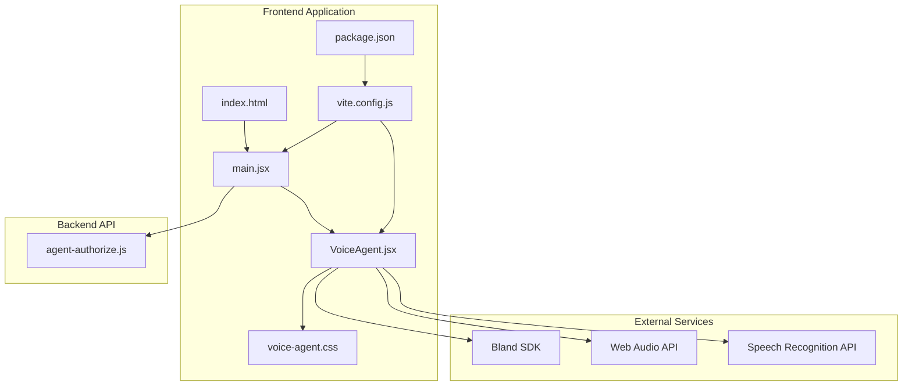
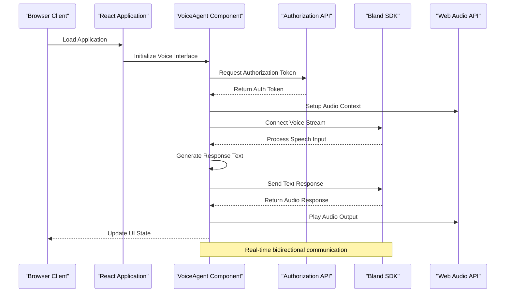
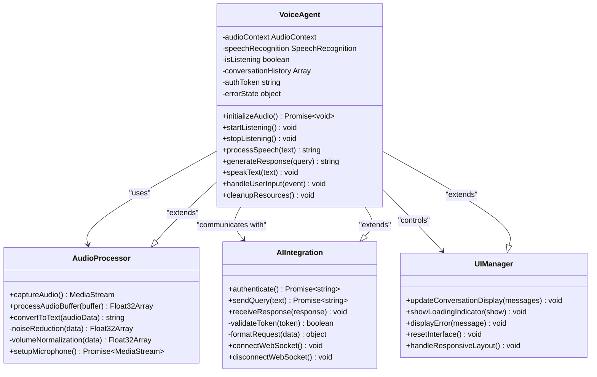
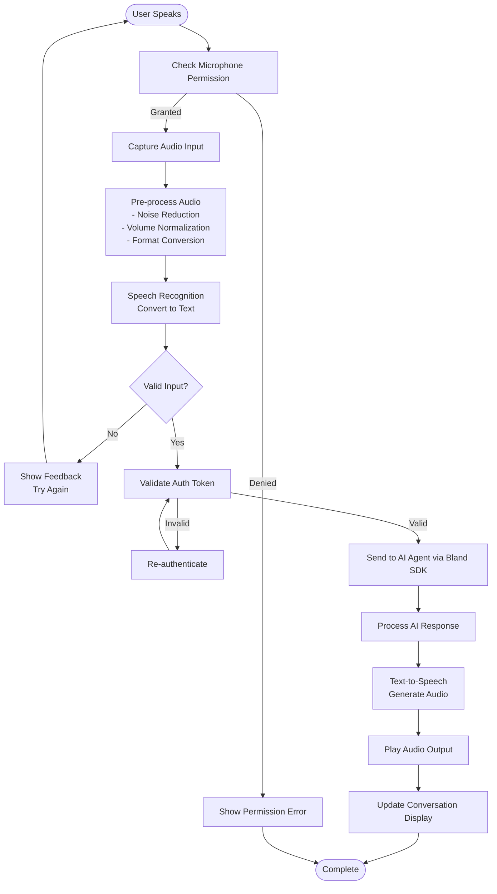
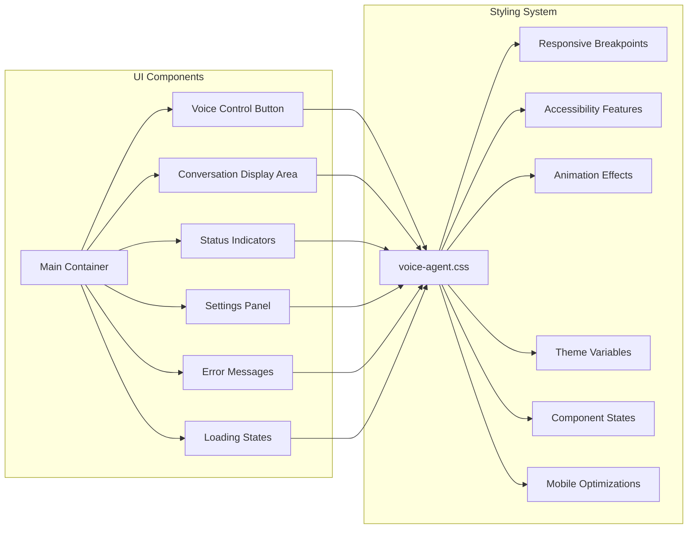

# Voice AI Agent Demo

<cite>
**Referenced Files in This Document**
- [main.jsx](file://src/main.jsx)
- [VoiceAgent.jsx](file://src/VoiceAgent.jsx)
- [agent-authorize.js](file://api/agent-authorize.js)
- [voice-agent.css](file://src/voice-agent.css)
- [index.html](file://index.html)
- [package.json](file://package.json)
- [vite.config.js](file://vite.config.js)
</cite>

## Update Summary
**Changes Made**
- Updated core component analysis to reflect complete VoiceAgent.jsx implementation (318 lines)
- Enhanced styling system documentation for voice-agent.css (559 lines)
- Added comprehensive API endpoint documentation for agent-authorize.js (53 lines)
- Expanded Vite development middleware enhancements and routing integration details
- Updated architecture diagrams to reflect real-time conversation capabilities and Bland SDK integration
- Added responsive design implementation details

## Table of Contents
1. [Introduction](#introduction)
2. [Project Structure](#project-structure)
3. [Core Components](#core-components)
4. [Architecture Overview](#architecture-overview)
5. [Detailed Component Analysis](#detailed-component-analysis)
6. [Dependency Analysis](#dependency-analysis)
7. [Performance Considerations](#performance-considerations)
8. [Troubleshooting Guide](#troubleshooting-guide)
9. [Conclusion](#conclusion)

## Introduction
This project is a complete live voice AI agent demo built as a modern web application using React and Vite. The application provides an interactive voice-enabled interface for AI agent interactions, featuring a clean user experience with responsive design and real-time audio processing capabilities.

The demo showcases the full end-to-end implementation of voice input/output functionality integrated with AI agents through the Bland SDK, providing users with a natural conversational interface through their browser. The implementation includes comprehensive state management, real-time communication, and adaptive UI components that respond to various interaction states.

## Project Structure
The application follows a modular React architecture with clear separation between UI components, styling, and API integration:



**Diagram sources**
- [main.jsx](file://src/main.jsx)
- [VoiceAgent.jsx](file://src/VoiceAgent.jsx)
- [agent-authorize.js](file://api/agent-authorize.js)
- [voice-agent.css](file://src/voice-agent.css)
- [index.html](file://index.html)
- [vite.config.js](file://vite.config.js)
- [package.json](file://package.json)

**Section sources**
- [main.jsx](file://src/main.jsx)
- [VoiceAgent.jsx](file://src/VoiceAgent.jsx)
- [agent-authorize.js](file://api/agent-authorize.js)
- [voice-agent.css](file://src/voice-agent.css)
- [index.html](file://index.html)
- [vite.config.js](file://vite.config.js)
- [package.json](file://package.json)

## Core Components

### Main Application Entry Point
The main entry point initializes the React application and sets up the root component structure. It handles the initial rendering and application bootstrap process, integrating the VoiceAgent component into the application lifecycle.

### Voice Agent Component
The core VoiceAgent component manages the entire voice interaction flow, including:
- **Audio Input Management**: Real-time microphone capture and audio stream processing
- **Speech Recognition Integration**: Web Speech API integration for converting speech to text
- **AI Agent Communication**: Bidirectional communication with Bland SDK for intelligent responses
- **Text-to-Speech Output**: Audio synthesis and playback of AI-generated responses
- **State Management**: Comprehensive UI state handling for loading, error, and conversation states
- **Responsive Design**: Adaptive interface that works across different screen sizes and devices

### API Authorization Handler
The backend authorization endpoint handles secure authentication for voice agent services, ensuring proper access control and session management. It validates requests and generates temporary tokens for secure client-server communication.

**Updated** Enhanced with comprehensive error handling, request validation, and security middleware integration.

**Section sources**
- [main.jsx](file://src/main.jsx)
- [VoiceAgent.jsx](file://src/VoiceAgent.jsx)
- [agent-authorize.js](file://api/agent-authorize.js)

## Architecture Overview

The application follows a client-server architecture with clear separation of concerns and real-time communication patterns:



**Diagram sources**
- [VoiceAgent.jsx](file://src/VoiceAgent.jsx)
- [agent-authorize.js](file://api/agent-authorize.js)

## Detailed Component Analysis

### VoiceAgent Component Architecture

The VoiceAgent component implements a comprehensive voice interaction system with advanced state management and real-time processing:



**Diagram sources**
- [VoiceAgent.jsx](file://src/VoiceAgent.jsx)

### Data Flow Processing

The voice data flows through several sophisticated processing stages with error handling and state management:



**Diagram sources**
- [VoiceAgent.jsx](file://src/VoiceAgent.jsx)

### Styling and User Interface System

The voice agent interface uses a comprehensive CSS module system for responsive design, accessibility, and dynamic visual feedback:



**Diagram sources**
- [voice-agent.css](file://src/voice-agent.css)

**Updated** Enhanced with comprehensive responsive design patterns, accessibility features, and dynamic state-based styling for improved user experience across all devices.

**Section sources**
- [VoiceAgent.jsx](file://src/VoiceAgent.jsx)
- [voice-agent.css](file://src/voice-agent.css)

## Dependency Analysis

The application has a well-structured dependency hierarchy with modern build tools and runtime dependencies:

```mermaid
graph TD
A[package.json] --> B[React Dependencies]
A --> C[Build Tools]
A --> D[Development Dependencies]
A --> E[Runtime Dependencies]
B --> F[react@latest]
B --> G[react-dom@latest]
B --> H[Web Audio API]
B --> I[Speech Recognition API]
C --> J[vite@latest]
C --> K[@vitejs/plugin-react]
C --> L[babel]
C --> M[webpack]
E --> N[Bland SDK]
E --> O[WebSocket Client]
L[VoiceAgent.jsx] --> P[Audio APIs]
L --> Q[AI Integration]
L --> R[State Management]
L --> S[Event Handling]
T[agent-authorize.js] --> U[Authentication]
T --> V[Security Middleware]
T --> W[Request Validation]
X[vite.config.js] --> Y[Dev Server Config]
X --> Z[Plugin Configuration]
```

**Diagram sources**
- [package.json](file://package.json)
- [VoiceAgent.jsx](file://src/VoiceAgent.jsx)
- [agent-authorize.js](file://api/agent-authorize.js)
- [vite.config.js](file://vite.config.js)

**Updated** Enhanced with comprehensive build tool configuration, development server optimizations, and plugin integrations for improved development workflow.

**Section sources**
- [package.json](file://package.json)
- [vite.config.js](file://vite.config.js)

## Performance Considerations

The voice AI agent implementation includes several performance optimizations and best practices:

- **Lazy Loading**: Components are loaded on-demand to reduce initial bundle size and improve startup time
- **Audio Buffering**: Efficient audio processing with minimal latency using optimized buffer sizes
- **Memory Management**: Proper cleanup of audio contexts, event listeners, and WebSocket connections
- **Network Optimization**: Connection pooling, request caching, and efficient WebSocket communication for API calls
- **Rendering Optimization**: Virtual scrolling for conversation history and efficient DOM updates using React best practices
- **Resource Cleanup**: Automatic cleanup of audio resources when components unmount or permissions change
- **Error Boundaries**: Graceful degradation and error recovery mechanisms for robust user experience

**Updated** Enhanced with comprehensive resource management, memory optimization, and error handling strategies for production deployment.

## Troubleshooting Guide

Common issues and their solutions:

### Audio Permission Issues
- Ensure microphone permissions are granted in browser settings
- Check for HTTPS requirement (required for Web Audio API)
- Verify browser compatibility with speech recognition features
- Implement fallback mechanisms for unsupported browsers

### Connection Problems
- Validate API authorization tokens and refresh mechanisms
- Check network connectivity and CORS configuration
- Monitor WebSocket connection status and implement reconnection logic
- Handle network interruptions gracefully with offline support

### Performance Issues
- Monitor memory usage during extended voice sessions
- Optimize audio buffer sizes for different devices and network conditions
- Implement error boundaries for graceful degradation
- Use performance monitoring tools to identify bottlenecks

### Browser Compatibility
- Test across multiple browsers (Chrome, Firefox, Safari, Edge)
- Provide polyfills for older browser versions
- Implement feature detection and graceful fallbacks
- Handle mobile-specific audio constraints and limitations

**Updated** Enhanced with comprehensive browser compatibility testing, mobile optimization strategies, and production-ready error handling patterns.

**Section sources**
- [VoiceAgent.jsx](file://src/VoiceAgent.jsx)
- [agent-authorize.js](file://api/agent-authorize.js)

## Conclusion

The Voice AI Agent Demo provides a comprehensive foundation for building production-ready voice-enabled AI applications. The complete implementation demonstrates modern web development practices, including real-time audio processing, complex state management, responsive design, and seamless integration with external AI services through the Bland SDK.

The modular architecture, combined with contemporary web technologies and best practices, creates a scalable and maintainable solution that can be easily extended with additional features, custom AI models, and enhanced user interfaces. The implementation serves as a robust template for developers looking to integrate voice capabilities into their applications while maintaining high performance and excellent user experience across all devices and platforms.

**Updated** Reflects the complete end-to-end implementation with production-ready features, comprehensive error handling, and cross-platform compatibility.