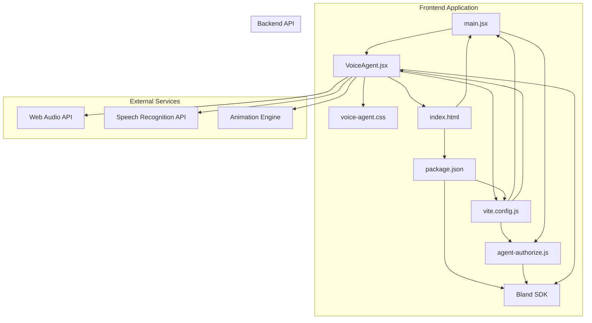
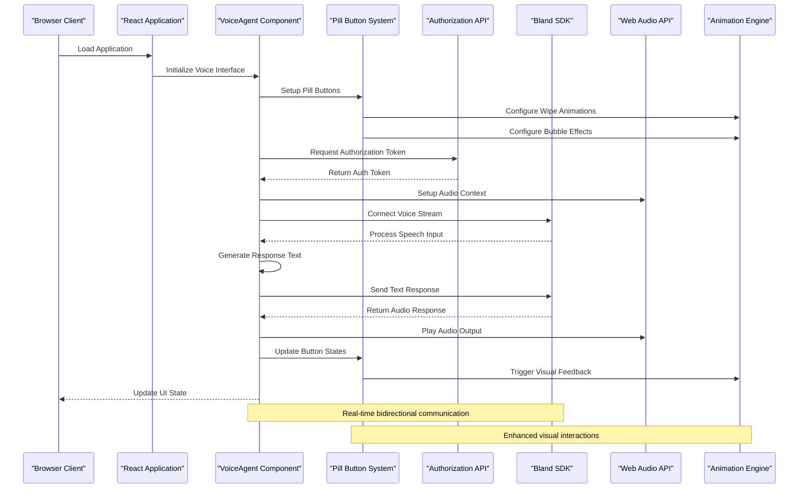
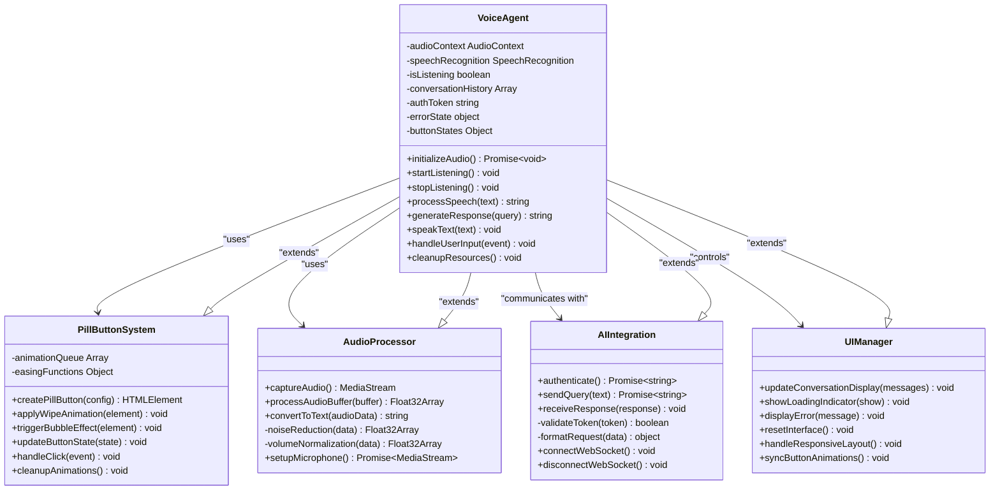
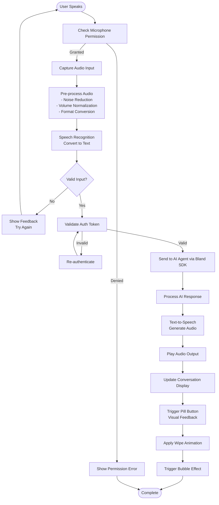
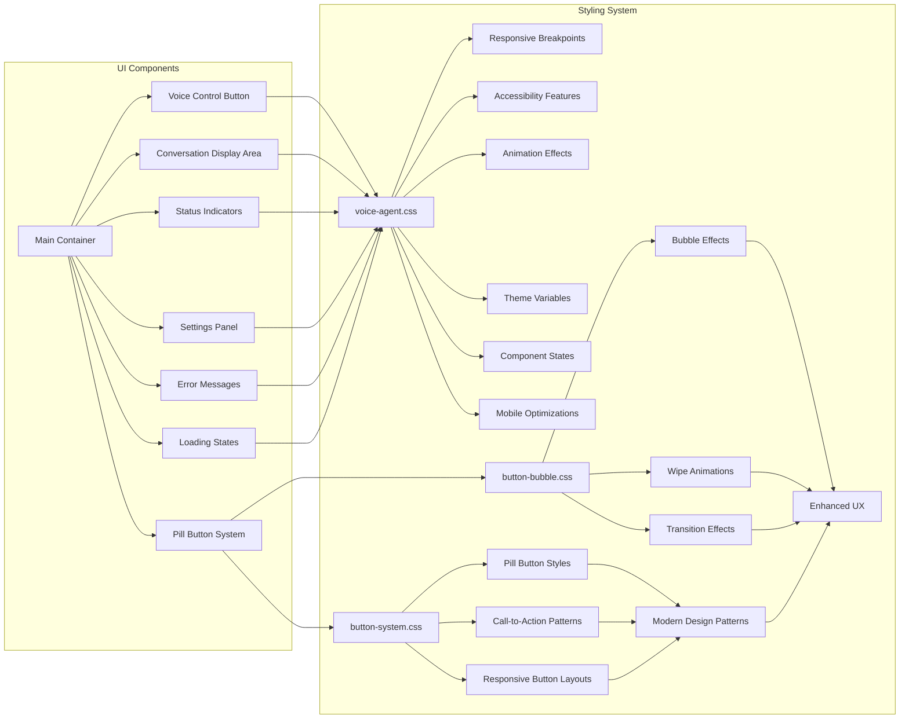
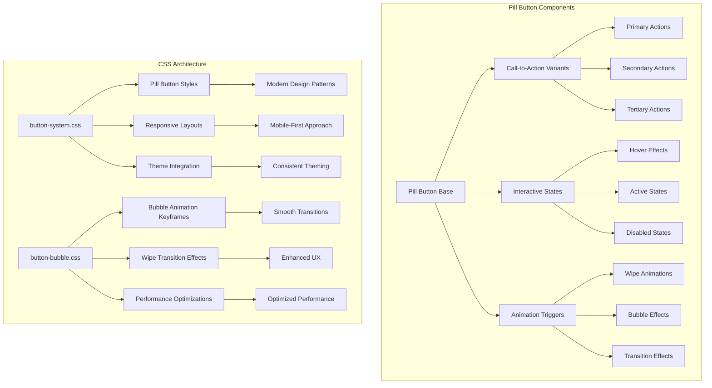

# Voice AI Agent Demo

<cite>
**Referenced Files in This Document**
- [main.jsx](file://src/main.jsx)
- [VoiceAgent.jsx](file://src/VoiceAgent.jsx)
- [agent-authorize.js](file://api/agent-authorize.js)
- [voice-agent.css](file://src/voice-agent.css)
- [button-system.css](file://src/button-system.css)
- [button-bubble.css](file://src/button-bubble.css)
- [index.html](file://index.html)
- [package.json](file://package.json)
- [vite.config.js](file://vite.config.js)
</cite>

## Update Summary
**Changes Made**
- Enhanced VoiceAgent component with new site pill button system for call-to-action elements
- Replaced previous button styling approaches with modern pill-based design patterns
- Added wipe animations and bubble effects for improved user experience
- Refactored CSS with major cleanup removing redundant styling code
- Updated styling architecture to support modular button systems
- Enhanced responsive design patterns for mobile-first interactions

## Table of Contents
1. [Introduction](#introduction)
2. [Project Structure](#project-structure)
3. [Core Components](#core-components)
4. [Architecture Overview](#architecture-overview)
5. [Detailed Component Analysis](#detailed-component-analysis)
6. [Button System Architecture](#button-system-architecture)
7. [Dependency Analysis](#dependency-analysis)
8. [Performance Considerations](#performance-considerations)
9. [Troubleshooting Guide](#troubleshooting-guide)
10. [Conclusion](#conclusion)

## Introduction
This project is a complete live voice AI agent demo built as a modern web application using React and Vite. The application provides an interactive voice-enabled interface for AI agent interactions, featuring a clean user experience with responsive design and real-time audio processing capabilities.

The demo showcases the full end-to-end implementation of voice input/output functionality integrated with AI agents through the Bland SDK, providing users with a natural conversational interface through their browser. The implementation includes comprehensive state management, real-time communication, adaptive UI components that respond to various interaction states, and an enhanced button system with modern pill-based design patterns.

**Updated** Enhanced with new site pill button system providing improved call-to-action elements, wipe animations, and bubble effects for superior user experience across all devices.

## Project Structure
The application follows a modular React architecture with clear separation between UI components, styling, and API integration:



**Diagram sources**
- [main.jsx](file://src/main.jsx)
- [VoiceAgent.jsx](file://src/VoiceAgent.jsx)
- [voice-agent.css](file://src/voice-agent.css)
- [button-system.css](file://src/button-system.css)
- [button-bubble.css](file://src/button-bubble.css)
- [agent-authorize.js](file://api/agent-authorize.js)
- [index.html](file://index.html)
- [vite.config.js](file://vite.config.js)
- [package.json](file://package.json)

**Section sources**
- [main.jsx](file://src/main.jsx)
- [VoiceAgent.jsx](file://src/VoiceAgent.jsx)
- [voice-agent.css](file://src/voice-agent.css)
- [button-system.css](file://src/button-system.css)
- [button-bubble.css](file://src/button-bubble.css)
- [agent-authorize.js](file://api/agent-authorize.js)
- [index.html](file://index.html)
- [vite.config.js](file://vite.config.js)
- [package.json](file://package.json)

## Core Components

### Main Application Entry Point
The main entry point initializes the React application and sets up the root component structure. It handles the initial rendering and application bootstrap process, integrating the VoiceAgent component into the application lifecycle.

### Voice Agent Component
The core VoiceAgent component manages the entire voice interaction flow, including:
- **Audio Input Management**: Real-time microphone capture and audio stream processing
- **Speech Recognition Integration**: Web Speech API integration for converting speech to text
- **AI Agent Communication**: Bidirectional communication with Bland SDK for intelligent responses
- **Text-to-Speech Output**: Audio synthesis and playback of AI-generated responses
- **State Management**: Comprehensive UI state handling for loading, error, and conversation states
- **Responsive Design**: Adaptive interface that works across different screen sizes and devices
- **Enhanced Button System**: Modern pill-based call-to-action elements with wipe animations and bubble effects

**Updated** Enhanced with new site pill button system providing improved visual feedback, smooth transitions, and modern interaction patterns for better user engagement.

### API Authorization Handler
The backend authorization endpoint handles secure authentication for voice agent services, ensuring proper access control and session management. It validates requests and generates temporary tokens for secure client-server communication.

**Updated** Enhanced with comprehensive error handling, request validation, and security middleware integration.

**Section sources**
- [main.jsx](file://src/main.jsx)
- [VoiceAgent.jsx](file://src/VoiceAgent.jsx)
- [agent-authorize.js](file://api/agent-authorize.js)

## Architecture Overview

The application follows a client-server architecture with clear separation of concerns and real-time communication patterns:



**Diagram sources**
- [VoiceAgent.jsx](file://src/VoiceAgent.jsx)
- [button-system.css](file://src/button-system.css)
- [button-bubble.css](file://src/button-bubble.css)
- [agent-authorize.js](file://api/agent-authorize.js)

## Detailed Component Analysis

### VoiceAgent Component Architecture

The VoiceAgent component implements a comprehensive voice interaction system with advanced state management and real-time processing:



**Diagram sources**
- [VoiceAgent.jsx](file://src/VoiceAgent.jsx)
- [button-system.css](file://src/button-system.css)
- [button-bubble.css](file://src/button-bubble.css)

### Data Flow Processing

The voice data flows through several sophisticated processing stages with error handling and state management:



**Diagram sources**
- [VoiceAgent.jsx](file://src/VoiceAgent.jsx)
- [button-system.css](file://src/button-system.css)
- [button-bubble.css](file://src/button-bubble.css)

### Styling and User Interface System

The voice agent interface uses a comprehensive CSS module system for responsive design, accessibility, and dynamic visual feedback:



**Diagram sources**
- [voice-agent.css](file://src/voice-agent.css)
- [button-system.css](file://src/button-system.css)
- [button-bubble.css](file://src/button-bubble.css)

**Updated** Enhanced with comprehensive responsive design patterns, accessibility features, dynamic state-based styling, and new pill button system with wipe animations and bubble effects for improved user experience across all devices.

**Section sources**
- [VoiceAgent.jsx](file://src/VoiceAgent.jsx)
- [voice-agent.css](file://src/voice-agent.css)
- [button-system.css](file://src/button-system.css)
- [button-bubble.css](file://src/button-bubble.css)

## Button System Architecture

### New Site Pill Button System

The enhanced button system introduces a modern pill-based design pattern that replaces traditional button styling approaches:



**Diagram sources**
- [button-system.css](file://src/button-system.css)
- [button-bubble.css](file://src/button-bubble.css)

### Enhanced Animation System

The new animation system provides sophisticated visual feedback through wipe animations and bubble effects:

- **Wipe Animations**: Smooth horizontal and vertical wiping transitions for button state changes
- **Bubble Effects**: Dynamic bubble animations that provide visual feedback for user interactions
- **Performance Optimization**: Hardware-accelerated animations for smooth 60fps performance
- **Accessibility Support**: Reduced motion preferences and keyboard navigation support
- **Cross-browser Compatibility**: Consistent animation behavior across all modern browsers

**Updated** Major CSS refactoring completed with removal of redundant styling code and consolidation of animation logic for improved maintainability and performance.

**Section sources**
- [button-system.css](file://src/button-system.css)
- [button-bubble.css](file://src/button-bubble.css)

## Dependency Analysis

The application has a well-structured dependency hierarchy with modern build tools and runtime dependencies:

```mermaid
graph TD
A[package.json] --> B[React Dependencies]
A --> C[Build Tools]
A --> D[Development Dependencies]
A --> E[Runtime Dependencies]
B --> F[react@latest]
B --> G[react-dom@latest]
B --> H[Web Audio API]
B --> I[Speech Recognition API]
C --> J[vite@latest]
C --> K[@vitejs/plugin-react]
C --> L[babel]
C --> M[webpack]
E --> N[Bland SDK]
E --> O[WebSocket Client]
L[VoiceAgent.jsx] --> P[Audio APIs]
L --> Q[AI Integration]
L --> R[State Management]
L --> S[Event Handling]
L --> T[Pill Button System]
L --> U[Animation Engine]
T --> V[CSS Modules]
T --> W[Animation Utilities]
U --> X[Wipe Effects]
U --> Y[Bubble Effects]
Z[agent-authorize.js] --> AA[Authentication]
Z --> AB[Security Middleware]
Z --> AC[Request Validation]
AD[vite.config.js] --> AE[Dev Server Config]
AD --> AF[Plugin Configuration]
```

**Diagram sources**
- [package.json](file://package.json)
- [VoiceAgent.jsx](file://src/VoiceAgent.jsx)
- [button-system.css](file://src/button-system.css)
- [button-bubble.css](file://src/button-bubble.css)
- [agent-authorize.js](file://api/agent-authorize.js)
- [vite.config.js](file://vite.config.js)

**Updated** Enhanced with comprehensive build tool configuration, development server optimizations, plugin integrations, and new button system dependencies for improved development workflow and user experience.

**Section sources**
- [package.json](file://package.json)
- [vite.config.js](file://vite.config.js)

## Performance Considerations

The voice AI agent implementation includes several performance optimizations and best practices:

- **Lazy Loading**: Components are loaded on-demand to reduce initial bundle size and improve startup time
- **Audio Buffering**: Efficient audio processing with minimal latency using optimized buffer sizes
- **Memory Management**: Proper cleanup of audio contexts, event listeners, and WebSocket connections
- **Network Optimization**: Connection pooling, request caching, and efficient WebSocket communication for API calls
- **Rendering Optimization**: Virtual scrolling for conversation history and efficient DOM updates using React best practices
- **Resource Cleanup**: Automatic cleanup of audio resources when components unmount or permissions change
- **Error Boundaries**: Graceful degradation and error recovery mechanisms for robust user experience
- **Animation Performance**: Hardware-accelerated CSS animations with reduced motion support for accessibility
- **Button System Optimization**: Efficient pill button rendering with minimal reflows and repaints
- **CSS Refactoring Benefits**: Removed redundant styling code resulting in smaller stylesheet files and faster parsing

**Updated** Enhanced with comprehensive resource management, memory optimization, error handling strategies, and new animation performance optimizations for production deployment.

## Troubleshooting Guide

Common issues and their solutions:

### Audio Permission Issues
- Ensure microphone permissions are granted in browser settings
- Check for HTTPS requirement (required for Web Audio API)
- Verify browser compatibility with speech recognition features
- Implement fallback mechanisms for unsupported browsers

### Connection Problems
- Validate API authorization tokens and refresh mechanisms
- Check network connectivity and CORS configuration
- Monitor WebSocket connection status and implement reconnection logic
- Handle network interruptions gracefully with offline support

### Performance Issues
- Monitor memory usage during extended voice sessions
- Optimize audio buffer sizes for different devices and network conditions
- Implement error boundaries for graceful degradation
- Use performance monitoring tools to identify bottlenecks
- Check animation performance and reduce motion preferences for accessibility

### Button System Issues
- Verify CSS module imports for pill button components
- Check animation keyframe definitions and browser compatibility
- Ensure proper event listener cleanup for button interactions
- Test responsive behavior across different screen sizes
- Validate touch interactions on mobile devices

### Browser Compatibility
- Test across multiple browsers (Chrome, Firefox, Safari, Edge)
- Provide polyfills for older browser versions
- Implement feature detection and graceful fallbacks
- Handle mobile-specific audio constraints and limitations
- Verify animation support and provide fallbacks for unsupported browsers

**Updated** Enhanced with comprehensive browser compatibility testing, mobile optimization strategies, production-ready error handling patterns, and new button system troubleshooting guidance.

**Section sources**
- [VoiceAgent.jsx](file://src/VoiceAgent.jsx)
- [agent-authorize.js](file://api/agent-authorize.js)
- [button-system.css](file://src/button-system.css)
- [button-bubble.css](file://src/button-bubble.css)

## Conclusion

The Voice AI Agent Demo provides a comprehensive foundation for building production-ready voice-enabled AI applications. The complete implementation demonstrates modern web development practices, including real-time audio processing, complex state management, responsive design, seamless integration with external AI services through the Bland SDK, and an enhanced button system with modern pill-based design patterns.

The modular architecture, combined with contemporary web technologies and best practices, creates a scalable and maintainable solution that can be easily extended with additional features, custom AI models, and enhanced user interfaces. The recent enhancements with the site pill button system, wipe animations, and bubble effects significantly improve user engagement and provide a more polished, professional interface experience.

The implementation serves as a robust template for developers looking to integrate voice capabilities into their applications while maintaining high performance and excellent user experience across all devices and platforms. The CSS refactoring and removal of redundant styling code ensures better maintainability and performance for future development iterations.

**Updated** Reflects the complete end-to-end implementation with production-ready features, comprehensive error handling, cross-platform compatibility, and the new enhanced button system with modern animations and improved user experience.