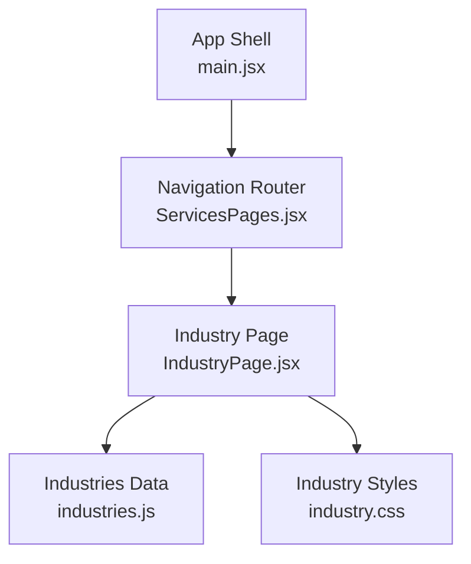
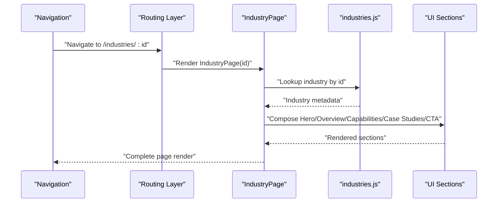
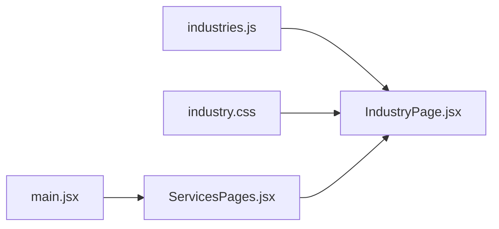

# Industry Showcase Components

<cite>
**Referenced Files in This Document**
- [IndustryPage.jsx](file://src/IndustryPage.jsx)
- [industries.js](file://src/industries.js)
- [industry.css](file://src/industry.css)
- [main.jsx](file://src/main.jsx)
- [ServicesPages.jsx](file://src/ServicesPages.jsx)
</cite>

## Table of Contents
1. [Introduction](#introduction)
2. [Project Structure](#project-structure)
3. [Core Components](#core-components)
4. [Architecture Overview](#architecture-overview)
5. [Detailed Component Analysis](#detailed-component-analysis)
6. [Dependency Analysis](#dependency-analysis)
7. [Performance Considerations](#performance-considerations)
8. [Troubleshooting Guide](#troubleshooting-guide)
9. [Conclusion](#conclusion)
10. [Appendices](#appendices)

## Introduction
This document explains the industry showcase system that presents sector-specific expertise and case studies. It focuses on how the IndustryPage component renders industry content dynamically from a centralized data source, how metadata drives visual storytelling, and how to extend or customize the system for new industries and layouts.

## Project Structure
The industry showcase is implemented as a small set of focused modules:
- A page-level component that orchestrates rendering
- A data module that defines industries and their content
- Styles that govern layout and presentation
- Integration points within the application shell

**Diagram sources**
- [main.jsx](file://src/main.jsx)
- [ServicesPages.jsx](file://src/ServicesPages.jsx)
- [IndustryPage.jsx](file://src/IndustryPage.jsx)
- [industries.js](file://src/industries.js)
- [industry.css](file://src/industry.css)

**Section sources**
- [main.jsx](file://src/main.jsx)
- [ServicesPages.jsx](file://src/ServicesPages.jsx)
- [IndustryPage.jsx](file://src/IndustryPage.jsx)
- [industries.js](file://src/industries.js)
- [industry.css](file://src/industry.css)

## Core Components
- IndustryPage: The main container responsible for loading industry metadata, selecting the active industry, and composing sections such as hero, overview, capabilities, case studies, and call-to-action.
- industries.js: Centralized data model defining each industry’s metadata, narrative blocks, visuals, and linked projects/case studies.
- industry.css: Presentation rules for typography, spacing, grids, and responsive behavior specific to industry pages.
- Navigation integration: Routing or menu wiring that maps site navigation to the IndustryPage with an industry identifier.

Key responsibilities:
- Resolve the current industry by URL or route parameter
- Render dynamic sections based on available metadata
- Compose reusable sub-sections (hero, overview, capabilities, case studies, CTA)
- Apply consistent styling and motion behaviors

**Section sources**
- [IndustryPage.jsx](file://src/IndustryPage.jsx)
- [industries.js](file://src/industries.js)
- [industry.css](file://src/industry.css)

## Architecture Overview
The system follows a data-driven rendering pattern:
- Navigation selects an industry via a stable identifier
- IndustryPage reads the corresponding record from industries.js
- Sections are composed conditionally based on fields present in the record
- Visual assets and copy are bound to the selected industry’s metadata

**Diagram sources**
- [IndustryPage.jsx](file://src/IndustryPage.jsx)
- [industries.js](file://src/industries.js)

## Detailed Component Analysis

### IndustryPage Component
Responsibilities:
- Parse the active industry identifier from routing context
- Fetch the matching industry object from the data module
- Build and render section components based on available fields
- Manage state for active tabs, filters, or interactive elements if used
- Apply layout and animation hooks where appropriate

Rendering strategy:
- Conditional rendering based on presence of fields (e.g., hero, overview, capabilities, caseStudies, cta)
- Reusable sub-components for consistent UX across industries
- Data binding to images, videos, links, and structured lists

Common props/state:
- industryId: string identifier for the selected industry
- industry: resolved metadata object
- activeSection/tab: optional state for tabbed content
- theme overrides: optional style tokens for customization

Error handling:
- Graceful fallback when an industry is not found
- Empty states for missing assets or incomplete records

Accessibility:
- Semantic headings per section
- Alt text for images
- Keyboard navigable tabs/lists

**Section sources**
- [IndustryPage.jsx](file://src/IndustryPage.jsx)

### Industries Data Model (industries.js)
Structure:
- Array or map keyed by industry identifiers
- Each entry includes:
  - Identifier and human-readable title
  - Short description and long-form overview
  - Capabilities or services list
  - Case studies/projects array with titles, summaries, links, and media
  - Optional hero image/video, color accents, or layout hints
  - Metadata like SEO fields, tags, and related industries

Data flow:
- IndustryPage imports the dataset and resolves the current record by id
- Sub-components consume typed fields to render content consistently

Extensibility:
- Add a new industry by appending a new record with required fields
- Introduce optional fields for advanced layouts without breaking existing pages

Validation:
- Ensure required fields exist before rendering
- Provide sensible defaults for optional fields

**Section sources**
- [industries.js](file://src/industries.js)

### Styling and Visual Storytelling (industry.css)
Scope:
- Section spacing, grid systems, and responsive breakpoints
- Typography scale and hierarchy for readability
- Media containers for images/videos with aspect ratios
- Hover and focus states for interactive elements
- Motion transitions for reveal effects and scroll interactions

Customization:
- CSS variables or tokens for colors and spacing to support brand variants
- Utility classes for quick overrides when needed
- Consistent naming conventions to avoid conflicts

**Section sources**
- [industry.css](file://src/industry.css)

### Navigation and Routing Integration
Patterns:
- Route definition mapping /industries/:id to IndustryPage
- Menu entries linking to industry routes using stable ids
- Breadcrumbs or back navigation returning to the industries index

Best practices:
- Use kebab-case identifiers for URLs
- Keep route params minimal and stable
- Provide a canonical link and meta tags per industry

**Section sources**
- [ServicesPages.jsx](file://src/ServicesPages.jsx)
- [main.jsx](file://src/main.jsx)

## Dependency Analysis
High-level relationships:
- IndustryPage depends on industries.js for content
- IndustryPage consumes industry.css for presentation
- Routing layer wires navigation to IndustryPage

**Diagram sources**
- [IndustryPage.jsx](file://src/IndustryPage.jsx)
- [industries.js](file://src/industries.js)
- [industry.css](file://src/industry.css)
- [main.jsx](file://src/main.jsx)
- [ServicesPages.jsx](file://src/ServicesPages.jsx)

**Section sources**
- [IndustryPage.jsx](file://src/IndustryPage.jsx)
- [industries.js](file://src/industries.js)
- [industry.css](file://src/industry.css)
- [main.jsx](file://src/main.jsx)
- [ServicesPages.jsx](file://src/ServicesPages.jsx)

## Performance Considerations
- Lazy-load heavy media per industry to reduce initial payload
- Defer non-critical animations until after first paint
- Memoize computed sections to avoid re-renders
- Preload critical assets for the default industry
- Use pagination or virtualization for large case study lists

[No sources needed since this section provides general guidance]

## Troubleshooting Guide
Common issues and resolutions:
- Missing industry id: ensure route param matches a valid key in industries.js
- Blank sections: verify required fields exist in the industry record
- Broken media: confirm asset paths and availability
- Layout shifts: check aspect-ratio settings and placeholder sizing
- Navigation mismatch: validate menu hrefs align with route definitions

**Section sources**
- [IndustryPage.jsx](file://src/IndustryPage.jsx)
- [industries.js](file://src/industries.js)
- [industry.css](file://src/industry.css)

## Conclusion
The industry showcase system is a data-driven, modular implementation centered around IndustryPage and a well-structured industries.js dataset. By adhering to the documented patterns for metadata, composition, and styling, teams can reliably add new industries, customize layouts, and maintain a cohesive user experience across sectors.

[No sources needed since this section summarizes without analyzing specific files]

## Appendices

### How to Add a New Industry
Steps:
- Define a unique, stable id for the new industry
- Add a new record to industries.js with required fields
- Link to the new industry from navigation
- Verify rendering and accessibility

Guidelines:
- Follow the existing field schema
- Provide alt text and captions for media
- Keep descriptions concise and scannable

**Section sources**
- [industries.js](file://src/industries.js)
- [IndustryPage.jsx](file://src/IndustryPage.jsx)

### Structuring Industry Content
Recommended fields:
- Title and short description
- Overview paragraph(s)
- Capabilities/services list
- Case studies/projects with summary and link
- Hero media and optional video
- Call-to-action text and link

Layout hints:
- Use optional flags to enable/disable sections
- Prefer consistent ordering for predictable UX

**Section sources**
- [industries.js](file://src/industries.js)

### Customizing Industry Page Layouts
Approaches:
- Introduce optional layout tokens in the industry record
- Extend IndustryPage to read layout hints and switch templates
- Use CSS variables for theme overrides
- Create variant components for specialized sections

**Section sources**
- [IndustryPage.jsx](file://src/IndustryPage.jsx)
- [industry.css](file://src/industry.css)

### Navigation Patterns and Hierarchy
Recommendations:
- Top-level menu item “Industries” linking to an index
- Sub-items for each industry using stable ids
- Breadcrumb trail: Home > Industries > {Industry}
- Back button returning to the index

**Section sources**
- [ServicesPages.jsx](file://src/ServicesPages.jsx)
- [main.jsx](file://src/main.jsx)