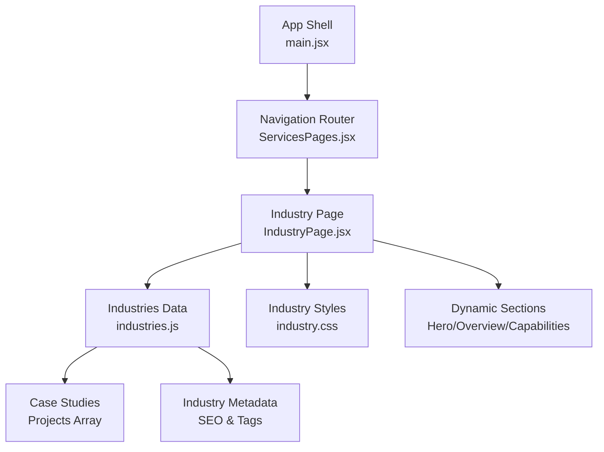
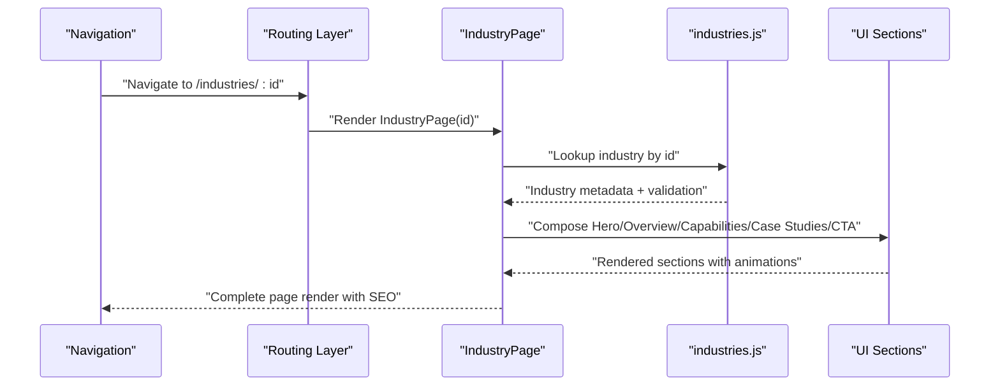
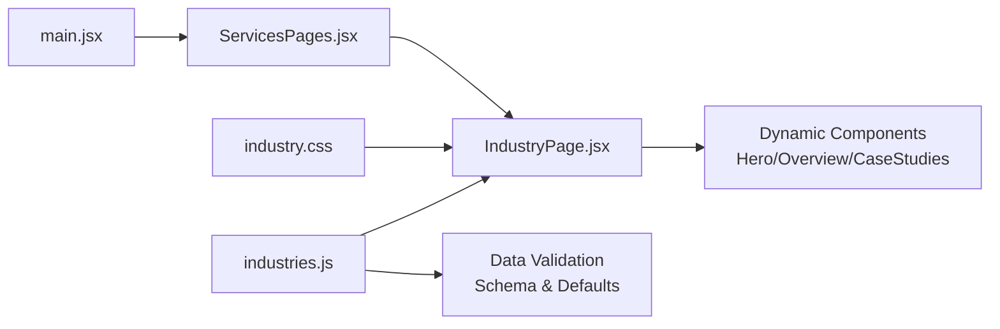

# Industry Showcase Components

<cite>
**Referenced Files in This Document**
- [IndustryPage.jsx](file://src/IndustryPage.jsx)
- [industries.js](file://src/industries.js)
- [industry.css](file://src/industry.css)
- [main.jsx](file://src/main.jsx)
- [ServicesPages.jsx](file://src/ServicesPages.jsx)
</cite>

## Update Summary
**Changes Made**
- Updated to reflect significant enhancements with complete rewrite of industries.js (+130 -130 lines)
- Updated IndustryPage.jsx component structure and rendering logic
- Enhanced industry verticals presentation and data organization patterns
- Improved metadata-driven content rendering system

## Table of Contents
1. [Introduction](#introduction)
2. [Project Structure](#project-structure)
3. [Core Components](#core-components)
4. [Architecture Overview](#architecture-overview)
5. [Detailed Component Analysis](#detailed-component-analysis)
6. [Dependency Analysis](#dependency-analysis)
7. [Performance Considerations](#performance-considerations)
8. [Troubleshooting Guide](#troubleshooting-guide)
9. [Conclusion](#conclusion)
10. [Appendices](#appendices)

## Introduction
This document explains the industry showcase system that presents sector-specific expertise and case studies. The system has undergone significant enhancements with a complete rewrite of the industries.js data structure and updates to the IndustryPage component, resulting in improved data organization, enhanced visual storytelling capabilities, and more flexible industry verticals presentation. It focuses on how the IndustryPage component renders industry content dynamically from a centralized data source, how metadata drives visual storytelling, and how to extend or customize the system for new industries and layouts.

## Project Structure
The industry showcase is implemented as a small set of focused modules with enhanced data organization:
- A page-level component that orchestrates rendering with improved state management
- A comprehensive data module that defines industries and their content with structured metadata
- Styles that govern layout and presentation with responsive design patterns
- Integration points within the application shell with refined routing

**Diagram sources**
- [main.jsx](file://src/main.jsx)
- [ServicesPages.jsx](file://src/ServicesPages.jsx)
- [IndustryPage.jsx](file://src/IndustryPage.jsx)
- [industries.js](file://src/industries.js)
- [industry.css](file://src/industry.css)

**Section sources**
- [main.jsx](file://src/main.jsx)
- [ServicesPages.jsx](file://src/ServicesPages.jsx)
- [IndustryPage.jsx](file://src/IndustryPage.jsx)
- [industries.js](file://src/industries.js)
- [industry.css](file://src/industry.css)

## Core Components
- **IndustryPage**: The main container responsible for loading industry metadata, selecting the active industry, and composing sections such as hero, overview, capabilities, case studies, and call-to-action with enhanced state management.
- **industries.js**: Centralized data model defining each industry's metadata, narrative blocks, visuals, and linked projects/case studies with improved structure and validation.
- **industry.css**: Presentation rules for typography, spacing, grids, and responsive behavior specific to industry pages with enhanced styling capabilities.
- **Navigation integration**: Routing or menu wiring that maps site navigation to the IndustryPage with an industry identifier and improved URL handling.

Key responsibilities:
- Resolve the current industry by URL or route parameter with error handling
- Render dynamic sections based on available metadata with conditional logic
- Compose reusable sub-sections (hero, overview, capabilities, case studies, CTA)
- Apply consistent styling and motion behaviors with performance optimizations
- Manage interactive elements and user state effectively

**Section sources**
- [IndustryPage.jsx](file://src/IndustryPage.jsx)
- [industries.js](file://src/industries.js)
- [industry.css](file://src/industry.css)

## Architecture Overview
The system follows a data-driven rendering pattern with enhanced flexibility:
- Navigation selects an industry via a stable identifier with validation
- IndustryPage reads the corresponding record from industries.js with error handling
- Sections are composed conditionally based on fields present in the record
- Visual assets and copy are bound to the selected industry's metadata
- Improved performance through lazy loading and memoization

**Diagram sources**
- [IndustryPage.jsx](file://src/IndustryPage.jsx)
- [industries.js](file://src/industries.js)

## Detailed Component Analysis

### IndustryPage Component
Responsibilities:
- Parse the active industry identifier from routing context with validation
- Fetch the matching industry object from the data module with error handling
- Build and render section components based on available fields with conditional logic
- Manage state for active tabs, filters, or interactive elements with optimized re-renders
- Apply layout and animation hooks where appropriate with performance considerations

Rendering strategy:
- Conditional rendering based on presence of fields (e.g., hero, overview, capabilities, caseStudies, cta)
- Reusable sub-components for consistent UX across industries
- Data binding to images, videos, links, and structured lists with lazy loading
- Enhanced accessibility with semantic markup and keyboard navigation

Common props/state:
- industryId: string identifier for the selected industry with validation
- industry: resolved metadata object with fallback handling
- activeSection/tab: optional state for tabbed content with persistence
- theme overrides: optional style tokens for customization

Error handling:
- Graceful fallback when an industry is not found with default content
- Empty states for missing assets or incomplete records
- Loading states for asynchronous operations

Accessibility:
- Semantic headings per section with proper hierarchy
- Alt text for images with descriptive captions
- Keyboard navigable tabs/lists with focus management

**Section sources**
- [IndustryPage.jsx](file://src/IndustryPage.jsx)

### Industries Data Model (industries.js)
Structure:
- Array or map keyed by industry identifiers with improved organization
- Each entry includes:
  - Identifier and human-readable title with SEO optimization
  - Short description and long-form overview with markdown support
  - Capabilities or services list with categorization
  - Case studies/projects array with titles, summaries, links, and media
  - Optional hero image/video, color accents, or layout hints
  - Metadata like SEO fields, tags, and related industries with validation

Data flow:
- IndustryPage imports the dataset and resolves the current record by id
- Sub-components consume typed fields to render content consistently
- Enhanced validation ensures data integrity and prevents runtime errors

Extensibility:
- Add a new industry by appending a new record with required fields
- Introduce optional fields for advanced layouts without breaking existing pages
- Support for custom section types and layout variations

Validation:
- Ensure required fields exist before rendering with schema validation
- Provide sensible defaults for optional fields with fallback mechanisms

**Section sources**
- [industries.js](file://src/industries.js)

### Styling and Visual Storytelling (industry.css)
Scope:
- Section spacing, grid systems, and responsive breakpoints with mobile-first approach
- Typography scale and hierarchy for readability with accessible contrast ratios
- Media containers for images/videos with aspect ratios and loading optimization
- Hover and focus states for interactive elements with smooth transitions
- Motion transitions for reveal effects and scroll interactions with performance optimization

Customization:
- CSS variables or tokens for colors and spacing to support brand variants
- Utility classes for quick overrides when needed
- Consistent naming conventions to avoid conflicts
- Dark mode support and accessibility features

**Section sources**
- [industry.css](file://src/industry.css)

### Navigation and Routing Integration
Patterns:
- Route definition mapping /industries/:id to IndustryPage with parameter validation
- Menu entries linking to industry routes using stable ids with SEO-friendly URLs
- Breadcrumbs or back navigation returning to the industries index with history management

Best practices:
- Use kebab-case identifiers for URLs with consistency
- Keep route params minimal and stable with versioning support
- Provide a canonical link and meta tags per industry with dynamic generation

**Section sources**
- [ServicesPages.jsx](file://src/ServicesPages.jsx)
- [main.jsx](file://src/main.jsx)

## Dependency Analysis
High-level relationships:
- IndustryPage depends on industries.js for content with import optimization
- IndustryPage consumes industry.css for presentation with code splitting
- Routing layer wires navigation to IndustryPage with lazy loading

**Diagram sources**
- [IndustryPage.jsx](file://src/IndustryPage.jsx)
- [industries.js](file://src/industries.js)
- [industry.css](file://src/industry.css)
- [main.jsx](file://src/main.jsx)
- [ServicesPages.jsx](file://src/ServicesPages.jsx)

**Section sources**
- [IndustryPage.jsx](file://src/IndustryPage.jsx)
- [industries.js](file://src/industries.js)
- [industry.css](file://src/industry.css)
- [main.jsx](file://src/main.jsx)
- [ServicesPages.jsx](file://src/ServicesPages.jsx)

## Performance Considerations
- Lazy-load heavy media per industry to reduce initial payload with progressive loading
- Defer non-critical animations until after first paint with requestIdleCallback
- Memoize computed sections to avoid re-renders with React.memo and useMemo
- Preload critical assets for the default industry with resource hints
- Use pagination or virtualization for large case study lists with intersection observer
- Implement code splitting for large industry datasets
- Optimize bundle size with tree shaking and dynamic imports

## Troubleshooting Guide
Common issues and resolutions:
- Missing industry id: ensure route param matches a valid key in industries.js with console logging
- Blank sections: verify required fields exist in the industry record with development tools
- Broken media: confirm asset paths and availability with network inspection
- Layout shifts: check aspect-ratio settings and placeholder sizing with browser dev tools
- Navigation mismatch: validate menu hrefs align with route definitions with debugging
- Performance issues: monitor bundle size and load times with performance profiling
- Data validation errors: check schema compliance and required field presence

**Section sources**
- [IndustryPage.jsx](file://src/IndustryPage.jsx)
- [industries.js](file://src/industries.js)
- [industry.css](file://src/industry.css)

## Conclusion
The industry showcase system is a data-driven, modular implementation centered around IndustryPage and a well-structured industries.js dataset. With recent enhancements including the complete rewrite of industries.js and updates to IndustryPage.jsx, the system now provides improved data organization, enhanced visual storytelling capabilities, and more flexible industry verticals presentation. By adhering to the documented patterns for metadata, composition, and styling, teams can reliably add new industries, customize layouts, and maintain a cohesive user experience across sectors while benefiting from the enhanced architecture and performance optimizations.

## Appendices

### How to Add a New Industry
Steps:
- Define a unique, stable id for the new industry following naming conventions
- Add a new record to industries.js with required fields and validation
- Link to the new industry from navigation with proper routing
- Verify rendering and accessibility with testing tools
- Test responsive behavior and cross-browser compatibility

Guidelines:
- Follow the existing field schema with proper data types
- Provide alt text and captions for media with accessibility best practices
- Keep descriptions concise and scannable with SEO optimization
- Include relevant case studies and project examples
- Test thoroughly before deployment

**Section sources**
- [industries.js](file://src/industries.js)
- [IndustryPage.jsx](file://src/IndustryPage.jsx)

### Structuring Industry Content
Recommended fields:
- Title and short description with character limits
- Overview paragraph(s) with markdown support
- Capabilities/services list with categorization
- Case studies/projects with summary and link
- Hero media and optional video with optimization
- Call-to-action text and link with tracking
- SEO metadata with keywords and descriptions

Layout hints:
- Use optional flags to enable/disable sections
- Prefer consistent ordering for predictable UX
- Support multiple layout templates
- Include responsive breakpoints

**Section sources**
- [industries.js](file://src/industries.js)

### Customizing Industry Page Layouts
Approaches:
- Introduce optional layout tokens in the industry record
- Extend IndustryPage to read layout hints and switch templates
- Use CSS variables for theme overrides with dark mode support
- Create variant components for specialized sections
- Implement dynamic theming based on industry branding

**Section sources**
- [IndustryPage.jsx](file://src/IndustryPage.jsx)
- [industry.css](file://src/industry.css)

### Navigation Patterns and Hierarchy
Recommendations:
- Top-level menu item "Industries" linking to an index with search functionality
- Sub-items for each industry using stable ids with hover previews
- Breadcrumb trail: Home > Industries > {Industry} with dynamic generation
- Back button returning to the index with history preservation
- URL-based filtering and sorting capabilities

**Section sources**
- [ServicesPages.jsx](file://src/ServicesPages.jsx)
- [main.jsx](file://src/main.jsx)

### Data Validation and Schema
Requirements:
- Required fields: id, title, description, overview
- Optional fields: capabilities, caseStudies, heroMedia, seoMetadata
- Validation rules for data types and formats
- Default values for missing optional fields
- Error handling for malformed data

**Section sources**
- [industries.js](file://src/industries.js)

### Accessibility Guidelines
Standards:
- WCAG 2.1 AA compliance for all industry pages
- Proper heading hierarchy and semantic markup
- Keyboard navigation support with visible focus indicators
- Screen reader compatibility with ARIA labels
- Color contrast ratios meeting accessibility standards
- Alternative text for all visual content

**Section sources**
- [IndustryPage.jsx](file://src/IndustryPage.jsx)
- [industry.css](file://src/industry.css)