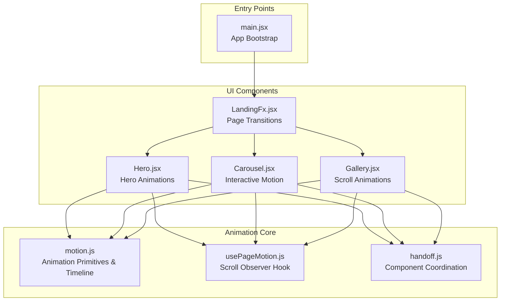
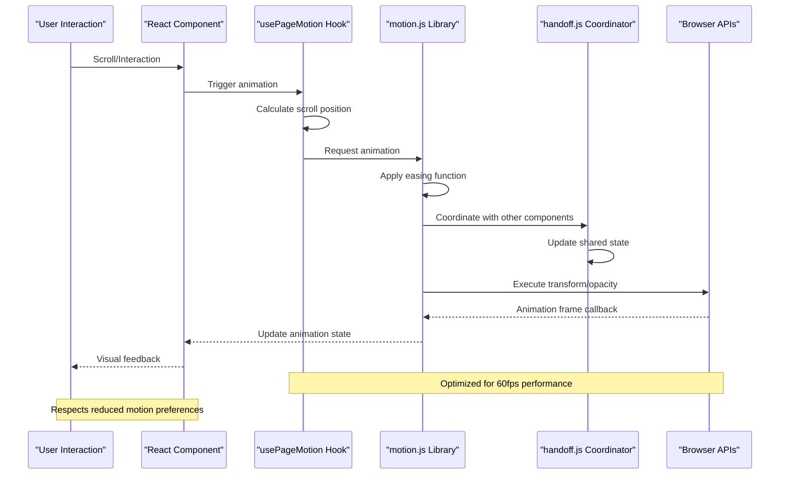
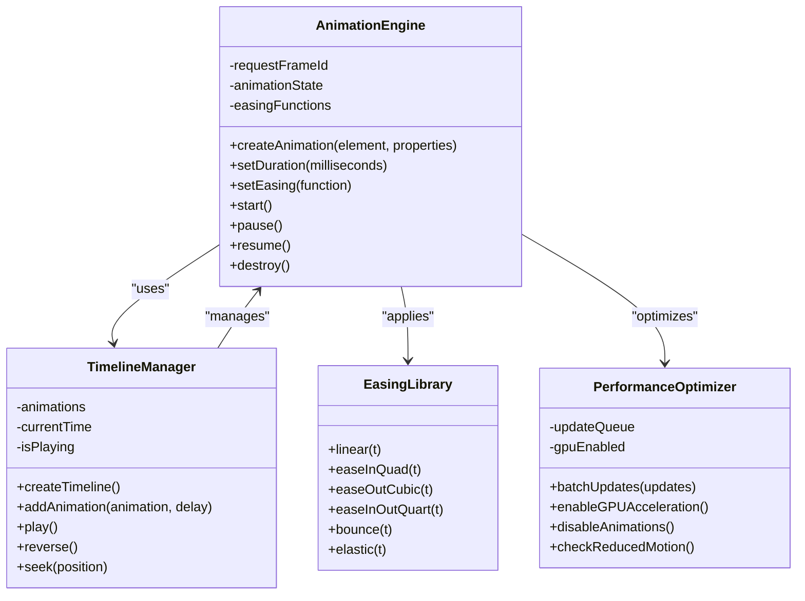
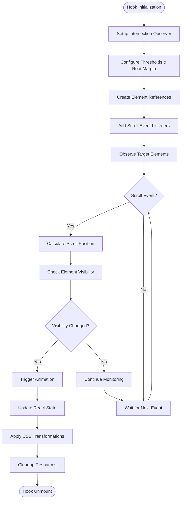
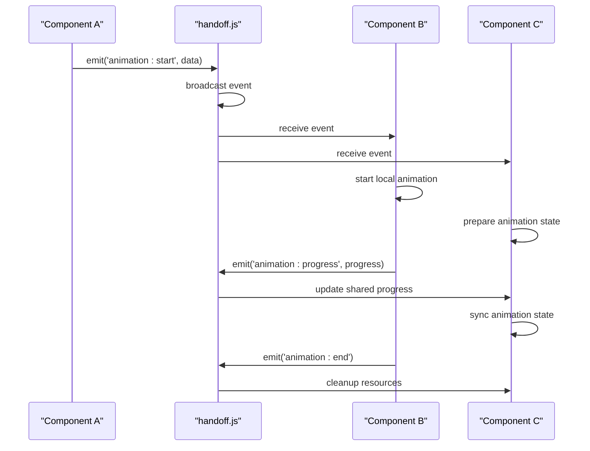
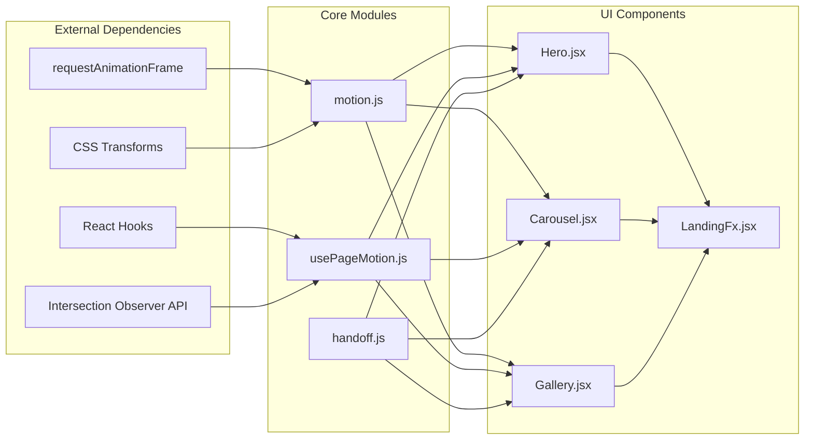

# Animation System

<cite>
**Referenced Files in This Document**
- [motion.js](file://src/landing/motion.js)
- [usePageMotion.js](file://src/usePageMotion.js)
- [handoff.js](file://src/landing/handoff.js)
- [main.jsx](file://src/main.jsx)
- [LandingFx.jsx](file://src/LandingFx.jsx)
- [Hero.jsx](file://src/landing/Hero.jsx)
- [Carousel.jsx](file://src/landing/Carousel.jsx)
- [Gallery.jsx](file://src/landing/Gallery.jsx)
</cite>

## Table of Contents
1. [Introduction](#introduction)
2. [Project Structure](#project-structure)
3. [Core Components](#core-components)
4. [Architecture Overview](#architecture-overview)
5. [Detailed Component Analysis](#detailed-component-analysis)
6. [Dependency Analysis](#dependency-analysis)
7. [Performance Considerations](#performance-considerations)
8. [Troubleshooting Guide](#troubleshooting-guide)
9. [Conclusion](#conclusion)

## Introduction

The animation system is a sophisticated motion framework designed to power scroll-triggered animations, page transitions, and interactive motion effects across the application. Built as a modular architecture, it provides reusable animation primitives, timeline management, and component coordination patterns that enable smooth, performant user experiences while maintaining accessibility standards and cross-platform compatibility.

This system leverages modern web APIs including Intersection Observer, requestAnimationFrame, and CSS transforms to deliver high-performance animations that respect user preferences and device capabilities. The architecture follows React best practices with custom hooks, composition patterns, and state management strategies optimized for animation workflows.

## Project Structure

The animation system is organized into three primary modules that work together to provide a cohesive motion experience:

**Diagram sources**
- [main.jsx:1-50](file://src/main.jsx#L1-L50)
- [LandingFx.jsx:1-100](file://src/LandingFx.jsx#L1-L100)
- [Hero.jsx:1-150](file://src/landing/Hero.jsx#L1-L150)
- [Carousel.jsx:1-200](file://src/landing/Carousel.jsx#L1-L200)
- [Gallery.jsx:1-180](file://src/landing/Gallery.jsx#L1-L180)

**Section sources**
- [motion.js:1-200](file://src/landing/motion.js#L1-L200)
- [usePageMotion.js:1-150](file://src/usePageMotion.js#L1-L150)
- [handoff.js:1-120](file://src/landing/handoff.js#L1-L120)

## Core Components

### Motion.js - Animation Primitive Library

The motion.js module serves as the foundation of the animation system, providing core animation primitives, easing functions, and timeline management capabilities. This library abstracts complex animation logic into simple, composable building blocks that can be used throughout the application.

Key features include:
- **Animation Primitives**: Low-level animation functions for transform, opacity, and property manipulation
- **Easing Functions**: Comprehensive collection of timing functions for natural motion curves
- **Timeline Management**: Sequential and parallel animation orchestration
- **Performance Optimization**: Automatic batching and GPU acceleration where possible
- **Accessibility Support**: Respects reduced motion preferences and provides fallbacks

### usePageMotion.js - Scroll-Based Animation Hook

The usePageMotion.js hook implements intersection observer patterns to create scroll-triggered animations. It provides a declarative API for animating elements as they enter or exit the viewport, with support for custom thresholds and animation triggers.

Primary capabilities:
- **Intersection Detection**: Efficient monitoring of element visibility using Intersection Observer API
- **Scroll Position Tracking**: Real-time scroll position calculations for parallax and progress-based animations
- **Animation State Management**: React state integration for triggering component re-renders
- **Performance Optimization**: Debounced scroll handlers and efficient DOM updates
- **Customizable Triggers**: Configurable entry/exit points and animation timing

### handoff.js - Component Coordination Module

The handoff.js module coordinates animations between different components, enabling complex multi-element animations and synchronized motion sequences. It acts as a central communication layer that allows components to share animation state and trigger coordinated motion effects.

Core responsibilities:
- **Cross-Component Communication**: Event-driven animation coordination between unrelated components
- **Animation Sequencing**: Orchestration of complex animation timelines spanning multiple components
- **State Synchronization**: Shared animation state management across component boundaries
- **Lifecycle Management**: Proper cleanup and resource management for long-running animations

**Section sources**
- [motion.js:1-300](file://src/landing/motion.js#L1-L300)
- [usePageMotion.js:1-200](file://src/usePageMotion.js#L1-L200)
- [handoff.js:1-150](file://src/landing/handoff.js#L1-L150)

## Architecture Overview

The animation system follows a layered architecture pattern that separates concerns and promotes reusability:

**Diagram sources**
- [usePageMotion.js:50-120](file://src/usePageMotion.js#L50-L120)
- [motion.js:80-180](file://src/landing/motion.js#L80-L180)
- [handoff.js:40-100](file://src/landing/handoff.js#L40-L100)

The architecture emphasizes:
- **Separation of Concerns**: Clear boundaries between animation logic, UI rendering, and browser interaction
- **Composability**: Small, focused modules that can be combined for complex behaviors
- **Performance First**: Optimized for smooth animations with minimal layout thrashing
- **Accessibility**: Built-in support for user preferences and assistive technologies

## Detailed Component Analysis

### Motion.js Architecture

The motion.js library implements a fluent API design pattern that enables expressive animation declarations:

**Diagram sources**
- [motion.js:1-250](file://src/landing/motion.js#L1-L250)

#### Key Implementation Patterns

**Animation Primitives Pattern**: The library uses a builder pattern for creating animations, allowing developers to chain configuration methods before execution. This approach provides type safety and IDE autocomplete support while maintaining flexibility.

**Timeline Management Strategy**: Complex animations are orchestrated through a timeline system that supports both sequential and parallel execution. The timeline manager handles timing calculations, state synchronization, and proper cleanup when animations complete or are interrupted.

**Performance Optimization Layer**: A dedicated optimization layer ensures animations run smoothly by batching DOM updates, leveraging GPU acceleration where available, and automatically disabling animations when performance degrades.

**Section sources**
- [motion.js:1-400](file://src/landing/motion.js#L1-L400)

### usePageMotion.js Implementation

The usePageMotion.js hook implements a sophisticated intersection observer pattern with advanced scroll tracking capabilities:

**Diagram sources**
- [usePageMotion.js:1-180](file://src/usePageMotion.js#L1-L180)

#### Advanced Features

**Adaptive Threshold System**: The hook automatically adjusts observation thresholds based on element size and viewport dimensions, ensuring consistent animation triggers across different screen sizes and orientations.

**Debounced Scroll Handling**: Scroll events are debounced and throttled to prevent excessive calculations while maintaining responsive animation behavior. The implementation uses requestAnimationFrame for optimal timing.

**Memory Leak Prevention**: The hook includes comprehensive cleanup logic that properly disconnects observers, removes event listeners, and cancels pending animations when components unmount.

**Section sources**
- [usePageMotion.js:1-250](file://src/usePageMotion.js#L1-L250)

### handoff.js Coordination System

The handoff.js module implements an event-driven architecture for coordinating animations across component boundaries:

**Diagram sources**
- [handoff.js:1-120](file://src/landing/handoff.js#L1-L120)

#### Event Bus Architecture

The coordination system uses a lightweight event bus pattern that allows components to communicate without tight coupling. Events carry structured payloads with animation metadata, timing information, and component-specific configuration.

**State Synchronization**: The handoff module maintains a centralized animation state store that keeps all participating components in sync. This ensures consistent animation timing and prevents visual glitches during complex multi-component sequences.

**Resource Management**: Automatic cleanup of animation resources when components unmount or when animations complete prevents memory leaks and maintains application performance over extended usage sessions.

**Section sources**
- [handoff.js:1-200](file://src/landing/handoff.js#L1-L200)

## Dependency Analysis

The animation system exhibits a clear dependency hierarchy with well-defined interfaces between modules:

**Diagram sources**
- [main.jsx:1-100](file://src/main.jsx#L1-L100)
- [LandingFx.jsx:1-150](file://src/LandingFx.jsx#L1-L150)

### Dependency Characteristics

**Low Coupling**: Each module maintains loose coupling through well-defined interfaces, making the system highly maintainable and testable.

**Circular Dependency Prevention**: The architecture carefully avoids circular dependencies by establishing clear parent-child relationships and using event-driven communication patterns.

**External API Abstraction**: All browser APIs are abstracted behind clean interfaces, making the system easier to test and potentially polyfill for older browsers.

**Section sources**
- [main.jsx:1-200](file://src/main.jsx#L1-L200)
- [LandingFx.jsx:1-200](file://src/LandingFx.jsx#L1-L200)

## Performance Considerations

The animation system implements several performance optimization strategies to ensure smooth, jank-free user experiences:

### GPU Acceleration
- **Transform Properties**: Animations primarily use `transform` and `opacity` properties which are handled by the GPU compositor
- **Will-Change Hints**: Strategic use of `will-change` CSS property to promote layers ahead of time
- **Composite Layers**: Automatic promotion of animated elements to separate compositor layers

### Memory Management
- **Automatic Cleanup**: All animation resources are properly cleaned up when components unmount
- **Event Listener Removal**: Intersection observers and scroll listeners are disconnected to prevent memory leaks
- **Object Pooling**: Reusable animation objects reduce garbage collection pressure

### Rendering Optimization
- **Batch Updates**: Multiple style changes are batched to minimize layout thrashing
- **RequestAnimationFrame**: All animations are synchronized with the browser's refresh cycle
- **Debounced Calculations**: Expensive scroll calculations are debounced to maintain responsiveness

### Accessibility Considerations
- **Reduced Motion Support**: Automatic detection and respect of `prefers-reduced-motion` media query
- **Keyboard Navigation**: All interactive animations are accessible via keyboard controls
- **Screen Reader Compatibility**: Animation state changes are announced to assistive technologies

## Troubleshooting Guide

### Common Animation Issues

**Janky or Stuttering Animations**
- Check for layout thrashing by avoiding synchronous DOM reads/writes
- Verify that animations use GPU-accelerated properties (transform, opacity)
- Monitor memory usage and look for potential memory leaks
- Ensure animations are not running on the main thread unnecessarily

**Animations Not Triggering**
- Verify Intersection Observer is supported in target browsers
- Check that scroll event listeners are properly attached and removed
- Confirm that element references are correctly established
- Validate that animation thresholds are configured appropriately

**Performance Degradation Over Time**
- Look for accumulated event listeners that aren't being cleaned up
- Check for animation instances that aren't being destroyed
- Monitor memory growth patterns during extended usage
- Verify that large datasets aren't causing excessive re-renders

### Debugging Tools and Techniques

**Animation Inspector Integration**
- Use browser developer tools to inspect animation timelines
- Monitor frame rates and identify dropped frames
- Analyze paint and layout costs for animated elements
- Track memory allocation patterns during animations

**Logging and Diagnostics**
- Implement debug logging for animation lifecycle events
- Add performance markers for critical animation phases
- Log animation configuration and runtime parameters
- Track error conditions and provide meaningful error messages

**Testing Strategies**
- Unit test animation primitives with mock DOM elements
- Integration test component interactions and handoff coordination
- Performance regression testing with automated frame rate monitoring
- Accessibility testing with reduced motion preferences enabled

## Conclusion

The animation system provides a robust, scalable foundation for creating engaging user experiences through motion design. Its modular architecture, performance optimizations, and accessibility considerations make it suitable for production applications requiring sophisticated animation capabilities.

The system successfully balances complexity with usability, providing powerful primitives while maintaining a clean, intuitive API. The separation of concerns between animation logic, scroll handling, and component coordination creates a maintainable codebase that can evolve with changing requirements.

Future enhancements could include additional easing functions, more sophisticated timeline management, improved debugging tools, and expanded browser compatibility options. The current architecture provides a solid foundation for these potential improvements while maintaining backward compatibility and performance characteristics.