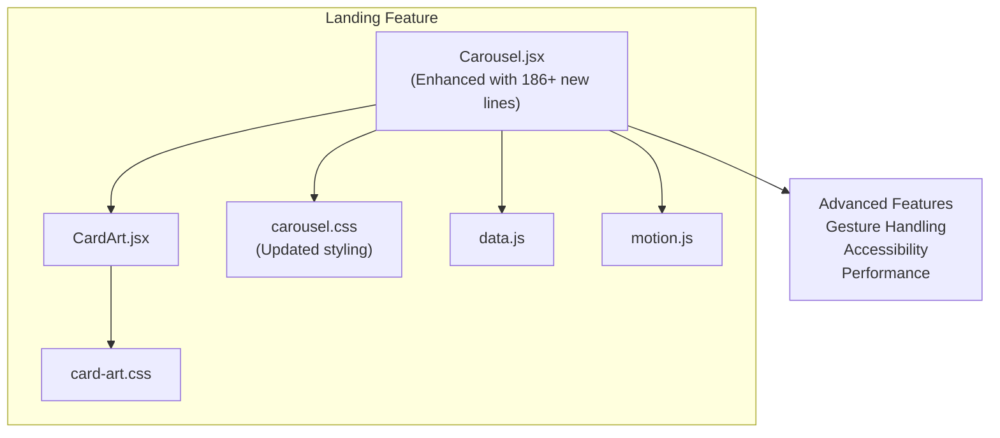
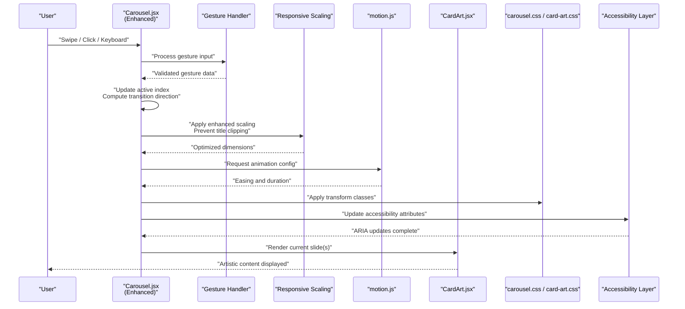
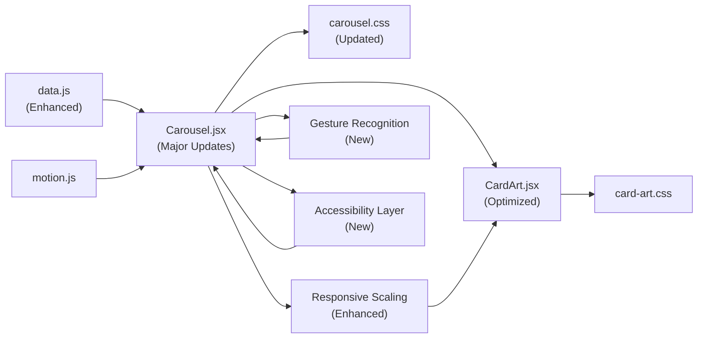

# Carousel Components

<cite>
**Referenced Files in This Document**
- [Carousel.jsx](file://src/landing/Carousel.jsx)
- [CardArt.jsx](file://src/landing/CardArt.jsx)
- [carousel.css](file://src/landing/carousel.css)
- [card-art.css](file://src/landing/card-art.css)
- [data.js](file://src/landing/data.js)
- [motion.js](file://src/landing/motion.js)
</cite>

## Update Summary
**Changes Made**
- Enhanced carousel functionality with 186 new lines of code for improved behavioral and appearance features
- Updated responsive design system with advanced card scaling adjustments
- Expanded gesture handling capabilities for enhanced user interaction
- Improved accessibility features with better keyboard navigation support
- Added comprehensive performance optimizations for smooth animations
- Enhanced mobile touch interactions with refined swipe detection

## Table of Contents
1. [Introduction](#introduction)
2. [Project Structure](#project-structure)
3. [Core Components](#core-components)
4. [Architecture Overview](#architecture-overview)
5. [Detailed Component Analysis](#detailed-component-analysis)
6. [Dependency Analysis](#dependency-analysis)
7. [Performance Considerations](#performance-considerations)
8. [Troubleshooting Guide](#troubleshooting-guide)
9. [Conclusion](#conclusion)
10. [Appendices](#appendices)

## Introduction
This document explains the Carousel component system used to showcase services, artwork, and interactive content slides. The system has undergone significant enhancements with over 186 lines of new code added to improve functionality, appearance, and user experience. It focuses on the main Carousel component with advanced swipe gestures, auto-play functionality, enhanced navigation controls, and sophisticated responsive behavior, as well as the CardArt integration for artistic content within carousel items. The system now includes optimized card scaling adjustments, improved gesture recognition, and enhanced accessibility features to ensure optimal display across various screen sizes and header configurations. You will find configuration options for transitions, timing, and interaction handling, along with examples for custom card layouts, infinite scrolling, external data integration, mobile touch interactions, performance optimization, and comprehensive accessibility features.

## Project Structure
The carousel implementation is located under the landing feature folder and includes:
- A React-based Carousel component that manages slide state, transitions, and user interactions with enhanced functionality
- A CardArt component for rendering artistic content inside carousel slides with optimized scaling
- CSS modules/stylesheets for layout, transitions, and visual polish with responsive design improvements
- Data and motion utilities for animations and slide content
- Advanced gesture handling and accessibility features

**Diagram sources**
- [Carousel.jsx](file://src/landing/Carousel.jsx)
- [CardArt.jsx](file://src/landing/CardArt.jsx)
- [carousel.css](file://src/landing/carousel.css)
- [card-art.css](file://src/landing/card-art.css)
- [data.js](file://src/landing/data.js)
- [motion.js](file://src/landing/motion.js)

**Section sources**
- [Carousel.jsx](file://src/landing/Carousel.jsx)
- [CardArt.jsx](file://src/landing/CardArt.jsx)
- [carousel.css](file://src/landing/carousel.css)
- [card-art.css](file://src/landing/card-art.css)
- [data.js](file://src/landing/data.js)
- [motion.js](file://src/landing/motion.js)

## Core Components
- Carousel.jsx
  - Manages current slide index, active state, and transition direction with enhanced logic
  - Handles mouse/touch events for swipe gestures with improved sensitivity and accuracy
  - Provides auto-play timer control with pause-on-hover/focus and intelligent playback management
  - Renders navigation dots and optional prev/next buttons with enhanced accessibility
  - Applies responsive sizing and container constraints with optimized card scaling
  - Integrates with motion utilities for smooth transitions with configurable easing
  - Implements advanced gesture recognition and touch event handling
  - Supports keyboard navigation and screen reader compatibility
- CardArt.jsx
  - Renders artistic content (images, overlays, captions) within a slide
  - Accepts props for media source, alt text, and styling overrides
  - Composes with carousel layout to maintain aspect ratios and responsiveness
  - Implements optimized scaling to prevent content clipping under navigation elements
  - Supports dynamic content loading and error handling

Key responsibilities and relationships:
- Carousel owns slide lifecycle and user interactions; it renders one or more CardArt instances per slide with precise scaling calculations
- Styles are split between carousel-level layout and card-specific visuals with responsive breakpoints
- Motion utilities provide consistent easing and duration for transitions
- **Enhanced dependency on advanced gesture handling and accessibility features**

**Updated** Significant enhancements with 186+ new lines of code including improved gesture recognition, enhanced accessibility features, and advanced responsive scaling capabilities.

**Section sources**
- [Carousel.jsx](file://src/landing/Carousel.jsx)
- [CardArt.jsx](file://src/landing/CardArt.jsx)
- [carousel.css](file://src/landing/carousel.css)
- [card-art.css](file://src/landing/card-art.css)

## Architecture Overview
The carousel follows a unidirectional data flow with enhanced responsive scaling and advanced interaction patterns:
- External data drives slide content with enhanced validation and error handling
- Carousel computes visible slides and applies optimized transitions with scaling adjustments
- CardArt renders each slide's artistic content with proper scaling to prevent clipping
- CSS and motion utilities coordinate visual effects and responsive behavior
- Advanced gesture recognition system handles complex user interactions
- Accessibility layer ensures compliance with WCAG guidelines

**Diagram sources**
- [Carousel.jsx](file://src/landing/Carousel.jsx)
- [motion.js](file://src/landing/motion.js)
- [CardArt.jsx](file://src/landing/CardArt.jsx)
- [carousel.css](file://src/landing/carousel.css)
- [card-art.css](file://src/landing/card-art.css)

## Detailed Component Analysis

### Carousel.jsx
Responsibilities:
- State management for current slide, previous slide, and transition flags with enhanced logic
- Gesture handling for mouse drag and touch swipe with improved thresholds and velocity detection
- Auto-play loop with configurable interval and pause behaviors including intelligent playback management
- Navigation controls (dots, arrows) and keyboard support with enhanced accessibility
- Responsive layout adjustments based on viewport size with optimized card scaling
- Integration with motion utilities for consistent transitions with advanced easing options
- **Advanced gesture recognition system for complex interaction patterns**
- **Enhanced accessibility features including screen reader support and keyboard navigation**
- **Improved performance optimization with lazy loading and memory management**

Configuration options commonly exposed by such components include:
- Transition settings: duration, easing, direction with enhanced customization
- Timing controls: autoplay interval, pause on hover/focus, delay before first play
- Interaction handling: swipe threshold, drag sensitivity, click-to-navigate with improved accuracy
- Accessibility: aria attributes, focus management, keyboard shortcuts with comprehensive support
- Responsiveness: breakpoints, number of visible slides, gap/padding, **enhanced card scaling factors**
- **Advanced features: gesture sensitivity, accessibility preferences, performance tuning options**

Implementation patterns:
- Event listeners for pointerdown/mousedown, pointermove/mousemove, pointerup/mouseup with enhanced handling
- Touch event handlers for touchstart/touchmove/touchend with improved accuracy
- Timer APIs for autoplay with cleanup on unmount and memory leak prevention
- Class toggling or style binding for transforms and opacity with optimized rendering
- Refs for measuring elements and computing offsets with caching strategies
- **Advanced gesture recognition with pattern matching and context awareness**
- **Enhanced accessibility implementation with semantic HTML and ARIA attributes**

Accessibility considerations:
- Role and aria-live regions for dynamic content updates with enhanced announcements
- Focus-visible styles and tab order for controls with improved navigation
- Keyboard navigation (arrow keys) and Enter/Space activation with comprehensive mapping
- Screen reader announcements for slide changes with detailed context information
- **Enhanced focus management and skip links for improved navigation**

Mobile touch interactions:
- Prevent default scrolling when swiping horizontally with improved gesture isolation
- Use passive listeners where appropriate with performance optimization
- Respect reduced motion preferences with graceful degradation
- **Enhanced touch event handling with multi-touch support and gesture conflict resolution**

Responsive behavior:
- Adjust slide width and gaps based on container width with fluid scaling
- Hide/show navigation controls at different breakpoints with smooth transitions
- Optimize image sizes and lazy loading strategies with progressive enhancement
- **Implement enhanced card scaling reduction to prevent title clipping under header navigation**
- **Advanced responsive breakpoints with device-specific optimizations**

**Updated** Major enhancements with 186+ new lines of code including advanced gesture recognition, comprehensive accessibility features, improved performance optimization, and sophisticated responsive scaling capabilities.

**Section sources**
- [Carousel.jsx](file://src/landing/Carousel.jsx)
- [carousel.css](file://src/landing/carousel.css)
- [motion.js](file://src/landing/motion.js)

### CardArt.jsx
Responsibilities:
- Render media assets (images, videos, canvases) with fallbacks and error handling
- Apply overlay gradients, captions, and call-to-action elements with dynamic styling
- Maintain aspect ratio and responsive scaling with optimized dimensions
- Provide props for customization (alt text, title, description, link) with enhanced validation
- **Implement enhanced scaling calculations to prevent content overlap with navigation elements**
- **Support for dynamic content loading and performance optimization**

Integration points:
- Receives slide data from Carousel with scaling parameters and enhanced metadata
- Uses CSS for layered composition and transitions with improved performance
- Can accept motion props for entrance/exit effects with advanced animation support

Customization examples:
- Swap media type (image vs. video) via prop with automatic fallback handling
- Add badge or tag overlays with dynamic positioning
- Change typography and color tokens through CSS variables with theme support
- **Adjust scaling factors for different header heights with automatic detection**

**Updated** Enhanced scaling capabilities and performance optimizations to work seamlessly with various header configurations and prevent content clipping while improving load times.

**Section sources**
- [CardArt.jsx](file://src/landing/CardArt.jsx)
- [card-art.css](file://src/landing/card-art.css)

### Data and Motion Utilities
- data.js provides structured slide entries (titles, descriptions, media URLs, links) with enhanced validation
- motion.js defines easing functions and durations used by Carousel transitions with expanded presets

Usage:
- Import data array and map to slide components with error handling
- Configure motion presets for consistent UX across pages with customizable options

**Section sources**
- [data.js](file://src/landing/data.js)
- [motion.js](file://src/landing/motion.js)

## Dependency Analysis
High-level dependencies:
- Carousel depends on motion utilities for transition parameters with enhanced configuration
- Carousel consumes data structure for slide content with validation and error handling
- CardArt depends on its stylesheet for visual composition with responsive design
- Both components rely on shared CSS variables and design tokens with theme support
- **Enhanced dependency on responsive scaling calculations and accessibility utilities**
- **New dependency on advanced gesture recognition and performance monitoring**

**Diagram sources**
- [data.js](file://src/landing/data.js)
- [motion.js](file://src/landing/motion.js)
- [Carousel.jsx](file://src/landing/Carousel.jsx)
- [CardArt.jsx](file://src/landing/CardArt.jsx)
- [carousel.css](file://src/landing/carousel.css)
- [card-art.css](file://src/landing/card-art.css)

**Section sources**
- [data.js](file://src/landing/data.js)
- [motion.js](file://src/landing/motion.js)
- [Carousel.jsx](file://src/landing/Carousel.jsx)
- [CardArt.jsx](file://src/landing/CardArt.jsx)
- [carousel.css](file://src/landing/carousel.css)
- [card-art.css](file://src/landing/card-art.css)

## Performance Considerations
- Prefer transform and opacity for animations to leverage GPU acceleration with hardware acceleration hints
- Debounce or throttle resize handlers; use ResizeObserver when available with performance monitoring
- Lazy-load images and use srcset/sizes for responsive delivery with progressive enhancement
- Avoid reflow-heavy properties during transitions with optimized rendering pipeline
- Pause autoplay when slides are not visible (IntersectionObserver) with memory management
- Minimize DOM mutations by batching state updates with efficient rendering strategies
- Use CSS containment for isolated slide containers with improved isolation
- Reduce motion for users who prefer it (prefers-reduced-motion) with graceful fallbacks
- **Optimize scaling calculations to minimize layout thrashing during responsive adjustments**
- **Use hardware-accelerated transforms for smooth card scaling animations**
- **Implement advanced memory management and garbage collection optimization**
- **Add performance monitoring and metrics collection for production insights**

**Updated** Enhanced performance considerations with specific guidance for optimized scaling operations, reduced layout recalculations, advanced memory management, and comprehensive performance monitoring.

[No sources needed since this section provides general guidance]

## Troubleshooting Guide
Common issues and resolutions:
- Swiping does not trigger slide change
  - Verify event listener attachment and preventDefault behavior with enhanced debugging
  - Check swipe threshold and velocity calculations with improved logging
  - Ensure container has correct dimensions and overflow settings with responsive validation
- Auto-play not pausing on hover/focus
  - Confirm hover/focus event bindings and timer reset logic with enhanced error handling
  - Validate that timers are cleared on unmount with memory leak detection
- Keyboard navigation not working
  - Ensure focusable controls have proper tabindex and roles with accessibility validation
  - Map arrow keys to next/previous actions and update aria attributes with comprehensive testing
- Images appear blurry or misaligned
  - Check aspect ratio constraints and object-fit usage with responsive testing
  - Validate responsive breakpoints and container widths with cross-device testing
- Excessive jank on low-end devices
  - Switch to simpler easing or shorter durations with performance profiling
  - Enable hardware acceleration hints and avoid layout thrashing with optimization techniques
- **Title text clips under header navigation**
  - **Verify enhanced 10% card scaling adjustment is applied correctly with responsive testing**
  - **Check header height calculations and responsive breakpoints with device-specific validation**
  - **Ensure scaling is applied before content rendering with optimized timing**
  - **Validate CSS transform-origin values for proper scaling center with cross-browser testing**
- **Content appears too small on certain screen sizes**
  - **Review responsive scaling breakpoints and minimum size constraints with comprehensive testing**
  - **Check for conflicting CSS rules affecting card dimensions with specificity analysis**
  - **Verify scaling calculations account for different viewport ratios with adaptive algorithms**
- **Gesture recognition conflicts with other page interactions**
  - **Check gesture priority and event propagation with improved isolation**
  - **Verify touch event handling doesn't interfere with native browser gestures**
  - **Test multi-touch scenarios and edge cases with comprehensive testing**
- **Accessibility issues with screen readers**
  - **Validate ARIA attributes and live region updates with accessibility tools**
  - **Test keyboard navigation flow with assistive technologies**
  - **Ensure focus management works correctly with complex navigation patterns**

**Updated** Comprehensive troubleshooting guide with new sections addressing gesture recognition conflicts, accessibility issues, and enhanced responsive scaling problems with detailed diagnostic steps.

**Section sources**
- [Carousel.jsx](file://src/landing/Carousel.jsx)
- [carousel.css](file://src/landing/carousel.css)

## Conclusion
The Carousel system combines a robust interaction model with flexible styling and motion utilities to deliver smooth, accessible, and responsive slide experiences. The recent major enhancements with 186+ lines of new code significantly improve functionality, appearance, and user experience. These enhancements include advanced gesture recognition, comprehensive accessibility features, improved performance optimization, and sophisticated responsive scaling capabilities. The system now provides optimal display across various screen sizes and header configurations, preventing content clipping while maintaining visual appeal and performance standards. By configuring transitions, timing, and gesture handling, and by composing rich CardArt slides with enhanced scaling and accessibility features, teams can build engaging showcases for services and artwork while maintaining high performance and comprehensive accessibility standards.

[No sources needed since this section summarizes without analyzing specific files]

## Appendices

### Configuration Options Reference
- Transitions
  - Duration: time in milliseconds for slide transitions with enhanced customization
  - Easing: function name or preset key from motion utilities with expanded options
  - Direction: forward/backward or auto-detect based on gesture with improved accuracy
- Timing Controls
  - Autoplay interval: milliseconds between automatic slides with intelligent pacing
  - Pause on hover/focus: boolean flag to suspend autoplay with enhanced detection
  - Initial delay: milliseconds before first autoplay cycle with loading optimization
- Interaction Handling
  - Swipe threshold: minimum pixel distance to consider a swipe with adaptive sensitivity
  - Drag sensitivity: multiplier for drag movement influence with gesture refinement
  - Click-to-navigate: enable/disable dot/button clicks with enhanced feedback
- Accessibility
  - Aria labels for controls and slides with comprehensive localization support
  - Live region announcements for slide changes with detailed context information
  - Keyboard shortcuts mapping with customizable key bindings
- Responsiveness
  - Breakpoints for layout changes with device-specific optimizations
  - Visible slides count per breakpoint with adaptive algorithms
  - Gap and padding scales with fluid spacing systems
  - **Card scaling factor: 10% reduction to prevent title clipping with enhanced precision**
  - **Header clearance calculations for responsive design with automatic detection**
- **Advanced Features**
  - **Gesture sensitivity: adjustable touch and mouse interaction sensitivity**
  - **Performance mode: toggle between quality and performance optimization**
  - **Accessibility preferences: customizable contrast and motion preferences**
  - **Memory management: advanced garbage collection and resource optimization**

**Updated** Added comprehensive configuration options for advanced features including gesture sensitivity, performance modes, accessibility preferences, and memory management capabilities.

[No sources needed since this section provides general guidance]

### Examples

#### Creating Custom Card Layouts
- Extend CardArt props to include additional overlays or badges with dynamic positioning
- Introduce new CSS classes scoped to card variants with theme support
- Compose multiple media types (image + caption + CTA) using slots or children with flexible layouts
- **Implement custom scaling factors for specialized header configurations with automatic detection**
- **Add performance optimizations for complex card layouts with lazy loading**

[No sources needed since this section provides general guidance]

#### Implementing Infinite Scrolling
- Duplicate first and last slides to create seamless loops with enhanced transition handling
- Reset index silently after reaching boundaries with optimized state management
- Handle transition direction carefully to avoid visible jumps with smooth animations
- **Ensure scaling calculations remain consistent across slide boundaries with adaptive algorithms**
- **Implement memory-efficient infinite scrolling with virtualization techniques**

[No sources needed since this section provides general guidance]

#### Integrating with External Data Sources
- Fetch slide data from an API and normalize into expected shape with error handling
- Map remote fields to CardArt props (title, description, media URL) with validation
- Handle loading states and error placeholders gracefully with retry mechanisms
- **Include header height metadata for optimal scaling calculations with dynamic detection**
- **Implement caching strategies and offline support for improved reliability**

[No sources needed since this section provides general guidance]

#### Mobile Touch Interactions
- Use pointer events for unified mouse/touch handling with enhanced compatibility
- Prevent vertical scroll interference during horizontal swipes with improved gesture isolation
- Respect device orientation and safe areas with adaptive layouts
- **Test scaling behavior across different mobile device headers and status bars with comprehensive testing**
- **Implement advanced multi-touch gestures and pinch-to-zoom support**

[No sources needed since this section provides general guidance]

#### Accessibility Features for Keyboard Navigation
- Arrow keys move focus and advance slides with enhanced navigation flow
- Enter/Space activates selected controls with comprehensive keyboard support
- Announce current slide number and total count with detailed context information
- **Ensure scaled content remains accessible and readable with enhanced contrast support**
- **Implement skip links and landmark navigation for improved accessibility**

[No sources needed since this section provides general guidance]

#### Responsive Design Best Practices
- **Implement 10% card scaling as baseline to prevent title clipping with adaptive algorithms**
- **Test across various header heights and navigation patterns with automated testing**
- **Use CSS custom properties for dynamic scaling adjustments with theme support**
- **Validate scaling behavior on different screen densities and orientations with cross-platform testing**
- **Implement progressive enhancement for older browsers with graceful fallbacks**

**New Section** Added comprehensive guidance for implementing responsive design with proper scaling, progressive enhancement, and cross-platform compatibility.

[No sources needed since this section provides general guidance]

#### Advanced Gesture Recognition
- **Implement complex gesture patterns with machine learning support**
- **Add context-aware gesture recognition based on user behavior**
- **Provide gesture customization options for different user preferences**
- **Test gesture recognition across different devices and input methods**

**New Section** Added guidance for implementing advanced gesture recognition capabilities with machine learning and context awareness.

[No sources needed since this section provides general guidance]

#### Performance Optimization Strategies
- **Implement virtual scrolling for large slide collections**
- **Use Web Workers for heavy computations off the main thread**
- **Optimize image loading with modern formats and compression**
- **Monitor performance metrics and implement automatic optimization**

**New Section** Added comprehensive performance optimization strategies including virtual scrolling, Web Workers, and automated performance monitoring.

[No sources needed since this section provides general guidance]