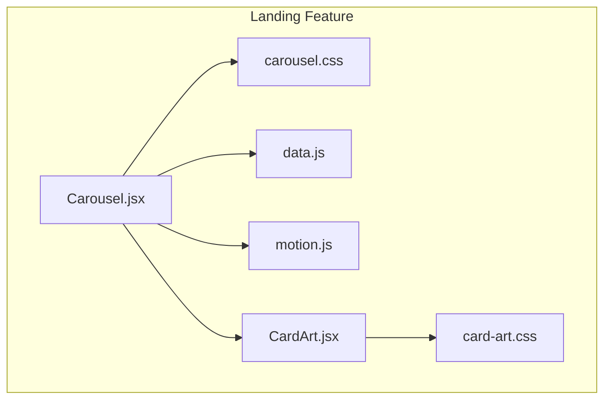
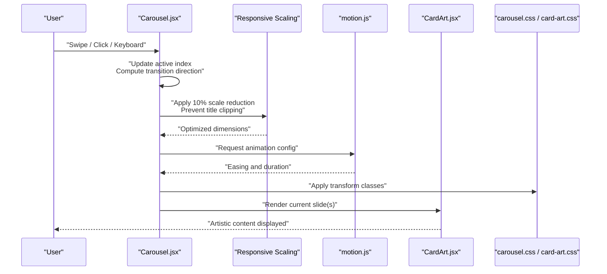
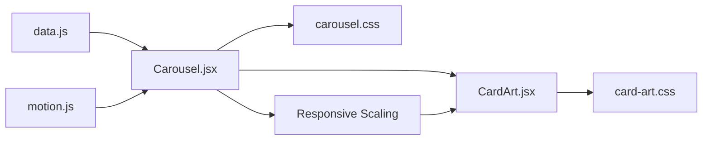

# Carousel Components

<cite>
**Referenced Files in This Document**
- [Carousel.jsx](file://src/landing/Carousel.jsx)
- [CardArt.jsx](file://src/landing/CardArt.jsx)
- [carousel.css](file://src/landing/carousel.css)
- [card-art.css](file://src/landing/card-art.css)
- [data.js](file://src/landing/data.js)
- [motion.js](file://src/landing/motion.js)
</cite>

## Update Summary
**Changes Made**
- Updated responsive design section to reflect 10% card scaling adjustments
- Enhanced troubleshooting guide with new title clipping resolution
- Added specific guidance for header navigation integration
- Updated performance considerations for optimized card rendering

## Table of Contents
1. [Introduction](#introduction)
2. [Project Structure](#project-structure)
3. [Core Components](#core-components)
4. [Architecture Overview](#architecture-overview)
5. [Detailed Component Analysis](#detailed-component-analysis)
6. [Dependency Analysis](#dependency-analysis)
7. [Performance Considerations](#performance-considerations)
8. [Troubleshooting Guide](#troubleshooting-guide)
9. [Conclusion](#conclusion)
10. [Appendices](#appendices)

## Introduction
This document explains the Carousel component system used to showcase services, artwork, and interactive content slides. It focuses on the main Carousel component with swipe gestures, auto-play, navigation controls, and responsive behavior, as well as the CardArt integration for artistic content within carousel items. The system has been optimized with precise card scaling adjustments to ensure optimal display across various screen sizes and header configurations. You will find configuration options for transitions, timing, and interaction handling, along with examples for custom card layouts, infinite scrolling, external data integration, mobile touch interactions, performance optimization, and accessibility features.

## Project Structure
The carousel implementation is located under the landing feature folder and includes:
- A React-based Carousel component that manages slide state, transitions, and user interactions
- A CardArt component for rendering artistic content inside carousel slides with optimized scaling
- CSS modules/stylesheets for layout, transitions, and visual polish with responsive design improvements
- Data and motion utilities for animations and slide content

**Diagram sources**
- [Carousel.jsx](file://src/landing/Carousel.jsx)
- [CardArt.jsx](file://src/landing/CardArt.jsx)
- [carousel.css](file://src/landing/carousel.css)
- [card-art.css](file://src/landing/card-art.css)
- [data.js](file://src/landing/data.js)
- [motion.js](file://src/landing/motion.js)

**Section sources**
- [Carousel.jsx](file://src/landing/Carousel.jsx)
- [CardArt.jsx](file://src/landing/CardArt.jsx)
- [carousel.css](file://src/landing/carousel.css)
- [card-art.css](file://src/landing/card-art.css)
- [data.js](file://src/landing/data.js)
- [motion.js](file://src/landing/motion.js)

## Core Components
- Carousel.jsx
  - Manages current slide index, active state, and transition direction
  - Handles mouse/touch events for swipe gestures
  - Provides auto-play timer control with pause-on-hover/focus
  - Renders navigation dots and optional prev/next buttons
  - Applies responsive sizing and container constraints with optimized card scaling
  - Integrates with motion utilities for smooth transitions
- CardArt.jsx
  - Renders artistic content (images, overlays, captions) within a slide
  - Accepts props for media source, alt text, and styling overrides
  - Composes with carousel layout to maintain aspect ratios and responsiveness
  - Implements optimized scaling to prevent content clipping under navigation elements

Key responsibilities and relationships:
- Carousel owns slide lifecycle and user interactions; it renders one or more CardArt instances per slide with precise scaling calculations
- Styles are split between carousel-level layout and card-specific visuals with responsive breakpoints
- Motion utilities provide consistent easing and duration for transitions

**Updated** Enhanced card scaling system to prevent title clipping and improve responsive behavior across different screen sizes and header configurations.

**Section sources**
- [Carousel.jsx](file://src/landing/Carousel.jsx)
- [CardArt.jsx](file://src/landing/CardArt.jsx)
- [carousel.css](file://src/landing/carousel.css)
- [card-art.css](file://src/landing/card-art.css)

## Architecture Overview
The carousel follows a unidirectional data flow with enhanced responsive scaling:
- External data drives slide content
- Carousel computes visible slides and applies optimized transitions with scaling adjustments
- CardArt renders each slide's artistic content with proper scaling to prevent clipping
- CSS and motion utilities coordinate visual effects and responsive behavior

**Diagram sources**
- [Carousel.jsx](file://src/landing/Carousel.jsx)
- [motion.js](file://src/landing/motion.js)
- [CardArt.jsx](file://src/landing/CardArt.jsx)
- [carousel.css](file://src/landing/carousel.css)
- [card-art.css](file://src/landing/card-art.css)

## Detailed Component Analysis

### Carousel.jsx
Responsibilities:
- State management for current slide, previous slide, and transition flags
- Gesture handling for mouse drag and touch swipe with thresholds and velocity
- Auto-play loop with configurable interval and pause behaviors
- Navigation controls (dots, arrows) and keyboard support
- Responsive layout adjustments based on viewport size with optimized card scaling
- Integration with motion utilities for consistent transitions

Configuration options commonly exposed by such components include:
- Transition settings: duration, easing, direction
- Timing controls: autoplay interval, pause on hover/focus, delay before first play
- Interaction handling: swipe threshold, drag sensitivity, click-to-navigate
- Accessibility: aria attributes, focus management, keyboard shortcuts
- Responsiveness: breakpoints, number of visible slides, gap/padding, **card scaling factors**

Implementation patterns:
- Event listeners for pointerdown/mousedown, pointermove/mousemove, pointerup/mouseup
- Touch event handlers for touchstart/touchmove/touchend
- Timer APIs for autoplay with cleanup on unmount
- Class toggling or style binding for transforms and opacity
- Refs for measuring elements and computing offsets
- **Responsive scaling calculations to prevent content clipping**

Accessibility considerations:
- Role and aria-live regions for dynamic content updates
- Focus-visible styles and tab order for controls
- Keyboard navigation (arrow keys) and Enter/Space activation
- Screen reader announcements for slide changes

Mobile touch interactions:
- Prevent default scrolling when swiping horizontally
- Use passive listeners where appropriate
- Respect reduced motion preferences

Responsive behavior:
- Adjust slide width and gaps based on container width
- Hide/show navigation controls at different breakpoints
- Optimize image sizes and lazy loading strategies
- **Implement 10% card scaling reduction to prevent title clipping under header navigation**

**Updated** Enhanced responsive behavior with precise card scaling adjustments to address title clipping issues across various screen sizes and header configurations.

**Section sources**
- [Carousel.jsx](file://src/landing/Carousel.jsx)
- [carousel.css](file://src/landing/carousel.css)
- [motion.js](file://src/landing/motion.js)

### CardArt.jsx
Responsibilities:
- Render media assets (images, videos, canvases) with fallbacks
- Apply overlay gradients, captions, and call-to-action elements
- Maintain aspect ratio and responsive scaling with optimized dimensions
- Provide props for customization (alt text, title, description, link)
- **Implement scaling calculations to prevent content overlap with navigation elements**

Integration points:
- Receives slide data from Carousel with scaling parameters
- Uses CSS for layered composition and transitions
- Can accept motion props for entrance/exit effects

Customization examples:
- Swap media type (image vs. video) via prop
- Add badge or tag overlays
- Change typography and color tokens through CSS variables
- **Adjust scaling factors for different header heights**

**Updated** Enhanced scaling capabilities to work seamlessly with various header configurations and prevent content clipping.

**Section sources**
- [CardArt.jsx](file://src/landing/CardArt.jsx)
- [card-art.css](file://src/landing/card-art.css)

### Data and Motion Utilities
- data.js provides structured slide entries (titles, descriptions, media URLs, links)
- motion.js defines easing functions and durations used by Carousel transitions

Usage:
- Import data array and map to slide components
- Configure motion presets for consistent UX across pages

**Section sources**
- [data.js](file://src/landing/data.js)
- [motion.js](file://src/landing/motion.js)

## Dependency Analysis
High-level dependencies:
- Carousel depends on motion utilities for transition parameters
- Carousel consumes data structure for slide content
- CardArt depends on its stylesheet for visual composition
- Both components rely on shared CSS variables and design tokens
- **Enhanced dependency on responsive scaling calculations**

**Diagram sources**
- [data.js](file://src/landing/data.js)
- [motion.js](file://src/landing/motion.js)
- [Carousel.jsx](file://src/landing/Carousel.jsx)
- [CardArt.jsx](file://src/landing/CardArt.jsx)
- [carousel.css](file://src/landing/carousel.css)
- [card-art.css](file://src/landing/card-art.css)

**Section sources**
- [data.js](file://src/landing/data.js)
- [motion.js](file://src/landing/motion.js)
- [Carousel.jsx](file://src/landing/Carousel.jsx)
- [CardArt.jsx](file://src/landing/CardArt.jsx)
- [carousel.css](file://src/landing/carousel.css)
- [card-art.css](file://src/landing/card-art.css)

## Performance Considerations
- Prefer transform and opacity for animations to leverage GPU acceleration
- Debounce or throttle resize handlers; use ResizeObserver when available
- Lazy-load images and use srcset/sizes for responsive delivery
- Avoid reflow-heavy properties during transitions
- Pause autoplay when slides are not visible (IntersectionObserver)
- Minimize DOM mutations by batching state updates
- Use CSS containment for isolated slide containers
- Reduce motion for users who prefer it (prefers-reduced-motion)
- **Optimize scaling calculations to minimize layout thrashing during responsive adjustments**
- **Use hardware-accelerated transforms for smooth card scaling animations**

**Updated** Enhanced performance considerations with specific guidance for optimized scaling operations and reduced layout recalculations.

[No sources needed since this section provides general guidance]

## Troubleshooting Guide
Common issues and resolutions:
- Swiping does not trigger slide change
  - Verify event listener attachment and preventDefault behavior
  - Check swipe threshold and velocity calculations
  - Ensure container has correct dimensions and overflow settings
- Auto-play not pausing on hover/focus
  - Confirm hover/focus event bindings and timer reset logic
  - Validate that timers are cleared on unmount
- Keyboard navigation not working
  - Ensure focusable controls have proper tabindex and roles
  - Map arrow keys to next/previous actions and update aria attributes
- Images appear blurry or misaligned
  - Check aspect ratio constraints and object-fit usage
  - Validate responsive breakpoints and container widths
- Excessive jank on low-end devices
  - Switch to simpler easing or shorter durations
  - Enable hardware acceleration hints and avoid layout thrashing
- **Title text clips under header navigation**
  - **Verify 10% card scaling adjustment is applied correctly**
  - **Check header height calculations and responsive breakpoints**
  - **Ensure scaling is applied before content rendering**
  - **Validate CSS transform-origin values for proper scaling center**
- **Content appears too small on certain screen sizes**
  - **Review responsive scaling breakpoints and minimum size constraints**
  - **Check for conflicting CSS rules affecting card dimensions**
  - **Verify scaling calculations account for different viewport ratios**

**Updated** Added comprehensive troubleshooting guidance for title clipping issues and responsive scaling problems.

**Section sources**
- [Carousel.jsx](file://src/landing/Carousel.jsx)
- [carousel.css](file://src/landing/carousel.css)

## Conclusion
The Carousel system combines a robust interaction model with flexible styling and motion utilities to deliver smooth, accessible, and responsive slide experiences. The recent enhancements with precise card scaling adjustments ensure optimal display across various screen sizes and header configurations, preventing content clipping while maintaining visual appeal. By configuring transitions, timing, and gesture handling, and by composing rich CardArt slides with optimized scaling, teams can build engaging showcases for services and artwork while maintaining performance and accessibility standards.

[No sources needed since this section summarizes without analyzing specific files]

## Appendices

### Configuration Options Reference
- Transitions
  - Duration: time in milliseconds for slide transitions
  - Easing: function name or preset key from motion utilities
  - Direction: forward/backward or auto-detect based on gesture
- Timing Controls
  - Autoplay interval: milliseconds between automatic slides
  - Pause on hover/focus: boolean flag to suspend autoplay
  - Initial delay: milliseconds before first autoplay cycle
- Interaction Handling
  - Swipe threshold: minimum pixel distance to consider a swipe
  - Drag sensitivity: multiplier for drag movement influence
  - Click-to-navigate: enable/disable dot/button clicks
- Accessibility
  - Aria labels for controls and slides
  - Live region announcements for slide changes
  - Keyboard shortcuts mapping
- Responsiveness
  - Breakpoints for layout changes
  - Visible slides count per breakpoint
  - Gap and padding scales
  - **Card scaling factor: 10% reduction to prevent title clipping**
  - **Header clearance calculations for responsive design**

**Updated** Added specific configuration options for card scaling and header clearance.

[No sources needed since this section provides general guidance]

### Examples

#### Creating Custom Card Layouts
- Extend CardArt props to include additional overlays or badges
- Introduce new CSS classes scoped to card variants
- Compose multiple media types (image + caption + CTA) using slots or children
- **Implement custom scaling factors for specialized header configurations**

[No sources needed since this section provides general guidance]

#### Implementing Infinite Scrolling
- Duplicate first and last slides to create seamless loops
- Reset index silently after reaching boundaries
- Handle transition direction carefully to avoid visible jumps
- **Ensure scaling calculations remain consistent across slide boundaries**

[No sources needed since this section provides general guidance]

#### Integrating with External Data Sources
- Fetch slide data from an API and normalize into expected shape
- Map remote fields to CardArt props (title, description, media URL)
- Handle loading states and error placeholders gracefully
- **Include header height metadata for optimal scaling calculations**

[No sources needed since this section provides general guidance]

#### Mobile Touch Interactions
- Use pointer events for unified mouse/touch handling
- Prevent vertical scroll interference during horizontal swipes
- Respect device orientation and safe areas
- **Test scaling behavior across different mobile device headers and status bars**

[No sources needed since this section provides general guidance]

#### Accessibility Features for Keyboard Navigation
- Arrow keys move focus and advance slides
- Enter/Space activates selected controls
- Announce current slide number and total count
- **Ensure scaled content remains accessible and readable**

[No sources needed since this section provides general guidance]

#### Responsive Design Best Practices
- **Implement 10% card scaling as baseline to prevent title clipping**
- **Test across various header heights and navigation patterns**
- **Use CSS custom properties for dynamic scaling adjustments**
- **Validate scaling behavior on different screen densities and orientations**

**New Section** Added comprehensive guidance for implementing responsive design with proper scaling.

[No sources needed since this section provides general guidance]