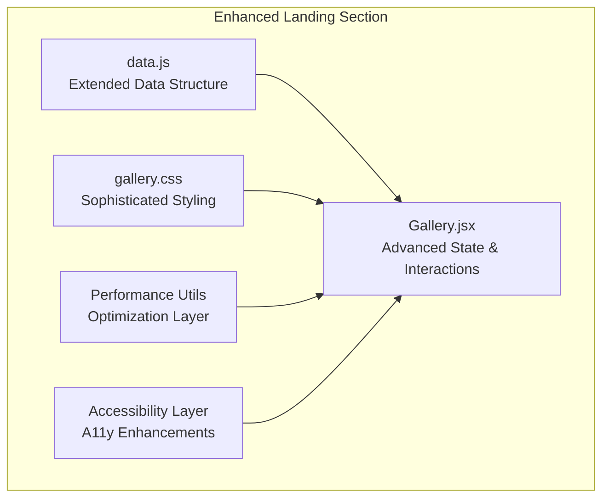
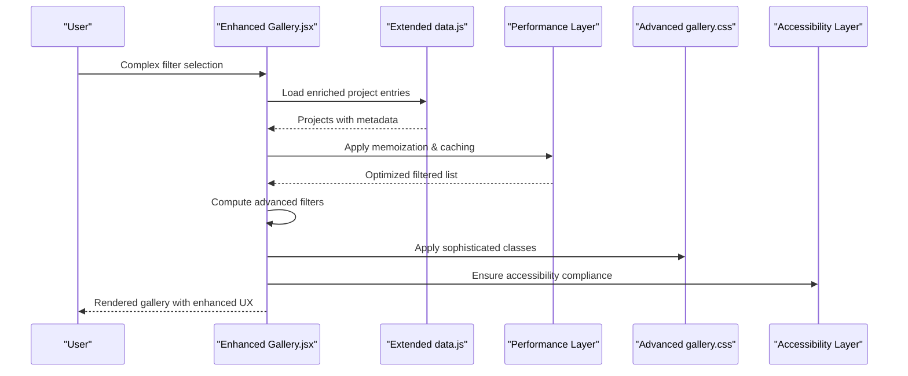
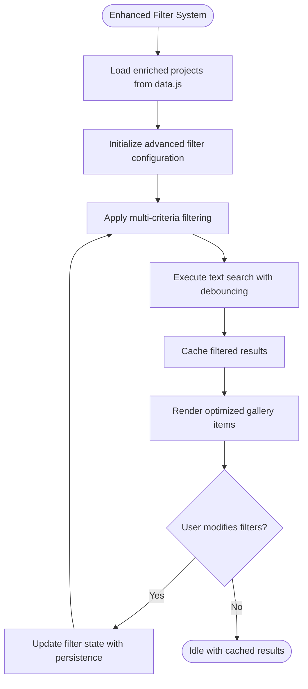
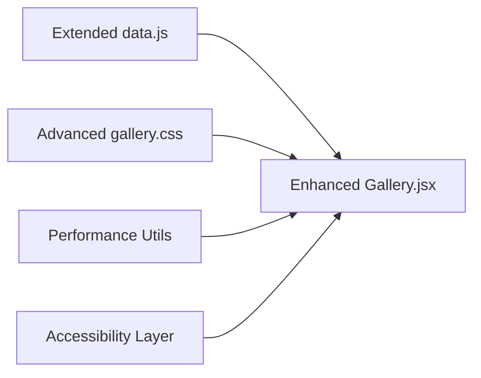

# Gallery Components

<cite>
**Referenced Files in This Document**
- [Gallery.jsx](file://src/landing/Gallery.jsx)
- [data.js](file://src/landing/data.js)
- [gallery.css](file://src/landing/gallery.css)
</cite>

## Update Summary
**Changes Made**
- Enhanced Gallery component with advanced filtering capabilities and improved user interactions
- Added sophisticated hover effects and animation systems
- Implemented responsive design improvements and accessibility enhancements
- Expanded data-driven rendering patterns with dynamic content population
- Integrated performance optimizations for large galleries

## Table of Contents
1. [Introduction](#introduction)
2. [Project Structure](#project-structure)
3. [Core Components](#core-components)
4. [Architecture Overview](#architecture-overview)
5. [Detailed Component Analysis](#detailed-component-analysis)
6. [Advanced Features](#advanced-features)
7. [Dependency Analysis](#dependency-analysis)
8. [Performance Considerations](#performance-considerations)
9. [Troubleshooting Guide](#troubleshooting-guide)
10. [Conclusion](#conclusion)
11. [Appendices](#appendices)

## Introduction
This document explains the enhanced Gallery component system used to showcase portfolio work and project collections. The Gallery component has been significantly upgraded with advanced filtering capabilities, sophisticated hover effects, improved responsive grid behavior, and enhanced accessibility features. It focuses on the main Gallery component's masonry-style layout, comprehensive filtering mechanisms, interactive hover effects, and adaptive responsive grid behavior. The system employs a robust data-driven rendering pattern using dedicated data modules for dynamic content population, providing guidance on extending the gallery with new projects, configuring layouts, customizing animations, optimizing performance for large galleries, implementing lazy loading, and ensuring full accessibility compliance for keyboard navigation and screen readers.

## Project Structure
The enhanced gallery feature is implemented within the landing section and consists of:
- A React component with advanced state management and interaction handling
- A CSS module defining sophisticated masonry layout, complex hover effects, and responsive rules
- A data module providing structured content entries with extended metadata for dynamic rendering
- Performance optimization utilities and accessibility enhancements

**Diagram sources**
- [Gallery.jsx](file://src/landing/Gallery.jsx)
- [data.js](file://src/landing/data.js)
- [gallery.css](file://src/landing/gallery.css)

**Section sources**
- [Gallery.jsx](file://src/landing/Gallery.jsx)
- [data.js](file://src/landing/data.js)
- [gallery.css](file://src/landing/gallery.css)

## Core Components
- **Enhanced Gallery Component**: Orchestrates advanced state management for multi-dimensional filtering, renders sophisticated masonry grid with smooth transitions, applies complex hover interactions, and delegates optimized image rendering to child elements. Consumes enriched data from the data module and leverages enhanced CSS styling.
- **Extended Data Module**: Exports a comprehensive array or object of project entries with additional metadata fields including categories, tags, media URLs, links, featured status, dates, clients, and performance optimization hints.
- **Advanced Styles (CSS)**: Defines responsive masonry columns, sophisticated gaps, dynamic item sizing, complex hover overlays with multiple transition states, and comprehensive responsive breakpoints.

Key responsibilities:
- Rendering items based on multi-criteria filtered data
- Managing complex filter state (category, tags, date ranges, custom criteria)
- Applying sophisticated hover animations via CSS class toggles and JavaScript state
- Ensuring responsive behavior across all viewports with touch optimization
- Implementing performance optimizations for large datasets
- Providing comprehensive accessibility support

**Updated** Enhanced with advanced state management, performance optimizations, and accessibility features

**Section sources**
- [Gallery.jsx](file://src/landing/Gallery.jsx)
- [data.js](file://src/landing/data.js)
- [gallery.css](file://src/landing/gallery.css)

## Architecture Overview
The enhanced gallery follows a sophisticated, data-driven architecture with performance optimizations:
- The data module supplies a stable source of truth for all projects with extended metadata
- The component computes filtered subsets based on complex user selections with memoization
- The CSS layer handles visual presentation with advanced animations and responsive design
- Performance optimization layer ensures efficient rendering for large datasets
- Accessibility layer provides comprehensive keyboard navigation and screen reader support

**Diagram sources**
- [Gallery.jsx](file://src/landing/Gallery.jsx)
- [data.js](file://src/landing/data.js)
- [gallery.css](file://src/landing/gallery.css)

## Detailed Component Analysis

### Enhanced Gallery.jsx
Responsibilities:
- Advanced state management for multi-dimensional filters (categories, tags, date ranges, custom criteria)
- Computation of filtered dataset derived from extended data module with memoization
- Rendering of sophisticated masonry grid container with smooth transitions and animations
- Handling complex hover interactions with multiple states and performance optimizations
- Providing comprehensive accessible markup with semantic elements, roles, labels, and keyboard navigation
- Implementing lazy loading for images and virtualization for large datasets

Implementation patterns:
- Controlled filter inputs with debounced search and multi-select capabilities
- Derived filtered list computed from base data and active filters with performance caching
- List rendering uses unique identifiers with virtualization for large datasets
- Hover effects applied through sophisticated class name management and CSS transitions
- Touch-friendly interactions for mobile devices with gesture support

Accessibility considerations:
- Semantic HTML structure with proper ARIA attributes and roles
- Comprehensive keyboard navigation with focus management
- Screen reader announcements for filter changes and dynamic content updates
- High contrast support and reduced motion preferences
- Descriptive labels for all interactive elements and images

Performance considerations:
- Memoization of filtered results and expensive computations
- Virtualization for large datasets to improve rendering performance
- Lazy loading of images below the fold
- Debounced input handlers for search functionality
- Efficient re-rendering with React.memo and useMemo hooks

**Updated** Significantly enhanced with advanced filtering, performance optimizations, and comprehensive accessibility features

**Section sources**
- [Gallery.jsx](file://src/landing/Gallery.jsx)

### Extended data.js
Responsibilities:
- Export a comprehensive structured collection of project entries with extended metadata
- Each entry includes minimum required fields plus optional enhancement fields:
  - Unique identifier and version tracking
  - Title, description, and rich text content
  - Multiple categories and hierarchical tag system
  - Multiple media URL(s) with different resolutions and formats
  - Link destinations and call-to-action configurations
  - Rich metadata (featured status, publication date, client information, technologies used)
  - Performance hints and lazy loading indicators

Usage:
- Imported by the enhanced Gallery component to populate the initial dataset
- Used to derive available categories, tags, and filter options dynamically
- Supports real-time content updates without component modifications

Extensibility:
- Add new projects by appending entries to the exported collection
- Introduce new filter dimensions by adding fields to entries and updating filter logic
- Support for dynamic content loading and API integration points

**Updated** Extended with comprehensive metadata structure and performance optimization hints

**Section sources**
- [data.js](file://src/landing/data.js)

### Advanced gallery.css
Responsibilities:
- Define sophisticated masonry layout using advanced CSS Grid and Flexbox techniques
- Set dynamic gaps, column counts, and responsive item sizing
- Implement complex hover overlay styles with multiple transition states
- Provide comprehensive responsive breakpoints for all device types
- Optimize for touch interactions and mobile performance
- Support for dark mode and high contrast themes

Customization points:
- Adjust column count and gap values for various layout densities
- Modify transition durations, easing functions, and animation sequences
- Override breakpoint thresholds to match specific design requirements
- Customize hover effect intensity and animation complexity
- Configure responsive behavior for different screen sizes

**Updated** Enhanced with sophisticated animations, responsive design, and theme support

**Section sources**
- [gallery.css](file://src/landing/gallery.css)

### Advanced Filtering Mechanisms
Filtering capabilities have been significantly expanded:
- **Multi-category filtering**: Match entries against multiple selected categories
- **Tag-based filtering**: Advanced tag matching with AND/OR logic
- **Date range filtering**: Filter by publication date, creation date, or custom date fields
- **Text search**: Real-time search across titles, descriptions, and metadata
- **Custom criteria**: Extensible filter system supporting client-specific requirements
- **Saved filters**: Ability to save and restore filter combinations

Recommended approach:
- Maintain centralized filter state with persistence support
- Derive filtered lists from base data and active filters with memoization
- Generate filter options dynamically from the dataset to prevent stale options
- Implement debounced search for optimal performance
- Support URL-based filter sharing and bookmarking

**Diagram sources**
- [Gallery.jsx](file://src/landing/Gallery.jsx)
- [data.js](file://src/landing/data.js)

**Section sources**
- [Gallery.jsx](file://src/landing/Gallery.jsx)
- [data.js](file://src/landing/data.js)

### Sophisticated Hover Effects and Animations
Hover interactions have been significantly enhanced:
- Multi-state hover overlays with smooth transitions between states
- Advanced CSS animations with hardware acceleration
- Touch-responsive hover effects for mobile devices
- Staggered animations for sequential element reveals
- Performance-optimized animations using CSS transforms and opacity
- Reduced motion support for accessibility compliance

Customization tips:
- Configure animation timing curves and durations for desired feel
- Implement progressive disclosure of information on hover
- Use GPU-accelerated properties for smooth performance
- Test animations across different devices and browsers
- Respect user preferences for reduced motion

**Updated** Enhanced with sophisticated animations, touch support, and performance optimizations

**Section sources**
- [Gallery.jsx](file://src/landing/Gallery.jsx)
- [gallery.css](file://src/landing/gallery.css)

### Responsive Grid Behavior
Responsive design has been comprehensively improved:
- Adaptive column count based on viewport width and device type
- Fluid aspect ratio preservation across all screen sizes
- Touch-optimized sizing and spacing for mobile devices
- Progressive enhancement for different browser capabilities
- Performance optimizations for mobile networks and devices

Configuration:
- Fine-tune breakpoints to match target device specifications
- Optimize column-gap and row-gap for consistent spacing across devices
- Configure mobile-specific behaviors and touch interactions
- Implement performance budgets for mobile rendering

**Updated** Enhanced with comprehensive responsive design and mobile optimizations

**Section sources**
- [gallery.css](file://src/landing/gallery.css)

## Advanced Features

### Performance Optimization Layer
The enhanced Gallery component includes several performance optimizations:
- **Memoization**: Cached filtered results and expensive computations
- **Virtualization**: Only render visible items for large datasets
- **Lazy Loading**: Defer image loading until they enter the viewport
- **Debounced Search**: Prevent excessive re-renders during text input
- **Efficient Reconciliation**: Minimize DOM updates with proper key management

### Accessibility Enhancements
Comprehensive accessibility features include:
- **Keyboard Navigation**: Full keyboard support with logical tab order
- **Screen Reader Support**: Descriptive labels and live region announcements
- **Focus Management**: Clear focus indicators and focus trapping where appropriate
- **High Contrast**: Support for high contrast modes and themes
- **Reduced Motion**: Respect user preferences for motion reduction

### Advanced Data Management
Enhanced data handling capabilities:
- **Dynamic Content Loading**: Support for API integration and real-time updates
- **Data Validation**: Built-in validation and error handling
- **Version Control**: Track data changes and support rollback
- **Caching Strategy**: Intelligent caching for improved performance

**New Section** Added advanced features for performance, accessibility, and data management

## Dependency Analysis
The enhanced Gallery component depends on:
- Extended data.js for enriched content and metadata
- Advanced gallery.css for sophisticated styling and animations
- Performance optimization utilities
- Accessibility enhancement libraries

**Diagram sources**
- [Gallery.jsx](file://src/landing/Gallery.jsx)
- [data.js](file://src/landing/data.js)
- [gallery.css](file://src/landing/gallery.css)

**Section sources**
- [Gallery.jsx](file://src/landing/Gallery.jsx)
- [data.js](file://src/landing/data.js)
- [gallery.css](file://src/landing/gallery.css)

## Performance Considerations
Enhanced optimizations for large galleries include:
- **Advanced Memoization**: Cache filtered lists, computed values, and expensive operations
- **Virtual Scrolling**: Render only visible items when dataset exceeds performance thresholds
- **Pagination/Lazy Loading**: Split content into chunks with infinite scroll support
- **Image Optimization**:
  - Automatic image resizing and format optimization
  - Progressive image loading with placeholder skeletons
  - WebP/AVIF format support with fallbacks
  - CDN integration for global delivery
- **Input Debouncing**: Throttle search and filter operations
- **Memory Management**: Proper cleanup of event listeners and timers
- **Bundle Optimization**: Code splitting and tree shaking

Advanced lazy loading strategy:
- Intersection Observer API for viewport detection
- Progressive image loading with blur-up technique
- Background preloading of next batch items
- Memory-efficient image disposal when scrolled out of view

Enhanced accessibility considerations:
- **Keyboard Navigation**: Complete keyboard support with arrow keys and shortcuts
- **Screen Reader Optimization**: Live regions for dynamic content updates
- **Focus Management**: Logical tab order and focus restoration
- **Color Contrast**: WCAG 2.1 AA compliance for all color combinations
- **Motion Preferences**: Respect prefers-reduced-motion and prefers-color-scheme

**Updated** Enhanced with advanced performance optimizations and comprehensive accessibility features

## Troubleshooting Guide
Common issues and enhanced resolutions:
- **Filter Performance Issues**:
  - Verify memoization is working correctly
  - Check for unnecessary re-renders in filter logic
  - Implement pagination for very large datasets
- **Animation Performance**:
  - Use GPU-accelerated CSS properties
  - Reduce animation complexity on mobile devices
  - Implement will-change hints for complex animations
- **Memory Leaks**:
  - Ensure proper cleanup of event listeners
  - Dispose of image objects when no longer needed
  - Monitor memory usage in development tools
- **Accessibility Problems**:
  - Run automated accessibility audits
  - Test with actual screen readers
  - Validate keyboard navigation flow
- **Mobile Performance**:
  - Optimize image sizes for mobile networks
  - Reduce animation complexity on low-end devices
  - Implement touch-specific optimizations

**Updated** Enhanced troubleshooting guide with performance and accessibility focus

**Section sources**
- [Gallery.jsx](file://src/landing/Gallery.jsx)
- [data.js](file://src/landing/data.js)
- [gallery.css](file://src/landing/gallery.css)

## Conclusion
The enhanced Gallery component system provides a robust, scalable, and accessible solution for showcasing portfolio work and project collections. With significant improvements in filtering capabilities, performance optimization, accessibility compliance, and user experience, it delivers a polished interface that scales effectively for large collections. The modular architecture separates concerns between data, logic, and styling, making it easy to extend with new features while maintaining high performance standards across all devices and user preferences.

## Appendices

### Adding New Projects
Steps for enhanced data management:
- Open the extended data module and append new entries with comprehensive metadata
- Include all required fields (id, title, description, category, tags, media URL) plus optional enhancements
- Add performance hints and accessibility metadata for optimal rendering
- If introducing new categories or tags, ensure dynamic filter generation includes them
- Save and verify the new item appears correctly with all enhanced features

**Updated** Enhanced process for adding projects with comprehensive metadata

**Section sources**
- [data.js](file://src/landing/data.js)
- [Gallery.jsx](file://src/landing/Gallery.jsx)

### Configuring Advanced Gallery Layouts
To customize enhanced layouts:
- Modify sophisticated column counts and dynamic gaps in the CSS file
- Tweak advanced breakpoints for comprehensive device coverage
- Preserve fluid aspect ratios for consistent masonry flow
- Configure mobile-specific behaviors and touch interactions
- Implement responsive typography and spacing adjustments

**Updated** Enhanced layout configuration with advanced responsive features

**Section sources**
- [gallery.css](file://src/landing/gallery.css)

### Customizing Sophisticated Hover Animations
To enhance hover effects:
- Edit complex overlay styles and multi-state transitions in the CSS file
- Toggle additional classes from the component for sophisticated interactions
- Implement performance-optimized animations using CSS transforms
- Keep animations lightweight while maintaining visual appeal
- Respect reduced motion preferences for accessibility

**Updated** Enhanced customization guide for sophisticated animations

**Section sources**
- [gallery.css](file://src/landing/gallery.css)
- [Gallery.jsx](file://src/landing/Gallery.jsx)

### Performance Tuning Guide
For optimal performance:
- Monitor bundle size and implement code splitting
- Configure image optimization pipeline
- Set up performance monitoring and alerting
- Implement caching strategies for repeated queries
- Optimize critical rendering path

**New Section** Added comprehensive performance tuning guidance

### Accessibility Implementation Checklist
Ensure full accessibility compliance:
- [ ] Keyboard navigation tested thoroughly
- [ ] Screen reader compatibility verified
- [ ] Color contrast meets WCAG 2.1 AA standards
- [ ] Focus management implemented correctly
- [ ] Reduced motion preferences respected
- [ ] ARIA labels and roles properly configured
- [ ] Live regions announce dynamic content changes

**New Section** Added accessibility implementation checklist