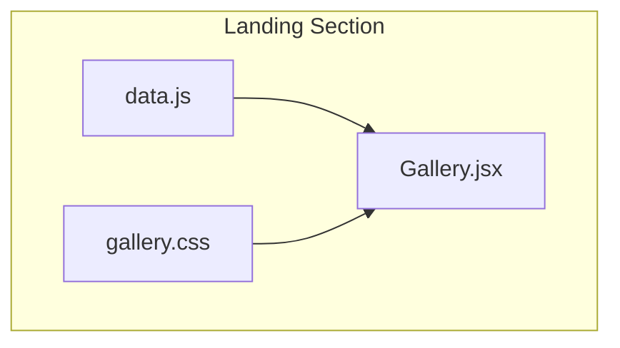
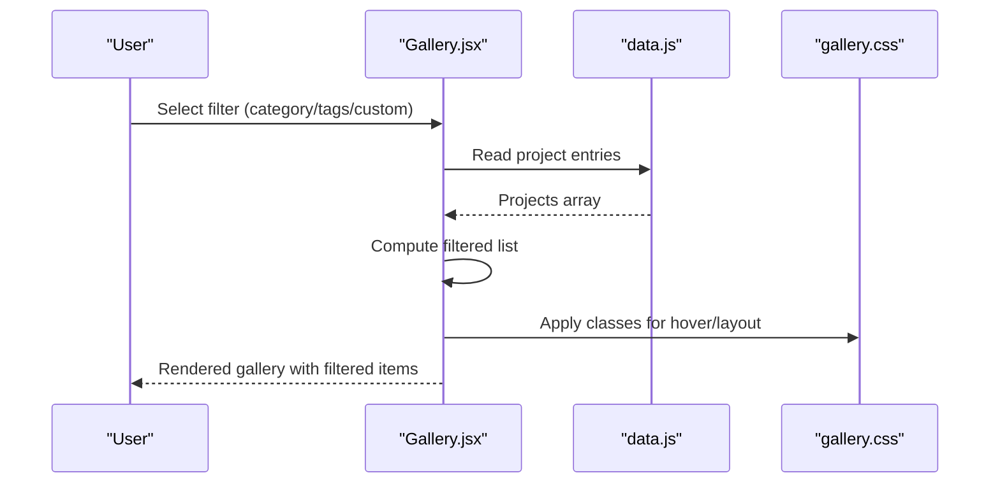
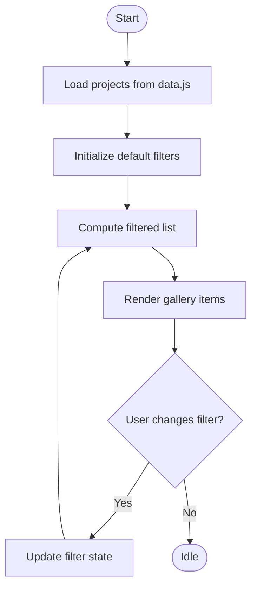
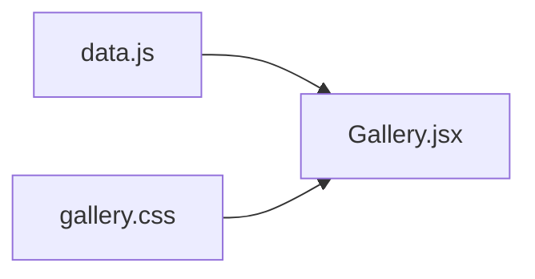

# Gallery Components

<cite>
**Referenced Files in This Document**
- [Gallery.jsx](file://src/landing/Gallery.jsx)
- [data.js](file://src/landing/data.js)
- [gallery.css](file://src/landing/gallery.css)
</cite>

## Table of Contents
1. [Introduction](#introduction)
2. [Project Structure](#project-structure)
3. [Core Components](#core-components)
4. [Architecture Overview](#architecture-overview)
5. [Detailed Component Analysis](#detailed-component-analysis)
6. [Dependency Analysis](#dependency-analysis)
7. [Performance Considerations](#performance-considerations)
8. [Troubleshooting Guide](#troubleshooting-guide)
9. [Conclusion](#conclusion)
10. [Appendices](#appendices)

## Introduction
This document explains the Gallery component system used to showcase portfolio work and project collections. It focuses on the main Gallery component, its masonry-style layout, filtering capabilities, hover effects, and responsive grid behavior. It also documents the data-driven rendering pattern using a dedicated data module for dynamic content population, and provides guidance on extending the gallery with new projects, configuring layouts, customizing hover animations, optimizing performance for large galleries, implementing lazy loading, and ensuring accessibility for keyboard navigation and screen readers.

## Project Structure
The gallery feature is implemented within the landing section and consists of:
- A React component that renders the gallery UI and logic
- A CSS file defining masonry layout, hover effects, and responsive rules
- A data module providing structured content entries for dynamic rendering

**Diagram sources**
- [Gallery.jsx](file://src/landing/Gallery.jsx)
- [data.js](file://src/landing/data.js)
- [gallery.css](file://src/landing/gallery.css)

**Section sources**
- [Gallery.jsx](file://src/landing/Gallery.jsx)
- [data.js](file://src/landing/data.js)
- [gallery.css](file://src/landing/gallery.css)

## Core Components
- Gallery (React component): Orchestrates state for filtering, renders the masonry grid, applies hover interactions, and delegates image rendering to child elements. It consumes data from the data module and styles from the CSS module.
- Data module: Exports an array or object of project entries. Each entry typically includes fields such as title, description, category, tags, media URL(s), and optional metadata like link or featured status.
- Styles (CSS): Defines masonry columns, gaps, item sizing, hover overlays, transitions, and responsive breakpoints.

Key responsibilities:
- Rendering items based on filtered data
- Managing filter state (category, tags, custom criteria)
- Applying hover animations via CSS classes toggled by component state
- Ensuring responsive behavior across viewports

**Section sources**
- [Gallery.jsx](file://src/landing/Gallery.jsx)
- [data.js](file://src/landing/data.js)
- [gallery.css](file://src/landing/gallery.css)

## Architecture Overview
The gallery follows a simple, data-driven architecture:
- The data module supplies a stable source of truth for all projects
- The component computes filtered subsets based on user selections
- The CSS layer handles visual presentation, including masonry and hover states

**Diagram sources**
- [Gallery.jsx](file://src/landing/Gallery.jsx)
- [data.js](file://src/landing/data.js)
- [gallery.css](file://src/landing/gallery.css)

## Detailed Component Analysis

### Gallery.jsx
Responsibilities:
- State management for active filters (e.g., selected category, tag, or custom criteria)
- Computation of filtered dataset derived from the data module
- Rendering of a masonry grid container and individual project cards
- Handling hover interactions by toggling CSS classes or inline styles
- Providing accessible markup (semantic elements, roles, labels)

Implementation patterns:
- Controlled filter inputs (buttons, selects, or search input) update state
- Derived filtered list computed from base data and current filters
- List rendering uses keys derived from unique identifiers in data entries
- Hover effects are applied through class names defined in the CSS module

Accessibility considerations:
- Use semantic elements (e.g., section, article, figure) for structure
- Provide aria-labels or titles for images and interactive controls
- Ensure focus order and visible focus indicators for keyboard users
- Include alt text for images and descriptive labels for links

Performance considerations:
- Memoize filtered results when datasets grow large
- Avoid unnecessary re-renders by stabilizing props and state updates
- Consider virtualization or pagination for very large galleries

**Section sources**
- [Gallery.jsx](file://src/landing/Gallery.jsx)

### data.js
Responsibilities:
- Export a structured collection of project entries
- Each entry should include at minimum:
  - Unique identifier
  - Title and description
  - Category and tags arrays
  - Media URL(s) (image or video)
  - Optional link and metadata (featured, date, client)

Usage:
- Imported by the Gallery component to populate the initial dataset
- Used to derive available categories and tags for filter UI generation

Extensibility:
- Add new projects by appending entries to the exported collection
- Introduce new filter dimensions by adding fields to entries and updating filter logic in the component

**Section sources**
- [data.js](file://src/landing/data.js)

### gallery.css
Responsibilities:
- Define masonry layout using CSS columns or grid techniques
- Set gaps, column counts, and item sizing
- Implement hover overlay styles and transitions
- Provide responsive breakpoints for different screen sizes

Customization points:
- Adjust column count and gap values for denser or looser layouts
- Modify transition durations and easing for hover animations
- Override breakpoint thresholds to match design requirements

**Section sources**
- [gallery.css](file://src/landing/gallery.css)

### Filtering Mechanisms
Filtering can be implemented by:
- Category: Match entries whose category field equals the selected value
- Tags: Match entries containing any of the selected tags
- Custom criteria: Additional filters such as year, client, or featured flag

Recommended approach:
- Maintain a single source of truth for filters in component state
- Derive filtered list from base data and active filters
- Generate filter options dynamically from the dataset to avoid stale options

**Diagram sources**
- [Gallery.jsx](file://src/landing/Gallery.jsx)
- [data.js](file://src/landing/data.js)

**Section sources**
- [Gallery.jsx](file://src/landing/Gallery.jsx)
- [data.js](file://src/landing/data.js)

### Hover Effects and Animations
- Hover overlays are controlled via CSS classes toggled by component state or pseudo-selectors
- Transitions define timing and easing for smooth appearance/disappearance
- Z-index stacking ensures overlays appear above thumbnails

Customization tips:
- Change opacity, scale, or blur for subtle or dramatic effects
- Animate text reveal or badge badges on hover
- Keep animations short and performant to maintain responsiveness

**Section sources**
- [Gallery.jsx](file://src/landing/Gallery.jsx)
- [gallery.css](file://src/landing/gallery.css)

### Responsive Grid Behavior
- Column count adapts based on viewport width
- Item aspect ratios preserved while fitting into masonry flow
- Touch-friendly sizing for mobile devices

Configuration:
- Adjust breakpoints in CSS to align with design system
- Tune column-gap and row-gap for consistent spacing

**Section sources**
- [gallery.css](file://src/landing/gallery.css)

## Dependency Analysis
The Gallery component depends on:
- data.js for content
- gallery.css for styling

**Diagram sources**
- [Gallery.jsx](file://src/landing/Gallery.jsx)
- [data.js](file://src/landing/data.js)
- [gallery.css](file://src/landing/gallery.css)

**Section sources**
- [Gallery.jsx](file://src/landing/Gallery.jsx)
- [data.js](file://src/landing/data.js)
- [gallery.css](file://src/landing/gallery.css)

## Performance Considerations
Optimizations for large galleries:
- Memoization: Cache filtered lists to avoid recomputation on every render
- Virtualization: Render only visible items when the dataset is very large
- Pagination or load-more: Split content into chunks to reduce initial payload
- Image optimization:
  - Use appropriately sized images
  - Lazy-load images below the fold
  - Prefer modern formats (WebP/AVIF) where supported
- Debounce input: For free-text search, debounce to limit frequent re-filters
- Stable keys: Ensure unique, stable keys per item to minimize DOM churn

Lazy loading strategy:
- Defer loading offscreen images until they enter the viewport
- Combine with placeholder skeletons for perceived performance

Accessibility considerations:
- Keyboard navigation:
  - Focusable filter controls with clear focus indicators
  - Arrow-key navigation between items if applicable
- Screen reader support:
  - Descriptive labels for images and links
  - Announce filter changes via live regions if needed
- Color contrast and reduced motion:
  - Respect prefers-reduced-motion for animations
  - Ensure sufficient contrast for overlay text

[No sources needed since this section provides general guidance]

## Troubleshooting Guide
Common issues and resolutions:
- Filters not updating:
  - Verify state updates trigger re-render
  - Confirm derived filtered list recalculates on dependency change
- Missing images:
  - Validate URLs in data entries
  - Check CORS and asset paths
- Layout breaks on small screens:
  - Review CSS breakpoints and column settings
  - Ensure images have appropriate aspect ratios
- Slow performance with many items:
  - Implement memoization or virtualization
  - Reduce heavy computations inside render loops
- Accessibility problems:
  - Add alt text and labels
  - Test keyboard-only navigation and screen reader announcements

**Section sources**
- [Gallery.jsx](file://src/landing/Gallery.jsx)
- [data.js](file://src/landing/data.js)
- [gallery.css](file://src/landing/gallery.css)

## Conclusion
The Gallery component system provides a flexible, data-driven approach to showcasing portfolio work. By separating concerns—data, logic, and styling—it remains easy to extend with new projects, filters, and visual effects. With attention to performance and accessibility, it scales well for large collections and delivers a polished user experience across devices.

[No sources needed since this section summarizes without analyzing specific files]

## Appendices

### Adding New Projects
Steps:
- Open the data module and append a new entry with required fields (id, title, description, category, tags, media URL)
- If introducing a new category or tag, ensure it appears in filter options (dynamic derivation recommended)
- Save and verify the new item appears in the gallery and responds to filters

**Section sources**
- [data.js](file://src/landing/data.js)
- [Gallery.jsx](file://src/landing/Gallery.jsx)

### Configuring Gallery Layouts
To adjust layout:
- Modify column counts and gaps in the CSS file
- Tweak breakpoints to match target devices
- Preserve item aspect ratios for consistent masonry flow

**Section sources**
- [gallery.css](file://src/landing/gallery.css)

### Customizing Hover Animations
To customize hover effects:
- Edit overlay styles and transitions in the CSS file
- Optionally toggle additional classes from the component for complex interactions
- Keep animations lightweight and respect reduced motion preferences

**Section sources**
- [gallery.css](file://src/landing/gallery.css)
- [Gallery.jsx](file://src/landing/Gallery.jsx)