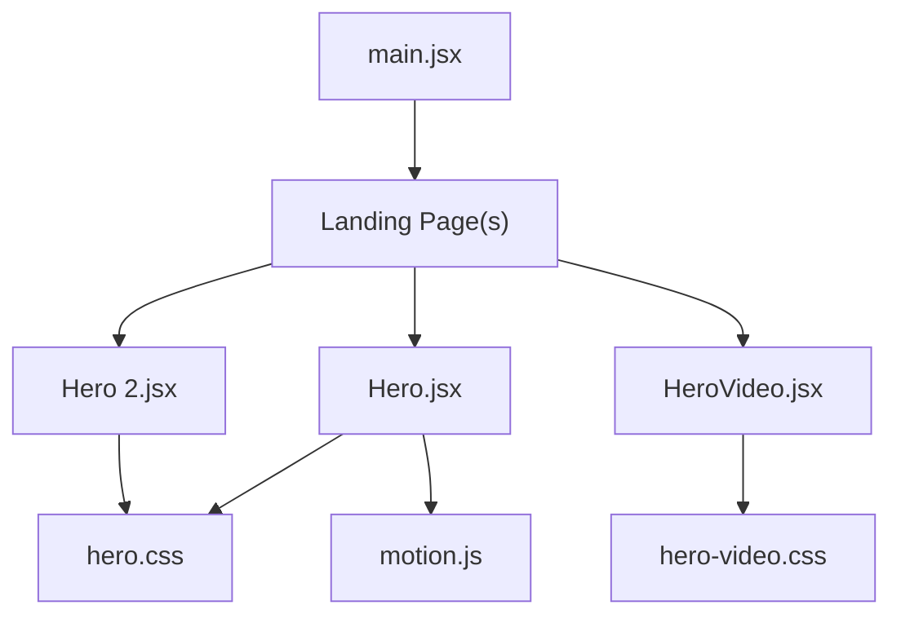
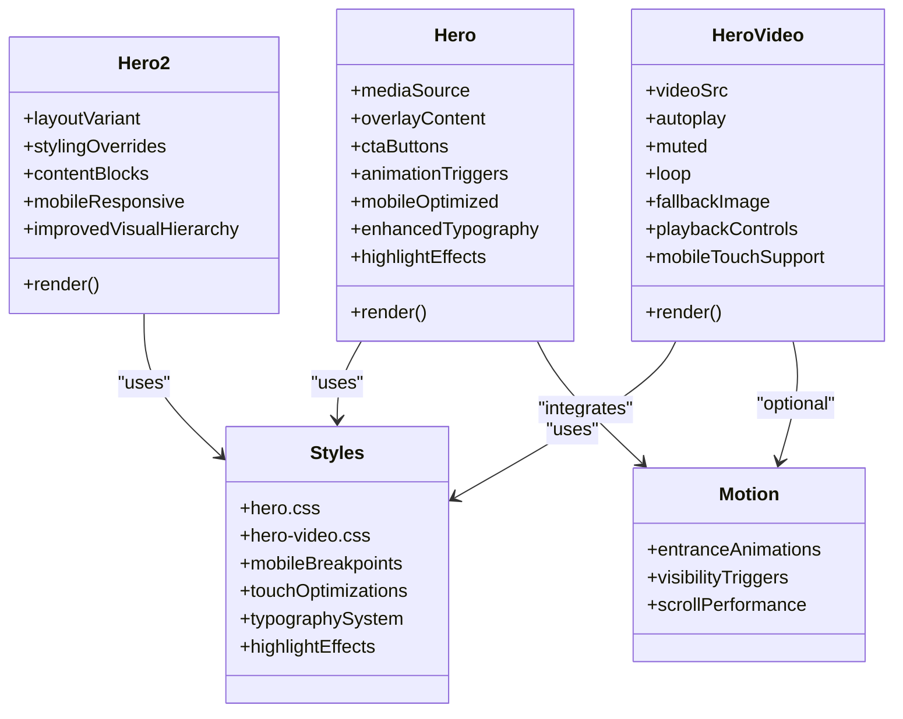
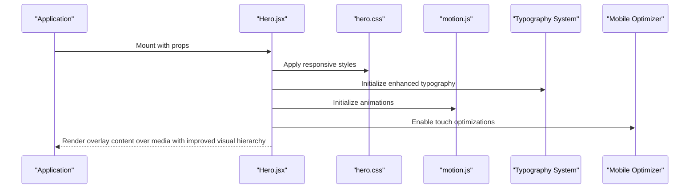
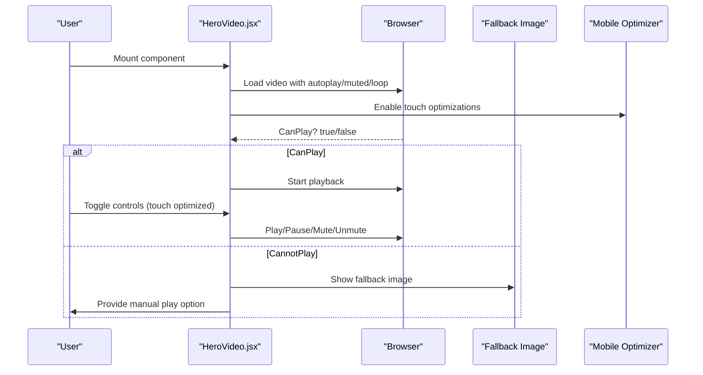
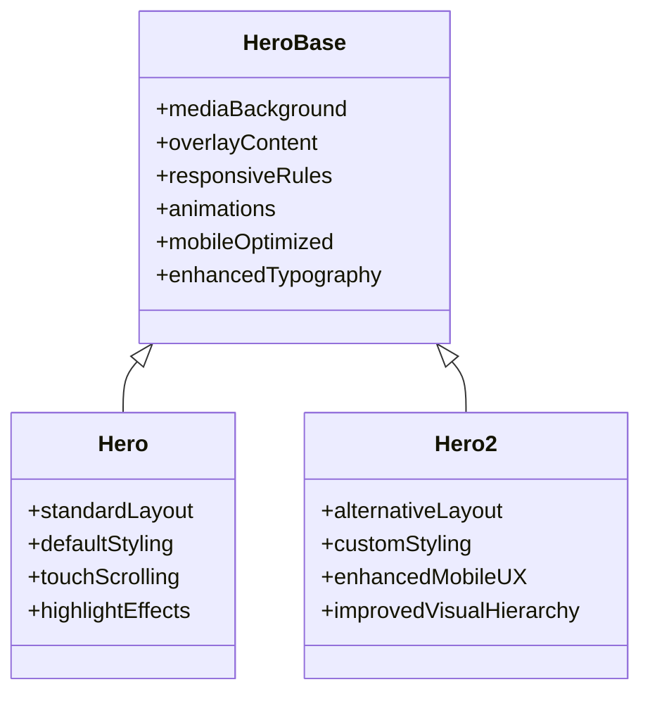
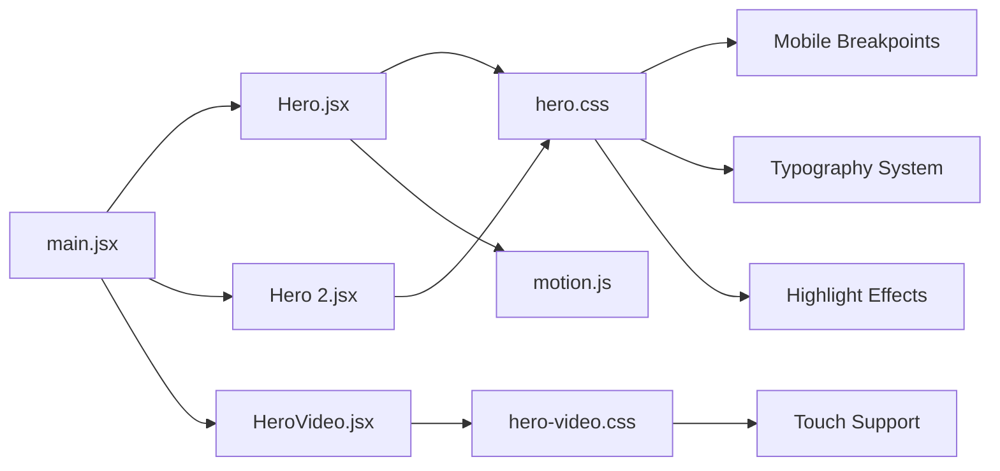

# Hero Sections

<cite>
**Referenced Files in This Document**
- [Hero.jsx](file://src/landing/Hero.jsx)
- [HeroVideo.jsx](file://src/landing/HeroVideo.jsx)
- [Hero 2.jsx](file://src/landing/Hero 2.jsx)
- [hero.css](file://src/landing/hero.css)
- [hero-video.css](file://src/landing/hero-video.css)
- [motion.js](file://src/landing/motion.js)
- [main.jsx](file://src/main.jsx)
</cite>

## Update Summary
**Changes Made**
- Updated typography and font styling documentation to reflect enhanced visual presentation
- Added new section on highlight effects and weight adjustments in Hero components
- Enhanced visual hierarchy documentation with improved text emphasis techniques
- Updated mobile optimization section with refined typography scaling for better readability
- Expanded accessibility considerations for enhanced font rendering across devices

## Table of Contents
1. [Introduction](#introduction)
2. [Project Structure](#project-structure)
3. [Core Components](#core-components)
4. [Architecture Overview](#architecture-overview)
5. [Detailed Component Analysis](#detailed-component-analysis)
6. [Typography and Visual Styling](#typography-and-visual-styling)
7. [Mobile Optimization and Responsive Design](#mobile-optimization-and-responsive-design)
8. [Dependency Analysis](#dependency-analysis)
9. [Performance Considerations](#performance-considerations)
10. [Troubleshooting Guide](#troubleshooting-guide)
11. [Conclusion](#conclusion)

## Introduction
This document provides comprehensive documentation for the Hero section components that serve as the primary visual entry points of the landing page. It covers:
- Hero.jsx: background media (video/image), overlay content, and responsive patterns with enhanced typography
- HeroVideo.jsx: full-screen video backgrounds with playback controls and fallback handling
- Hero 2.jsx: alternative layout and styling approach with improved visual hierarchy
It also includes configuration options for media sources, text overlays, call-to-action buttons, animation triggers, performance optimization techniques, lazy loading strategies, cross-browser compatibility considerations, extensive mobile optimization features, and advanced typography enhancements.

## Project Structure
The Hero-related code is organized under src/landing with component files and associated styles and motion utilities. The main application entry point imports and renders the landing pages that include these Hero components.

**Diagram sources**
- [main.jsx](file://src/main.jsx)
- [Hero.jsx](file://src/landing/Hero.jsx)
- [Hero 2.jsx](file://src/landing/Hero 2.jsx)
- [HeroVideo.jsx](file://src/landing/HeroVideo.jsx)
- [hero.css](file://src/landing/hero.css)
- [hero-video.css](file://src/landing/hero-video.css)
- [motion.js](file://src/landing/motion.js)

**Section sources**
- [main.jsx](file://src/main.jsx)
- [Hero.jsx](file://src/landing/Hero.jsx)
- [Hero 2.jsx](file://src/landing/Hero 2.jsx)
- [HeroVideo.jsx](file://src/landing/HeroVideo.jsx)
- [hero.css](file://src/landing/hero.css)
- [hero-video.css](file://src/landing/hero-video.css)
- [motion.js](file://src/landing/motion.js)

## Core Components
- Hero.jsx: Primary hero with configurable media background (image or video), overlay content, and responsive behavior. Integrates with shared motion utilities for entrance animations and enhanced typography system.
- HeroVideo.jsx: Dedicated full-screen video background component with playback controls and robust fallbacks when video cannot play.
- Hero 2.jsx: Variant with an alternative layout and styling approach to support different brand or campaign needs with improved visual hierarchy.

Key responsibilities:
- Media management: source selection, aspect ratio, and fallbacks
- Overlay content: title, subtitle, description, and call-to-action buttons with enhanced typography
- Responsive design: adapting layouts across breakpoints with optimized text rendering
- Animation integration: triggering motion effects on mount or visibility
- Mobile optimization: enhanced touch interactions, scroll performance, and refined typography scaling
- Visual enhancement: highlight effects, font weight adjustments, and improved text emphasis

**Section sources**
- [Hero.jsx](file://src/landing/Hero.jsx)
- [HeroVideo.jsx](file://src/landing/HeroVideo.jsx)
- [Hero 2.jsx](file://src/landing/Hero 2.jsx)
- [hero.css](file://src/landing/hero.css)
- [hero-video.css](file://src/landing/hero-video.css)
- [motion.js](file://src/landing/motion.js)

## Architecture Overview
The Hero system follows a layered architecture:
- Presentation layer: React components render the hero UI with enhanced typography and visual effects
- Styling layer: CSS modules/stylesheets define layout, typography, highlight effects, and responsive rules
- Motion layer: Shared motion utilities drive entrance animations and transitions
- Application layer: Main entry point composes landing pages that include the Hero components

**Diagram sources**
- [Hero.jsx](file://src/landing/Hero.jsx)
- [Hero 2.jsx](file://src/landing/Hero 2.jsx)
- [HeroVideo.jsx](file://src/landing/HeroVideo.jsx)
- [hero.css](file://src/landing/hero.css)
- [hero-video.css](file://src/landing/hero-video.css)
- [motion.js](file://src/landing/motion.js)

## Detailed Component Analysis

### Hero.jsx
Responsibilities:
- Renders a hero section with either image or video background
- Manages overlay content such as headings, descriptions, and CTAs with enhanced typography
- Applies responsive layout rules via CSS with improved font rendering
- Triggers motion animations based on props or visibility
- Implements mobile-first responsive design patterns with refined text scaling

Configuration options:
- Media sources: image URL or video URL
- Overlay content: title, subtitle, body text with enhanced font styling
- Call-to-action buttons: labels, links, variants with improved visual emphasis
- Animation triggers: enable/disable entrance animations, timing
- Mobile optimizations: touch scrolling, viewport adjustments, optimized typography

Responsive patterns:
- Adapts typography scale and spacing for mobile/tablet/desktop with enhanced readability
- Ensures media fills viewport while maintaining aspect ratio
- Stacks overlay content vertically on small screens with improved text hierarchy
- Optimizes touch interaction areas for mobile devices with larger tap targets

Accessibility:
- Provides alt text for images
- Offers captions or transcripts for videos where applicable
- Ensures sufficient contrast for overlay text with enhanced color schemes
- Supports keyboard navigation on mobile devices
- Improved font rendering for better screen reader compatibility

**Updated** Enhanced typography system with improved font weights, highlight effects, and visual emphasis for better content hierarchy and user engagement

**Section sources**
- [Hero.jsx](file://src/landing/Hero.jsx)
- [hero.css](file://src/landing/hero.css)
- [motion.js](file://src/landing/motion.js)

#### Sequence Diagram: Hero Render Flow

**Diagram sources**
- [Hero.jsx](file://src/landing/Hero.jsx)
- [hero.css](file://src/landing/hero.css)
- [motion.js](file://src/landing/motion.js)

### HeroVideo.jsx
Responsibilities:
- Full-screen video background with autoplay, muted, and loop by default
- Playback controls toggle for user interaction
- Robust fallback handling if video fails to load or autoplay is blocked
- Optional poster image for initial display
- Enhanced mobile touch support for video controls

Playback controls:
- Play/pause toggle
- Mute/unmute toggle
- Loop control
- Touch-optimized control interfaces

Fallback handling:
- Displays a static image when video cannot play
- Graceful degradation on low-power devices or restricted environments
- Mobile-specific fallback strategies

Cross-browser considerations:
- Uses standard HTML5 video attributes
- Handles autoplay policies across browsers
- Ensures muted autoplay works consistently
- Optimized for mobile browser behaviors

**Updated** Improved mobile touch scrolling support and enhanced video control responsiveness with better visual feedback

**Section sources**
- [HeroVideo.jsx](file://src/landing/HeroVideo.jsx)
- [hero-video.css](file://src/landing/hero-video.css)

#### Sequence Diagram: Video Playback and Fallback

**Diagram sources**
- [HeroVideo.jsx](file://src/landing/HeroVideo.jsx)
- [hero-video.css](file://src/landing/hero-video.css)

### Hero 2.jsx
Responsibilities:
- Alternative layout variant with distinct styling approach and improved visual hierarchy
- Supports different content arrangements and enhanced typography system
- Reuses shared styles and motion utilities where appropriate
- Maintains consistent mobile optimization standards with refined text rendering

Layout and styling:
- Different grid/flex configurations with enhanced spacing
- Customized typography and spacing tokens with improved font weights
- Optional side-by-side content blocks with better visual separation
- Mobile-first responsive breakpoints with optimized text scaling

Use cases:
- Campaign-specific hero designs with enhanced visual appeal
- Brand variations requiring alternate visual emphasis
- Split-screen or asymmetric layouts with improved readability
- Mobile-optimized alternative presentations with better text hierarchy

**Updated** Enhanced mobile responsiveness and improved touch interaction support with refined typography and better visual emphasis

**Section sources**
- [Hero 2.jsx](file://src/landing/Hero 2.jsx)
- [hero.css](file://src/landing/hero.css)

#### Class Diagram: Hero Variants

**Diagram sources**
- [Hero.jsx](file://src/landing/Hero.jsx)
- [Hero 2.jsx](file://src/landing/Hero 2.jsx)
- [hero.css](file://src/landing/hero.css)

## Typography and Visual Styling

### Enhanced Typography System
The Hero components now feature a comprehensive typography system with significant improvements:

- **Font Weight Adjustments**: Strategic use of varying font weights to establish clear visual hierarchy and improve content scannability
- **Highlight Effects**: Advanced text highlighting techniques using CSS gradients, shadows, and backdrop filters for emphasis
- **Improved Font Rendering**: Enhanced font smoothing and anti-aliasing for better text clarity across devices
- **Dynamic Typography Scaling**: Fluid typography that adapts seamlessly across different screen sizes while maintaining optimal readability

### Visual Emphasis Techniques
- **Text Shadows and Glows**: Subtle shadow effects that enhance text legibility against various backgrounds
- **Gradient Text Overlays**: Modern gradient effects applied to key headlines for visual impact
- **Letter Spacing Optimization**: Fine-tuned letter spacing for improved readability at different scales
- **Line Height Refinements**: Optimized line heights for better text flow and reduced eye strain

### Color Contrast and Accessibility
- **Enhanced Contrast Ratios**: Improved color combinations ensuring WCAG compliance for better accessibility
- **Adaptive Color Schemes**: Dynamic color adjustments based on background media brightness
- **Focus States**: Clear focus indicators for keyboard navigation and screen readers
- **Reduced Motion Support**: Respects user preferences for reduced motion while maintaining visual appeal

### Mobile Typography Optimizations
- **Larger Base Font Sizes**: Increased minimum font sizes for better mobile readability
- **Improved Line Lengths**: Optimal character count per line for comfortable reading on mobile devices
- **Touch-Friendly Text Areas**: Larger tap targets for interactive text elements
- **Orientation-Aware Scaling**: Dynamic font size adjustments for portrait and landscape orientations

**Section sources**
- [Hero.jsx](file://src/landing/Hero.jsx)
- [Hero 2.jsx](file://src/landing/Hero 2.jsx)
- [hero.css](file://src/landing/hero.css)

## Mobile Optimization and Responsive Design

### CSS Refactoring for Mobile Performance
The Hero sections have undergone substantial CSS refactoring to improve mobile performance and user experience:

- **Mobile-first approach**: Base styles are optimized for mobile devices with progressive enhancement for larger screens
- **Touch-optimized interactions**: All interactive elements have been redesigned for touch targets with minimum 44px touch areas
- **Improved subtext positioning**: Subtitle and description text now uses dynamic positioning that adapts to viewport height and orientation changes
- **CTA element repositioning**: Call-to-action buttons are strategically positioned for optimal thumb reach on mobile devices
- **Enhanced touch scrolling**: Smooth scrolling behavior with proper momentum and bounce effects

### Responsive Breakpoint Strategy
The Hero components implement a comprehensive breakpoint strategy:

- **Mobile (< 768px)**: Single column layout, stacked content, simplified animations with enhanced typography
- **Tablet (768px - 1024px)**: Two-column layouts where appropriate, medium-sized touch targets with refined text scaling
- **Desktop (> 1024px)**: Full feature set with hover states, complex animations, and advanced typography effects

### Touch Scrolling Support
Enhanced touch scrolling implementation includes:

- **Gesture recognition**: Proper handling of swipe gestures without interfering with page scrolling
- **Momentum scrolling**: Native-feeling scroll behavior with proper deceleration
- **Scroll position preservation**: Maintains scroll position during component updates
- **Performance optimization**: Uses transform-based animations instead of layout-triggering properties

### Mobile-Specific Optimizations
- **Reduced animation complexity**: Simplified motion effects on mobile devices to preserve battery life
- **Lazy loading**: Media assets load progressively based on viewport visibility
- **Memory management**: Automatic cleanup of unused media resources
- **Orientation handling**: Dynamic layout adjustments for portrait and landscape modes
- **Enhanced font rendering**: Improved text clarity and readability on mobile displays

**Section sources**
- [hero.css](file://src/landing/hero.css)
- [hero-video.css](file://src/landing/hero-video.css)
- [Hero.jsx](file://src/landing/Hero.jsx)
- [HeroVideo.jsx](file://src/landing/HeroVideo.jsx)
- [Hero 2.jsx](file://src/landing/Hero 2.jsx)

## Dependency Analysis
The Hero components depend on:
- CSS stylesheets for layout, typography, and responsive behavior
- Motion utilities for entrance animations
- Application entry point for composition into landing pages

**Diagram sources**
- [main.jsx](file://src/main.jsx)
- [Hero.jsx](file://src/landing/Hero.jsx)
- [Hero 2.jsx](file://src/landing/Hero 2.jsx)
- [HeroVideo.jsx](file://src/landing/HeroVideo.jsx)
- [hero.css](file://src/landing/hero.css)
- [hero-video.css](file://src/landing/hero-video.css)
- [motion.js](file://src/landing/motion.js)

**Section sources**
- [main.jsx](file://src/main.jsx)
- [Hero.jsx](file://src/landing/Hero.jsx)
- [Hero 2.jsx](file://src/landing/Hero 2.jsx)
- [HeroVideo.jsx](file://src/landing/HeroVideo.jsx)
- [hero.css](file://src/landing/hero.css)
- [hero-video.css](file://src/landing/hero-video.css)
- [motion.js](file://src/landing/motion.js)

## Performance Considerations
Optimization techniques for large media files:
- Use compressed video formats (e.g., MP4/H.264, WebM) and optimized images (WebP/AVIF)
- Limit video resolution and bitrate; prefer shorter loops for background use
- Implement lazy loading for offscreen hero sections using IntersectionObserver
- Defer non-critical animations until after first paint
- Preload critical assets selectively with link rel="preload" for above-the-fold media

Mobile-specific performance optimizations:
- Reduced animation complexity on mobile devices to preserve battery life
- Progressive media loading based on network conditions
- Memory-efficient video playback with automatic resource cleanup
- Touch-optimized rendering pipeline for smooth 60fps interactions
- **Enhanced typography performance**: Optimized font loading and rendering for faster text display

Lazy loading strategies:
- Load video only when visible to improve initial page load
- Use placeholder images or low-res previews until user scrolls into view
- Pause or stop video playback when hero leaves viewport to save CPU/battery
- Implement viewport-aware loading for mobile devices with limited bandwidth
- **Font loading optimization**: Prioritize critical fonts and defer non-essential typefaces

Cross-browser compatibility:
- Ensure muted autoplay works across modern browsers
- Provide fallback images for unsupported codecs or autoplay restrictions
- Test on iOS Safari and Android Chrome for video behavior differences
- Validate accessibility features like captions and keyboard navigation
- Handle mobile browser-specific quirks and limitations
- **Typography consistency**: Ensure consistent font rendering across different browsers and operating systems

**Section sources**
- [HeroVideo.jsx](file://src/landing/HeroVideo.jsx)
- [hero-video.css](file://src/landing/hero-video.css)
- [hero.css](file://src/landing/hero.css)

## Troubleshooting Guide
Common issues and resolutions:
- Video does not autoplay: verify muted attribute and browser autoplay policy; provide manual play control
- Black screen or blank hero: check media URLs, CORS settings, and MIME types; ensure fallback image displays
- Poor performance on mobile: reduce video size, disable heavy animations, and implement lazy loading
- Accessibility problems: add alt text for images, captions for videos, and ensure sufficient color contrast
- Touch interaction issues: verify touch target sizes and gesture conflict resolution
- Scroll performance problems: check for layout thrashing and optimize animation properties

Mobile-specific troubleshooting:
- Touch scrolling conflicts: ensure proper event propagation and preventDefault usage
- Orientation change issues: test layout adjustments for both portrait and landscape modes
- Battery drain concerns: monitor animation frequency and media playback duration
- Network performance: implement adaptive quality based on connection speed
- **Typography rendering issues**: Verify font loading, check for missing font files, and test text clarity on different devices
- **Highlight effect problems**: Ensure proper z-index stacking and test highlight visibility against various backgrounds

Debugging steps:
- Inspect network requests to confirm media loads correctly
- Check console errors for codec or format issues
- Validate CSS z-index and positioning so overlay content appears above media
- Review motion library usage for unnecessary re-renders or expensive operations
- Test on actual mobile devices rather than just browser emulation
- Monitor memory usage and performance metrics during mobile testing
- **Typography debugging**: Use browser developer tools to inspect font loading, check CSS specificity for typography rules, and validate color contrast ratios

**Section sources**
- [HeroVideo.jsx](file://src/landing/HeroVideo.jsx)
- [hero-video.css](file://src/landing/hero-video.css)
- [hero.css](file://src/landing/hero.css)

## Conclusion
The Hero section components provide flexible, performant, and accessible entry points for the landing page. With recent enhancements including advanced typography systems, improved font weights, sophisticated highlight effects, and refined visual presentation techniques, these components deliver exceptional user experiences across all devices. The comprehensive mobile optimization improvements including CSS refactoring, enhanced touch scrolling support, improved subtext positioning, strategic CTA element repositioning, and advanced typography scaling ensure outstanding performance on both desktop and mobile platforms. By leveraging configurable media sources, overlay content with enhanced typography, responsive design, motion integration, and comprehensive visual enhancements, teams can craft compelling hero experiences that perform beautifully while maintaining high usability and accessibility standards across all devices and environments.