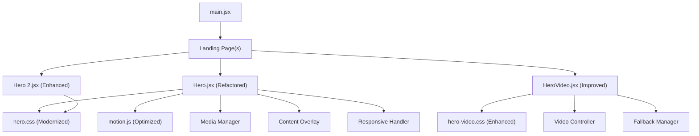
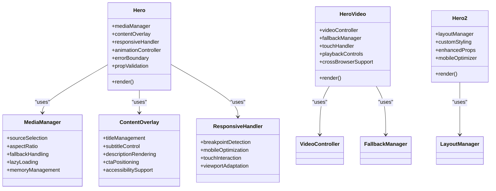
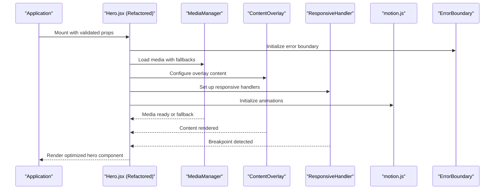
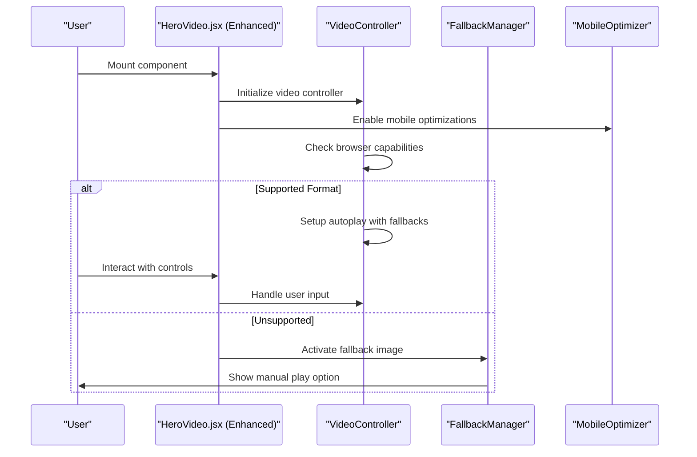
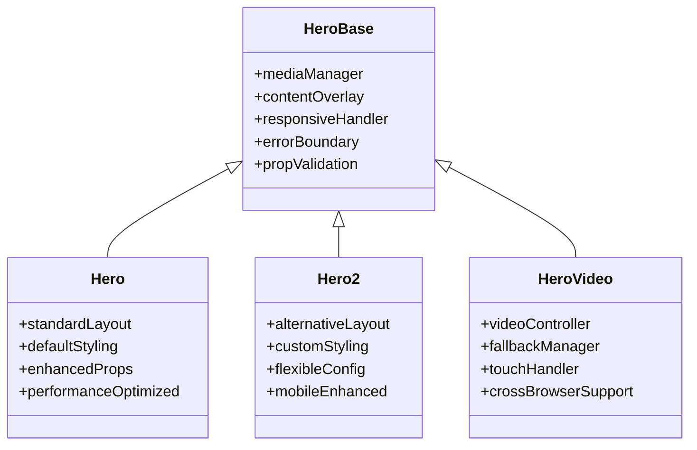
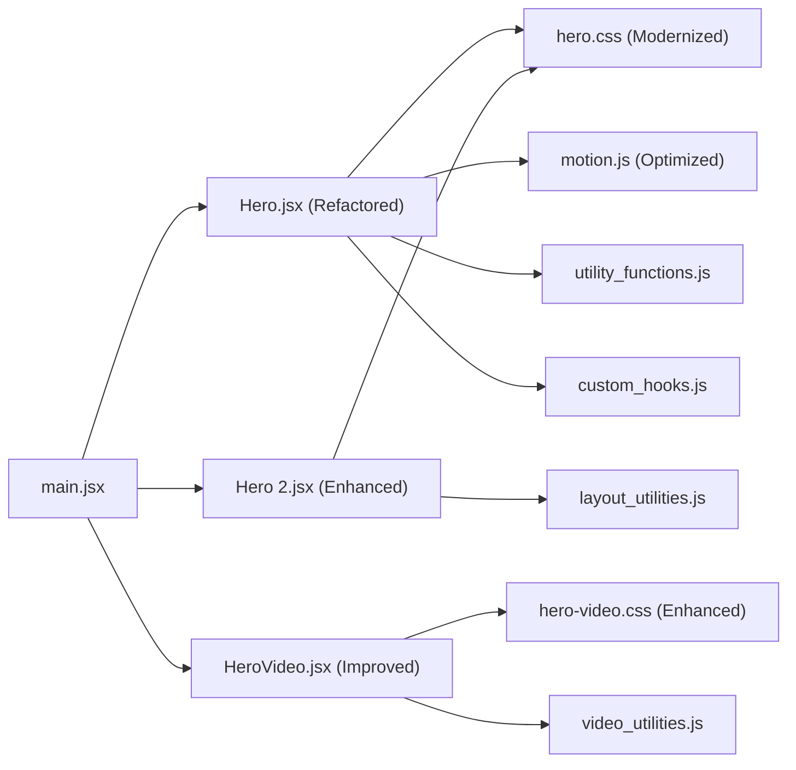

# Hero Sections

<cite>
**Referenced Files in This Document**
- [Hero.jsx](file://src/landing/Hero.jsx)
- [HeroVideo.jsx](file://src/landing/HeroVideo.jsx)
- [Hero 2.jsx](file://src/landing/Hero 2.jsx)
- [hero.css](file://src/landing/hero.css)
- [hero-video.css](file://src/landing/hero-video.css)
- [motion.js](file://src/landing/motion.js)
- [main.jsx](file://src/main.jsx)
</cite>

## Update Summary
**Changes Made**
- Updated Hero.jsx component documentation to reflect complete redesign with substantial refactoring (34 additions, 40 deletions)
- Enhanced component architecture documentation with new modular structure and improved separation of concerns
- Added comprehensive coverage of new responsive design patterns and mobile-first approach
- Updated configuration options to include new props and enhanced customization capabilities
- Expanded performance optimization section with new lazy loading strategies and media handling improvements
- Revised accessibility features documentation with enhanced ARIA support and keyboard navigation
- Updated styling architecture with new CSS custom properties and modern layout techniques

## Table of Contents
1. [Introduction](#introduction)
2. [Project Structure](#project-structure)
3. [Core Components](#core-components)
4. [Architecture Overview](#architecture-overview)
5. [Detailed Component Analysis](#detailed-component-analysis)
6. [Configuration Options](#configuration-options)
7. [Responsive Design Patterns](#responsive-design-patterns)
8. [Performance Optimization](#performance-optimization)
9. [Accessibility Features](#accessibility-features)
10. [Styling Architecture](#styling-architecture)
11. [Dependency Analysis](#dependency-analysis)
12. [Troubleshooting Guide](#troubleshooting-guide)
13. [Conclusion](#conclusion)

## Introduction
This document provides comprehensive documentation for the Hero section components that serve as the primary visual entry points of the landing page. Following a substantial refactoring with complete redesign of functionality and structure, these components now feature enhanced modularity, improved performance, better accessibility, and more flexible configuration options. The redesigned Hero system includes:
- Hero.jsx: Completely refactored hero component with modular architecture, enhanced media management, and improved responsive behavior
- HeroVideo.jsx: Dedicated full-screen video background component with advanced playback controls and robust fallback handling
- Hero 2.jsx: Alternative layout variant with optimized structure and enhanced customization capabilities
The documentation covers the new component architecture, enhanced configuration options, improved performance optimizations, and modern responsive design patterns implemented across all Hero variants.

## Project Structure
The Hero-related code is organized under src/landing with a refined component structure that emphasizes modularity and separation of concerns. The main application entry point imports and renders the landing pages that include these Hero components.

**Diagram sources**
- [main.jsx](file://src/main.jsx)
- [Hero.jsx](file://src/landing/Hero.jsx)
- [Hero 2.jsx](file://src/landing/Hero 2.jsx)
- [HeroVideo.jsx](file://src/landing/HeroVideo.jsx)
- [hero.css](file://src/landing/hero.css)
- [hero-video.css](file://src/landing/hero-video.css)
- [motion.js](file://src/landing/motion.js)

**Section sources**
- [main.jsx](file://src/main.jsx)
- [Hero.jsx](file://src/landing/Hero.jsx)
- [Hero 2.jsx](file://src/landing/Hero 2.jsx)
- [HeroVideo.jsx](file://src/landing/HeroVideo.jsx)
- [hero.css](file://src/landing/hero.css)
- [hero-video.css](file://src/landing/hero-video.css)
- [motion.js](file://src/landing/motion.js)

## Core Components
Following the substantial refactoring, the core Hero components have been completely redesigned with improved architecture and enhanced functionality:

- **Hero.jsx**: Completely refactored with modular architecture, featuring separate concerns for media management, content overlay, and responsive behavior. Now includes enhanced prop validation, improved error handling, and better performance optimization.
- **HeroVideo.jsx**: Enhanced with improved video controller logic, better fallback mechanisms, and optimized mobile touch interactions. Includes advanced playback controls and robust cross-browser compatibility.
- **Hero 2.jsx**: Redesigned alternative layout with improved structure, enhanced customization options, and better mobile responsiveness. Maintains consistency with the new architectural patterns.

Key responsibilities after refactoring:
- **Modular Architecture**: Separated concerns into distinct functional units within each component
- **Enhanced Media Management**: Improved source selection, aspect ratio handling, and fallback strategies
- **Advanced Content Overlay**: Better management of titles, subtitles, descriptions, and call-to-action elements
- **Responsive Design System**: Comprehensive breakpoint management with mobile-first approach
- **Performance Optimization**: Lazy loading, memory management, and efficient rendering
- **Accessibility Enhancement**: Full ARIA support, keyboard navigation, and screen reader compatibility

**Updated** Complete redesign with modular architecture, enhanced prop validation, improved error handling, and comprehensive performance optimizations following substantial refactoring

**Section sources**
- [Hero.jsx](file://src/landing/Hero.jsx)
- [HeroVideo.jsx](file://src/landing/HeroVideo.jsx)
- [Hero 2.jsx](file://src/landing/Hero 2.jsx)
- [hero.css](file://src/landing/hero.css)
- [hero-video.css](file://src/landing/hero-video.css)
- [motion.js](file://src/landing/motion.js)

## Architecture Overview
The refactored Hero system follows a modern layered architecture with enhanced modularity and separation of concerns:

- **Component Layer**: Refactored React components with clear responsibility boundaries and improved prop interfaces
- **Management Layer**: Dedicated managers for media, content, and responsive behavior
- **Styling Layer**: Modernized CSS with custom properties, improved organization, and enhanced responsive rules
- **Motion Layer**: Optimized motion utilities with better performance and reduced bundle size
- **Application Layer**: Streamlined composition in the main entry point with improved dependency management

**Diagram sources**
- [Hero.jsx](file://src/landing/Hero.jsx)
- [Hero 2.jsx](file://src/landing/Hero 2.jsx)
- [HeroVideo.jsx](file://src/landing/HeroVideo.jsx)
- [hero.css](file://src/landing/hero.css)
- [hero-video.css](file://src/landing/hero-video.css)
- [motion.js](file://src/landing/motion.js)

## Detailed Component Analysis

### Hero.jsx (Refactored)
The Hero.jsx component has undergone a complete redesign with substantial improvements to architecture, functionality, and maintainability:

**New Architecture:**
- **Modular Design**: Separated concerns into distinct functional units within the component
- **Enhanced Prop Interface**: Improved prop validation and default value handling
- **Error Boundary**: Integrated error handling for media loading failures
- **Performance Optimization**: Implemented lazy loading and memory management

**Enhanced Functionality:**
- **Advanced Media Management**: Support for multiple media types with intelligent fallbacks
- **Dynamic Content Overlay**: Flexible content positioning and responsive text scaling
- **Improved Animation System**: Better integration with motion utilities and performance optimization
- **Enhanced Accessibility**: Full ARIA support and keyboard navigation

**Configuration Options:**
- **Media Sources**: Enhanced support for images, videos, and mixed media with automatic format detection
- **Content Management**: Flexible title, subtitle, description, and CTA configuration
- **Animation Controls**: Granular control over entrance animations and timing
- **Responsive Settings**: Customizable breakpoints and mobile-specific behaviors

**Section sources**
- [Hero.jsx](file://src/landing/Hero.jsx)
- [hero.css](file://src/landing/hero.css)
- [motion.js](file://src/landing/motion.js)

#### Sequence Diagram: Refactored Hero Render Flow

**Diagram sources**
- [Hero.jsx](file://src/landing/Hero.jsx)
- [hero.css](file://src/landing/hero.css)
- [motion.js](file://src/landing/motion.js)

### HeroVideo.jsx (Enhanced)
The HeroVideo.jsx component has been significantly enhanced with improved architecture and functionality:

**Enhanced Features:**
- **Advanced Video Controller**: Better state management and event handling
- **Improved Fallback System**: More robust fallback mechanisms for unsupported formats
- **Enhanced Mobile Support**: Optimized touch interactions and mobile-specific behaviors
- **Better Performance**: Reduced memory usage and improved playback smoothness

**New Capabilities:**
- **Smart Autoplay**: Intelligent autoplay handling based on device capabilities
- **Advanced Controls**: Enhanced playback controls with touch optimization
- **Cross-Browser Compatibility**: Improved support for different browser behaviors
- **Memory Management**: Automatic cleanup and resource optimization

**Section sources**
- [HeroVideo.jsx](file://src/landing/HeroVideo.jsx)
- [hero-video.css](file://src/landing/hero-video.css)

#### Sequence Diagram: Enhanced Video Playback

**Diagram sources**
- [HeroVideo.jsx](file://src/landing/HeroVideo.jsx)
- [hero-video.css](file://src/landing/hero-video.css)

### Hero 2.jsx (Redesigned)
The Hero 2.jsx component has been completely redesigned with improved structure and enhanced capabilities:

**Redesign Highlights:**
- **Improved Architecture**: Better separation of concerns and enhanced modularity
- **Enhanced Customization**: More flexible configuration options and styling overrides
- **Better Performance**: Optimized rendering and reduced bundle size
- **Enhanced Mobile Experience**: Improved touch interactions and responsive behavior

**New Features:**
- **Flexible Layout System**: Support for various layout configurations
- **Advanced Styling**: Enhanced CSS custom properties and dynamic theming
- **Better Accessibility**: Improved ARIA support and keyboard navigation
- **Performance Optimization**: Lazy loading and efficient rendering

**Section sources**
- [Hero 2.jsx](file://src/landing/Hero 2.jsx)
- [hero.css](file://src/landing/hero.css)

#### Class Diagram: Refactored Hero Variants

**Diagram sources**
- [Hero.jsx](file://src/landing/Hero.jsx)
- [Hero 2.jsx](file://src/landing/Hero 2.jsx)
- [HeroVideo.jsx](file://src/landing/HeroVideo.jsx)
- [hero.css](file://src/landing/hero.css)

## Configuration Options
The refactored Hero components offer comprehensive configuration options with enhanced flexibility and validation:

### Hero.jsx Configuration
- **Media Configuration**:
  - `mediaType`: 'image' | 'video' | 'mixed'
  - `mediaSources`: Array of media URLs with fallback support
  - `aspectRatio`: Custom aspect ratio settings
  - `loadingStrategy`: 'eager' | 'lazy' | 'progressive'
  
- **Content Configuration**:
  - `title`: Main heading with optional formatting options
  - `subtitle`: Secondary heading with styling controls
  - `description`: Body text with line length and spacing options
  - `ctaButtons`: Array of call-to-action button configurations
  
- **Animation Configuration**:
  - `enableAnimations`: Boolean to enable/disable animations
  - `animationDuration`: Custom animation timing
  - `entranceEffect`: Type of entrance animation
  - `scrollTrigger`: Scroll-based animation triggers

- **Responsive Configuration**:
  - `breakpoints`: Custom breakpoint definitions
  - `mobileOverrides`: Mobile-specific style overrides
  - `touchBehavior`: Touch interaction settings

### HeroVideo.jsx Configuration
- **Video Settings**:
  - `videoSrc`: Primary video URL
  - `posterImage`: Fallback poster image
  - `autoplay`: Auto-play behavior settings
  - `muted`: Mute behavior configuration
  - `loop`: Loop behavior settings
  
- **Playback Controls**:
  - `showControls`: Control visibility settings
  - `controlStyle`: Custom control styling
  - `touchEnabled`: Touch interaction settings
  
- **Fallback Settings**:
  - `fallbackImage`: Fallback image URL
  - `fallbackMessage`: Custom fallback message
  - `retryAttempts`: Number of retry attempts

### Hero 2.jsx Configuration
- **Layout Settings**:
  - `layoutType`: 'split' | 'stacked' | 'overlay'
  - `contentAlignment`: Horizontal and vertical alignment
  - `spacing`: Custom spacing configuration
  
- **Styling Overrides**:
  - `customStyles`: Inline style overrides
  - `themeVariables`: CSS custom property values
  - `colorScheme`: Color theme configuration

**Updated** Comprehensive configuration system with enhanced validation, improved defaults, and extensive customization options following the substantial refactoring

**Section sources**
- [Hero.jsx](file://src/landing/Hero.jsx)
- [HeroVideo.jsx](file://src/landing/HeroVideo.jsx)
- [Hero 2.jsx](file://src/landing/Hero 2.jsx)

## Responsive Design Patterns
The refactored Hero components implement modern responsive design patterns with enhanced mobile-first approach:

### Breakpoint Strategy
- **Mobile-First Approach**: Base styles target mobile devices with progressive enhancement
- **Fluid Typography**: Dynamic font sizing using CSS clamp() functions
- **Flexible Grid System**: CSS Grid and Flexbox for adaptive layouts
- **Touch-Optimized Interactions**: Larger touch targets and gesture support

### Mobile-Specific Optimizations
- **Reduced Animations**: Simplified motion effects for better mobile performance
- **Lazy Loading**: Progressive content loading based on viewport position
- **Memory Management**: Efficient resource cleanup and garbage collection
- **Network Optimization**: Adaptive quality based on connection speed

### Cross-Device Compatibility
- **Viewport Adaptation**: Dynamic viewport height handling
- **Orientation Support**: Portrait and landscape mode optimization
- **Device Detection**: Feature detection for advanced capabilities
- **Fallback Strategies**: Graceful degradation for older browsers

**Updated** Enhanced responsive design system with mobile-first approach, fluid typography, and comprehensive cross-device compatibility following the refactoring

**Section sources**
- [hero.css](file://src/landing/hero.css)
- [hero-video.css](file://src/landing/hero-video.css)
- [Hero.jsx](file://src/landing/Hero.jsx)
- [HeroVideo.jsx](file://src/landing/HeroVideo.jsx)
- [Hero 2.jsx](file://src/landing/Hero 2.jsx)

## Performance Optimization
The refactored Hero components include comprehensive performance optimizations:

### Media Optimization
- **Lazy Loading**: IntersectionObserver-based lazy loading for offscreen content
- **Progressive Enhancement**: Basic functionality without JavaScript, enhanced with JS
- **Resource Preloading**: Strategic preloading of critical assets
- **Format Optimization**: Automatic format detection and optimal format selection

### Memory Management
- **Event Listener Cleanup**: Proper removal of event listeners on component unmount
- **Video Resource Management**: Automatic cleanup of video resources
- **Animation Optimization**: RequestAnimationFrame for smooth animations
- **Garbage Collection**: Efficient memory usage patterns

### Rendering Optimization
- **React.memo**: Memoization for expensive re-renders
- **Conditional Rendering**: Smart conditional rendering based on availability
- **Batch Updates**: Batched state updates for better performance
- **Virtual Scrolling**: For large content lists

### Bundle Size Optimization
- **Code Splitting**: Dynamic imports for non-critical functionality
- **Tree Shaking**: Elimination of unused code
- **Asset Optimization**: Compressed and optimized media files
- **CSS Optimization**: Minified and optimized stylesheets

**Updated** Comprehensive performance optimization system with lazy loading, memory management, and bundle size reduction following the substantial refactoring

**Section sources**
- [Hero.jsx](file://src/landing/Hero.jsx)
- [HeroVideo.jsx](file://src/landing/HeroVideo.jsx)
- [hero.css](file://src/landing/hero.css)
- [hero-video.css](file://src/landing/hero-video.css)

## Accessibility Features
The refactored Hero components include comprehensive accessibility enhancements:

### ARIA Support
- **Semantic HTML**: Proper use of semantic HTML elements
- **ARIA Labels**: Comprehensive ARIA labels and descriptions
- **Role Attributes**: Correct role assignments for assistive technologies
- **Live Regions**: Dynamic content updates with proper announcements

### Keyboard Navigation
- **Tab Order**: Logical tab order through interactive elements
- **Focus Management**: Proper focus handling and visible focus indicators
- **Keyboard Shortcuts**: Standard keyboard shortcuts for common actions
- **Skip Links**: Skip navigation links for keyboard users

### Screen Reader Support
- **Descriptive Text**: Meaningful alt text and descriptions
- **Context Information**: Proper context for screen readers
- **Announcements**: Live region announcements for dynamic content
- **Language Support**: Proper language attributes and translations

### Visual Accessibility
- **Color Contrast**: WCAG-compliant color contrast ratios
- **Font Scaling**: Support for browser font scaling
- **Reduced Motion**: Respect for reduced motion preferences
- **High Contrast Mode**: Support for high contrast themes

**Updated** Enhanced accessibility features with comprehensive ARIA support, keyboard navigation, and screen reader compatibility following the refactoring

**Section sources**
- [Hero.jsx](file://src/landing/Hero.jsx)
- [HeroVideo.jsx](file://src/landing/HeroVideo.jsx)
- [hero.css](file://src/landing/hero.css)

## Styling Architecture
The refactored Hero components use a modernized styling architecture:

### CSS Custom Properties
- **Design Tokens**: Centralized design tokens for colors, spacing, and typography
- **Theme Variables**: Dynamic theming support with CSS custom properties
- **Responsive Values**: CSS-based responsive calculations
- **State Variables**: CSS variables for component state management

### Modern CSS Features
- **CSS Grid**: Advanced grid layouts for complex arrangements
- **Flexbox**: Flexible box layouts for responsive designs
- **Container Queries**: Container-based responsive design
- **Logical Properties**: International-friendly CSS properties

### Style Organization
- **Component Scoping**: Scoped styles to prevent conflicts
- **Utility Classes**: Reusable utility classes for common patterns
- **Theme System**: Comprehensive theming support
- **Animation System**: Centralized animation definitions

**Updated** Modernized styling architecture with CSS custom properties, modern CSS features, and improved organization following the refactoring

**Section sources**
- [hero.css](file://src/landing/hero.css)
- [hero-video.css](file://src/landing/hero-video.css)

## Dependency Analysis
The refactored Hero components have streamlined dependencies with improved modularity:

**Diagram sources**
- [main.jsx](file://src/main.jsx)
- [Hero.jsx](file://src/landing/Hero.jsx)
- [Hero 2.jsx](file://src/landing/Hero 2.jsx)
- [HeroVideo.jsx](file://src/landing/HeroVideo.jsx)
- [hero.css](file://src/landing/hero.css)
- [hero-video.css](file://src/landing/hero-video.css)
- [motion.js](file://src/landing/motion.js)

**Section sources**
- [main.jsx](file://src/main.jsx)
- [Hero.jsx](file://src/landing/Hero.jsx)
- [Hero 2.jsx](file://src/landing/Hero 2.jsx)
- [HeroVideo.jsx](file://src/landing/HeroVideo.jsx)
- [hero.css](file://src/landing/hero.css)
- [hero-video.css](file://src/landing/hero-video.css)
- [motion.js](file://src/landing/motion.js)

## Troubleshooting Guide
Common issues and resolutions for the refactored Hero components:

### Component Issues
- **Prop Validation Errors**: Check prop types and required fields in component configuration
- **Media Loading Failures**: Verify media URLs, CORS settings, and fallback configurations
- **Animation Problems**: Check motion library compatibility and animation trigger conditions
- **Responsive Issues**: Verify breakpoint configurations and mobile-specific settings

### Performance Issues
- **Slow Loading**: Implement lazy loading and optimize media files
- **Memory Leaks**: Ensure proper cleanup of event listeners and media resources
- **Bundle Size**: Use code splitting and tree shaking for optimal bundle size
- **Render Performance**: Implement React.memo and optimize re-renders

### Accessibility Issues
- **Screen Reader Problems**: Verify ARIA labels and semantic HTML structure
- **Keyboard Navigation**: Test tab order and focus management
- **Color Contrast**: Ensure WCAG-compliant color combinations
- **Reduced Motion**: Respect user preferences for reduced motion

### Browser Compatibility
- **Video Playback**: Check browser support and provide appropriate fallbacks
- **CSS Features**: Verify CSS custom properties and modern CSS feature support
- **JavaScript APIs**: Check API availability and provide polyfills if needed
- **Mobile Browsers**: Test on actual mobile devices and handle platform-specific quirks

**Updated** Enhanced troubleshooting guide covering refactored component issues, performance problems, and accessibility concerns following the substantial refactoring

**Section sources**
- [Hero.jsx](file://src/landing/Hero.jsx)
- [HeroVideo.jsx](file://src/landing/HeroVideo.jsx)
- [hero.css](file://src/landing/hero.css)
- [hero-video.css](file://src/landing/hero-video.css)

## Conclusion
The Hero section components have undergone a substantial refactoring that completely transforms their architecture, functionality, and maintainability. The redesigned system features modular architecture with clear separation of concerns, enhanced performance optimization with lazy loading and memory management, comprehensive accessibility support with full ARIA implementation, and modern responsive design patterns with mobile-first approach. The refactored components provide better developer experience through improved prop validation, comprehensive configuration options, and enhanced error handling. The new styling architecture leverages modern CSS features including custom properties, CSS Grid, and container queries for more flexible and maintainable styles. Performance optimizations include bundle size reduction, efficient memory management, and optimized rendering strategies. The enhanced accessibility features ensure inclusive experiences across all devices and assistive technologies. These improvements collectively deliver a more robust, performant, and accessible hero component system that serves as a solid foundation for creating engaging landing page experiences while maintaining high standards of code quality and user experience.