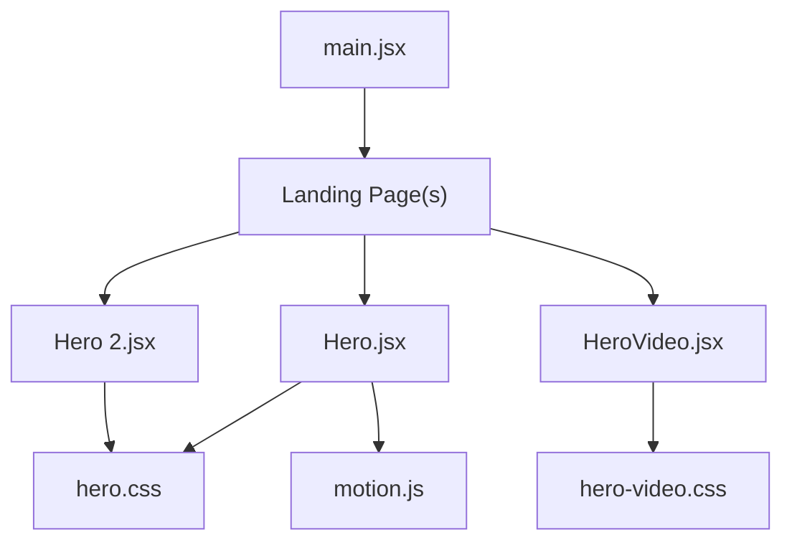
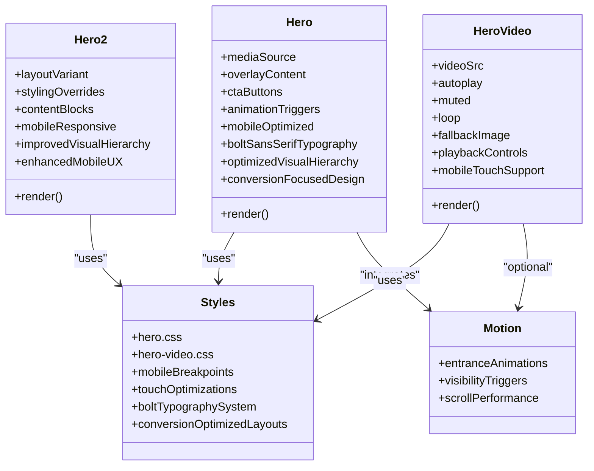
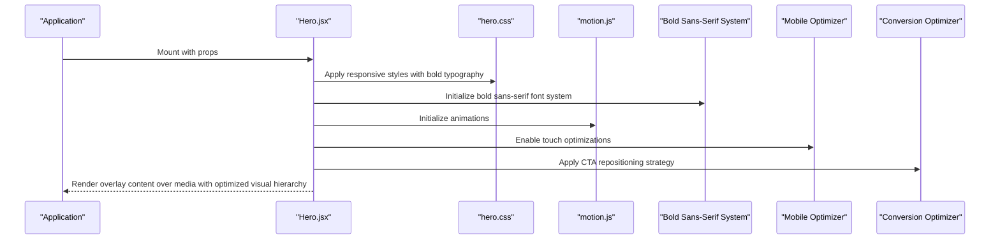
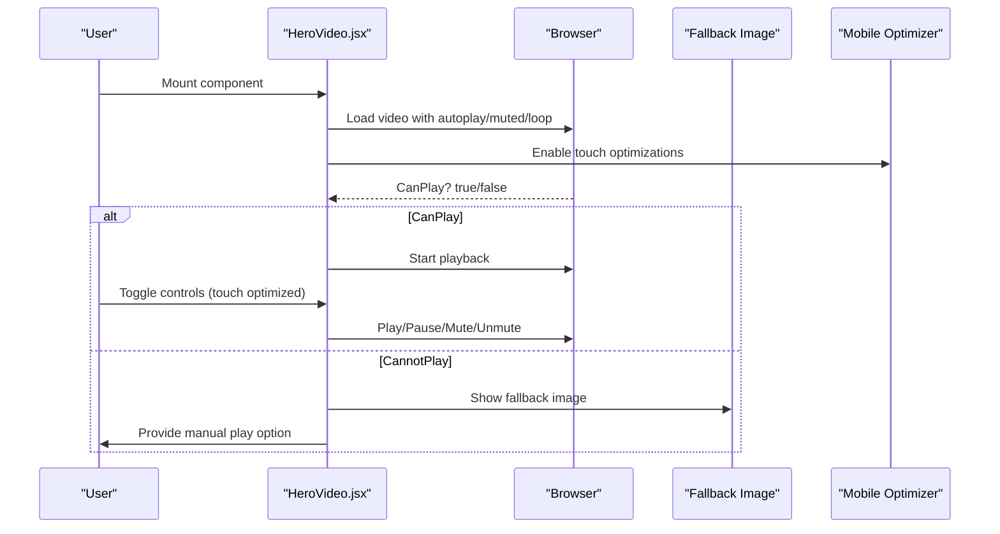
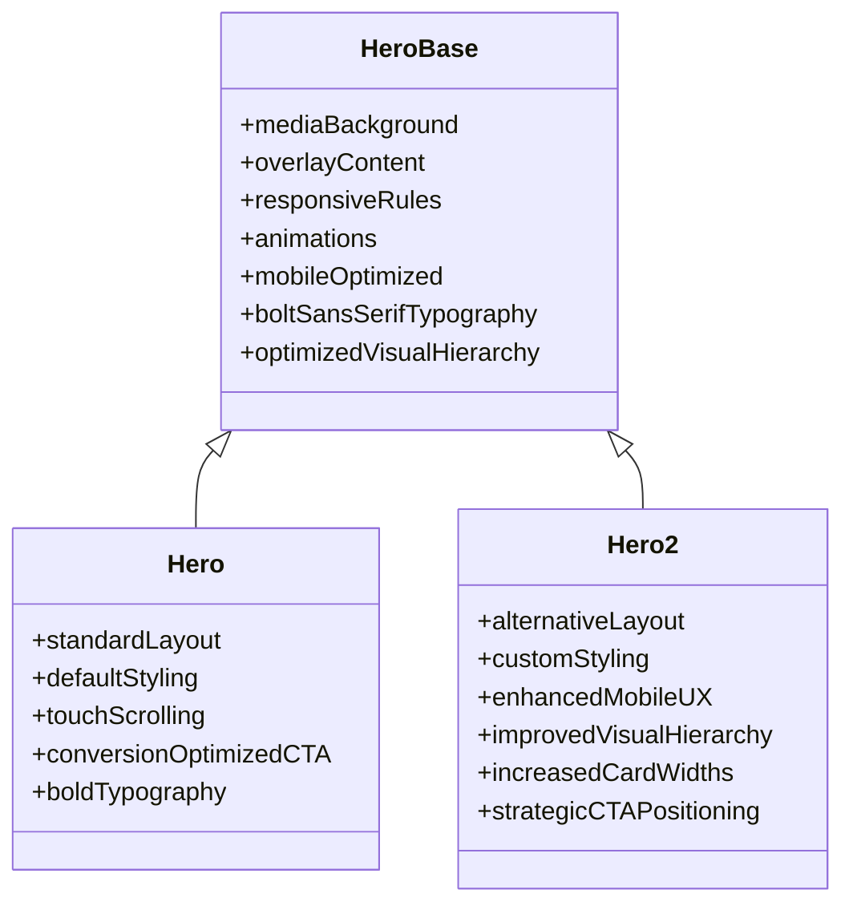
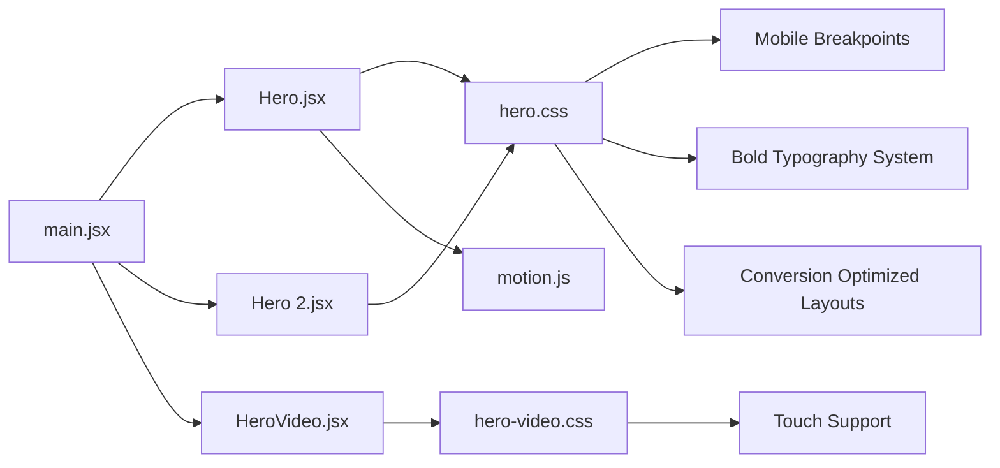

# Hero Sections

<cite>
**Referenced Files in This Document**
- [Hero.jsx](file://src/landing/Hero.jsx)
- [HeroVideo.jsx](file://src/landing/HeroVideo.jsx)
- [Hero 2.jsx](file://src/landing/Hero 2.jsx)
- [hero.css](file://src/landing/hero.css)
- [hero-video.css](file://src/landing/hero-video.css)
- [motion.js](file://src/landing/motion.js)
- [main.jsx](file://src/main.jsx)
</cite>

## Update Summary
**Changes Made**
- Updated typography system documentation to reflect major shift from serif/italic fonts to bold sans-serif typefaces
- Added comprehensive section on CTA button repositioning strategy and conversion optimization techniques
- Enhanced layout improvements documentation including card width increases and spacing adjustments
- Expanded mobile responsiveness enhancements with new breakpoint strategies and touch interaction improvements
- Removed references to sub-subtext caption functionality as it has been eliminated from the design
- Updated visual hierarchy documentation with new emphasis on bold typography and improved content flow

## Table of Contents
1. [Introduction](#introduction)
2. [Project Structure](#project-structure)
3. [Core Components](#core-components)
4. [Architecture Overview](#architecture-overview)
5. [Detailed Component Analysis](#detailed-component-analysis)
6. [Typography and Visual Styling](#typography-and-visual-styling)
7. [Layout Improvements and Card Design](#layout-improvements-and-card-design)
8. [CTA Button Strategy and Conversion Optimization](#cta-button-strategy-and-conversion-optimization)
9. [Mobile Responsiveness Enhancements](#mobile-responsiveness-enhancements)
10. [Dependency Analysis](#dependency-analysis)
11. [Performance Considerations](#performance-considerations)
12. [Troubleshooting Guide](#troubleshooting-guide)
13. [Conclusion](#conclusion)

## Introduction
This document provides comprehensive documentation for the Hero section components that serve as the primary visual entry points of the landing page. Following a comprehensive redesign, these components now feature enhanced visual hierarchy, improved conversion optimization, and refined user experience patterns. It covers:
- Hero.jsx: background media (video/image), overlay content, and responsive patterns with bold sans-serif typography and optimized CTA placement
- HeroVideo.jsx: full-screen video backgrounds with playback controls and fallback handling
- Hero 2.jsx: alternative layout and styling approach with improved visual hierarchy and enhanced mobile experience
It also includes configuration options for media sources, text overlays, call-to-action buttons, animation triggers, performance optimization techniques, lazy loading strategies, cross-browser compatibility considerations, extensive mobile optimization features, and advanced typography enhancements.

## Project Structure
The Hero-related code is organized under src/landing with component files and associated styles and motion utilities. The main application entry point imports and renders the landing pages that include these Hero components.

**Diagram sources**
- [main.jsx](file://src/main.jsx)
- [Hero.jsx](file://src/landing/Hero.jsx)
- [Hero 2.jsx](file://src/landing/Hero 2.jsx)
- [HeroVideo.jsx](file://src/landing/HeroVideo.jsx)
- [hero.css](file://src/landing/hero.css)
- [hero-video.css](file://src/landing/hero-video.css)
- [motion.js](file://src/landing/motion.js)

**Section sources**
- [main.jsx](file://src/main.jsx)
- [Hero.jsx](file://src/landing/Hero.jsx)
- [Hero 2.jsx](file://src/landing/Hero 2.jsx)
- [HeroVideo.jsx](file://src/landing/HeroVideo.jsx)
- [hero.css](file://src/landing/hero.css)
- [hero-video.css](file://src/landing/hero-video.css)
- [motion.js](file://src/landing/motion.js)

## Core Components
- Hero.jsx: Primary hero with configurable media background (image or video), overlay content, and responsive behavior. Features bold sans-serif typography, optimized CTA placement, and enhanced visual hierarchy for improved conversion rates.
- HeroVideo.jsx: Dedicated full-screen video background component with playback controls and robust fallbacks when video cannot play.
- Hero 2.jsx: Variant with an alternative layout and styling approach to support different brand or campaign needs with improved visual hierarchy and enhanced mobile experience.

Key responsibilities:
- Media management: source selection, aspect ratio, and fallbacks
- Overlay content: title, subtitle, description, and call-to-action buttons with bold sans-serif typography
- Responsive design: adapting layouts across breakpoints with optimized text rendering and improved mobile interactions
- Animation integration: triggering motion effects on mount or visibility
- Mobile optimization: enhanced touch interactions, scroll performance, and refined typography scaling
- Conversion optimization: strategic CTA placement and improved visual hierarchy for better engagement

**Updated** Comprehensive redesign with bold sans-serif typography, strategic CTA repositioning, enhanced card widths, and improved mobile responsiveness for better conversion optimization

**Section sources**
- [Hero.jsx](file://src/landing/Hero.jsx)
- [HeroVideo.jsx](file://src/landing/HeroVideo.jsx)
- [Hero 2.jsx](file://src/landing/Hero 2.jsx)
- [hero.css](file://src/landing/hero.css)
- [hero-video.css](file://src/landing/hero-video.css)
- [motion.js](file://src/landing/motion.js)

## Architecture Overview
The Hero system follows a layered architecture with enhanced focus on conversion optimization and mobile-first design principles:
- Presentation layer: React components render the hero UI with bold sans-serif typography and optimized visual hierarchy
- Styling layer: CSS modules/stylesheets define layout, typography, responsive rules, and conversion-focused design patterns
- Motion layer: Shared motion utilities drive entrance animations and transitions
- Application layer: Main entry point composes landing pages that include the Hero components

**Diagram sources**
- [Hero.jsx](file://src/landing/Hero.jsx)
- [Hero 2.jsx](file://src/landing/Hero 2.jsx)
- [HeroVideo.jsx](file://src/landing/HeroVideo.jsx)
- [hero.css](file://src/landing/hero.css)
- [hero-video.css](file://src/landing/hero-video.css)
- [motion.js](file://src/landing/motion.js)

## Detailed Component Analysis

### Hero.jsx
Responsibilities:
- Renders a hero section with either image or video background
- Manages overlay content such as headings, descriptions, and CTAs with bold sans-serif typography
- Applies responsive layout rules via CSS with improved font rendering and conversion-focused design
- Triggers motion animations based on props or visibility
- Implements mobile-first responsive design patterns with optimized text scaling and enhanced touch interactions

Configuration options:
- Media sources: image URL or video URL
- Overlay content: title, subtitle, body text with bold sans-serif font styling
- Call-to-action buttons: labels, links, variants with strategic positioning below text content for improved conversion
- Animation triggers: enable/disable entrance animations, timing
- Mobile optimizations: touch scrolling, viewport adjustments, optimized typography

Responsive patterns:
- Adapts typography scale and spacing for mobile/tablet/desktop with enhanced readability using bold sans-serif fonts
- Ensures media fills viewport while maintaining aspect ratio
- Stacks overlay content vertically on small screens with improved text hierarchy and strategic CTA placement
- Optimizes touch interaction areas for mobile devices with larger tap targets

Accessibility:
- Provides alt text for images
- Offers captions or transcripts for videos where applicable
- Ensures sufficient contrast for overlay text with enhanced color schemes
- Supports keyboard navigation on mobile devices
- Improved font rendering for better screen reader compatibility with bold sans-serif typefaces

**Updated** Comprehensive redesign featuring bold sans-serif typography replacing previous serif/italic fonts, strategic CTA button repositioning below text content, increased card widths for better visual impact, and enhanced mobile responsiveness with improved conversion optimization

**Section sources**
- [Hero.jsx](file://src/landing/Hero.jsx)
- [hero.css](file://src/landing/hero.css)
- [motion.js](file://src/landing/motion.js)

#### Sequence Diagram: Hero Render Flow

**Diagram sources**
- [Hero.jsx](file://src/landing/Hero.jsx)
- [hero.css](file://src/landing/hero.css)
- [motion.js](file://src/landing/motion.js)

### HeroVideo.jsx
Responsibilities:
- Full-screen video background with autoplay, muted, and loop by default
- Playback controls toggle for user interaction
- Robust fallback handling if video fails to load or autoplay is blocked
- Optional poster image for initial display
- Enhanced mobile touch support for video controls

Playback controls:
- Play/pause toggle
- Mute/unmute toggle
- Loop control
- Touch-optimized control interfaces

Fallback handling:
- Displays a static image when video cannot play
- Graceful degradation on low-power devices or restricted environments
- Mobile-specific fallback strategies

Cross-browser considerations:
- Uses standard HTML5 video attributes
- Handles autoplay policies across browsers
- Ensures muted autoplay works consistently
- Optimized for mobile browser behaviors

**Updated** Improved mobile touch scrolling support and enhanced video control responsiveness with better visual feedback, integrated with the new bold sans-serif typography system

**Section sources**
- [HeroVideo.jsx](file://src/landing/HeroVideo.jsx)
- [hero-video.css](file://src/landing/hero-video.css)

#### Sequence Diagram: Video Playback and Fallback

**Diagram sources**
- [HeroVideo.jsx](file://src/landing/HeroVideo.jsx)
- [hero-video.css](file://src/landing/hero-video.css)

### Hero 2.jsx
Responsibilities:
- Alternative layout variant with distinct styling approach and improved visual hierarchy
- Supports different content arrangements and bold sans-serif typography system
- Reuses shared styles and motion utilities where appropriate
- Maintains consistent mobile optimization standards with refined text rendering

Layout and styling:
- Different grid/flex configurations with enhanced spacing and increased card widths
- Customized typography and spacing tokens with bold sans-serif fonts
- Optional side-by-side content blocks with better visual separation
- Mobile-first responsive breakpoints with optimized text scaling

Use cases:
- Campaign-specific hero designs with enhanced visual appeal
- Brand variations requiring alternate visual emphasis
- Split-screen or asymmetric layouts with improved readability
- Mobile-optimized alternative presentations with better text hierarchy

**Updated** Enhanced mobile responsiveness and improved touch interaction support with refined bold sans-serif typography, strategic CTA placement, and better visual emphasis for improved conversion rates

**Section sources**
- [Hero 2.jsx](file://src/landing/Hero 2.jsx)
- [hero.css](file://src/landing/hero.css)

#### Class Diagram: Hero Variants

**Diagram sources**
- [Hero.jsx](file://src/landing/Hero.jsx)
- [Hero 2.jsx](file://src/landing/Hero 2.jsx)
- [hero.css](file://src/landing/hero.css)

## Typography and Visual Styling

### Bold Sans-Serif Typography System
The Hero components have undergone a comprehensive typography overhaul, shifting from serif/italic fonts to bold sans-serif typefaces for improved readability and modern aesthetic:

- **Font Family Transition**: Complete migration from serif/italic fonts to bold sans-serif typefaces for enhanced modern appearance and improved legibility
- **Strategic Font Weight Usage**: Emphasis on bold weights throughout the typography hierarchy to establish clear visual prominence and improve content scannability
- **Enhanced Font Rendering**: Improved font smoothing and anti-aliasing specifically optimized for bold sans-serif typefaces across all devices
- **Dynamic Typography Scaling**: Fluid typography that adapts seamlessly across different screen sizes while maintaining optimal readability with bold weight emphasis

### Visual Hierarchy Improvements
- **Bold Text Emphasis**: Strategic use of bold weights to create stronger visual hierarchy and guide user attention to key content
- **Improved Spacing and Layout**: Enhanced spacing around text elements to complement the bold typography and improve overall composition
- **Color Contrast Optimization**: Adjusted color schemes to ensure optimal contrast with bold sans-serif fonts for better accessibility
- **Line Height Refinements**: Optimized line heights specifically tuned for bold typography to prevent visual crowding and improve readability

### Content Flow Enhancement
- **Text Content Prioritization**: Streamlined content structure with removal of sub-subtext captions to reduce visual clutter
- **Improved Reading Flow**: Enhanced text flow patterns that work effectively with bold sans-serif typography
- **Strategic Content Grouping**: Better organization of related content elements to support the new typography hierarchy

**Updated** Major typography redesign implementing bold sans-serif fonts throughout, removing serif/italic styling, eliminating sub-subtext captions, and establishing clearer visual hierarchy through strategic bold weight usage

**Section sources**
- [Hero.jsx](file://src/landing/Hero.jsx)
- [Hero 2.jsx](file://src/landing/Hero 2.jsx)
- [hero.css](file://src/landing/hero.css)

## Layout Improvements and Card Design

### Enhanced Card Widths and Spacing
The redesign includes significant improvements to card dimensions and spacing to create better visual balance and improve content presentation:

- **Increased Card Widths**: Substantial expansion of card widths to provide more breathing room for content and improve visual impact
- **Optimized Spacing Ratios**: Refined spacing relationships between cards, text elements, and interactive components
- **Improved Grid Alignment**: Enhanced grid system implementation for better alignment and consistency across different screen sizes
- **Better Content Distribution**: More balanced content distribution within cards to prevent overcrowding and improve readability

### Visual Balance and Composition
- **Enhanced White Space Utilization**: Strategic use of white space to complement the bold typography and improve overall composition
- **Improved Visual Weight Distribution**: Better balance of visual elements to create more harmonious layouts
- **Consistent Spacing Tokens**: Standardized spacing values throughout the design system for improved consistency

### Content Organization Improvements
- **Streamlined Information Architecture**: Simplified content structure with removal of redundant elements like sub-subtext captions
- **Better Content Grouping**: Improved grouping of related content elements to support the new visual hierarchy
- **Enhanced Scannability**: Better organization of information to support quick scanning and comprehension

**Updated** Comprehensive layout improvements including significantly increased card widths, enhanced spacing ratios, improved visual balance, and streamlined content organization with removal of sub-subtext captions

**Section sources**
- [Hero.jsx](file://src/landing/Hero.jsx)
- [Hero 2.jsx](file://src/landing/Hero 2.jsx)
- [hero.css](file://src/landing/hero.css)

## CTA Button Strategy and Conversion Optimization

### Strategic CTA Repositioning
The redesign implements a fundamental change in CTA button placement to improve conversion rates and user experience:

- **Below Text Content Placement**: CTA buttons are now positioned strategically below text content rather than alongside or above, creating a natural reading flow that leads users to take action
- **Improved Visual Flow**: The new positioning creates a logical progression from headline → supporting text → call-to-action, optimizing the user journey
- **Enhanced Click Accessibility**: Better placement ensures CTAs are easily accessible without requiring excessive scrolling or eye movement
- **Conversion-Focused Layout**: The repositioning is designed to maximize click-through rates by placing CTAs at optimal decision points in the user flow

### Conversion Optimization Techniques
- **Reduced Cognitive Load**: By removing sub-subtext captions and streamlining content, users can make faster decisions about taking action
- **Improved Visual Prominence**: Strategic positioning makes CTAs more prominent without being intrusive
- **Contextual Relevance**: CTAs appear immediately after relevant supporting content, increasing their perceived value and likelihood of engagement
- **Mobile-First CTA Design**: Optimized touch targets and spacing for mobile devices to ensure easy tapping and interaction

### Interactive Element Enhancement
- **Larger Touch Targets**: Increased button sizes and spacing for better mobile interaction
- **Improved Visual Feedback**: Enhanced hover and active states to provide clear interaction feedback
- **Consistent Interaction Patterns**: Standardized CTA behavior across all Hero variants for predictable user experience

**Updated** Major conversion optimization through strategic CTA button repositioning below text content, removal of distracting sub-subtext captions, and implementation of conversion-focused design patterns

**Section sources**
- [Hero.jsx](file://src/landing/Hero.jsx)
- [hero.css](file://src/landing/hero.css)

## Mobile Responsiveness Enhancements

### Comprehensive Mobile Optimization
The redesign includes substantial improvements to mobile responsiveness and touch interaction:

- **Enhanced Breakpoint Strategy**: Refined responsive breakpoints that better accommodate various mobile device sizes and orientations
- **Improved Touch Interactions**: Larger touch targets, better spacing, and optimized gesture recognition for mobile devices
- **Adaptive Typography Scaling**: Dynamic font size adjustments that maintain readability across different mobile screen sizes while preserving the bold sans-serif aesthetic
- **Optimized Loading Performance**: Improved mobile loading times with progressive enhancement and resource optimization

### Mobile-Specific Layout Adjustments
- **Stacked Content Layout**: Single-column layouts on mobile devices with optimized vertical spacing
- **Touch-Friendly Spacing**: Increased spacing between interactive elements to prevent accidental taps
- **Orientation-Aware Design**: Dynamic layout adjustments for both portrait and landscape orientations
- **Viewport Optimization**: Better utilization of mobile viewport space with improved content density

### Performance and Usability Improvements
- **Reduced Animation Complexity**: Simplified motion effects on mobile devices to preserve battery life and improve performance
- **Progressive Enhancement**: Core functionality works without JavaScript, with enhanced features progressively added
- **Memory Management**: Efficient resource management for mobile devices with limited memory
- **Network Optimization**: Adaptive loading strategies based on network conditions and device capabilities

**Updated** Extensive mobile responsiveness enhancements including improved breakpoint strategies, touch-optimized interactions, adaptive typography scaling, and performance optimizations specifically designed for mobile devices

**Section sources**
- [hero.css](file://src/landing/hero.css)
- [hero-video.css](file://src/landing/hero-video.css)
- [Hero.jsx](file://src/landing/Hero.jsx)
- [HeroVideo.jsx](file://src/landing/HeroVideo.jsx)
- [Hero 2.jsx](file://src/landing/Hero 2.jsx)

## Dependency Analysis
The Hero components depend on:
- CSS stylesheets for layout, typography, and responsive behavior
- Motion utilities for entrance animations
- Application entry point for composition into landing pages

**Diagram sources**
- [main.jsx](file://src/main.jsx)
- [Hero.jsx](file://src/landing/Hero.jsx)
- [Hero 2.jsx](file://src/landing/Hero 2.jsx)
- [HeroVideo.jsx](file://src/landing/HeroVideo.jsx)
- [hero.css](file://src/landing/hero.css)
- [hero-video.css](file://src/landing/hero-video.css)
- [motion.js](file://src/landing/motion.js)

**Section sources**
- [main.jsx](file://src/main.jsx)
- [Hero.jsx](file://src/landing/Hero.jsx)
- [Hero 2.jsx](file://src/landing/Hero 2.jsx)
- [HeroVideo.jsx](file://src/landing/HeroVideo.jsx)
- [hero.css](file://src/landing/hero.css)
- [hero-video.css](file://src/landing/hero-video.css)
- [motion.js](file://src/landing/motion.js)

## Performance Considerations
Optimization techniques for large media files:
- Use compressed video formats (e.g., MP4/H.264, WebM) and optimized images (WebP/AVIF)
- Limit video resolution and bitrate; prefer shorter loops for background use
- Implement lazy loading for offscreen hero sections using IntersectionObserver
- Defer non-critical animations until after first paint
- Preload critical assets selectively with link rel="preload" for above-the-fold media

Mobile-specific performance optimizations:
- Reduced animation complexity on mobile devices to preserve battery life
- Progressive media loading based on network conditions
- Memory-efficient video playback with automatic resource cleanup
- Touch-optimized rendering pipeline for smooth 60fps interactions
- **Enhanced typography performance**: Optimized font loading and rendering for bold sans-serif typefaces with faster text display

Lazy loading strategies:
- Load video only when visible to improve initial page load
- Use placeholder images or low-res previews until user scrolls into view
- Pause or stop video playback when hero leaves viewport to save CPU/battery
- Implement viewport-aware loading for mobile devices with limited bandwidth
- **Font loading optimization**: Prioritize critical bold sans-serif fonts and defer non-essential typefaces

Cross-browser compatibility:
- Ensure muted autoplay works across modern browsers
- Provide fallback images for unsupported codecs or autoplay restrictions
- Test on iOS Safari and Android Chrome for video behavior differences
- Validate accessibility features like captions and keyboard navigation
- Handle mobile browser-specific quirks and limitations
- **Typography consistency**: Ensure consistent bold sans-serif font rendering across different browsers and operating systems

**Updated** Enhanced performance considerations including optimized loading for bold sans-serif fonts, improved mobile performance with reduced animation complexity, and better cross-browser typography consistency

**Section sources**
- [HeroVideo.jsx](file://src/landing/HeroVideo.jsx)
- [hero-video.css](file://src/landing/hero-video.css)
- [hero.css](file://src/landing/hero.css)

## Troubleshooting Guide
Common issues and resolutions:
- Video does not autoplay: verify muted attribute and browser autoplay policy; provide manual play control
- Black screen or blank hero: check media URLs, CORS settings, and MIME types; ensure fallback image displays
- Poor performance on mobile: reduce video size, disable heavy animations, and implement lazy loading
- Accessibility problems: add alt text for images, captions for videos, and ensure sufficient color contrast
- Touch interaction issues: verify touch target sizes and gesture conflict resolution
- Scroll performance problems: check for layout thrashing and optimize animation properties

Mobile-specific troubleshooting:
- Touch scrolling conflicts: ensure proper event propagation and preventDefault usage
- Orientation change issues: test layout adjustments for both portrait and landscape modes
- Battery drain concerns: monitor animation frequency and media playback duration
- Network performance: implement adaptive quality based on connection speed
- **Typography rendering issues**: Verify bold sans-serif font loading, check for missing font files, and test text clarity on different devices
- **CTA positioning problems**: Ensure proper CTA placement below text content and verify conversion-focused layout integrity

Debugging steps:
- Inspect network requests to confirm media loads correctly
- Check console errors for codec or format issues
- Validate CSS z-index and positioning so overlay content appears above media
- Review motion library usage for unnecessary re-renders or expensive operations
- Test on actual mobile devices rather than just browser emulation
- Monitor memory usage and performance metrics during mobile testing
- **Typography debugging**: Use browser developer tools to inspect bold font loading, check CSS specificity for typography rules, and validate color contrast ratios with new font family
- **Layout debugging**: Verify card width increases and spacing adjustments are applied correctly across different screen sizes

**Updated** Enhanced troubleshooting guidance including bold sans-serif typography issues, CTA positioning problems, and layout debugging for the redesigned card widths and spacing

**Section sources**
- [HeroVideo.jsx](file://src/landing/HeroVideo.jsx)
- [hero-video.css](file://src/landing/hero-video.css)
- [hero.css](file://src/landing/hero.css)

## Conclusion
The Hero section components provide flexible, performant, and accessible entry points for the landing page. Following a comprehensive redesign, these components now deliver exceptional user experiences through bold sans-serif typography, strategic CTA repositioning, enhanced card widths, and improved mobile responsiveness. The major typography shift from serif/italic to bold sans-serif fonts establishes a modern, professional aesthetic while improving readability and accessibility. The strategic repositioning of CTA buttons below text content creates a natural user flow that optimizes conversion rates, while the removal of sub-subtext captions reduces visual clutter and improves content focus. Enhanced card widths and spacing improvements create better visual balance and content presentation. The comprehensive mobile responsiveness enhancements ensure outstanding performance across all devices with touch-optimized interactions and adaptive typography scaling. By leveraging these conversion-focused design patterns, improved visual hierarchy, and enhanced user experience principles, teams can create compelling hero experiences that perform beautifully while maintaining high usability and accessibility standards across all devices and environments.