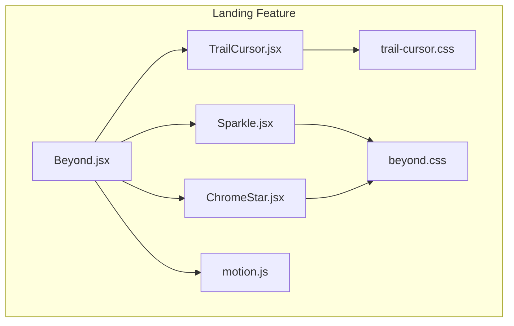
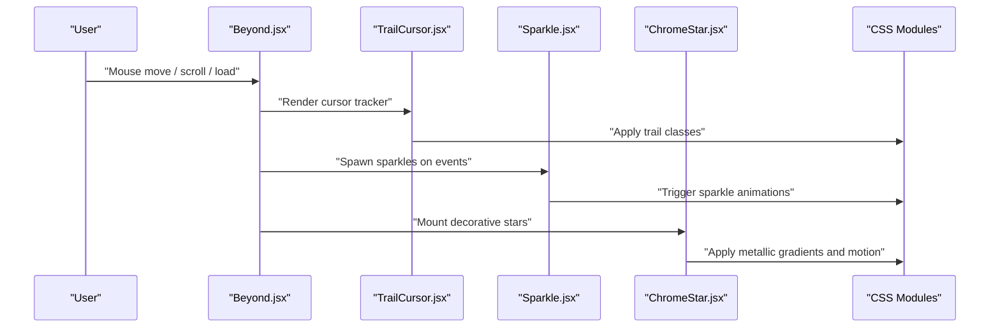
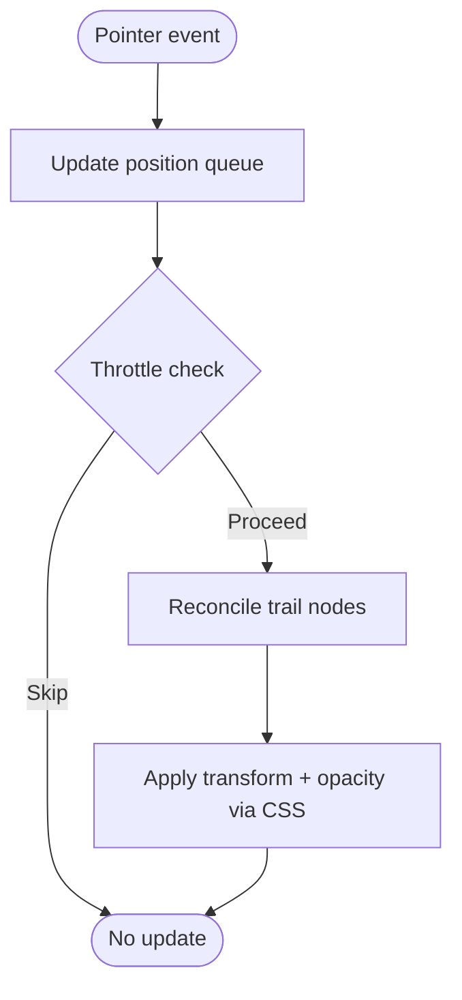
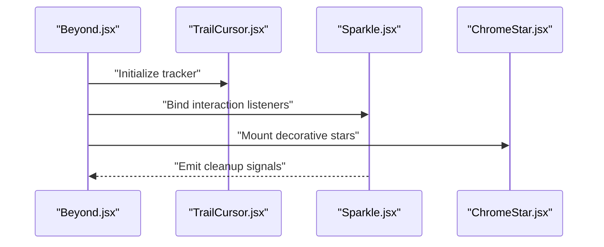
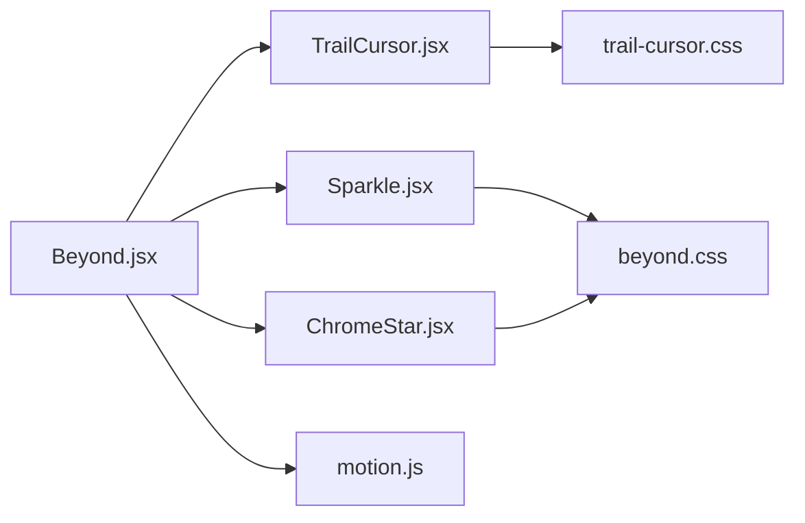

# Interactive Effects

<cite>
**Referenced Files in This Document**
- [TrailCursor.jsx](file://src/landing/TrailCursor.jsx)
- [Sparkle.jsx](file://src/landing/Sparkle.jsx)
- [ChromeStar.jsx](file://src/landing/ChromeStar.jsx)
- [trail-cursor.css](file://src/landing/trail-cursor.css)
- [beyond.css](file://src/landing/beyond.css)
- [Beyond.jsx](file://src/landing/Beyond.jsx)
- [motion.js](file://src/landing/motion.js)
</cite>

## Table of Contents
1. [Introduction](#introduction)
2. [Project Structure](#project-structure)
3. [Core Components](#core-components)
4. [Architecture Overview](#architecture-overview)
5. [Detailed Component Analysis](#detailed-component-analysis)
6. [Dependency Analysis](#dependency-analysis)
7. [Performance Considerations](#performance-considerations)
8. [Troubleshooting Guide](#troubleshooting-guide)
9. [Conclusion](#conclusion)
10. [Appendices](#appendices)

## Introduction
This document explains the interactive visual effects system that enhances user engagement through cursor trails, sparkle animations, and chrome star decorations. It focuses on:
- TrailCursor.jsx for custom cursor tracking with trailing particle effects
- Sparkle.jsx for randomized sparkle animations
- ChromeStar.jsx for metallic star decorations
- CSS animation techniques used in trail-cursor.css and beyond.css
- Customization examples for effect intensity, colors, and performance settings
- Browser compatibility, performance impact considerations, and accessibility alternatives for reduced motion

## Project Structure
The interactive effects are implemented within the landing feature area. The key components and styles are organized under src/landing.



[No sources needed since this diagram shows conceptual workflow, not actual code structure]

## Core Components
- TrailCursor.jsx: Tracks mouse movement and renders a set of trailing particles that follow the cursor with easing and fade-out behavior.
- Sparkle.jsx: Spawns randomized sparkle elements at configurable positions and timings, using CSS-driven animations for smooth transitions.
- ChromeStar.jsx: Renders metallic star decorations with gradient fills and subtle motion to add visual polish.

These components integrate into the landing page layout (e.g., Beyond.jsx) and leverage shared motion utilities (motion.js) and CSS modules for consistent styling and performance.

**Section sources**
- [TrailCursor.jsx](file://src/landing/TrailCursor.jsx)
- [Sparkle.jsx](file://src/landing/Sparkle.jsx)
- [ChromeStar.jsx](file://src/landing/ChromeStar.jsx)
- [Beyond.jsx](file://src/landing/Beyond.jsx)
- [motion.js](file://src/landing/motion.js)

## Architecture Overview
The effects system is component-driven with clear separation between logic and presentation:
- React components manage state and lifecycle (cursor position, spawn timers, element counts).
- CSS classes drive animations and transitions for performance and maintainability.
- Shared motion utilities centralize easing, timing, and requestAnimationFrame usage.



**Diagram sources**
- [Beyond.jsx](file://src/landing/Beyond.jsx)
- [TrailCursor.jsx](file://src/landing/TrailCursor.jsx)
- [Sparkle.jsx](file://src/landing/Sparkle.jsx)
- [ChromeStar.jsx](file://src/landing/ChromeStar.jsx)
- [trail-cursor.css](file://src/landing/trail-cursor.css)
- [beyond.css](file://src/landing/beyond.css)

## Detailed Component Analysis

### TrailCursor.jsx
Responsibilities:
- Track pointer coordinates and maintain a history of recent positions.
- Render a chain of trailing nodes with staggered opacity and scale to simulate a fluid trail.
- Debounce or throttle updates to avoid excessive re-renders.
- Respect prefers-reduced-motion by disabling or simplifying the trail.

Key implementation patterns:
- Use a ref-based queue for positions to minimize render churn.
- Apply CSS transforms for GPU-accelerated movement.
- Expose props for trail length, delay, and color customization.



**Diagram sources**
- [TrailCursor.jsx](file://src/landing/TrailCursor.jsx)
- [trail-cursor.css](file://src/landing/trail-cursor.css)

**Section sources**
- [TrailCursor.jsx](file://src/landing/TrailCursor.jsx)
- [trail-cursor.css](file://src/landing/trail-cursor.css)

### Sparkle.jsx
Responsibilities:
- Randomly spawn sparkle elements at given coordinates or relative to container bounds.
- Animate each sparkle with CSS keyframes for fade-in, scale, and rotation.
- Clean up DOM nodes after animation completes to prevent memory growth.

Customization points:
- Density: number of sparkles per trigger.
- Duration and delay ranges for varied timing.
- Color palette and size distribution.

```mermaid
classDiagram
class Sparkle {
+props : { count, duration, colors, sizes }
+spawn(positions) void
+cleanup() void
-randomizeTiming() object
}
```

**Diagram sources**
- [Sparkle.jsx](file://src/landing/Sparkle.jsx)
- [beyond.css](file://src/landing/beyond.css)

**Section sources**
- [Sparkle.jsx](file://src/landing/Sparkle.jsx)
- [beyond.css](file://src/landing/beyond.css)

### ChromeStar.jsx
Responsibilities:
- Render a star-shaped decoration with metallic gradient fills and subtle motion.
- Provide props for size, rotation, and placement.
- Integrate with CSS variables for theme-aware colors.

Styling approach:
- Use SVG or pseudo-elements with linear/radial gradients to achieve a chrome look.
- Apply gentle hover or idle animations for polish.

```mermaid
classDiagram
class ChromeStar {
+props : { size, rotation, colorSet }
+render() JSX
-applyGradient() string
}
```

**Diagram sources**
- [ChromeStar.jsx](file://src/landing/ChromeStar.jsx)
- [beyond.css](file://src/landing/beyond.css)

**Section sources**
- [ChromeStar.jsx](file://src/landing/ChromeStar.jsx)
- [beyond.css](file://src/landing/beyond.css)

### Beyond.jsx Integration
Beyond.jsx orchestrates the effects:
- Mounts TrailCursor, Sparkle, and ChromeStar within the page layout.
- Triggers sparkle spawns on interactions (e.g., clicks, hovers, scroll milestones).
- Applies global motion settings from motion.js and CSS variables.



**Diagram sources**
- [Beyond.jsx](file://src/landing/Beyond.jsx)
- [TrailCursor.jsx](file://src/landing/TrailCursor.jsx)
- [Sparkle.jsx](file://src/landing/Sparkle.jsx)
- [ChromeStar.jsx](file://src/landing/ChromeStar.jsx)

**Section sources**
- [Beyond.jsx](file://src/landing/Beyond.jsx)
- [motion.js](file://src/landing/motion.js)

## Dependency Analysis
- TrailCursor depends on CSS classes defined in trail-cursor.css for transforms and opacity transitions.
- Sparkle and ChromeStar rely on beyond.css for keyframes, gradients, and layout tokens.
- Beyond.jsx composes these components and may use motion.js for shared timing/easing.



**Diagram sources**
- [TrailCursor.jsx](file://src/landing/TrailCursor.jsx)
- [Sparkle.jsx](file://src/landing/Sparkle.jsx)
- [ChromeStar.jsx](file://src/landing/ChromeStar.jsx)
- [trail-cursor.css](file://src/landing/trail-cursor.css)
- [beyond.css](file://src/landing/beyond.css)
- [Beyond.jsx](file://src/landing/Beyond.jsx)
- [motion.js](file://src/landing/motion.js)

**Section sources**
- [TrailCursor.jsx](file://src/landing/TrailCursor.jsx)
- [Sparkle.jsx](file://src/landing/Sparkle.jsx)
- [ChromeStar.jsx](file://src/landing/ChromeStar.jsx)
- [trail-cursor.css](file://src/landing/trail-cursor.css)
- [beyond.css](file://src/landing/beyond.css)
- [Beyond.jsx](file://src/landing/Beyond.jsx)
- [motion.js](file://src/landing/motion.js)

## Performance Considerations
- Prefer CSS transforms and opacity for GPU acceleration; avoid animating layout properties like width/height.
- Limit trail length and debounce pointer events to reduce reflows and repaints.
- Remove sparkle elements promptly after animation completion to prevent DOM bloat.
- Use will-change sparingly and only on animated layers.
- Respect prefers-reduced-motion to disable heavy effects for users who prefer less motion.

[No sources needed since this section provides general guidance]

## Troubleshooting Guide
Common issues and resolutions:
- Jittery cursor trail: Increase debounce interval or reduce trail node count; ensure transforms are applied instead of top/left changes.
- Memory leaks from sparkles: Verify cleanup after animation ends; remove nodes from DOM and cancel any pending timers.
- Inconsistent colors across devices: Centralize color tokens in CSS variables and reference them consistently in components.
- Accessibility concerns: Honor prefers-reduced-motion; provide an option to disable effects entirely.

**Section sources**
- [TrailCursor.jsx](file://src/landing/TrailCursor.jsx)
- [Sparkle.jsx](file://src/landing/Sparkle.jsx)
- [ChromeStar.jsx](file://src/landing/ChromeStar.jsx)
- [trail-cursor.css](file://src/landing/trail-cursor.css)
- [beyond.css](file://src/landing/beyond.css)

## Conclusion
The interactive effects system combines lightweight React components with performant CSS animations to deliver engaging visuals without compromising usability. By centralizing motion logic, leveraging GPU-friendly transforms, and honoring accessibility preferences, the system balances delight with performance and inclusivity.

[No sources needed since this section summarizes without analyzing specific files]

## Appendices

### Customization Examples
- Effect intensity: Adjust trail length, sparkle density, and animation durations via component props or CSS variables.
- Colors: Define palettes in CSS variables and pass them to components for theme-aware rendering.
- Performance settings: Toggle reduced motion globally or per component; limit concurrent animations.

[No sources needed since this section provides general guidance]

### Browser Compatibility
- Modern browsers support CSS transforms, opacity, and keyframe animations efficiently.
- For older environments, consider graceful degradation by disabling effects when certain features are unavailable.

[No sources needed since this section provides general guidance]

### Accessibility Alternatives
- Respect prefers-reduced-motion to disable or simplify animations.
- Ensure interactive elements remain fully operable without relying on visual cues.
- Provide controls to toggle effects off for sensitive users.

[No sources needed since this section provides general guidance]