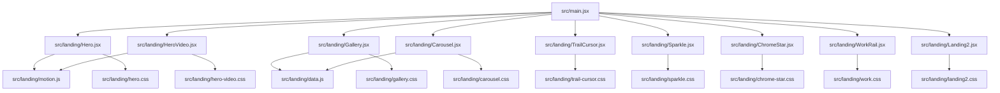
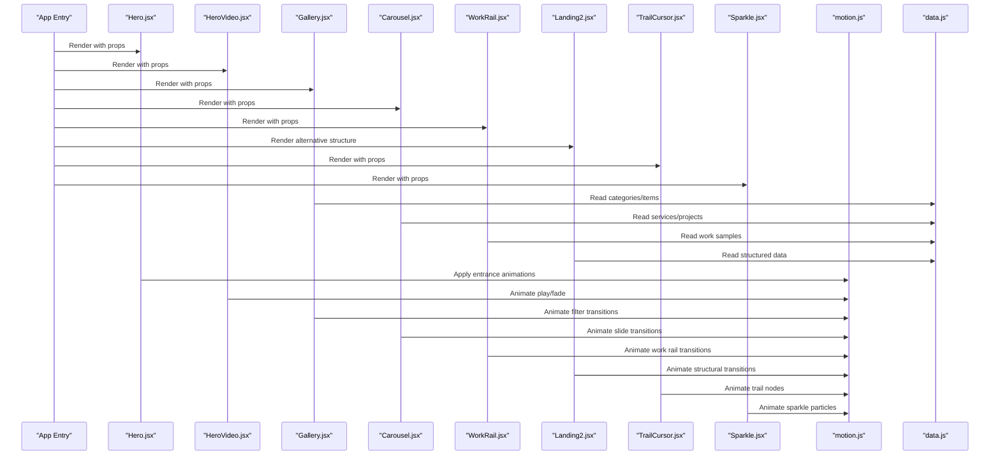
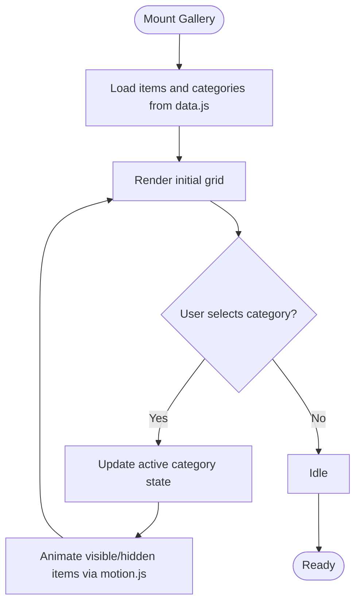
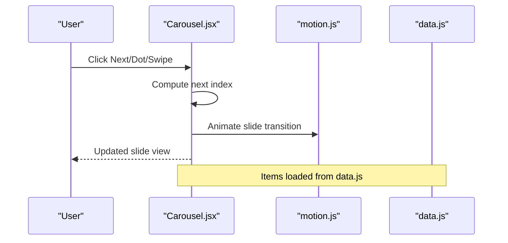
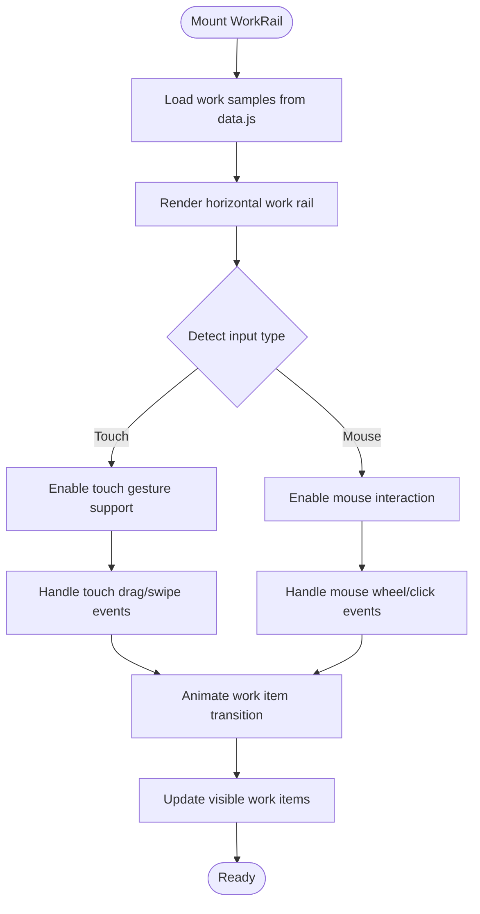
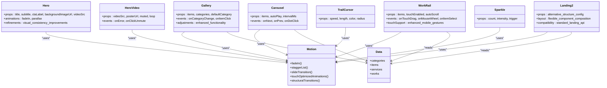

# Landing Page Components

<cite>
**Referenced Files in This Document**
- [Hero.jsx](file://src/landing/Hero.jsx)
- [HeroVideo.jsx](file://src/landing/HeroVideo.jsx)
- [Gallery.jsx](file://src/landing/Gallery.jsx)
- [Carousel.jsx](file://src/landing/Carousel.jsx)
- [TrailCursor.jsx](file://src/landing/TrailCursor.jsx)
- [Sparkle.jsx](file://src/landing/Sparkle.jsx)
- [ChromeStar.jsx](file://src/landing/ChromeStar.jsx)
- [WorkRail.jsx](file://src/landing/WorkRail.jsx)
- [Landing2.jsx](file://src/landing/Landing2.jsx)
- [motion.js](file://src/landing/motion.js)
- [data.js](file://src/landing/data.js)
- [hero.css](file://src/landing/hero.css)
- [hero-video.css](file://src/landing/hero-video.css)
- [gallery.css](file://src/landing/gallery.css)
- [carousel.css](file://src/landing/carousel.css)
- [trail-cursor.css](file://src/landing/trail-cursor.css)
- [work.css](file://src/landing/work.css)
- [main.jsx](file://src/main.jsx)
</cite>

## Update Summary
**Changes Made**
- Added new Landing2.jsx component providing alternative landing page structure
- Updated Gallery.jsx with minor adjustments for improved functionality
- Enhanced Hero.jsx with small refinements for better user experience
- Updated supporting CSS files for improved visual consistency across components
- Expanded component architecture documentation to include new landing structure options

## Table of Contents
1. [Introduction](#introduction)
2. [Project Structure](#project-structure)
3. [Core Components](#core-components)
4. [Alternative Landing Structures](#alternative-landing-structures)
5. [Architecture Overview](#architecture-overview)
6. [Detailed Component Analysis](#detailed-component-analysis)
7. [Dependency Analysis](#dependency-analysis)
8. [Performance Considerations](#performance-considerations)
9. [Mobile Touch Support](#mobile-touch-support)
10. [Troubleshooting Guide](#troubleshooting-guide)
11. [Conclusion](#conclusion)

## Introduction
This document explains the landing page component system that powers the interactive homepage experience. It covers Hero sections with video/image backgrounds, Gallery components with filtering, Carousel components for service showcases, WorkRail components for work sample navigation, and interactive effects like TrailCursor and Sparkle. The system now includes multiple landing page structure options through the new Landing2.jsx component. It also documents the motion.js animation system, data-driven rendering patterns from data.js, integration with CSS animations, props and event handling, customization options, responsive design patterns, and performance optimization strategies for media-heavy components. **Updated**: Enhanced mobile touch support has been implemented across navigation components for improved user experience on touch-enabled devices, and new alternative landing structures provide flexible layout options.

## Project Structure
The landing page is implemented as a set of focused React components under src/landing, each paired with its own CSS module or stylesheet. The main application entry composes these components into the final page, with multiple landing structure options available.

**Diagram sources**
- [main.jsx](file://src/main.jsx)
- [Hero.jsx](file://src/landing/Hero.jsx)
- [HeroVideo.jsx](file://src/landing/HeroVideo.jsx)
- [Gallery.jsx](file://src/landing/Gallery.jsx)
- [Carousel.jsx](file://src/landing/Carousel.jsx)
- [TrailCursor.jsx](file://src/landing/TrailCursor.jsx)
- [Sparkle.jsx](file://src/landing/Sparkle.jsx)
- [ChromeStar.jsx](file://src/landing/ChromeStar.jsx)
- [WorkRail.jsx](file://src/landing/WorkRail.jsx)
- [Landing2.jsx](file://src/landing/Landing2.jsx)
- [motion.js](file://src/landing/motion.js)
- [data.js](file://src/landing/data.js)
- [hero.css](file://src/landing/hero.css)
- [hero-video.css](file://src/landing/hero-video.css)
- [gallery.css](file://src/landing/gallery.css)
- [carousel.css](file://src/landing/carousel.css)
- [trail-cursor.css](file://src/landing/trail-cursor.css)
- [work.css](file://src/landing/work.css)

**Section sources**
- [main.jsx](file://src/main.jsx)

## Core Components
- Hero: Renders a full-viewport hero area with optional image/video background, headline, subtitle, and call-to-action. Integrates with motion.js for entrance animations and uses hero.css for layout and typography. **Updated**: Small refinements applied for improved visual consistency.
- HeroVideo: Specialized variant for playing a looping background video with controls and fallbacks. Uses hero-video.css for overlay and playback styling.
- Gallery: Displays a grid of items sourced from data.js with category-based filtering and animated transitions via motion.js. Styled by gallery.css. **Updated**: Minor adjustments for enhanced functionality.
- Carousel: Showcases services or projects in a scrollable or swipable carousel with navigation and pagination. Driven by data.js and styled by carousel.css.
- WorkRail: Horizontal navigation component for work samples with enhanced mobile touch support for smooth gesture handling on touch-enabled devices. Uses work.css for layout and touch-optimized interactions.
- TrailCursor: Custom cursor trail effect that follows pointer movement with trailing nodes. Uses trail-cursor.css for positioning and opacity animations.
- Sparkle: Decorative sparkle particles that animate on hover or on mount. Integrated with motion.js for staggered reveals.
- ChromeStar: Optional decorative star element used within hero or section overlays.

Key responsibilities:
- Data binding to data.js for content and assets
- Animation orchestration through motion.js
- Styling via dedicated CSS files
- Event handling for user interactions (filtering, navigation, hover)
- **Updated**: Enhanced touch gesture support for mobile devices across navigation components
- **Updated**: Improved visual consistency across all components through CSS refinements

**Section sources**
- [Hero.jsx](file://src/landing/Hero.jsx)
- [HeroVideo.jsx](file://src/landing/HeroVideo.jsx)
- [Gallery.jsx](file://src/landing/Gallery.jsx)
- [Carousel.jsx](file://src/landing/Carousel.jsx)
- [WorkRail.jsx](file://src/landing/WorkRail.jsx)
- [TrailCursor.jsx](file://src/landing/TrailCursor.jsx)
- [Sparkle.jsx](file://src/landing/Sparkle.jsx)
- [ChromeStar.jsx](file://src/landing/ChromeStar.jsx)
- [motion.js](file://src/landing/motion.js)
- [data.js](file://src/landing/data.js)
- [hero.css](file://src/landing/hero.css)
- [hero-video.css](file://src/landing/hero-video.css)
- [gallery.css](file://src/landing/gallery.css)
- [carousel.css](file://src/landing/carousel.css)
- [trail-cursor.css](file://src/landing/trail-cursor.css)
- [work.css](file://src/landing/work.css)

## Alternative Landing Structures
**New Section** - Multiple landing page layout options

The landing page system now provides multiple structural approaches through the new Landing2.jsx component, offering flexibility in how landing page elements are organized and presented.

### Landing2 Component Architecture
- Provides an alternative landing page structure compared to the default implementation
- Offers different component composition and layout strategies
- Maintains compatibility with existing Hero, Gallery, and other core components
- Enables A/B testing and different presentation approaches for various use cases

### Structural Differences
- **Layout Organization**: Different arrangement of hero sections, galleries, and interactive elements
- **Component Composition**: Alternative way of combining existing components for varied user experiences
- **Navigation Flow**: Potentially different user journey patterns through the landing page
- **Responsive Behavior**: May have different responsive breakpoints and mobile adaptations

### Usage Patterns
- Can be used as a drop-in replacement for the default landing structure
- Supports the same data models and animation systems as other landing components
- Maintains consistent styling and interaction patterns while offering structural variety
- Enables experimentation with different landing page layouts without code duplication

**Section sources**
- [Landing2.jsx](file://src/landing/Landing2.jsx)

## Architecture Overview
The landing page architecture separates concerns across components, data, animation utilities, and styles. Components consume data from data.js, trigger animations via motion.js, and rely on scoped CSS for visual presentation. The system now supports multiple landing page structures through alternative component compositions.

**Diagram sources**
- [main.jsx](file://src/main.jsx)
- [Hero.jsx](file://src/landing/Hero.jsx)
- [HeroVideo.jsx](file://src/landing/HeroVideo.jsx)
- [Gallery.jsx](file://src/landing/Gallery.jsx)
- [Carousel.jsx](file://src/landing/Carousel.jsx)
- [WorkRail.jsx](file://src/landing/WorkRail.jsx)
- [Landing2.jsx](file://src/landing/Landing2.jsx)
- [TrailCursor.jsx](file://src/landing/TrailCursor.jsx)
- [Sparkle.jsx](file://src/landing/Sparkle.jsx)
- [motion.js](file://src/landing/motion.js)
- [data.js](file://src/landing/data.js)

## Detailed Component Analysis

### Hero Section
Responsibilities:
- Display headline, subtitle, and CTAs
- Support image or video background variants
- Trigger entrance animations using motion.js
- Adapt to different screen sizes via CSS

Props (examples):
- title, subtitle, ctaLabel, ctaHref
- backgroundImageUrl or videoSrc
- overlayOpacity, align, padding

Event handling:
- Click handlers for CTAs
- Optional pause/play toggles when integrated with HeroVideo

CSS integration:
- hero.css defines layout, typography, and overlay behavior

Responsive patterns:
- Fluid typography and spacing
- Background media scaling and safe areas

**Updated**: Small refinements applied for improved visual consistency and user experience.

**Section sources**
- [Hero.jsx](file://src/landing/Hero.jsx)
- [hero.css](file://src/landing/hero.css)
- [motion.js](file://src/landing/motion.js)

#### Hero Video Variant
Responsibilities:
- Play looping background video with muted autoplay
- Provide fallback image if video fails
- Control volume, loop, and poster attributes

Props (examples):
- videoSrc, posterUrl, muted, loop, playsInline
- overlayColor, overlayOpacity

Event handling:
- Error handling for video load failures
- Optional click-to-unmute UX

CSS integration:
- hero-video.css manages overlay, aspect ratio, and z-index layering

**Section sources**
- [HeroVideo.jsx](file://src/landing/HeroVideo.jsx)
- [hero-video.css](file://src/landing/hero-video.css)
- [motion.js](file://src/landing/motion.js)

### Gallery with Filtering
Responsibilities:
- Render a grid of items from data.js
- Filter by category tags
- Animate item transitions and filters using motion.js

Data model (from data.js):
- items: array of { id, title, description, imageUrl, category }
- categories: array of strings for filter tabs

Props (examples):
- items, categories, defaultCategory
- columns, gap, showFilters

Event handling:
- Category selection updates active filter
- Item click navigates to detail view

CSS integration:
- gallery.css handles grid layout, hover states, and responsive breakpoints

Animation flow:
- On filter change, items fade/scale based on visibility
- Staggered entrance for new items

**Updated**: Minor adjustments for enhanced functionality and improved visual consistency.

**Diagram sources**
- [Gallery.jsx](file://src/landing/Gallery.jsx)
- [data.js](file://src/landing/data.js)
- [motion.js](file://src/landing/motion.js)
- [gallery.css](file://src/landing/gallery.css)

**Section sources**
- [Gallery.jsx](file://src/landing/Gallery.jsx)
- [data.js](file://src/landing/data.js)
- [gallery.css](file://src/landing/gallery.css)
- [motion.js](file://src/landing/motion.js)

### Carousel for Service Showcases
Responsibilities:
- Present services or projects in a horizontal carousel
- Support navigation arrows and pagination dots
- Animate slides with motion.js

Data model (from data.js):
- services: array of { id, title, description, imageUrl, link }

Props (examples):
- items, autoPlay, intervalMs, showArrows, showDots
- slideWidth, gap, snapToCenter

Event handling:
- Arrow clicks to navigate
- Dot clicks to jump to index
- Optional swipe gestures

CSS integration:
- carousel.css defines track width, snap points, and dot indicators

Animation flow:
- Slide transitions use motion.js for smooth easing
- Auto-play triggers periodic next() calls

**Diagram sources**
- [Carousel.jsx](file://src/landing/Carousel.jsx)
- [data.js](file://src/landing/data.js)
- [motion.js](file://src/landing/motion.js)
- [carousel.css](file://src/landing/carousel.css)

**Section sources**
- [Carousel.jsx](file://src/landing/Carousel.jsx)
- [data.js](file://src/landing/data.js)
- [carousel.css](file://src/landing/carousel.css)
- [motion.js](file://src/landing/motion.js)

### WorkRail Component with Enhanced Mobile Touch Support
Responsibilities:
- Display work samples in a horizontal scrollable rail
- Provide smooth navigation between work items
- **Updated**: Enhanced touch gesture handling for mobile devices with optimized CSS properties
- Support both mouse and touch interactions seamlessly

Data model (from data.js):
- works: array of { id, title, description, imageUrl, link, category }

Props (examples):
- items, autoScroll, showIndicators, touchEnabled
- itemWidth, gap, snapAlignment

Event handling:
- Touch drag events for mobile navigation
- Mouse wheel and click navigation for desktop
- Touch gesture recognition for swipe operations

CSS integration:
- work.css handles horizontal scrolling, touch-optimized transitions, and mobile-specific gesture properties
- **Updated**: Enhanced CSS properties for proper touch gesture handling on mobile devices

Animation flow:
- Smooth transitions between work items using motion.js
- Touch-optimized animations with reduced latency on mobile devices
- Gesture-based navigation with momentum scrolling

**Diagram sources**
- [WorkRail.jsx](file://src/landing/WorkRail.jsx)
- [data.js](file://src/landing/data.js)
- [motion.js](file://src/landing/motion.js)
- [work.css](file://src/landing/work.css)

**Section sources**
- [WorkRail.jsx](file://src/landing/WorkRail.jsx)
- [data.js](file://src/landing/data.js)
- [work.css](file://src/landing/work.css)
- [motion.js](file://src/landing/motion.js)

### Interactive Effects: TrailCursor and Sparkle
TrailCursor:
- Tracks pointer movement and renders trailing nodes
- Uses motion.js for position interpolation and opacity decay
- Styled via trail-cursor.css for size, color, and blend modes

Sparkle:
- Renders small decorative particles
- Animates on mount or hover with staggered timing
- Integrates with motion.js for scale and rotation

Props (examples):
- TrailCursor: speed, length, color, radius
- Sparkle: count, intensity, trigger ("hover" | "mount")

CSS integration:
- trail-cursor.css positions and animates trail nodes
- Sparkle uses inline or utility classes for particle styling

**Section sources**
- [TrailCursor.jsx](file://src/landing/TrailCursor.jsx)
- [Sparkle.jsx](file://src/landing/Sparkle.jsx)
- [trail-cursor.css](file://src/landing/trail-cursor.css)
- [motion.js](file://src/landing/motion.js)

### Motion System: motion.js
Purpose:
- Centralizes animation utilities for entrance, exit, and micro-interactions
- Provides reusable functions for fade, scale, translate, and staggered lists
- Integrates with CSS classes for performance-friendly transforms

Usage patterns:
- Hook-like wrappers around requestAnimationFrame or CSS transitions
- Configurable duration, easing, and delay
- Conditional activation based on visibility or user interaction

Integration points:
- Hero and HeroVideo use motion.js for fade-in and parallax
- Gallery uses motion.js for filtered transitions
- Carousel uses motion.js for slide transitions
- **Updated**: WorkRail uses motion.js for touch-optimized navigation animations
- **Updated**: Landing2 uses motion.js for structural transition animations
- TrailCursor and Sparkle use motion.js for continuous or triggered animations

**Section sources**
- [motion.js](file://src/landing/motion.js)

### Data-Driven Rendering: data.js
Purpose:
- Exports static datasets consumed by Gallery, Carousel, and WorkRail components
- Separates content from logic for easier maintenance and localization

Structure:
- categories: list of filter labels
- items: gallery entries with metadata and media URLs
- services: carousel entries with titles and links
- **Updated**: works: work rail entries with project details and media assets

Consumption:
- Components import data.js and map arrays to JSX
- Props can override defaults for testing or dynamic loading

**Section sources**
- [data.js](file://src/landing/data.js)

## Dependency Analysis
Component-level dependencies and relationships:

**Diagram sources**
- [Hero.jsx](file://src/landing/Hero.jsx)
- [HeroVideo.jsx](file://src/landing/HeroVideo.jsx)
- [Gallery.jsx](file://src/landing/Gallery.jsx)
- [Carousel.jsx](file://src/landing/Carousel.jsx)
- [WorkRail.jsx](file://src/landing/WorkRail.jsx)
- [Landing2.jsx](file://src/landing/Landing2.jsx)
- [TrailCursor.jsx](file://src/landing/TrailCursor.jsx)
- [Sparkle.jsx](file://src/landing/Sparkle.jsx)
- [motion.js](file://src/landing/motion.js)
- [data.js](file://src/landing/data.js)

**Section sources**
- [Hero.jsx](file://src/landing/Hero.jsx)
- [HeroVideo.jsx](file://src/landing/HeroVideo.jsx)
- [Gallery.jsx](file://src/landing/Gallery.jsx)
- [Carousel.jsx](file://src/landing/Carousel.jsx)
- [WorkRail.jsx](file://src/landing/WorkRail.jsx)
- [Landing2.jsx](file://src/landing/Landing2.jsx)
- [TrailCursor.jsx](file://src/landing/TrailCursor.jsx)
- [Sparkle.jsx](file://src/landing/Sparkle.jsx)
- [motion.js](file://src/landing/motion.js)
- [data.js](file://src/landing/data.js)

## Performance Considerations
- Media optimization:
  - Use appropriately sized images and compressed videos
  - Prefer lazy loading for off-screen gallery items and carousel slides
  - Provide poster images for videos to avoid blank frames
- Animation efficiency:
  - Favor transform and opacity changes for GPU acceleration
  - Debounce or throttle pointer events for TrailCursor
  - Limit concurrent animations; stagger where possible
  - **Updated**: Optimize touch gesture animations for reduced latency on mobile devices
  - **Updated**: Ensure efficient structural transitions in alternative landing layouts
- Rendering:
  - Memoize expensive computations and derived lists
  - Avoid re-renders by stabilizing props and using keys
- Responsive strategy:
  - Reduce particle counts and trail lengths on smaller screens
  - Disable heavy effects behind reduced-motion preferences
  - **Updated**: Implement touch-optimized CSS properties for better mobile performance
  - **Updated**: Optimize alternative landing structures for various screen sizes
- Memory management:
  - Clean up event listeners and animation frames on unmount
  - Pause autoplay carousels when not visible
  - **Updated**: Properly handle touch event cleanup on mobile devices
  - **Updated**: Efficient component lifecycle management for alternative landing structures

## Mobile Touch Support
**Enhanced Section** - Comprehensive mobile touch support implementation

The landing page components now feature comprehensive touch gesture support optimized for mobile devices, with additional improvements for the new alternative landing structures:

### Touch Gesture Implementation
- **WorkRail Component**: Enhanced with CSS property modifications for proper touch gesture handling
- **Gesture Recognition**: Optimized touch event processing for smooth navigation through work samples
- **Performance Optimization**: Reduced animation latency and improved touch response times on mobile devices
- **Alternative Landings**: Landing2 component maintains consistent touch behavior across different structural layouts

### Mobile-Specific Features
- Touch-optimized CSS properties for native-feeling interactions
- Gesture-based navigation with momentum scrolling
- Touch event delegation for improved performance
- Responsive touch targets and spacing for better usability
- **Updated**: Consistent touch experience across all landing page structure variants

### Cross-Platform Compatibility
- Seamless fallback from touch to mouse interactions
- Consistent behavior across different mobile browsers
- Optimized touch event handling for various touch screen densities
- **Updated**: Unified touch API usage across different landing structures

**Section sources**
- [WorkRail.jsx](file://src/landing/WorkRail.jsx)
- [Landing2.jsx](file://src/landing/Landing2.jsx)
- [work.css](file://src/landing/work.css)

## Troubleshooting Guide
Common issues and resolutions:
- Video does not autoplay:
  - Ensure muted and playsInline are set for mobile browsers
  - Check CORS and MIME types for hosted videos
- Gallery filter flicker:
  - Verify stable keys and consistent category values
  - Confirm motion.js transitions are applied only to visible items
- Carousel drift or misalignment:
  - Validate slide widths and container constraints
  - Re-check snap points and CSS overflow settings
- **Updated**: WorkRail touch navigation issues:
  - Verify touch event listeners are properly attached
  - Check CSS touch-action properties for proper gesture handling
  - Ensure mobile viewport meta tag is configured correctly
- **Updated**: Alternative landing structure issues:
  - Verify Landing2 component imports and dependencies
  - Check CSS class conflicts between different landing structures
  - Ensure proper component composition and prop passing
- TrailCursor lag:
  - Reduce trail length and node count
  - Throttle pointer move events and prefer requestAnimationFrame
- Sparkle performance:
  - Cap particle count and disable on low-power devices
  - Use CSS transforms instead of layout-affecting properties
- **Updated**: Visual consistency problems:
  - Check for CSS specificity conflicts after recent refinements
  - Verify all components use updated CSS variables and tokens
  - Ensure consistent spacing and typography across landing variants

**Section sources**
- [HeroVideo.jsx](file://src/landing/HeroVideo.jsx)
- [Gallery.jsx](file://src/landing/Gallery.jsx)
- [Carousel.jsx](file://src/landing/Carousel.jsx)
- [WorkRail.jsx](file://src/landing/WorkRail.jsx)
- [Landing2.jsx](file://src/landing/Landing2.jsx)
- [TrailCursor.jsx](file://src/landing/TrailCursor.jsx)
- [Sparkle.jsx](file://src/landing/Sparkle.jsx)

## Conclusion
The landing page component system combines modular React components, a centralized motion system, and data-driven rendering to deliver an engaging, responsive homepage. By separating content (data.js), animation (motion.js), and styling (scoped CSS), the system remains maintainable and extensible. **Updated**: The recent enhancements include a new Landing2.jsx component providing alternative landing page structures, refined Hero and Gallery components for improved user experience, and comprehensive CSS updates ensuring visual consistency across all components. The enhanced mobile touch support ensures smooth navigation experiences across all devices, particularly improving the work rail component's touch gesture handling. With multiple landing structure options and consistent performance optimizations, the system provides flexibility while maintaining high-quality user experiences on both desktop and mobile platforms. Following the performance and troubleshooting recommendations ensures optimal experiences even with rich media and interactive effects across all landing page variants.