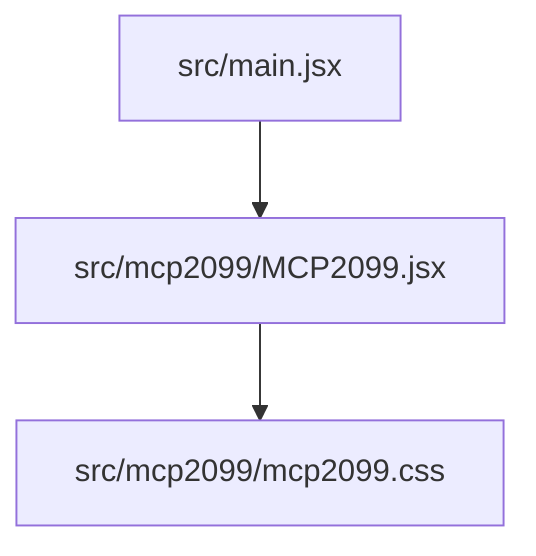
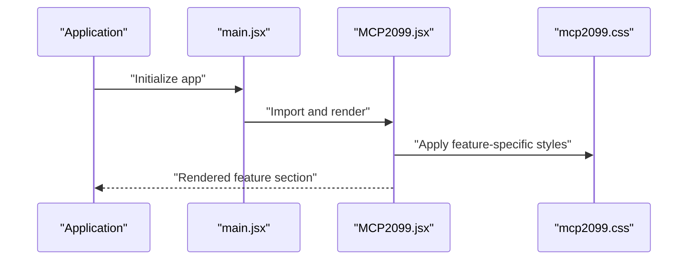
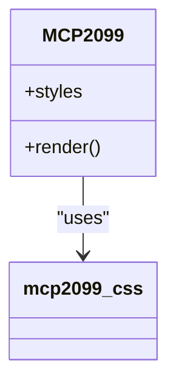

# MCP-2099 Feature Section

<cite>
**Referenced Files in This Document**
- [MCP2099.jsx](file://src/mcp2099/MCP2099.jsx)
- [mcp2099.css](file://src/mcp2099/mcp2099.css)
- [main.jsx](file://src/main.jsx)
</cite>

## Table of Contents
1. [Introduction](#introduction)
2. [Project Structure](#project-structure)
3. [Core Components](#core-components)
4. [Architecture Overview](#architecture-overview)
5. [Detailed Component Analysis](#detailed-component-analysis)
6. [Dependency Analysis](#dependency-analysis)
7. [Performance Considerations](#performance-considerations)
8. [Troubleshooting Guide](#troubleshooting-guide)
9. [Conclusion](#conclusion)

## Introduction
This document describes the MCP-2099 feature section implemented as a React component with associated styles. It explains how the component is structured, how it integrates into the application entry point, and provides guidance for maintenance and troubleshooting.

## Project Structure
The MCP-2099 feature is organized under a dedicated directory within the source tree:
- src/mcp2099/MCP2099.jsx: The React component implementation for the feature section.
- src/mcp2099/mcp2099.css: Styles specific to the feature section.
- src/main.jsx: Application entry point where the component is integrated.

**Diagram sources**
- [main.jsx](file://src/main.jsx)
- [MCP2099.jsx](file://src/mcp2099/MCP2099.jsx)
- [mcp2099.css](file://src/mcp2099/mcp2099.css)

**Section sources**
- [MCP2099.jsx](file://src/mcp2099/MCP2099.jsx)
- [mcp2099.css](file://src/mcp2099/mcp2099.css)
- [main.jsx](file://src/main.jsx)

## Core Components
- MCP2099 React Component
  - Purpose: Renders the MCP-2099 feature section UI.
  - Styling: Uses a dedicated CSS file scoped to this feature.
  - Integration: Imported and rendered by the application entry point.

- Styles (mcp2099.css)
  - Purpose: Provides layout, typography, colors, and responsive rules for the feature section.
  - Scope: Applied via class names used by the component.

**Section sources**
- [MCP2099.jsx](file://src/mcp2099/MCP2099.jsx)
- [mcp2099.css](file://src/mcp2099/mcp2099.css)
- [main.jsx](file://src/main.jsx)

## Architecture Overview
At runtime, the application bootstraps through the main entry point, which imports and renders the MCP-2099 component. The component applies its own styles from the dedicated stylesheet.

**Diagram sources**
- [main.jsx](file://src/main.jsx)
- [MCP2099.jsx](file://src/mcp2099/MCP2099.jsx)
- [mcp2099.css](file://src/mcp2099/mcp2099.css)

## Detailed Component Analysis

### MCP2099 Component
- Responsibilities
  - Render the feature section markup.
  - Apply semantic structure and accessibility attributes as needed.
  - Compose any internal sub-elements or content blocks required by the design.

- Styling Strategy
  - Uses a dedicated stylesheet to avoid global style conflicts.
  - Leverages class-based selectors consistent with standard React patterns.

- Integration Points
  - Consumed by the application entry point.
  - No explicit external API dependencies are indicated at the component level.

**Diagram sources**
- [MCP2099.jsx](file://src/mcp2099/MCP2099.jsx)
- [mcp2099.css](file://src/mcp2099/mcp2099.css)

**Section sources**
- [MCP2099.jsx](file://src/mcp2099/MCP2099.jsx)
- [mcp2099.css](file://src/mcp2099/mcp2099.css)

### Stylesheet (mcp2099.css)
- Organization
  - Scoped to the MCP-2099 feature section.
  - Contains layout, spacing, typography, color tokens, and responsive breakpoints.

- Usage
  - Referenced by the component via class names.
  - Designed to be self-contained to minimize side effects on other sections.

**Section sources**
- [mcp2099.css](file://src/mcp2099/mcp2099.css)

### Application Entry Point (main.jsx)
- Role
  - Bootstraps the application.
  - Imports and mounts the MCP-2099 component into the DOM.

- Integration Pattern
  - Standard React mounting pattern.
  - Ensures the feature section is included in the initial render.

**Section sources**
- [main.jsx](file://src/main.jsx)

## Dependency Analysis
The MCP-2099 feature has minimal coupling:
- The component depends only on its own styles.
- The application entry point depends on the component.

**Diagram sources**
- [main.jsx](file://src/main.jsx)
- [MCP2099.jsx](file://src/mcp2099/MCP2099.jsx)
- [mcp2099.css](file://src/mcp2099/mcp2099.css)

**Section sources**
- [main.jsx](file://src/main.jsx)
- [MCP2099.jsx](file://src/mcp2099/MCP2099.jsx)
- [mcp2099.css](file://src/mcp2099/mcp2099.css)

## Performance Considerations
- Keep the component lightweight:
  - Avoid heavy computations during render.
  - Prefer memoization if derived data is involved.
- Optimize styles:
  - Use scoped classes to prevent unnecessary reflows.
  - Minimize deep selector nesting.
- Asset strategy:
  - Ensure images and media assets are appropriately sized and lazy-loaded when applicable.

## Troubleshooting Guide
- Styles not applied
  - Verify that the component references the correct class names defined in the stylesheet.
  - Confirm the stylesheet is imported or available at build time.
- Component not rendering
  - Check the application entry point for correct import and mount calls.
  - Inspect browser console for JavaScript errors.
- Layout issues on mobile
  - Review responsive rules in the stylesheet and test across viewport sizes.
- Accessibility concerns
  - Ensure semantic HTML elements and ARIA attributes are used where appropriate.

## Conclusion
The MCP-2099 feature section is a focused React component with dedicated styling and straightforward integration into the application entry point. Its modular structure supports maintainability and clear separation of concerns. Follow the performance and troubleshooting recommendations above to ensure a smooth user experience and efficient development workflow.