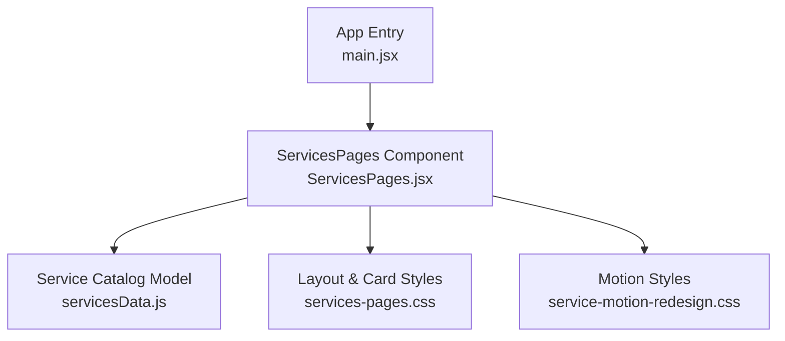
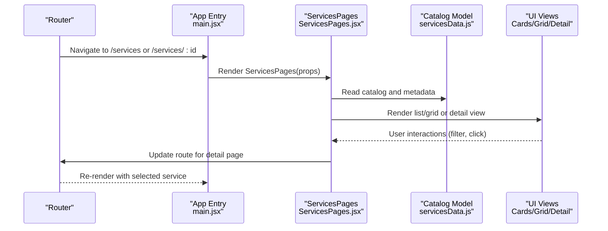
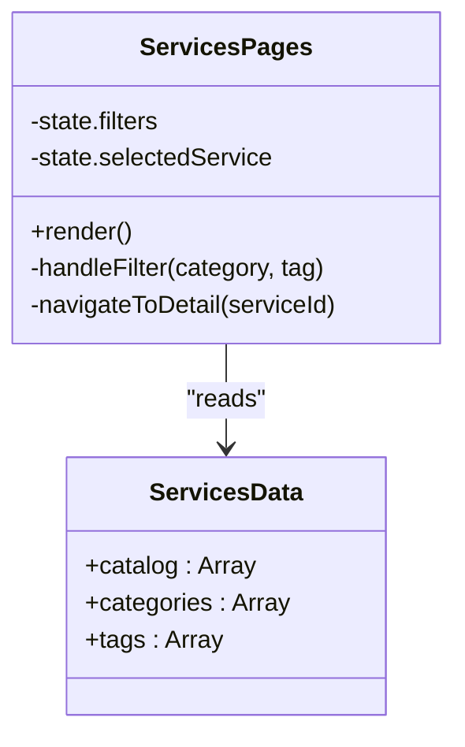
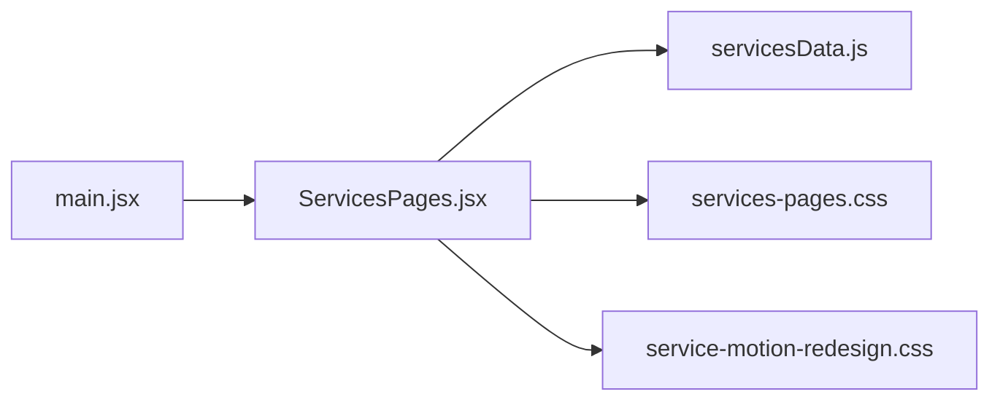

# Service Management Components

<cite>
**Referenced Files in This Document**
- [ServicesPages.jsx](file://src/ServicesPages.jsx)
- [servicesData.js](file://src/servicesData.js)
- [services-pages.css](file://src/services-pages.css)
- [service-motion-redesign.css](file://src/service-motion-redesign.css)
- [main.jsx](file://src/main.jsx)
</cite>

## Table of Contents
1. [Introduction](#introduction)
2. [Project Structure](#project-structure)
3. [Core Components](#core-components)
4. [Architecture Overview](#architecture-overview)
5. [Detailed Component Analysis](#detailed-component-analysis)
6. [Dependency Analysis](#dependency-analysis)
7. [Performance Considerations](#performance-considerations)
8. [Troubleshooting Guide](#troubleshooting-guide)
9. [Conclusion](#conclusion)
10. [Appendices](#appendices)

## Introduction
This document explains the dynamic service management system that generates service pages from a centralized data model. It focuses on how services are organized, filtered, and displayed across different layouts using the ServicesPages component and the servicesData.js data model. You will learn how to add new services, customize service cards, modify the catalog structure, and understand routing patterns, SEO considerations, and performance optimization strategies for large catalogs.

## Project Structure
The service management feature is implemented with a small set of focused files:
- A React component that renders the service catalog and detail views
- A JavaScript module that defines the service catalog data model
- CSS modules for layout and motion styling
- The application entry point where routes mount the service pages

**Diagram sources**
- [main.jsx](file://src/main.jsx)
- [ServicesPages.jsx](file://src/ServicesPages.jsx)
- [servicesData.js](file://src/servicesData.js)
- [services-pages.css](file://src/services-pages.css)
- [service-motion-redesign.css](file://src/service-motion-redesign.css)

**Section sources**
- [main.jsx](file://src/main.jsx)
- [ServicesPages.jsx](file://src/ServicesPages.jsx)
- [servicesData.js](file://src/servicesData.js)
- [services-pages.css](file://src/services-pages.css)
- [service-motion-redesign.css](file://src/service-motion-redesign.css)

## Core Components
- ServicesPages: The primary React component responsible for rendering the service catalog, handling filtering, and displaying individual service details. It consumes the servicesData.js model and applies layout and motion styles.
- servicesData.js: Centralized data model defining the service catalog structure, including metadata such as titles, descriptions, categories, tags, images, links, and any additional fields used by the UI.

Key responsibilities:
- Rendering lists and detail views based on the data model
- Filtering services by category or tag
- Mapping metadata to UI elements (cards, headers, content sections)
- Integrating with routing to navigate between catalog and detail views

**Section sources**
- [ServicesPages.jsx](file://src/ServicesPages.jsx)
- [servicesData.js](file://src/servicesData.js)

## Architecture Overview
The architecture follows a data-driven pattern:
- Data layer: servicesData.js provides a single source of truth for all service information.
- Presentation layer: ServicesPages.jsx reads the data and renders UI components (catalog grid, filters, detail view).
- Styling layer: CSS files define layout, card appearance, and motion effects.
- Routing layer: The app entry mounts ServicesPages at relevant routes.

**Diagram sources**
- [main.jsx](file://src/main.jsx)
- [ServicesPages.jsx](file://src/ServicesPages.jsx)
- [servicesData.js](file://src/servicesData.js)

## Detailed Component Analysis

### ServicesPages Component
Responsibilities:
- Consumes servicesData.js to build the catalog
- Provides filtering controls (by category/tag)
- Renders service cards in a responsive grid
- Navigates to a detail view when a card is clicked
- Applies layout and motion styles via CSS imports

Rendering logic:
- Reads the catalog array and maps each item to a card component
- Uses metadata fields to populate titles, descriptions, images, and links
- Filters items based on user selection or URL parameters
- Updates state to switch between catalog and detail views

Routing integration:
- Uses the app’s router to navigate to /services/:id for detail pages
- Reads route params to determine which service to display

Styling integration:
- Imports services-pages.css for layout and card styles
- Imports service-motion-redesign.css for animations and transitions

**Diagram sources**
- [ServicesPages.jsx](file://src/ServicesPages.jsx)
- [servicesData.js](file://src/servicesData.js)

**Section sources**
- [ServicesPages.jsx](file://src/ServicesPages.jsx)
- [services-pages.css](file://src/services-pages.css)
- [service-motion-redesign.css](file://src/service-motion-redesign.css)

### servicesData.js Data Model
Structure overview:
- catalog: An array of service objects representing each service
- categories: A list of available categories for filtering
- tags: A list of available tags for filtering
- Each service object includes metadata such as:
  - id: Unique identifier used for routing and referencing
  - title: Displayed in cards and detail header
  - description: Short summary shown in cards
  - longDescription: Detailed content for the detail view
  - image: Asset path for the card thumbnail
  - link: External or internal link associated with the service
  - category: Used for grouping and filtering
  - tags: Used for multi-dimensional filtering
  - order: Optional field to control sorting within the catalog

Complexity:
- Reading and mapping the catalog is O(n) per render
- Filtering operations are O(n) over the catalog size
- Detail view lookup by id is O(1) if using an index map; otherwise O(n)

Optimization opportunities:
- Precompute an index map by id for fast detail lookups
- Memoize filtered results to avoid recomputation on unchanged filters
- Lazy-load images and detail content for large catalogs

**Section sources**
- [servicesData.js](file://src/servicesData.js)

### Layout and Styling Integration
- services-pages.css: Defines grid layout, card dimensions, typography, spacing, and responsive breakpoints
- service-motion-redesign.css: Adds entrance animations, hover effects, and transitions for improved UX

Best practices:
- Keep layout styles modular and scoped to avoid conflicts
- Use consistent naming conventions for classes tied to service cards
- Ensure motion styles do not block critical rendering paths

**Section sources**
- [services-pages.css](file://src/services-pages.css)
- [service-motion-redesign.css](file://src/service-motion-redesign.css)

### Routing Patterns
- Catalog route: Displays the full list of services with filters
- Detail route: Displays a specific service using its id
- Navigation: Clicking a card updates the route to the corresponding detail page

Considerations:
- Preserve filter state across navigation if needed
- Provide back navigation from detail to catalog
- Handle invalid ids gracefully with fallbacks

**Section sources**
- [ServicesPages.jsx](file://src/ServicesPages.jsx)
- [main.jsx](file://src/main.jsx)

## Dependency Analysis
The ServicesPages component depends on:
- servicesData.js for catalog and metadata
- CSS files for visual presentation and motion
- The app’s routing mechanism mounted in main.jsx

**Diagram sources**
- [ServicesPages.jsx](file://src/ServicesPages.jsx)
- [servicesData.js](file://src/servicesData.js)
- [services-pages.css](file://src/services-pages.css)
- [service-motion-redesign.css](file://src/service-motion-redesign.css)
- [main.jsx](file://src/main.jsx)

**Section sources**
- [ServicesPages.jsx](file://src/ServicesPages.jsx)
- [servicesData.js](file://src/servicesData.js)
- [services-pages.css](file://src/services-pages.css)
- [service-motion-redesign.css](file://src/service-motion-redesign.css)
- [main.jsx](file://src/main.jsx)

## Performance Considerations
For large service catalogs:
- Indexing: Build an id-to-service map to achieve O(1) detail lookups
- Memoization: Cache filtered results keyed by active filters to prevent unnecessary re-renders
- Virtualization: Consider virtual scrolling for very large lists to improve initial render time
- Image optimization: Use lazy loading, appropriate formats (WebP), and responsive srcsets
- Code splitting: Split detail view components to reduce bundle size
- Server-side generation: Pre-generate static pages for top-level services to improve SEO and load times

[No sources needed since this section provides general guidance]

## Troubleshooting Guide
Common issues and resolutions:
- Missing service id: Ensure every service object has a unique id; detail routing relies on it
- Broken images: Verify asset paths in the image field and confirm assets exist under public/assets
- Filter not working: Confirm category and tag values match those defined in servicesData.js
- Route mismatch: Check that the detail route uses the same id format as the service objects
- Performance regressions: Add memoization and indexing if catalog size grows significantly

**Section sources**
- [ServicesPages.jsx](file://src/ServicesPages.jsx)
- [servicesData.js](file://src/servicesData.js)

## Conclusion
The dynamic service management system leverages a clear separation between data and presentation. The servicesData.js model centralizes service metadata, while ServicesPages.jsx handles rendering, filtering, and routing. By following the recommended optimizations and best practices, you can scale the catalog efficiently, maintain clean code, and deliver a responsive user experience.

[No sources needed since this section summarizes without analyzing specific files]

## Appendices

### How to Add a New Service
Steps:
- Open servicesData.js and add a new object to the catalog array
- Assign a unique id, title, description, longDescription, image, link, category, and tags
- If adding a new category or tag, include it in the respective arrays
- Save and verify the new service appears in the catalog and navigates correctly to the detail view

**Section sources**
- [servicesData.js](file://src/servicesData.js)

### Customizing Service Cards
Approach:
- Modify services-pages.css to adjust card layout, typography, spacing, and responsive behavior
- Enhance motion effects in service-motion-redesign.css for hover and entrance animations
- Extend the ServicesPages component to render additional metadata fields from the data model

**Section sources**
- [services-pages.css](file://src/services-pages.css)
- [service-motion-redesign.css](file://src/service-motion-redesign.css)
- [ServicesPages.jsx](file://src/ServicesPages.jsx)

### Modifying the Service Catalog Structure
Guidelines:
- Keep the catalog array schema consistent to avoid breaking the UI
- Introduce optional fields cautiously and guard against undefined values in the component
- Maintain separate arrays for categories and tags to support filtering
- Document any new fields in comments within servicesData.js for future maintainability

**Section sources**
- [servicesData.js](file://src/servicesData.js)
- [ServicesPages.jsx](file://src/ServicesPages.jsx)

### SEO Considerations
Recommendations:
- Use descriptive titles and meta descriptions derived from service metadata
- Generate structured data (JSON-LD) for services where applicable
- Ensure images have alt text populated from service descriptions
- Prefer static generation for high-traffic service pages to improve crawlability and performance

[No sources needed since this section provides general guidance]