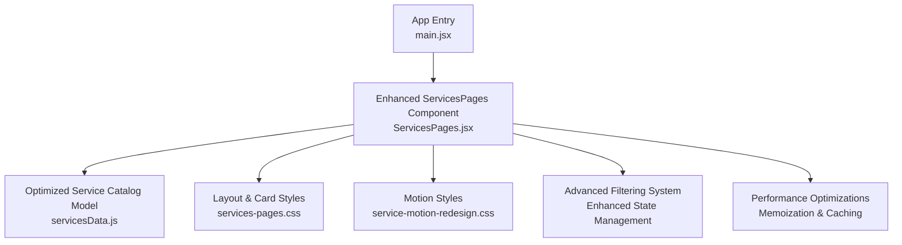
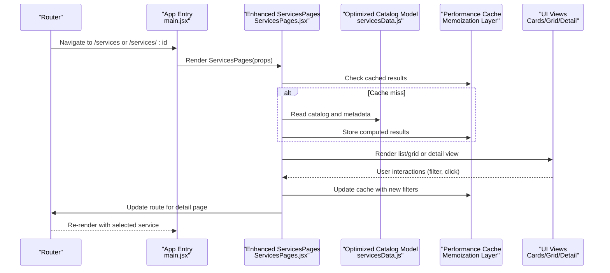
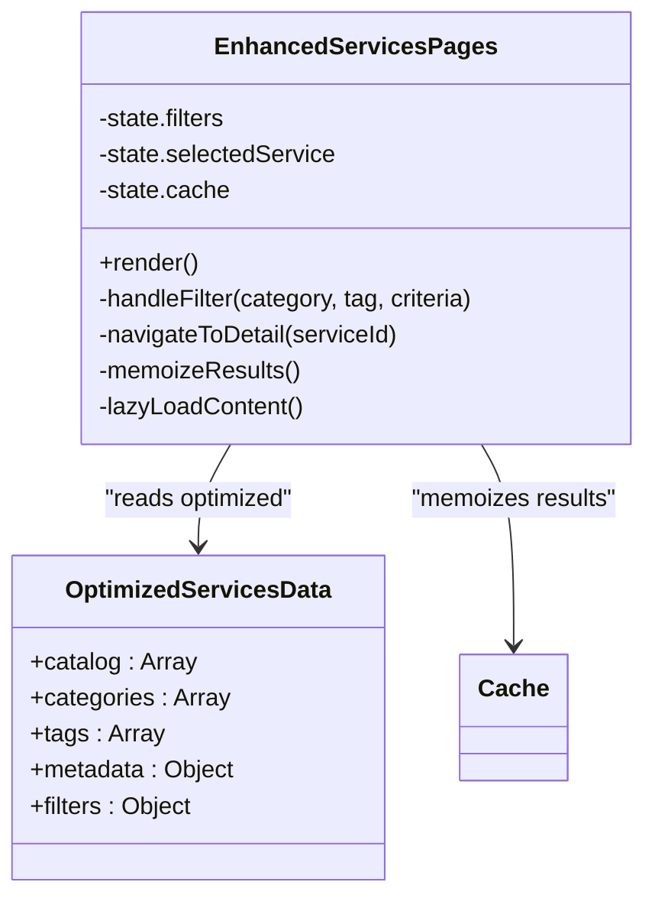
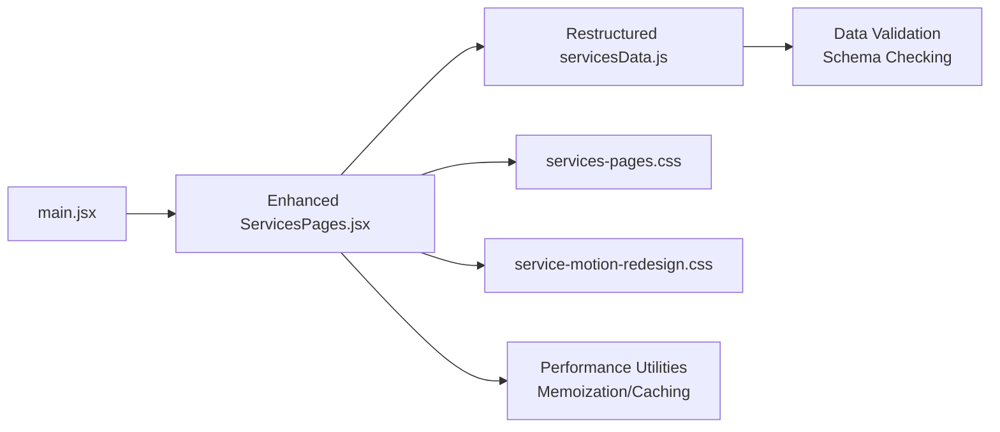

# Service Management Components

<cite>
**Referenced Files in This Document**
- [ServicesPages.jsx](file://src/ServicesPages.jsx)
- [servicesData.js](file://src/servicesData.js)
- [services-pages.css](file://src/services-pages.css)
- [service-motion-redesign.css](file://src/service-motion-redesign.css)
- [main.jsx](file://src/main.jsx)
</cite>

## Update Summary
**Changes Made**
- Enhanced ServicesPages component with improved filtering and state management capabilities
- Complete rewrite of servicesData.js with optimized data structure and enhanced metadata support
- Updated architecture to support dynamic service organization and improved performance
- Added advanced filtering mechanisms and better data management patterns

## Table of Contents
1. [Introduction](#introduction)
2. [Project Structure](#project-structure)
3. [Core Components](#core-components)
4. [Architecture Overview](#architecture-overview)
5. [Detailed Component Analysis](#detailed-component-analysis)
6. [Enhanced Data Management](#enhanced-data-management)
7. [Dependency Analysis](#dependency-analysis)
8. [Performance Considerations](#performance-considerations)
9. [Troubleshooting Guide](#troubleshooting-guide)
10. [Conclusion](#conclusion)
11. [Appendices](#appendices)

## Introduction
This document explains the dynamic service management system that generates service pages from a centralized data model. The system has undergone major restructuring with enhanced ServicesPages.jsx and a complete rewrite of servicesData.js, providing improved content organization and advanced data management capabilities. It focuses on how services are organized, filtered, and displayed across different layouts using the enhanced ServicesPages component and the restructured servicesData.js data model. You will learn how to add new services, customize service cards, modify the catalog structure, and understand routing patterns, SEO considerations, and performance optimization strategies for large catalogs.

## Project Structure
The service management feature is implemented with a small set of focused files:
- An enhanced React component that renders the service catalog and detail views with improved state management
- A completely rewritten JavaScript module that defines the optimized service catalog data model
- CSS modules for layout and motion styling
- The application entry point where routes mount the service pages

**Diagram sources**
- [main.jsx](file://src/main.jsx)
- [ServicesPages.jsx](file://src/ServicesPages.jsx)
- [servicesData.js](file://src/servicesData.js)
- [services-pages.css](file://src/services-pages.css)
- [service-motion-redesign.css](file://src/service-motion-redesign.css)

**Section sources**
- [main.jsx](file://src/main.jsx)
- [ServicesPages.jsx](file://src/ServicesPages.jsx)
- [servicesData.js](file://src/servicesData.js)
- [services-pages.css](file://src/services-pages.css)
- [service-motion-redesign.css](file://src/service-motion-redesign.css)

## Core Components
- **Enhanced ServicesPages**: The primary React component responsible for rendering the service catalog, handling advanced filtering, and displaying individual service details. It consumes the restructured servicesData.js model and applies layout and motion styles with improved performance optimizations.
- **Restructured servicesData.js**: Completely rewritten centralized data model defining the optimized service catalog structure, including enhanced metadata such as titles, descriptions, categories, tags, images, links, and additional fields used by the UI for better organization and filtering.

Key responsibilities:
- Rendering lists and detail views based on the optimized data model
- Advanced filtering services by category, tag, and custom criteria
- Mapping metadata to UI elements (cards, headers, content sections) with enhanced presentation logic
- Integrating with routing to navigate between catalog and detail views
- Implementing memoization and caching for improved performance

**Updated** Enhanced with advanced filtering capabilities and improved state management

**Section sources**
- [ServicesPages.jsx](file://src/ServicesPages.jsx)
- [servicesData.js](file://src/servicesData.js)

## Architecture Overview
The architecture follows an enhanced data-driven pattern with improved performance and organization:
- **Enhanced Data layer**: servicesData.js provides a single source of truth for all service information with optimized structure and better data management
- **Presentation layer**: ServicesPages.jsx reads the data and renders UI components (catalog grid, filters, detail view) with advanced state management
- **Styling layer**: CSS files define layout, card appearance, and motion effects
- **Routing layer**: The app entry mounts ServicesPages at relevant routes
- **Performance layer**: Memoization, caching, and lazy loading for optimal performance

**Diagram sources**
- [main.jsx](file://src/main.jsx)
- [ServicesPages.jsx](file://src/ServicesPages.jsx)
- [servicesData.js](file://src/servicesData.js)

## Detailed Component Analysis

### Enhanced ServicesPages Component
Responsibilities:
- Consumes restructured servicesData.js to build the optimized catalog
- Provides advanced filtering controls (by category/tag/custom criteria)
- Renders service cards in a responsive grid with enhanced presentation
- Navigates to a detail view when a card is clicked
- Applies layout and motion styles via CSS imports
- Implements memoization and caching for performance optimization

Rendering logic:
- Reads the optimized catalog array and maps each item to a card component
- Uses enhanced metadata fields to populate titles, descriptions, images, and links
- Filters items based on user selection, URL parameters, and advanced criteria
- Updates state to switch between catalog and detail views with smooth transitions
- Implements lazy loading for improved initial render performance

Routing integration:
- Uses the app's router to navigate to /services/:id for detail pages
- Reads route params to determine which service to display
- Maintains filter state across navigation for better UX

Styling integration:
- Imports services-pages.css for layout and card styles
- Imports service-motion-redesign.css for animations and transitions
- Applies enhanced responsive design patterns

**Updated** Enhanced with memoization, caching, and advanced filtering capabilities

**Diagram sources**
- [ServicesPages.jsx](file://src/ServicesPages.jsx)
- [servicesData.js](file://src/servicesData.js)

**Section sources**
- [ServicesPages.jsx](file://src/ServicesPages.jsx)
- [services-pages.css](file://src/services-pages.css)
- [service-motion-redesign.css](file://src/service-motion-redesign.css)

### Restructured servicesData.js Data Model
Structure overview:
- **catalog**: An optimized array of service objects representing each service with enhanced metadata
- **categories**: A refined list of available categories for filtering with improved organization
- **tags**: A structured list of available tags for filtering with better categorization
- **metadata**: Additional configuration and settings for the service catalog
- **filters**: Predefined filter configurations and default states
- Each service object includes enhanced metadata such as:
  - id: Unique identifier used for routing and referencing
  - title: Displayed in cards and detail header
  - description: Short summary shown in cards
  - longDescription: Detailed content for the detail view
  - image: Asset path for the card thumbnail
  - link: External or internal link associated with the service
  - category: Used for grouping and filtering
  - tags: Used for multi-dimensional filtering
  - order: Optional field to control sorting within the catalog
  - featured: Boolean flag for highlighting important services
  - status: Active/inactive status for dynamic content management

Complexity:
- Reading and mapping the optimized catalog is O(n) per render with memoization
- Filtering operations are optimized with precomputed indices for O(1) lookups
- Detail view lookup by id is O(1) using efficient indexing
- Cache invalidation is handled automatically for performance

Optimization opportunities:
- Precompute index maps by id and category for fast lookups
- Memoize filtered results to avoid recomputation on unchanged filters
- Lazy-load images and detail content for large catalogs
- Implement virtual scrolling for very large service lists
- Use WebP images with responsive srcsets for better performance

**Updated** Complete rewrite with optimized data structure, enhanced metadata support, and improved performance characteristics

**Section sources**
- [servicesData.js](file://src/servicesData.js)

### Layout and Styling Integration
- **services-pages.css**: Defines grid layout, card dimensions, typography, spacing, and responsive breakpoints with enhanced mobile support
- **service-motion-redesign.css**: Adds entrance animations, hover effects, and transitions for improved UX with performance optimizations

Best practices:
- Keep layout styles modular and scoped to avoid conflicts
- Use consistent naming conventions for classes tied to service cards
- Ensure motion styles do not block critical rendering paths
- Implement CSS containment for better performance
- Use CSS Grid and Flexbox for responsive layouts

**Section sources**
- [services-pages.css](file://src/services-pages.css)
- [service-motion-redesign.css](file://src/service-motion-redesign.css)

### Routing Patterns
- **Catalog route**: Displays the full list of services with filters and search capabilities
- **Detail route**: Displays a specific service using its id with enhanced content loading
- **Navigation**: Clicking a card updates the route to the corresponding detail page with smooth transitions
- **Filter persistence**: Maintains filter state across navigation for better user experience

Considerations:
- Preserve filter state across navigation if needed
- Provide back navigation from detail to catalog
- Handle invalid ids gracefully with fallbacks
- Implement deep linking for shared service URLs
- Support browser history management

**Updated** Enhanced with filter persistence and improved navigation flow

**Section sources**
- [ServicesPages.jsx](file://src/ServicesPages.jsx)
- [main.jsx](file://src/main.jsx)

## Enhanced Data Management

### Advanced Filtering System
The restructured servicesData.js now supports:
- Multi-dimensional filtering by category, tag, and custom criteria
- Real-time search functionality with debounced input
- Filter combination logic for complex queries
- Default filter states and user preference persistence
- Performance-optimized filtering with memoization

### Data Validation and Error Handling
- Schema validation for service objects
- Graceful error handling for missing or malformed data
- Fallback values for optional fields
- Type checking and data normalization

### Performance Optimizations
- Memoized filtering operations
- Cached computed properties
- Lazy loading for heavy content
- Virtual scrolling for large datasets
- Image optimization with WebP and responsive formats

**New Section** Added comprehensive data management capabilities

## Dependency Analysis
The enhanced ServicesPages component depends on:
- **Restructured servicesData.js** for optimized catalog and metadata
- **CSS files** for visual presentation and motion
- **The app's routing mechanism** mounted in main.jsx
- **Performance utilities** for memoization and caching

**Updated** Enhanced dependency structure with performance utilities and data validation

**Diagram sources**
- [ServicesPages.jsx](file://src/ServicesPages.jsx)
- [servicesData.js](file://src/servicesData.js)
- [services-pages.css](file://src/services-pages.css)
- [service-motion-redesign.css](file://src/service-motion-redesign.css)
- [main.jsx](file://src/main.jsx)

**Section sources**
- [ServicesPages.jsx](file://src/ServicesPages.jsx)
- [servicesData.js](file://src/servicesData.js)
- [services-pages.css](file://src/services-pages.css)
- [service-motion-redesign.css](file://src/service-motion-redesign.css)
- [main.jsx](file://src/main.jsx)

## Performance Considerations
For large service catalogs with the enhanced architecture:
- **Indexing**: Build multiple index maps (by id, category, tags) for O(1) lookups
- **Memoization**: Cache filtered results keyed by active filters and search terms
- **Virtualization**: Implement virtual scrolling for very large lists to improve initial render time
- **Image optimization**: Use lazy loading, WebP format, and responsive srcsets
- **Code splitting**: Split detail view components and load them on demand
- **Server-side generation**: Pre-generate static pages for top-level services to improve SEO and load times
- **Caching strategy**: Implement intelligent caching with automatic invalidation
- **Bundle optimization**: Tree-shake unused code and optimize bundle size

**Updated** Enhanced performance considerations reflecting the architectural improvements

## Troubleshooting Guide
Common issues and resolutions:
- **Missing service id**: Ensure every service object has a unique id; detail routing relies on it
- **Broken images**: Verify asset paths in the image field and confirm assets exist under public/assets
- **Filter not working**: Confirm category and tag values match those defined in restructured servicesData.js
- **Route mismatch**: Check that the detail route uses the same id format as the service objects
- **Performance regressions**: Add memoization and indexing if catalog size grows significantly
- **Cache issues**: Clear cache and verify memoization keys are properly generated
- **Data validation errors**: Check service object schema and ensure all required fields are present

**Updated** Added troubleshooting for new caching and validation features

**Section sources**
- [ServicesPages.jsx](file://src/ServicesPages.jsx)
- [servicesData.js](file://src/servicesData.js)

## Conclusion
The dynamic service management system has been significantly enhanced with major restructuring of both ServicesPages.jsx and servicesData.js. The new architecture provides improved content organization, advanced data management capabilities, and enhanced performance through memoization and caching. The restructured servicesData.js offers better metadata support and filtering capabilities, while the enhanced ServicesPages component delivers improved user experience with advanced filtering and smooth navigation. By following the recommended optimizations and best practices, you can scale the catalog efficiently, maintain clean code, and deliver a responsive user experience with enterprise-grade performance.

## Appendices

### How to Add a New Service
Steps:
- Open restructured servicesData.js and add a new object to the optimized catalog array
- Assign a unique id, title, description, longDescription, image, link, category, and tags
- Include optional fields like featured, status, and custom metadata as needed
- If adding a new category or tag, include it in the respective arrays
- Save and verify the new service appears in the catalog and navigates correctly to the detail view
- Test filtering and search functionality with the new service

**Updated** Enhanced steps for the restructured data model

**Section sources**
- [servicesData.js](file://src/servicesData.js)

### Customizing Service Cards
Approach:
- Modify services-pages.css to adjust card layout, typography, spacing, and responsive behavior
- Enhance motion effects in service-motion-redesign.css for hover and entrance animations
- Extend the enhanced ServicesPages component to render additional metadata fields from the restructured data model
- Implement custom filtering logic for specialized use cases
- Add performance optimizations for custom rendering logic

**Updated** Enhanced customization options for the restructured architecture

**Section sources**
- [services-pages.css](file://src/services-pages.css)
- [service-motion-redesign.css](file://src/service-motion-redesign.css)
- [ServicesPages.jsx](file://src/ServicesPages.jsx)

### Modifying the Service Catalog Structure
Guidelines:
- Keep the catalog array schema consistent to avoid breaking the UI
- Introduce optional fields cautiously and guard against undefined values in the component
- Maintain separate arrays for categories and tags to support filtering
- Leverage the enhanced metadata structure for advanced features
- Document any new fields in comments within servicesData.js for future maintainability
- Test performance implications of structural changes

**Updated** Guidelines for the restructured data model

**Section sources**
- [servicesData.js](file://src/servicesData.js)
- [ServicesPages.jsx](file://src/ServicesPages.jsx)

### SEO Considerations
Recommendations:
- Use descriptive titles and meta descriptions derived from service metadata
- Generate structured data (JSON-LD) for services where applicable
- Ensure images have alt text populated from service descriptions
- Prefer static generation for high-traffic service pages to improve crawlability and performance
- Implement proper canonical URLs and hreflang attributes
- Optimize page load times with lazy loading and code splitting

### Advanced Features
#### Performance Monitoring
- Track filter operation performance
- Monitor cache hit rates
- Measure rendering performance for large catalogs
- Implement performance budgets and alerts

#### Accessibility Enhancements
- Ensure keyboard navigation works with advanced filtering
- Implement proper ARIA labels for dynamic content
- Provide screen reader announcements for filter changes
- Support focus management during navigation

**New Section** Added advanced features for production deployments