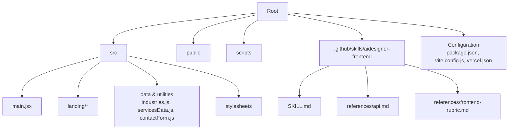
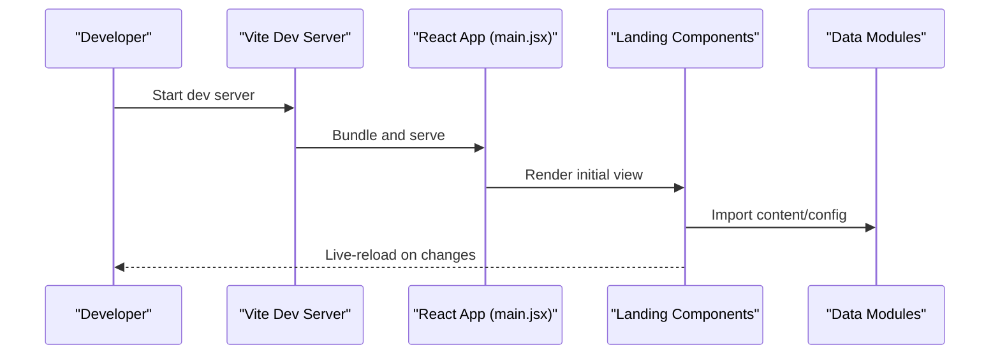
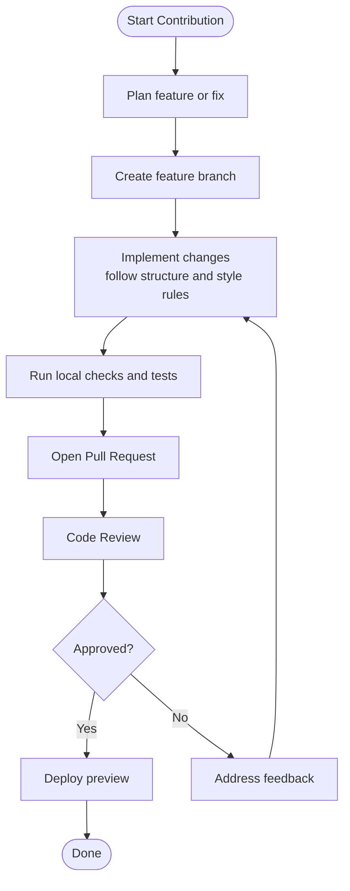
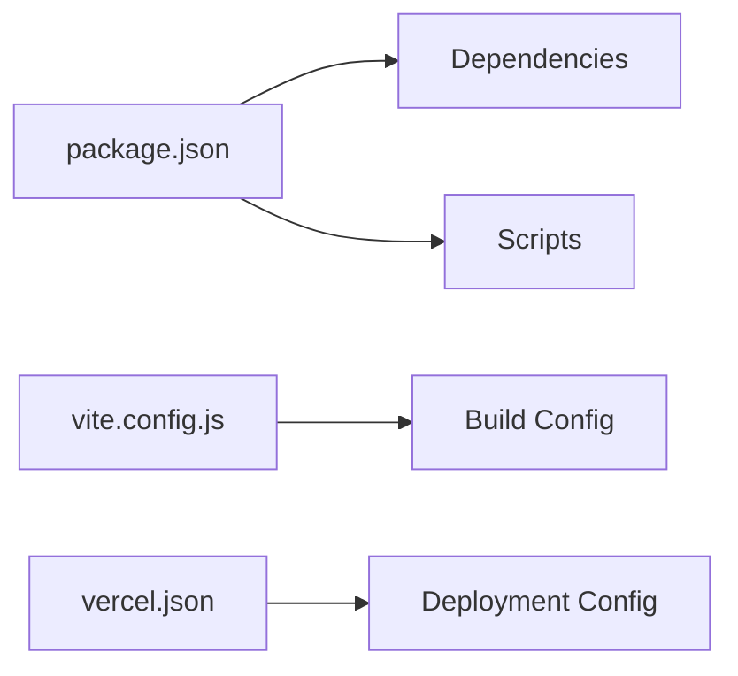

# Contributing Guidelines

<cite>
**Referenced Files in This Document**
- [README.md](file://README.md)
- [package.json](file://package.json)
- [vite.config.js](file://vite.config.js)
- [vercel.json](file://vercel.json)
- [src/main.jsx](file://src/main.jsx)
- [src/landing/Landing2.jsx](file://src/landing/Landing2.jsx)
- [src/landing/data.js](file://src/landing/data.js)
- [src/industries.js](file://src/industries.js)
- [src/servicesData.js](file://src/servicesData.js)
- [src/contactForm.js](file://src/contactForm.js)
- [scripts/check-services.mjs](file://scripts/check-services.mjs)
- [.github/skills/aidesigner-frontend/SKILL.md](file://.github/skills/aidesigner-frontend/SKILL.md)
- [.github/skills/aidesigner-frontend/references/api.md](file://.github/skills/aidesigner-frontend/references/api.md)
- [.github/skills/aidesigner-frontend/references/frontend-rubric.md](file://.github/skills/aidesigner-frontend/references/frontend-rubric.md)
</cite>

## Table of Contents
1. [Introduction](#introduction)
2. [Project Structure](#project-structure)
3. [Core Components](#core-components)
4. [Architecture Overview](#architecture-overview)
5. [Detailed Component Analysis](#detailed-component-analysis)
6. [Dependency Analysis](#dependency-analysis)
7. [Performance Considerations](#performance-considerations)
8. [Troubleshooting Guide](#troubleshooting-guide)
9. [Conclusion](#conclusion)
10. [Appendices](#appendices)

## Introduction
This document defines the contributing guidelines for PodiumMinds. It covers development workflow, code style conventions, commit message standards, branch naming strategies, pull request process, code review requirements, testing expectations, project structure conventions, component organization patterns, documentation standards, and guidance for adding features and maintaining quality. It also explains the GitHub skills system and AI-assisted development workflow, and provides templates for issues, pull requests, and documentation updates.

## Project Structure
The repository is a Vite-based React application with a clear separation between source code, assets, scripts, and configuration:
- src: Application source code (React components, styles, data, utilities)
- public: Static assets served as-is
- scripts: Build-time or QA automation scripts
- .github/skills: AI skill definitions and references used by the GitHub skills system
- Configuration files at root: package.json, vite.config.js, vercel.json

**Diagram sources**
- [src/main.jsx](file://src/main.jsx)
- [src/landing/Landing2.jsx](file://src/landing/Landing2.jsx)
- [src/landing/data.js](file://src/landing/data.js)
- [src/industries.js](file://src/industries.js)
- [src/servicesData.js](file://src/servicesData.js)
- [src/contactForm.js](file://src/contactForm.js)
- [.github/skills/aidesigner-frontend/SKILL.md](file://.github/skills/aidesigner-frontend/SKILL.md)
- [.github/skills/aidesigner-frontend/references/api.md](file://.github/skills/aidesigner-frontend/references/api.md)
- [.github/skills/aidesigner-frontend/references/frontend-rubric.md](file://.github/skills/aidesigner-frontend/references/frontend-rubric.md)

**Section sources**
- [README.md](file://README.md)
- [package.json](file://package.json)
- [vite.config.js](file://vite.config.js)
- [vercel.json](file://vercel.json)

## Core Components
Key areas to understand when contributing:
- Entry point and app bootstrap: src/main.jsx
- Landing page composition and motion: src/landing/* (e.g., Landing2.jsx, data.js, CSS modules)
- Domain data and forms: src/industries.js, src/servicesData.js, src/contactForm.js
- Build and deployment: vite.config.js, vercel.json, package.json scripts
- QA and checks: scripts/*.mjs

When adding new pages or sections, follow the existing pattern:
- Create a new JSX file under src/landing if it belongs to landing experiences
- Keep related styles adjacent (CSS next to JSX)
- Centralize content in data files where appropriate (e.g., data.js)

**Section sources**
- [src/main.jsx](file://src/main.jsx)
- [src/landing/Landing2.jsx](file://src/landing/Landing2.jsx)
- [src/landing/data.js](file://src/landing/data.js)
- [src/industries.js](file://src/industries.js)
- [src/servicesData.js](file://src/servicesData.js)
- [src/contactForm.js](file://src/contactForm.js)
- [vite.config.js](file://vite.config.js)
- [vercel.json](file://vercel.json)
- [package.json](file://package.json)

## Architecture Overview
High-level flow from entry point to rendered UI:

**Diagram sources**
- [src/main.jsx](file://src/main.jsx)
- [src/landing/Landing2.jsx](file://src/landing/Landing2.jsx)
- [src/landing/data.js](file://src/landing/data.js)
- [vite.config.js](file://vite.config.js)

## Detailed Component Analysis

### Landing Page Composition
- The landing experience is composed of multiple components under src/landing.
- Data-driven rendering uses dedicated data modules (e.g., data.js).
- Styles are colocated with components for maintainability.

[No sources needed since this diagram shows conceptual workflow, not actual code structure]

**Section sources**
- [src/landing/Landing2.jsx](file://src/landing/Landing2.jsx)
- [src/landing/data.js](file://src/landing/data.js)

### Data and Forms
- Content and configuration are centralized in JS modules (e.g., industries.js, servicesData.js).
- Form handling logic resides in src/contactForm.js.

Guidelines:
- Keep data immutable and typed via consistent structures.
- Validate user inputs before submission.
- Separate concerns: data vs. presentation vs. behavior.

**Section sources**
- [src/industries.js](file://src/industries.js)
- [src/servicesData.js](file://src/servicesData.js)
- [src/contactForm.js](file://src/contactForm.js)

### Build and Deployment
- Vite config controls build behavior and optimizations.
- Vercel config defines deployment settings.
- Package scripts define common commands (install, dev, build, etc.).

Best practices:
- Avoid large assets in src; use public for static resources.
- Use environment variables for deploy-specific settings.
- Keep bundle size small by lazy-loading heavy components.

**Section sources**
- [vite.config.js](file://vite.config.js)
- [vercel.json](file://vercel.json)
- [package.json](file://package.json)

### QA Scripts
- scripts/*.mjs provide automated checks and QA tasks.
- Use these scripts to validate parity, screenshots, or service configurations.

Usage:
- Run relevant scripts before opening a PR.
- Add new scripts for recurring checks as needed.

**Section sources**
- [scripts/check-services.mjs](file://scripts/check-services.mjs)

## Dependency Analysis
External dependencies and tooling are declared in package.json. Key aspects:
- Dependencies include React ecosystem and Vite toolchain.
- Scripts orchestrate development, building, and verification tasks.
- Vite config centralizes build options.

**Diagram sources**
- [package.json](file://package.json)
- [vite.config.js](file://vite.config.js)
- [vercel.json](file://vercel.json)

**Section sources**
- [package.json](file://package.json)
- [vite.config.js](file://vite.config.js)
- [vercel.json](file://vercel.json)

## Performance Considerations
- Prefer lazy loading for heavy components and routes.
- Optimize images and fonts; place them under public/assets.
- Minimize re-renders by memoizing expensive computations and stable props.
- Use Vite’s built-in optimizations and avoid unnecessary polyfills.
- Monitor bundle size and split chunks where beneficial.

[No sources needed since this section provides general guidance]

## Troubleshooting Guide
Common issues and resolutions:
- Development server fails to start: verify Node version and reinstall dependencies using the install script defined in package.json.
- Assets not found: ensure paths are correct and assets are placed under public.
- Build errors: check vite.config.js for misconfigurations and run the build script locally.
- Deployment failures: validate vercel.json and environment variables.

If you encounter persistent issues, open an issue with:
- Steps to reproduce
- Expected vs. actual behavior
- Environment details (Node, OS, browser)
- Relevant logs

**Section sources**
- [package.json](file://package.json)
- [vite.config.js](file://vite.config.js)
- [vercel.json](file://vercel.json)

## Conclusion
By following these guidelines, contributors can maintain consistency, improve code quality, and streamline collaboration. Use the provided templates and workflows to keep contributions efficient and reviewable.

[No sources needed since this section summarizes without analyzing specific files]

## Appendices

### Development Workflow
- Local setup:
  - Install dependencies using the install script in package.json.
  - Start the development server using the dev script.
- Code style:
  - Follow existing patterns in src/landing and data modules.
  - Keep styles close to components; prefer CSS modules or colocated styles.
- Commit messages:
  - Use concise, imperative subject lines.
  - Include context and motivation in the body when necessary.
- Branch naming:
  - Use prefixes like feature/, fix/, chore/, docs/.
  - Example: feature/add-hero-animation, fix/contact-form-validation.

**Section sources**
- [package.json](file://package.json)
- [src/landing/Landing2.jsx](file://src/landing/Landing2.jsx)
- [src/landing/data.js](file://src/landing/data.js)

### Pull Request Process
- Before opening a PR:
  - Ensure all local checks pass.
  - Update documentation if behavior changed.
- PR checklist:
  - Describe the change and rationale.
  - Link related issues.
  - Attach screenshots or recordings for UI changes.
  - Confirm performance impact is considered.
- Reviews:
  - Address reviewer feedback promptly.
  - Keep PRs focused and small for faster reviews.

[No sources needed since this section provides general guidance]

### Testing Expectations
- Manual testing:
  - Verify UI responsiveness and cross-browser compatibility.
  - Check accessibility basics (contrast, keyboard navigation).
- Automated checks:
  - Run QA scripts under scripts/*.mjs as applicable.
  - Add new scripts for recurring validations.

**Section sources**
- [scripts/check-services.mjs](file://scripts/check-services.mjs)

### Project Structure Conventions
- Place new components under src/landing if they belong to landing experiences.
- Keep data in dedicated modules (e.g., data.js, industries.js, servicesData.js).
- Colocate styles with components for clarity.
- Use public for static assets; reference them via absolute paths.

**Section sources**
- [src/landing/Landing2.jsx](file://src/landing/Landing2.jsx)
- [src/landing/data.js](file://src/landing/data.js)
- [src/industries.js](file://src/industries.js)
- [src/servicesData.js](file://src/servicesData.js)

### Documentation Standards
- Update README.md for significant changes.
- Add inline comments for complex logic.
- Maintain API references under .github/skills/aidesigner-frontend/references when relevant.

**Section sources**
- [README.md](file://README.md)
- [.github/skills/aidesigner-frontend/references/api.md](file://.github/skills/aidesigner-frontend/references/api.md)

### GitHub Skills System and AI-Assisted Development
- The GitHub skills system is configured under .github/skills/aidesigner-frontend.
- SKILL.md defines skill behavior and usage.
- References include API docs and frontend rubrics to guide AI assistance.

Workflow:
- Reference SKILL.md when prompting AI tools.
- Align suggestions with frontend-rubric.md for quality.
- Use api.md for accurate integration details.

**Section sources**
- [.github/skills/aidesigner-frontend/SKILL.md](file://.github/skills/aidesigner-frontend/SKILL.md)
- [.github/skills/aidesigner-frontend/references/api.md](file://.github/skills/aidesigner-frontend/references/api.md)
- [.github/skills/aidesigner-frontend/references/frontend-rubric.md](file://.github/skills/aidesigner-frontend/references/frontend-rubric.md)

### Templates

#### Issue Template
- Title: Clear and descriptive
- Description: What happened and what was expected
- Steps to Reproduce: Numbered list
- Screenshots/Logs: Attach if applicable
- Environment: Node, OS, Browser versions
- Additional Context: Links, related issues

#### Pull Request Template
- Summary: One-line overview
- Motivation: Why this change is needed
- Changes: Bullet list of modifications
- Testing: How to verify the change
- Screenshots/GIFs: For UI changes
- Related Issues: Links to tracked work

#### Documentation Update Template
- Scope: Which docs are updated
- Changes: What was added or revised
- Rationale: Why the update is necessary
- Review Notes: Any areas needing extra attention

[No sources needed since this section provides general guidance]