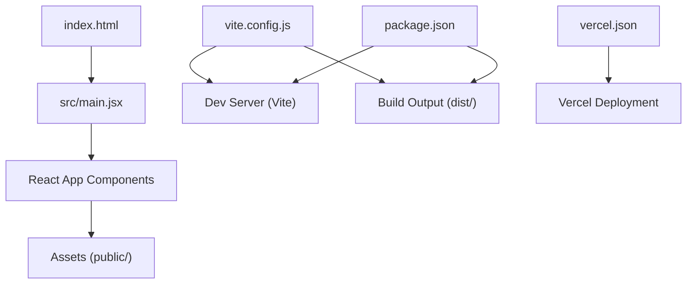

# Getting Started

<cite>
**Referenced Files in This Document**
- [package.json](file://package.json)
- [vite.config.js](file://vite.config.js)
- [index.html](file://index.html)
- [src/main.jsx](file://src/main.jsx)
- [vercel.json](file://vercel.json)
- [README.md](file://README.md)
</cite>

## Table of Contents
1. [Introduction](#introduction)
2. [Prerequisites](#prerequisites)
3. [Installation](#installation)
4. [Environment Setup](#environment-setup)
5. [Local Development Workflow](#local-development-workflow)
6. [Build Process](#build-process)
7. [Deployment to Vercel](#deployment-to-vercel)
8. [Testing](#testing)
9. [Troubleshooting](#troubleshooting)
10. [Browser Compatibility](#browser-compatibility)
11. [Architecture Overview](#architecture-overview)
12. [Conclusion](#conclusion)

## Introduction
This guide helps you set up and run the PodiumMinds project locally, build it for production, and deploy it to Vercel. It covers prerequisites, installation, environment configuration, development workflow, build commands, deployment steps, testing, troubleshooting, and browser compatibility requirements. The content is designed to be beginner-friendly while providing enough detail for experienced developers to move quickly.

## Prerequisites
- Node.js: Use a recent LTS version (for example, 18.x or 20.x). Verify with node -v.
- Package manager: npm is included with Node.js. You can also use pnpm if preferred.
- Git: For cloning the repository and managing versions.
- A modern web browser: Chrome, Edge, Firefox, or Safari.

Optional but recommended:
- VS Code with extensions such as ESLint and Prettier for a smoother development experience.

**Section sources**
- [README.md](file://README.md)

## Installation
Follow these steps to install dependencies and prepare the project for local development.

1. Clone the repository:
   - git clone <repository-url>
   - cd podiumminds

2. Install dependencies:
   - Using npm:
     - npm install
   - Using pnpm (if you prefer):
     - pnpm install

3. Verify the installation:
   - Ensure the node_modules directory exists and no errors were reported during install.

Notes:
- If you encounter permission issues on macOS/Linux, avoid using sudo with npm/pnpm; instead, configure your package manager to use a user-level directory.
- If you see lockfile warnings, ensure your package manager matches the one used by the project (the repository includes both package-lock.json and pnpm-lock.yaml).

**Section sources**
- [package.json](file://package.json)

## Environment Setup
The project uses Vite and React. No additional environment variables are required for basic local development. If you plan to integrate external services later, add them to an .env file at the project root and reference them via import.meta.env in your code.

Recommended local environment variables (optional):
- VITE_APP_TITLE: Application title
- VITE_API_BASE_URL: Base URL for any API calls

How to use them:
- Create a file named .env in the project root.
- Add key-value pairs (one per line), for example:
  - VITE_APP_TITLE="PodiumMinds"
  - VITE_API_BASE_URL="https://api.example.com"
- Access them in your code via import.meta.env.VITE_APP_TITLE or import.meta.env.VITE_API_BASE_URL.

Important:
- Do not commit secrets to version control. Keep .env out of the repository and configure your hosting platform’s environment variables securely.

**Section sources**
- [vite.config.js](file://vite.config.js)
- [src/main.jsx](file://src/main.jsx)

## Local Development Workflow
Start the development server with hot module replacement (HMR) enabled.

- Using npm:
  - npm run dev
- Using pnpm:
  - pnpm dev

What happens:
- Vite starts a local server (typically on http://localhost:5173).
- Any changes you make to source files under src/ will automatically refresh in the browser.
- Errors and logs appear in the terminal and the browser console.

Tips:
- Open the browser DevTools (F12) to inspect runtime errors and network requests.
- If the default port is already in use, Vite may prompt to switch to another port.

**Section sources**
- [package.json](file://package.json)
- [vite.config.js](file://vite.config.js)

## Build Process
Vite builds the application into optimized static assets for production.

- Using npm:
  - npm run build
- Using pnpm:
  - pnpm build

Output:
- The build artifacts are generated in the dist directory by default.
- These files are ready to be served by any static host or CDN.

Previewing the production build locally:
- After building, you can preview the output using a simple static server:
  - npx serve dist
- Or open the index.html in dist directly in your browser (some features like HMR won’t work).

Configuration highlights:
- Vite configuration is defined in vite.config.js.
- The HTML entry point is index.html.
- The React app initializes from src/main.jsx.

**Section sources**
- [package.json](file://package.json)
- [vite.config.js](file://vite.config.js)
- [index.html](file://index.html)
- [src/main.jsx](file://src/main.jsx)

## Deployment to Vercel
Vercel provides a zero-config deployment for static sites built with Vite.

Steps:
1. Push your code to a Git provider (GitHub, GitLab, Bitbucket).
2. In Vercel:
   - Import the repository.
   - Framework Preset: Vite.
   - Root Directory: ./ (project root).
   - Build Command: npm run build (or pnpm build).
   - Output Directory: dist.
   - Install Command: npm install (or pnpm install).
3. Deploy.

Environment variables:
- Add any required variables in the Vercel project settings under “Environment Variables”.
- They will be available at build time and runtime depending on how they are referenced in your code.

Custom domain and redirects:
- Configure domains and redirects in vercel.json if needed.

**Section sources**
- [package.json](file://package.json)
- [vercel.json](file://vercel.json)

## Testing
If tests are configured, run them with the following commands:

- Using npm:
  - npm test
- Using pnpm:
  - pnpm test

Notes:
- If no test runner is installed yet, you can add one (for example, Vitest or Jest) and update the scripts in package.json accordingly.
- Place test files alongside components or in a dedicated test directory.

**Section sources**
- [package.json](file://package.json)

## Troubleshooting
Common setup issues and resolutions:

- Port already in use:
  - The development server may fail if the default port is occupied. Try stopping other processes or let Vite pick another port.
- Dependency installation errors:
  - Clear caches and reinstall:
    - rm -rf node_modules
    - npm cache clean --force
    - npm install
  - If using pnpm, replace npm with pnpm in the commands above.
- Lockfile mismatch:
  - If you see warnings about lockfiles, ensure you use the same package manager that created the lockfile present in the repository.
- Missing environment variables:
  - If your app references env vars, create a .env file locally and add the necessary keys. For deployments, configure them in your hosting platform.
- Build fails due to missing assets:
  - Ensure all referenced assets exist under public/ or src/.
- Browser console errors:
  - Check for CORS issues when calling external APIs. Adjust headers or proxy configuration as needed.

**Section sources**
- [vite.config.js](file://vite.config.js)
- [package.json](file://package.json)

## Browser Compatibility
- Modern browsers are supported: Chrome, Edge, Firefox, Safari.
- If targeting older browsers, adjust Vite’s target configuration in vite.config.js to include legacy environments.
- Polyfills may be required for very old browsers; consider adding appropriate polyfills and updating the build targets.

**Section sources**
- [vite.config.js](file://vite.config.js)

## Architecture Overview
High-level structure:
- Entry points:
  - index.html serves as the HTML shell.
  - src/main.jsx bootstraps the React application.
- Build tooling:
  - vite.config.js configures Vite (dev server, build options, plugins).
- Scripts:
  - package.json defines commands for dev, build, and test.
- Deployment:
  - vercel.json configures Vercel-specific settings (domains, redirects, etc.).

**Diagram sources**
- [index.html](file://index.html)
- [src/main.jsx](file://src/main.jsx)
- [vite.config.js](file://vite.config.js)
- [package.json](file://package.json)
- [vercel.json](file://vercel.json)

## Conclusion
You now have everything needed to install, develop, build, and deploy the PodiumMinds project. Start with the local development workflow, iterate quickly with HMR, then build and deploy to Vercel. Refer to the troubleshooting section if you run into common issues, and consult the architecture overview to understand how the pieces fit together.