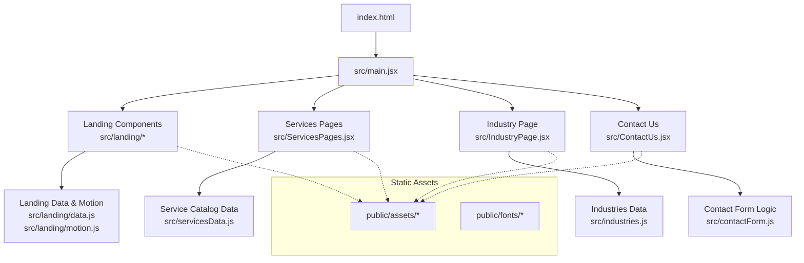
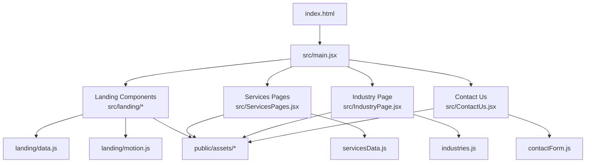
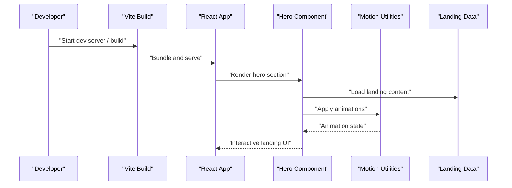
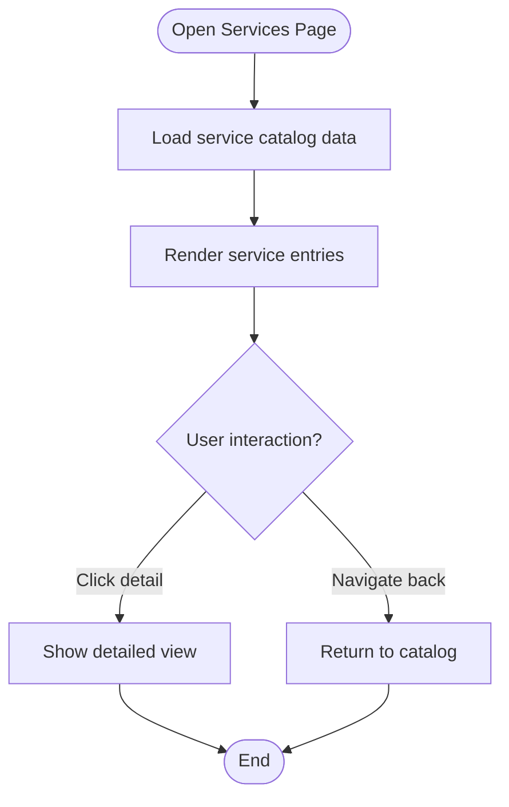
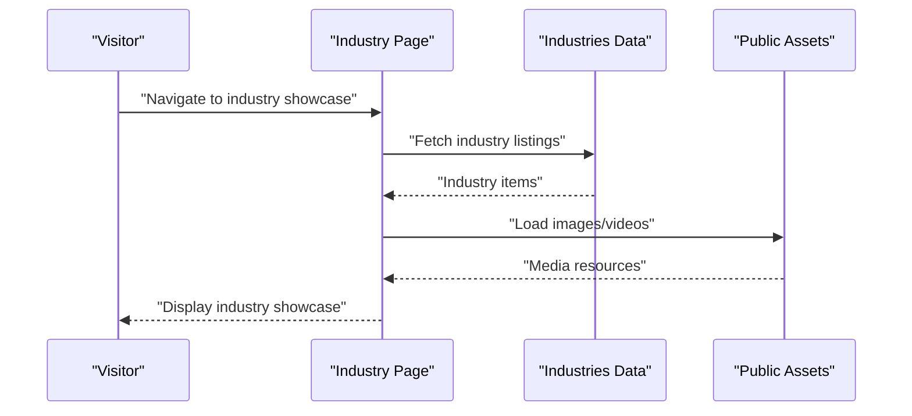
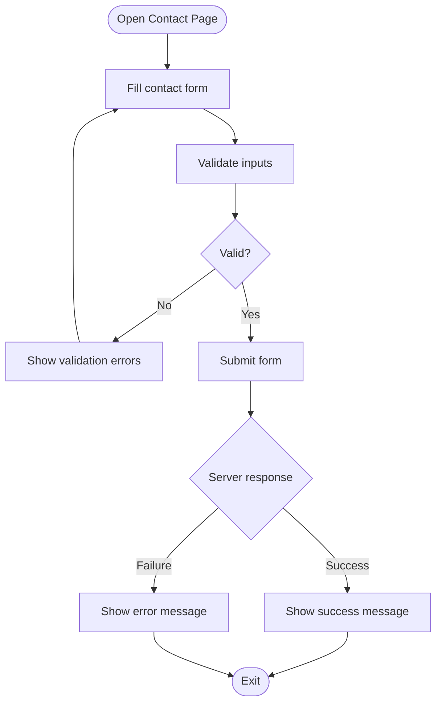
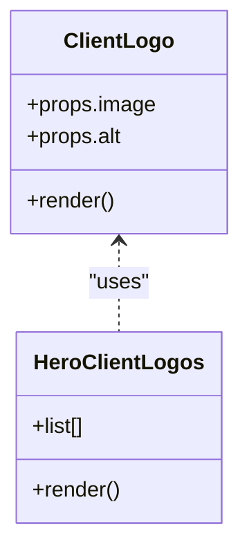
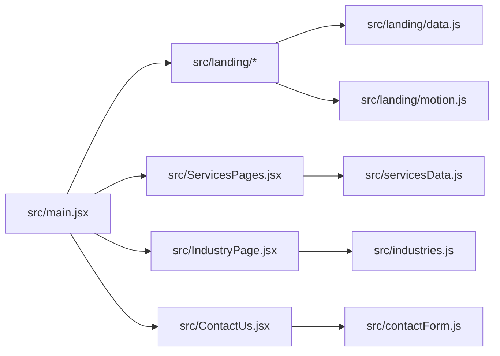

# Project Overview

<cite>
**Referenced Files in This Document**
- [README.md](file://README.md)
- [package.json](file://package.json)
- [vite.config.js](file://vite.config.js)
- [index.html](file://index.html)
- [src/main.jsx](file://src/main.jsx)
- [src/landing/Hero.jsx](file://src/landing/Hero.jsx)
- [src/landing/Landing2.jsx](file://src/landing/Landing2.jsx)
- [src/ServicesPages.jsx](file://src/ServicesPages.jsx)
- [src/servicesData.js](file://src/servicesData.js)
- [src/IndustryPage.jsx](file://src/IndustryPage.jsx)
- [src/industries.js](file://src/industries.js)
- [src/ContactUs.jsx](file://src/ContactUs.jsx)
- [src/contactForm.js](file://src/contactForm.js)
- [src/ClientLogo.jsx](file://src/ClientLogo.jsx)
- [src/heroClientLogos.js](file://src/heroClientLogos.js)
- [src/landing/data.js](file://src/landing/data.js)
- [src/landing/motion.js](file://src/landing/motion.js)
</cite>

## Table of Contents
1. Introduction
2. Project Structure
3. Core Components
4. Architecture Overview
5. Detailed Component Analysis
6. Dependency Analysis
7. Performance Considerations
8. Troubleshooting Guide
9. Conclusion

## Introduction
PodiumMinds is a modern React-based marketing website for a digital agency. It showcases the agency’s capabilities through interactive landing components, a service catalog, an industry showcase, and a contact system. The site emphasizes high-quality visuals, smooth animations, and clear navigation to help prospective clients quickly understand the agency’s offerings and get in touch.

Key features:
- Interactive landing pages with animated sections and scroll-driven effects
- Service catalog that presents offerings in a structured, navigable layout
- Industry showcase highlighting domain expertise and relevant case studies
- Contact system enabling visitors to reach out directly from the site

Target audience:
- Prospective clients evaluating the agency’s services and portfolio
- Partners and collaborators seeking information about capabilities and industries served
- Recruiters and stakeholders reviewing the agency’s public presence

Technology stack:
- React for component-based UI
- Vite as the build tool and development server
- CSS animations and motion utilities for visual polish
- Static assets (images, videos, fonts) managed under public/assets

Conceptual overview for beginners:
- Landing components are the first impression: hero sections, carousels, galleries, and animated transitions guide users through the story of what the agency does
- The service catalog organizes offerings into clear categories so visitors can find relevant solutions quickly
- The industry showcase demonstrates depth of experience across sectors with curated examples
- The contact system provides a straightforward way to start a conversation

Technical overview for experienced developers:
- Entry point initializes the React application and mounts the root component
- Feature modules are organized by domain (landing, services, industries, contact)
- Data files centralize content for services and industries, making updates straightforward
- Motion utilities and CSS classes provide consistent animation behavior across landing components

## Project Structure
The project follows a feature-oriented structure with clear separation between UI components, data, styles, and static assets.

**Diagram sources**
- [index.html:1-50](file://index.html#L1-L50)
- [src/main.jsx:1-40](file://src/main.jsx#L1-L40)
- [src/landing/Hero.jsx:1-40](file://src/landing/Hero.jsx#L1-L40)
- [src/ServicesPages.jsx:1-40](file://src/ServicesPages.jsx#L1-L40)
- [src/IndustryPage.jsx:1-40](file://src/IndustryPage.jsx#L1-L40)
- [src/ContactUs.jsx:1-40](file://src/ContactUs.jsx#L1-L40)
- [src/servicesData.js:1-40](file://src/servicesData.js#L1-L40)
- [src/industries.js:1-40](file://src/industries.js#L1-L40)
- [src/contactForm.js:1-40](file://src/contactForm.js#L1-L40)
- [src/landing/data.js:1-40](file://src/landing/data.js#L1-L40)
- [src/landing/motion.js:1-40](file://src/landing/motion.js#L1-L40)

**Section sources**
- [index.html:1-50](file://index.html#L1-L50)
- [src/main.jsx:1-40](file://src/main.jsx#L1-L40)
- [vite.config.js:1-40](file://vite.config.js#L1-L40)
- [package.json:1-40](file://package.json#L1-L40)

## Core Components
This section highlights the primary building blocks that power the site’s user-facing features.

- Landing components
  - Hero and multi-section landing experiences built with reusable components
  - Animated transitions and motion utilities enhance engagement
  - Centralized data drives content and media references

- Services catalog
  - Structured presentation of services via a dedicated page
  - Data-driven rendering from a centralized service catalog file
  - Consistent styling and motion patterns across service entries

- Industry showcase
  - Dedicated page to highlight industry expertise
  - Curated content sourced from an industries data file
  - Visual emphasis on sector-specific projects and outcomes

- Contact system
  - User-friendly form integrated into the site
  - Client-side logic handles validation and submission flow
  - Clear feedback paths for successful or failed submissions

- Client logos and brand assets
  - Reusable client logo component
  - Centralized list of logos used in hero and other sections
  - Static assets stored under public/assets for efficient delivery

Practical examples of key user flows:
- Explore services: Navigate to the services page, browse the service catalog, and click into details to learn more about each offering
- Discover industries: Visit the industry showcase, select a sector, and review relevant case studies and outcomes
- Start a conversation: Use the contact form to submit an inquiry; receive confirmation or error feedback based on submission results

**Section sources**
- [src/landing/Hero.jsx:1-40](file://src/landing/Hero.jsx#L1-L40)
- [src/landing/Landing2.jsx:1-40](file://src/landing/Landing2.jsx#L1-L40)
- [src/landing/data.js:1-40](file://src/landing/data.js#L1-L40)
- [src/landing/motion.js:1-40](file://src/landing/motion.js#L1-L40)
- [src/ServicesPages.jsx:1-40](file://src/ServicesPages.jsx#L1-L40)
- [src/servicesData.js:1-40](file://src/servicesData.js#L1-L40)
- [src/IndustryPage.jsx:1-40](file://src/IndustryPage.jsx#L1-L40)
- [src/industries.js:1-40](file://src/industries.js#L1-L40)
- [src/ContactUs.jsx:1-40](file://src/ContactUs.jsx#L1-L40)
- [src/contactForm.js:1-40](file://src/contactForm.js#L1-L40)
- [src/ClientLogo.jsx:1-40](file://src/ClientLogo.jsx#L1-L40)
- [src/heroClientLogos.js:1-40](file://src/heroClientLogos.js#L1-L40)

## Architecture Overview
At a high level, the application bootstraps via the HTML entrypoint and mounts a React root. Feature modules compose the landing experience, services, industries, and contact functionality. Data files decouple content from UI, while static assets provide images, videos, and fonts.

**Diagram sources**
- [index.html:1-50](file://index.html#L1-L50)
- [src/main.jsx:1-40](file://src/main.jsx#L1-L40)
- [src/ServicesPages.jsx:1-40](file://src/ServicesPages.jsx#L1-L40)
- [src/IndustryPage.jsx:1-40](file://src/IndustryPage.jsx#L1-L40)
- [src/ContactUs.jsx:1-40](file://src/ContactUs.jsx#L1-L40)
- [src/servicesData.js:1-40](file://src/servicesData.js#L1-L40)
- [src/industries.js:1-40](file://src/industries.js#L1-L40)
- [src/contactForm.js:1-40](file://src/contactForm.js#L1-L40)
- [src/landing/data.js:1-40](file://src/landing/data.js#L1-L40)
- [src/landing/motion.js:1-40](file://src/landing/motion.js#L1-L40)

## Detailed Component Analysis

### Landing Components
Landing components create engaging, animated experiences that introduce the agency’s story and capabilities. They rely on centralized data and motion utilities to maintain consistency and performance.

**Diagram sources**
- [src/landing/Hero.jsx:1-40](file://src/landing/Hero.jsx#L1-L40)
- [src/landing/Landing2.jsx:1-40](file://src/landing/Landing2.jsx#L1-L40)
- [src/landing/data.js:1-40](file://src/landing/data.js#L1-L40)
- [src/landing/motion.js:1-40](file://src/landing/motion.js#L1-L40)

**Section sources**
- [src/landing/Hero.jsx:1-40](file://src/landing/Hero.jsx#L1-L40)
- [src/landing/Landing2.jsx:1-40](file://src/landing/Landing2.jsx#L1-L40)
- [src/landing/data.js:1-40](file://src/landing/data.js#L1-L40)
- [src/landing/motion.js:1-40](file://src/landing/motion.js#L1-L40)

### Services Catalog
The services catalog renders a structured view of offerings using a data-driven approach. This makes it easy to update content without touching UI code.

**Diagram sources**
- [src/ServicesPages.jsx:1-40](file://src/ServicesPages.jsx#L1-L40)
- [src/servicesData.js:1-40](file://src/servicesData.js#L1-L40)

**Section sources**
- [src/ServicesPages.jsx:1-40](file://src/ServicesPages.jsx#L1-L40)
- [src/servicesData.js:1-40](file://src/servicesData.js#L1-L40)

### Industry Showcase
The industry showcase highlights domain expertise with curated content and visuals. It uses a dedicated data source to keep industry information organized and up-to-date.

**Diagram sources**
- [src/IndustryPage.jsx:1-40](file://src/IndustryPage.jsx#L1-L40)
- [src/industries.js:1-40](file://src/industries.js#L1-L40)

**Section sources**
- [src/IndustryPage.jsx:1-40](file://src/IndustryPage.jsx#L1-L40)
- [src/industries.js:1-40](file://src/industries.js#L1-L40)

### Contact System
The contact system provides a streamlined way for visitors to initiate conversations. It includes client-side logic for handling form interactions and feedback.

**Diagram sources**
- [src/ContactUs.jsx:1-40](file://src/ContactUs.jsx#L1-L40)
- [src/contactForm.js:1-40](file://src/contactForm.js#L1-L40)

**Section sources**
- [src/ContactUs.jsx:1-40](file://src/ContactUs.jsx#L1-L40)
- [src/contactForm.js:1-40](file://src/contactForm.js#L1-L40)

### Client Logos and Brand Assets
Reusable client logo components and centralized logo lists support consistent branding across the site, including hero sections and footers.

**Diagram sources**
- [src/ClientLogo.jsx:1-40](file://src/ClientLogo.jsx#L1-L40)
- [src/heroClientLogos.js:1-40](file://src/heroClientLogos.js#L1-L40)

**Section sources**
- [src/ClientLogo.jsx:1-40](file://src/ClientLogo.jsx#L1-L40)
- [src/heroClientLogos.js:1-40](file://src/heroClientLogos.js#L1-L40)

## Dependency Analysis
The project leverages React and Vite, with feature modules depending on shared data and assets. The following diagram illustrates core dependencies among main modules.

**Diagram sources**
- [src/main.jsx:1-40](file://src/main.jsx#L1-L40)
- [src/ServicesPages.jsx:1-40](file://src/ServicesPages.jsx#L1-L40)
- [src/IndustryPage.jsx:1-40](file://src/IndustryPage.jsx#L1-L40)
- [src/ContactUs.jsx:1-40](file://src/ContactUs.jsx#L1-L40)
- [src/servicesData.js:1-40](file://src/servicesData.js#L1-L40)
- [src/industries.js:1-40](file://src/industries.js#L1-L40)
- [src/contactForm.js:1-40](file://src/contactForm.js#L1-L40)
- [src/landing/data.js:1-40](file://src/landing/data.js#L1-L40)
- [src/landing/motion.js:1-40](file://src/landing/motion.js#L1-L40)

**Section sources**
- [package.json:1-40](file://package.json#L1-L40)
- [vite.config.js:1-40](file://vite.config.js#L1-L40)

## Performance Considerations
- Prefer lazy loading for heavy landing sections and media to reduce initial bundle size
- Optimize images and videos in public/assets for faster delivery
- Use memoization and stable references in landing components to avoid unnecessary re-renders
- Keep motion utilities lightweight and reuse animation primitives across components
- Defer non-critical scripts and assets to improve perceived performance

[No sources needed since this section provides general guidance]

## Troubleshooting Guide
Common issues and resolutions:
- Missing assets: Ensure all referenced images and videos exist under public/assets and paths match component usage
- Animation glitches: Verify motion utilities are imported correctly and CSS classes are applied consistently
- Form submission failures: Check client-side validation logic and network responses; log errors for debugging
- Build errors: Review Vite configuration and dependency versions; ensure environment variables are set if required

**Section sources**
- [src/contactForm.js:1-40](file://src/contactForm.js#L1-L40)
- [src/landing/motion.js:1-40](file://src/landing/motion.js#L1-L40)
- [vite.config.js:1-40](file://vite.config.js#L1-L40)

## Conclusion
PodiumMinds delivers a polished, modern marketing website tailored for a digital agency. Its modular architecture, data-driven content, and thoughtful use of animations make it both scalable and visually compelling. By organizing features around landing components, a service catalog, an industry showcase, and a contact system, the project balances clarity for visitors with maintainability for developers.

[No sources needed since this section summarizes without analyzing specific files]