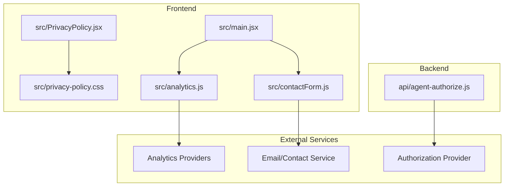
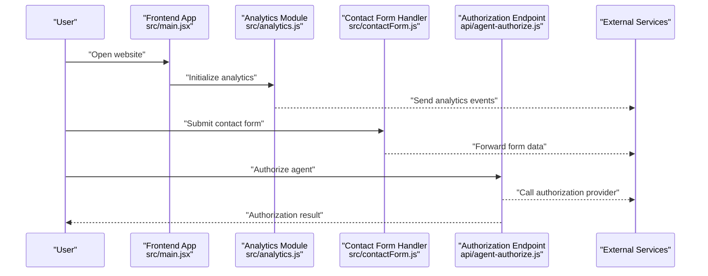
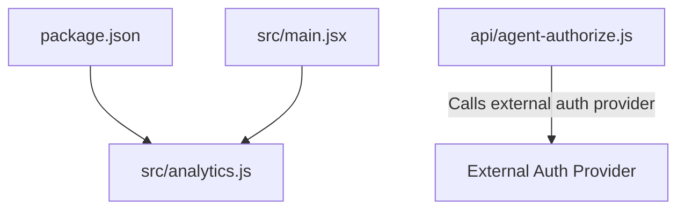

# Privacy and Compliance

<cite>
**Referenced Files in This Document**
- [PrivacyPolicy.jsx](file://src/PrivacyPolicy.jsx)
- [privacy-policy.css](file://src/privacy-policy.css)
- [analytics.js](file://src/analytics.js)
- [contactForm.js](file://src/contactForm.js)
- [agent-authorize.js](file://api/agent-authorize.js)
- [main.jsx](file://src/main.jsx)
- [package.json](file://package.json)
</cite>

## Table of Contents
1. [Introduction](#introduction)
2. [Project Structure](#project-structure)
3. [Core Components](#core-components)
4. [Architecture Overview](#architecture-overview)
5. [Detailed Component Analysis](#detailed-component-analysis)
6. [Dependency Analysis](#dependency-analysis)
7. [Performance Considerations](#performance-considerations)
8. [Troubleshooting Guide](#troubleshooting-guide)
9. [Conclusion](#conclusion)
10. [Appendices](#appendices)

## Introduction
This document provides a privacy and compliance overview for the project, focusing on how user data is handled across the application. It covers:
- Where privacy information is presented to users
- How analytics are implemented and configured
- How contact form submissions are processed
- Any server-side authorization flows that may involve personal data
- Integration points with third-party services

The goal is to help developers, operators, and reviewers understand data flows, identify potential compliance touchpoints (such as consent and data retention), and locate relevant implementation files for further review or updates.

## Project Structure
Relevant privacy and compliance-related code is primarily located in:
- src/PrivacyPolicy.jsx and src/privacy-policy.css: User-facing privacy policy content and styling
- src/analytics.js: Client-side analytics integration and configuration
- src/contactForm.js: Client-side logic for handling contact form interactions
- api/agent-authorize.js: Server-side endpoint used for agent authorization
- src/main.jsx: Application entry point where global scripts and integrations may be initialized
- package.json: Dependencies that may include analytics or tracking libraries

**Diagram sources**
- [PrivacyPolicy.jsx](file://src/PrivacyPolicy.jsx)
- [privacy-policy.css](file://src/privacy-policy.css)
- [analytics.js](file://src/analytics.js)
- [contactForm.js](file://src/contactForm.js)
- [agent-authorize.js](file://api/agent-authorize.js)
- [main.jsx](file://src/main.jsx)

**Section sources**
- [PrivacyPolicy.jsx](file://src/PrivacyPolicy.jsx)
- [privacy-policy.css](file://src/privacy-policy.css)
- [analytics.js](file://src/analytics.js)
- [contactForm.js](file://src/contactForm.js)
- [agent-authorize.js](file://api/agent-authorize.js)
- [main.jsx](file://src/main.jsx)
- [package.json](file://package.json)

## Core Components
- Privacy Policy Page: Presents the organization’s privacy commitments and data practices to users.
- Analytics Integration: Implements client-side analytics collection and configuration.
- Contact Form Handling: Manages user input submission and communication with external services.
- Agent Authorization Endpoint: Handles server-side authorization requests that may involve user identity or credentials.

Key responsibilities:
- Ensure transparency about data collection and usage via the privacy policy page.
- Provide mechanisms for users to interact with the site while minimizing unnecessary data collection.
- Securely handle any authorization flows and limit exposure of sensitive data.

**Section sources**
- [PrivacyPolicy.jsx](file://src/PrivacyPolicy.jsx)
- [analytics.js](file://src/analytics.js)
- [contactForm.js](file://src/contactForm.js)
- [agent-authorize.js](file://api/agent-authorize.js)

## Architecture Overview
The privacy and compliance architecture centers around three main areas:
- User-facing disclosures and controls (privacy policy)
- Data collection and transmission (analytics)
- Data processing endpoints (authorization and contact form submission)

**Diagram sources**
- [main.jsx](file://src/main.jsx)
- [analytics.js](file://src/analytics.js)
- [contactForm.js](file://src/contactForm.js)
- [agent-authorize.js](file://api/agent-authorize.js)

## Detailed Component Analysis

### Privacy Policy Page
Purpose:
- Displays the privacy policy to users, outlining data practices, rights, and contact information.

Implementation highlights:
- Renders policy content and styles for readability and accessibility.
- Should clearly state what data is collected, why it is collected, and how long it is retained.

Recommendations:
- Keep policy content up-to-date with changes in analytics or third-party integrations.
- Ensure links to the policy are accessible from key pages (e.g., footer).

**Section sources**
- [PrivacyPolicy.jsx](file://src/PrivacyPolicy.jsx)
- [privacy-policy.css](file://src/privacy-policy.css)

### Analytics Integration
Purpose:
- Collects anonymized or pseudonymized usage metrics to improve product experience.

Implementation highlights:
- Initializes analytics providers and configures event tracking.
- May include options to disable tracking based on user consent or environment settings.

Compliance considerations:
- Avoid collecting personally identifiable information (PII) unless explicitly necessary and disclosed.
- Respect user opt-out preferences and regional regulations.

Operational notes:
- Review dependencies in package.json for analytics libraries.
- Ensure network requests comply with CORS and security policies.

**Section sources**
- [analytics.js](file://src/analytics.js)
- [package.json](file://package.json)

### Contact Form Handling
Purpose:
- Captures user inquiries and forwards them to an external service for processing.

Implementation highlights:
- Validates inputs on the client side before submission.
- Sends form data securely to the designated backend or email service.

Compliance considerations:
- Minimize data fields to only what is necessary.
- Include clear notices about data usage and retention.
- Implement rate limiting and basic spam protection at the server level if applicable.

**Section sources**
- [contactForm.js](file://src/contactForm.js)

### Agent Authorization Endpoint
Purpose:
- Processes authorization requests for agents, potentially involving user identity or credentials.

Implementation highlights:
- Receives authorization payloads and interacts with external authorization providers.
- Returns results to the frontend for subsequent actions.

Security and compliance considerations:
- Validate and sanitize all inputs.
- Use secure transport (HTTPS) and avoid logging sensitive data.
- Apply least privilege principles when calling external services.

**Section sources**
- [agent-authorize.js](file://api/agent-authorize.js)

### Application Entry Point
Purpose:
- Bootstraps the application and initializes global integrations such as analytics.

Implementation highlights:
- Imports and configures modules like analytics.
- Sets up routing and core UI components.

Compliance considerations:
- Defer non-essential initialization until after consent is obtained, if required by policy.
- Ensure error boundaries prevent crashes that could leak sensitive context.

**Section sources**
- [main.jsx](file://src/main.jsx)

## Dependency Analysis
Third-party dependencies can impact privacy and compliance posture. Key areas to review:
- Analytics libraries: Check versions and features enabled.
- External APIs: Confirm data sharing agreements and data minimization.
- Build and deployment tools: Ensure no secrets or PII are embedded.

**Diagram sources**
- [package.json](file://package.json)
- [analytics.js](file://src/analytics.js)
- [main.jsx](file://src/main.jsx)
- [agent-authorize.js](file://api/agent-authorize.js)

**Section sources**
- [package.json](file://package.json)
- [analytics.js](file://src/analytics.js)
- [main.jsx](file://src/main.jsx)
- [agent-authorize.js](file://api/agent-authorize.js)

## Performance Considerations
- Lazy-load analytics scripts to reduce initial bundle size and improve perceived performance.
- Debounce or batch analytics events to minimize network overhead.
- Cache static assets (including CSS for the privacy policy) to reduce repeated downloads.
- Monitor network requests to ensure they do not block critical rendering paths.

[No sources needed since this section provides general guidance]

## Troubleshooting Guide
Common issues and resolutions:
- Analytics not firing:
  - Verify initialization sequence in the application entry point.
  - Check browser console for errors and network logs for blocked requests.
- Contact form submission failures:
  - Inspect client-side validation messages and network responses.
  - Confirm external service availability and CORS settings.
- Authorization endpoint errors:
  - Validate request payload structure and required headers.
  - Review server logs for authentication failures or timeouts.

Operational tips:
- Enable detailed logging in development environments only.
- Use feature flags to toggle analytics or experimental flows during testing.
- Regularly audit third-party library versions for security patches.

**Section sources**
- [analytics.js](file://src/analytics.js)
- [contactForm.js](file://src/contactForm.js)
- [agent-authorize.js](file://api/agent-authorize.js)
- [main.jsx](file://src/main.jsx)

## Conclusion
This privacy and compliance overview highlights the primary areas where user data is handled:
- Transparent disclosure via the privacy policy page
- Careful implementation of analytics to respect user preferences
- Secure and minimal data collection through the contact form
- Robust authorization flows with appropriate safeguards

Maintaining alignment with privacy best practices involves continuous review of integrations, dependencies, and data flows. Keep documentation current and ensure that any changes to analytics or external services are reflected in the privacy policy and operational procedures.

[No sources needed since this section summarizes without analyzing specific files]

## Appendices
- Recommended checks before release:
  - Confirm privacy policy links are present and accessible.
  - Validate analytics configuration does not collect PII.
  - Test contact form end-to-end with sanitized test data.
  - Review authorization endpoint for input validation and error handling.

[No sources needed since this section provides general guidance]