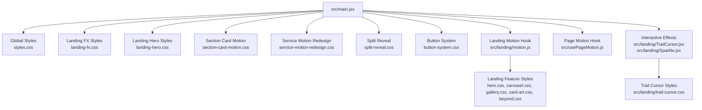
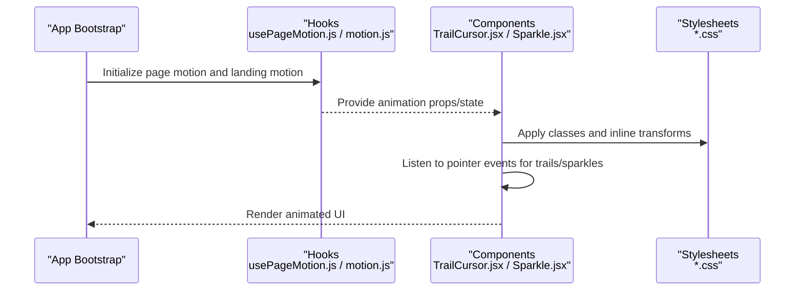
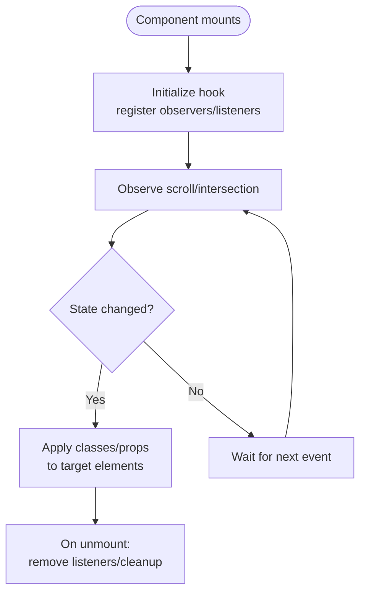
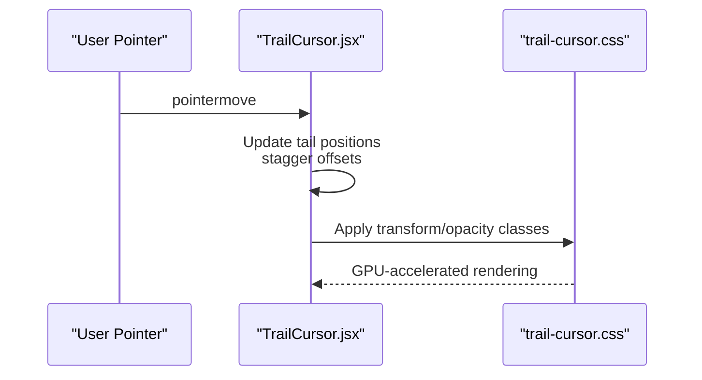
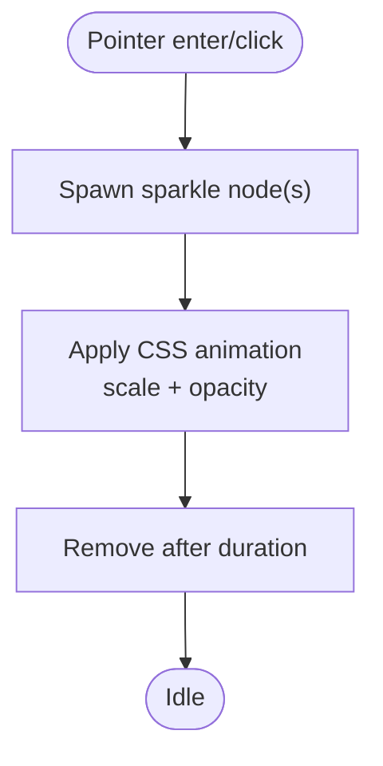
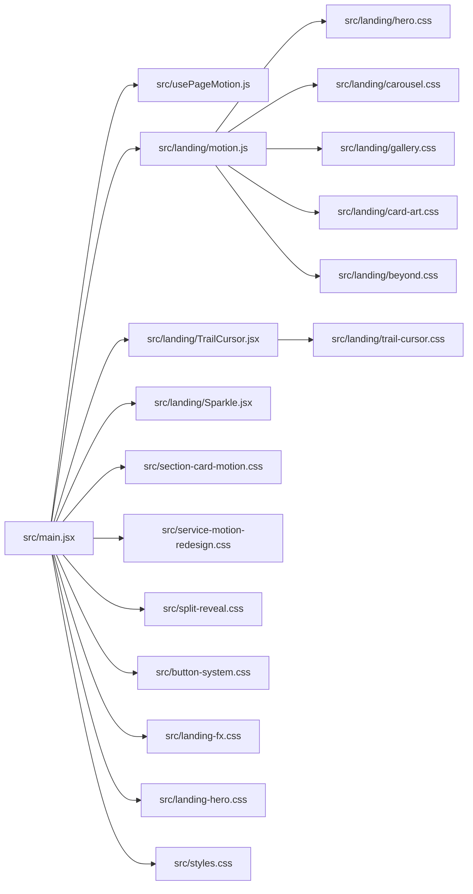

# Animation and Motion System

<cite>
**Referenced Files in This Document**
- [main.jsx](file://src/main.jsx)
- [usePageMotion.js](file://src/usePageMotion.js)
- [motion.js](file://src/landing/motion.js)
- [TrailCursor.jsx](file://src/landing/TrailCursor.jsx)
- [Sparkle.jsx](file://src/landing/Sparkle.jsx)
- [hero.css](file://src/landing/hero.css)
- [trail-cursor.css](file://src/landing/trail-cursor.css)
- [beyond.css](file://src/landing/beyond.css)
- [carousel.css](file://src/landing/carousel.css)
- [gallery.css](file://src/landing/gallery.css)
- [card-art.css](file://src/landing/card-art.css)
- [section-card-motion.css](file://src/section-card-motion.css)
- [service-motion-redesign.css](file://src/service-motion-redesign.css)
- [split-reveal.css](file://src/split-reveal.css)
- [button-system.css](file://src/button-system.css)
- [landing-fx.css](file://src/landing-fx.css)
- [landing-hero.css](file://src/landing-hero.css)
- [styles.css](file://src/styles.css)
</cite>

## Table of Contents
1. [Introduction](#introduction)
2. [Project Structure](#project-structure)
3. [Core Components](#core-components)
4. [Architecture Overview](#architecture-overview)
5. [Detailed Component Analysis](#detailed-component-analysis)
6. [Dependency Analysis](#dependency-analysis)
7. [Performance Considerations](#performance-considerations)
8. [Troubleshooting Guide](#troubleshooting-guide)
9. [Conclusion](#conclusion)

## Introduction
This document explains the animation and motion system used across PodiumMinds. It covers:
- CSS-based animations (transforms, transitions, keyframes)
- JavaScript-powered animations with motion libraries and custom hooks such as usePageMotion
- Interactive effects including cursor trails, sparkle overlays, and scroll-triggered reveals
- Performance optimization techniques, browser compatibility considerations, and accessibility guidelines for smooth, inclusive motion

The goal is to help developers understand how motion is implemented, where to find relevant code, and how to extend or optimize it safely.

## Project Structure
Animation-related assets are organized by feature areas:
- Shared styles and utilities under src/
- Landing-specific components and styles under src/landing/
- Global entry point wiring imports and global styles

**Diagram sources**
- [main.jsx](file://src/main.jsx)
- [styles.css](file://src/styles.css)
- [landing-fx.css](file://src/landing-fx.css)
- [landing-hero.css](file://src/landing-hero.css)
- [section-card-motion.css](file://src/section-card-motion.css)
- [service-motion-redesign.css](file://src/service-motion-redesign.css)
- [split-reveal.css](file://src/split-reveal.css)
- [button-system.css](file://src/button-system.css)
- [motion.js](file://src/landing/motion.js)
- [usePageMotion.js](file://src/usePageMotion.js)
- [TrailCursor.jsx](file://src/landing/TrailCursor.jsx)
- [Sparkle.jsx](file://src/landing/Sparkle.jsx)
- [trail-cursor.css](file://src/landing/trail-cursor.css)
- [hero.css](file://src/landing/hero.css)
- [carousel.css](file://src/landing/carousel.css)
- [gallery.css](file://src/landing/gallery.css)
- [card-art.css](file://src/landing/card-art.css)
- [beyond.css](file://src/landing/beyond.css)

**Section sources**
- [main.jsx](file://src/main.jsx)
- [styles.css](file://src/styles.css)
- [landing-fx.css](file://src/landing-fx.css)
- [landing-hero.css](file://src/landing-hero.css)
- [section-card-motion.css](file://src/section-card-motion.css)
- [service-motion-redesign.css](file://src/service-motion-redesign.css)
- [split-reveal.css](file://src/split-reveal.css)
- [button-system.css](file://src/button-system.css)
- [motion.js](file://src/landing/motion.js)
- [usePageMotion.js](file://src/usePageMotion.js)
- [TrailCursor.jsx](file://src/landing/TrailCursor.jsx)
- [Sparkle.jsx](file://src/landing/Sparkle.jsx)
- [trail-cursor.css](file://src/landing/trail-cursor.css)
- [hero.css](file://src/landing/hero.css)
- [carousel.css](file://src/landing/carousel.css)
- [gallery.css](file://src/landing/gallery.css)
- [card-art.css](file://src/landing/card-art.css)
- [beyond.css](file://src/landing/beyond.css)

## Core Components
- Page-level motion hook: Provides page transitions and scroll-driven behaviors via a reusable hook.
- Landing motion utilities: Centralized configuration and helpers for landing animations.
- Interactive effects: Cursor trail and sparkle overlay components that respond to pointer movement.
- CSS motion modules: Feature-scoped stylesheets implementing transforms, transitions, and keyframe animations.

Key responsibilities:
- Coordinate when and how elements animate on mount, scroll, and user interaction
- Provide consistent timing, easing, and performance-friendly properties
- Expose simple APIs for components to opt-in to motion

**Section sources**
- [usePageMotion.js](file://src/usePageMotion.js)
- [motion.js](file://src/landing/motion.js)
- [TrailCursor.jsx](file://src/landing/TrailCursor.jsx)
- [Sparkle.jsx](file://src/landing/Sparkle.jsx)
- [hero.css](file://src/landing/hero.css)
- [carousel.css](file://src/landing/carousel.css)
- [gallery.css](file://src/landing/gallery.css)
- [card-art.css](file://src/landing/card-art.css)
- [beyond.css](file://src/landing/beyond.css)

## Architecture Overview
The motion system combines:
- React hooks for lifecycle and state-driven animation orchestration
- CSS classes and keyframes for declarative visual effects
- Lightweight JS event listeners for interactive effects (cursor/sparkles)
- Global style imports at application bootstrap

**Diagram sources**
- [main.jsx](file://src/main.jsx)
- [usePageMotion.js](file://src/usePageMotion.js)
- [motion.js](file://src/landing/motion.js)
- [TrailCursor.jsx](file://src/landing/TrailCursor.jsx)
- [Sparkle.jsx](file://src/landing/Sparkle.jsx)
- [hero.css](file://src/landing/hero.css)
- [trail-cursor.css](file://src/landing/trail-cursor.css)

## Detailed Component Analysis

### Page Motion Hook (usePageMotion)
Purpose:
- Manage page-level transitions and scroll-driven visibility states
- Offer a consistent API for components to subscribe to motion state

Typical usage patterns:
- Subscribe to scroll position and viewport intersection
- Toggle CSS classes for reveal/hide transitions
- Provide normalized timing/easing values to components

**Diagram sources**
- [usePageMotion.js](file://src/usePageMotion.js)

**Section sources**
- [usePageMotion.js](file://src/usePageMotion.js)

### Landing Motion Utilities (motion.js)
Purpose:
- Centralize landing-specific animation configurations
- Export shared timings, easings, and helper functions used by landing components and styles

Common responsibilities:
- Define default durations and easing curves
- Provide utility functions to compute transform values based on scroll or pointer positions
- Expose constants consumed by both JS logic and CSS variables

**Section sources**
- [motion.js](file://src/landing/motion.js)

### Cursor Trail Effect (TrailCursor)
Behavior:
- Renders a set of trailing nodes that follow the pointer with staggered delays
- Uses lightweight pointer event handling and CSS transforms for performance

Implementation highlights:
- Event-driven updates for pointer coordinates
- Staggered opacity and scale transitions via CSS classes
- Debounced/throttled updates to avoid layout thrashing

**Diagram sources**
- [TrailCursor.jsx](file://src/landing/TrailCursor.jsx)
- [trail-cursor.css](file://src/landing/trail-cursor.css)

**Section sources**
- [TrailCursor.jsx](file://src/landing/TrailCursor.jsx)
- [trail-cursor.css](file://src/landing/trail-cursor.css)

### Sparkle Overlay (Sparkle)
Behavior:
- Spawns small decorative particles near pointer interactions
- Animates fade-out and slight displacement using CSS transitions/keyframes

Implementation highlights:
- Create and remove DOM nodes efficiently
- Use requestAnimationFrame or CSS-only animations where possible
- Limit particle count to maintain frame rate

**Diagram sources**
- [Sparkle.jsx](file://src/landing/Sparkle.jsx)

**Section sources**
- [Sparkle.jsx](file://src/landing/Sparkle.jsx)

### Scroll-Triggered Reveals and Section Motion
Scope:
- Sections and cards animate into view as users scroll
- Uses intersection observation and CSS transitions for entrance effects

Key styles:
- Entrance transforms (translate, scale, rotate)
- Opacity transitions
- Staggered delays for children

Relevant files:
- Section-level motion styles
- Feature-specific reveal styles

**Section sources**
- [section-card-motion.css](file://src/section-card-motion.css)
- [split-reveal.css](file://src/split-reveal.css)
- [hero.css](file://src/landing/hero.css)
- [carousel.css](file://src/landing/carousel.css)
- [gallery.css](file://src/landing/gallery.css)
- [card-art.css](file://src/landing/card-art.css)
- [beyond.css](file://src/landing/beyond.css)

### Button and Micro-interactions
Scope:
- Hover, focus, and active states with subtle transforms and color shifts
- Consistent timing and easing across interactive surfaces

Relevant styles:
- Button system transitions
- Focus-visible outlines for accessibility

**Section sources**
- [button-system.css](file://src/button-system.css)

### Global and Landing FX Styles
Scope:
- Global base animations and utility classes
- Landing-specific motion enhancements and hero section effects

Relevant styles:
- Global base styles
- Landing FX and hero enhancements

**Section sources**
- [styles.css](file://src/styles.css)
- [landing-fx.css](file://src/landing-fx.css)
- [landing-hero.css](file://src/landing-hero.css)

## Dependency Analysis
High-level relationships between motion modules and styles:

**Diagram sources**
- [main.jsx](file://src/main.jsx)
- [usePageMotion.js](file://src/usePageMotion.js)
- [motion.js](file://src/landing/motion.js)
- [TrailCursor.jsx](file://src/landing/TrailCursor.jsx)
- [Sparkle.jsx](file://src/landing/Sparkle.jsx)
- [trail-cursor.css](file://src/landing/trail-cursor.css)
- [hero.css](file://src/landing/hero.css)
- [carousel.css](file://src/landing/carousel.css)
- [gallery.css](file://src/landing/gallery.css)
- [card-art.css](file://src/landing/card-art.css)
- [beyond.css](file://src/landing/beyond.css)
- [section-card-motion.css](file://src/section-card-motion.css)
- [service-motion-redesign.css](file://src/service-motion-redesign.css)
- [split-reveal.css](file://src/split-reveal.css)
- [button-system.css](file://src/button-system.css)
- [landing-fx.css](file://src/landing-fx.css)
- [landing-hero.css](file://src/landing-hero.css)
- [styles.css](file://src/styles.css)

**Section sources**
- [main.jsx](file://src/main.jsx)
- [usePageMotion.js](file://src/usePageMotion.js)
- [motion.js](file://src/landing/motion.js)
- [TrailCursor.jsx](file://src/landing/TrailCursor.jsx)
- [Sparkle.jsx](file://src/landing/Sparkle.jsx)
- [trail-cursor.css](file://src/landing/trail-cursor.css)
- [hero.css](file://src/landing/hero.css)
- [carousel.css](file://src/landing/carousel.css)
- [gallery.css](file://src/landing/gallery.css)
- [card-art.css](file://src/landing/card-art.css)
- [beyond.css](file://src/landing/beyond.css)
- [section-card-motion.css](file://src/section-card-motion.css)
- [service-motion-redesign.css](file://src/service-motion-redesign.css)
- [split-reveal.css](file://src/split-reveal.css)
- [button-system.css](file://src/button-system.css)
- [landing-fx.css](file://src/landing-fx.css)
- [landing-hero.css](file://src/landing-hero.css)
- [styles.css](file://src/styles.css)

## Performance Considerations
- Prefer GPU-accelerated properties:
  - Use transform and opacity for animations; avoid animating layout-triggering properties like width, height, top/left.
- Minimize reflows and repaints:
  - Batch DOM reads/writes; avoid reading layout metrics inside tight loops.
- Throttle/debounce pointer events:
  - For cursor trails and sparkles, limit update frequency to maintain 60fps.
- Reduce particle counts:
  - Cap number of active sparkle nodes; reuse nodes via object pooling if needed.
- Leverage CSS transitions and keyframes:
  - Declarative CSS is often more performant than JS-driven per-frame updates.
- Respect reduced motion preferences:
  - Detect prefers-reduced-motion and disable or simplify animations accordingly.
- Avoid heavy computations during animation frames:
  - Offload work to Web Workers or schedule tasks outside rAF when necessary.
- Keep animation durations reasonable:
  - Shorter durations improve perceived responsiveness and reduce jank risk.

[No sources needed since this section provides general guidance]

## Troubleshooting Guide
Common issues and resolutions:
- Animations not triggering:
  - Verify that required CSS classes are applied and that no conflicting styles override them.
  - Ensure hooks have mounted and registered observers/listeners before expecting animations.
- Janky or stuttering animations:
  - Check for layout thrashing caused by frequent reads/writes to layout properties.
  - Confirm pointer event handlers are throttled/debounced.
- Accessibility concerns:
  - Ensure focus-visible styles remain clear when animations change appearance.
  - Honor prefers-reduced-motion to avoid disorienting users.
- Mobile performance:
  - Reduce particle counts and animation complexity on low-power devices.
  - Test on real devices to validate touch interactions and battery impact.

**Section sources**
- [trail-cursor.css](file://src/landing/trail-cursor.css)
- [button-system.css](file://src/button-system.css)
- [section-card-motion.css](file://src/section-card-motion.css)
- [split-reveal.css](file://src/split-reveal.css)
- [landing-fx.css](file://src/landing-fx.css)
- [landing-hero.css](file://src/landing-hero.css)
- [styles.css](file://src/styles.css)

## Conclusion
PodiumMinds’ motion system blends React hooks, targeted CSS animations, and lightweight interactive effects to deliver smooth, accessible experiences. By centralizing motion configuration, leveraging GPU-friendly properties, and respecting user preferences, the system achieves both visual polish and performance. Use the referenced files as starting points to extend, customize, or optimize animations while maintaining consistency and accessibility across the application.